# Process Flows - Club Manager Platform

This document maps every use case under `server/src/main/kotlin/.../domain/usecase` to a flowchart of its current, as-implemented logic. It complements [REQUIREMENTS.md](./REQUIREMENTS.md) (what the system should do) and [TECHNICAL_DECISIONS.md](./TECHNICAL_DECISIONS.md) (why it's built this way) with a process-level view: what each use case actually does today, branch by branch.

Generated from a read-through of all use cases on 2026-09-02. Per `AI_GUIDELINES.md`, this file should be revisited whenever a use case's business logic or flow changes.

## How to read these diagrams

- Rectangles are actions or steps.
- Diamonds are decision points taken directly from the code's `if`/`when` branches.
- Stadium shapes (`([...])`) are terminal outcomes: a return value or a thrown exception.
- Every use case wraps its body in `transactionManager.runInTransaction { }` (atomic commit/rollback) — omitted from each diagram for brevity, but assume it wraps the whole flow.

## Table of Contents

1. [Shared Building Blocks](#1-shared-building-blocks)
2. [Authentication & Session](#2-authentication--session)
3. [Platform & Club Administration](#3-platform--club-administration)
4. [Club Structure: Seasons, Age Groups, Teams](#4-club-structure-seasons-age-groups-teams)
5. [Player & Roster Management](#5-player--roster-management)
6. [Opponents](#6-opponents)
7. [Match Management & Call-ups](#7-match-management--call-ups)
8. [Live Match Engine](#8-live-match-engine)
9. [Dashboards](#9-dashboards)
10. [Cross-Cutting: The Invite System, End to End](#10-cross-cutting-the-invite-system-end-to-end)
11. [State of the Art: Observed Gaps & Inconsistencies](#11-state-of-the-art-observed-gaps--inconsistencies)
12. [Database Schema: Current State of the Art](#12-database-schema-current-state-of-the-art)

---

## 1. Shared Building Blocks

Almost every use case starts by fetching a parent resource for context, then delegates authorization to one of two shared use cases. These two flows are the backbone of the whole permission model described in `TECHNICAL_DECISIONS.md` §5.

### 1.1 `CheckUserPermissionUseCase` — the core authorization gate

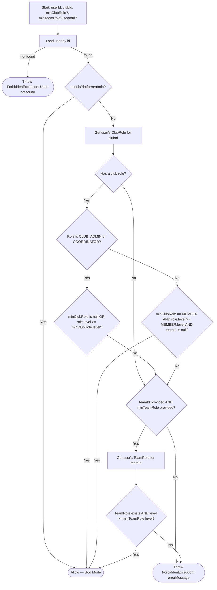

Key behaviours baked into this one function: Platform Admins bypass everything ("God Mode"); a club-level `CLUB_ADMIN`/`COORDINATOR` role satisfies almost any check without needing a team role; a plain `MEMBER` role is only sufficient when no team-specific check is requested; `COACH`/`STAFF` roles are validated per-team via `team_staff`.

### 1.2 `CheckUserIsAdminUseCase` — platform-level gate


Used directly by `ProvisionClubUseCase`, `GetClubsUseCase`, and `GetSuperAdminDashboardUseCase`.

### 1.3 The standard "permission-gated read" pattern

The majority of `Get*UseCase` classes share one exact shape:

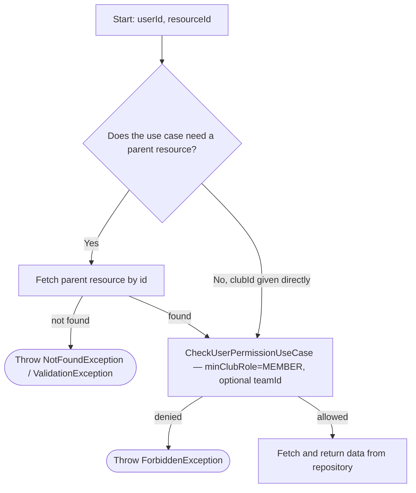

Use cases that follow this pattern exactly (fetch-context → require at least `MEMBER` → return): `GetClubDetailsUseCase`, `GetAgeGroupsUseCase`, `GetSeasonsUseCase`, `GetTeamsUseCase`, `GetTeamDetailsUseCase` (adds an aggregation step: also fetches players + staff), `GetTeamPlayersUseCase`, `GetTeamPlayersByClubUseCase`, `GetTeamStaffUseCase`, `GetPlayersUseCase`, `GetPlayerUseCase`, `GetMatchesUseCase`, `GetMatchDetailsUseCase` (adds aggregation: opponent + call-ups), `GetMatchEventsUseCase`, `GetMatchScoreUseCase`, `GetOpponentsUseCase`, and `GetLiveMatchUpdatesUseCase` (terminal step is "subscribe to the live bus" instead of "return data" — see §8.3).

Their individual diagrams are omitted below to avoid 15 near-identical copies; only the use cases with distinct branching logic get a dedicated diagram.

---

## 2. Authentication & Session

### 2.1 Register (`RegisterUseCase`)

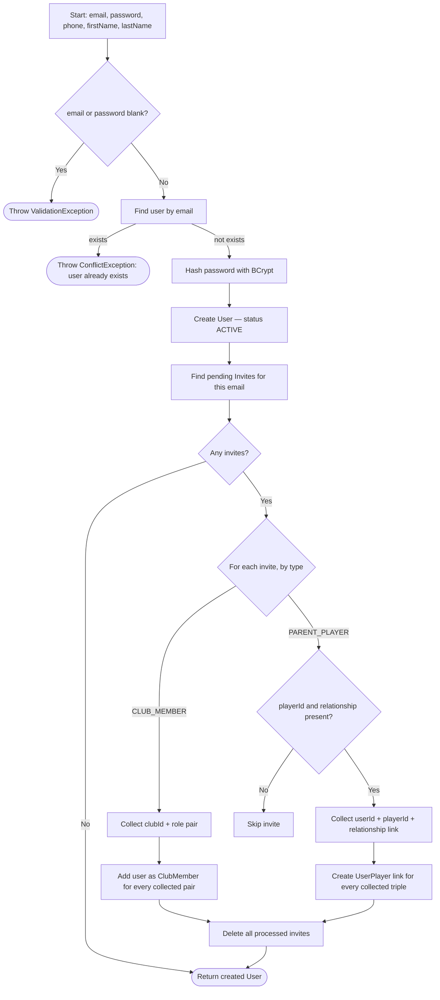

### 2.2 Login (`LoginUseCase`)


### 2.3 Refresh Token (`RefreshTokenUseCase`)

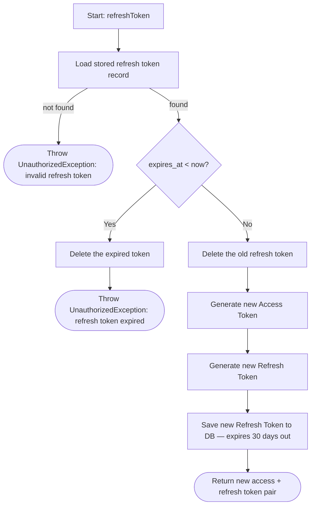

Note: the repository (`findRefreshToken`) just retrieves the row as-is; the expiry decision is a business rule owned by the use case, which deletes an expired token as it rejects it. Rotation deletes the presented token on the success path too. Covered by `RefreshTokenUseCaseTest` and `JwtConfigTest`.

### 2.4 Platform Admin Seeding (`SeedPlatformAdminUseCase`) — startup, not request-driven

Runs once from `Application.module()` (right after Koin is installed), so a freshly-created or wiped **dev** database is immediately usable with no manual bootstrapping. Idempotent — never mutates an existing account.


Config comes from `ServerConfig` and is injected into the use case: `DEV` enables it by default with labelled fallback credentials (`admin@local.dev` / `admin1234`); `PRODUCTION` keeps it off unless `SEED_ADMIN_ENABLED=true`, which then makes `SEED_ADMIN_EMAIL` / `SEED_ADMIN_PASSWORD` mandatory (no password fallback in production). Covered by `SeedPlatformAdminUseCaseTest`. See `TECHNICAL_DECISIONS.md` §5.

---

## 3. Platform & Club Administration

### 3.1 Provision Club (`ProvisionClubUseCase`) — Super Admin only

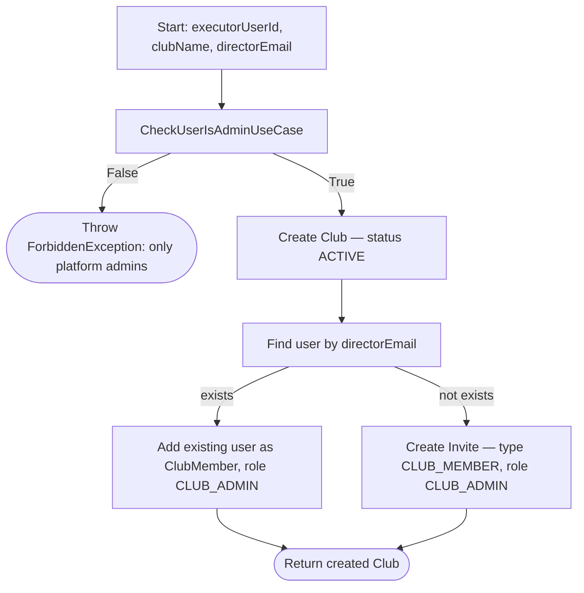

### 3.2 Get Clubs (`GetClubsUseCase`)


### 3.3 Get Club Details (`GetClubDetailsUseCase`)


`canEditClub` from the same single probe above — `CreateSeasonUseCase` and `CreateAgeGroupsUseCase` enforce the identical `minClubRole=COORDINATOR` gate, so one non-throwing check covers both response fields (they're separate fields, not one shared boolean, only so either could diverge later without an API shape change). The client uses them to distinguish, when a club has zero seasons or zero age groups, an admin/coordinator ("nothing here yet, create one") from a plain member ("nothing here yet") — see §4.1 and §4.3.

### 3.4 Update Club (`UpdateClubUseCase`)

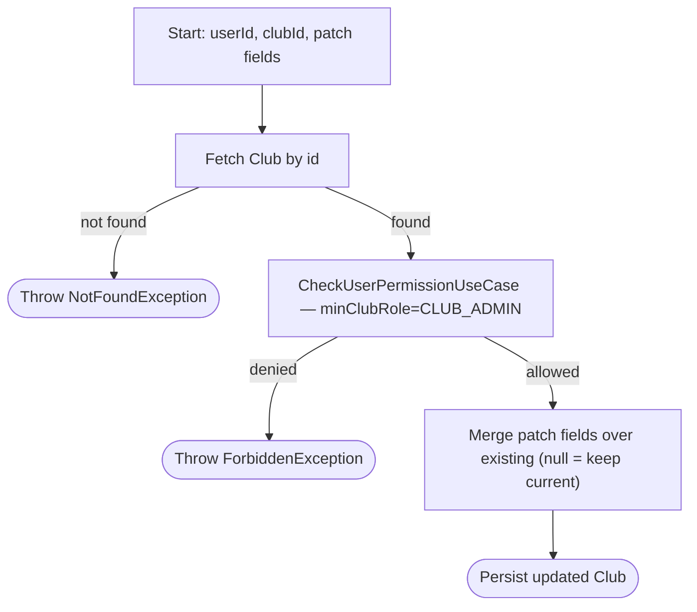

### 3.5 Update Club Member Role (`UpdateClubMemberRoleUseCase`)

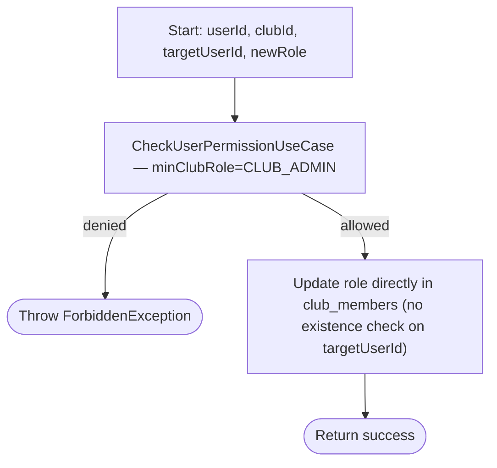

### 3.6 Add Club Members (`AddClubMembersUseCase`)


---

## 4. Club Structure: Seasons, Age Groups, Teams

### 4.1 Create Season (`CreateSeasonUseCase`)

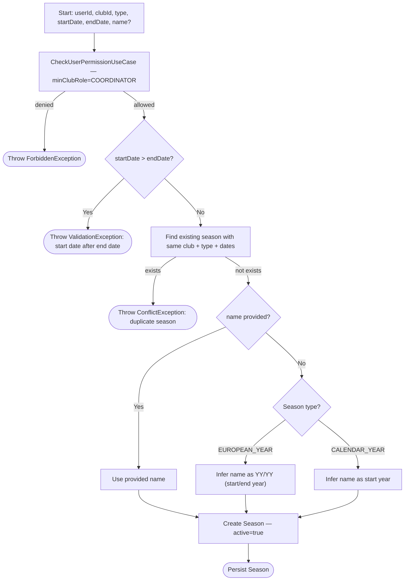

The client's `DatePickerSheet` (`minDate`/`maxDate`) already keeps the start/end ordering from happening in normal use — picking an end date before the current start date (or a start date after the current end date) simply isn't offered in the picker — but the server validates it independently since the client can't be trusted alone. Covered by `CreateSeasonUseCaseTest`.

### 4.2 Update Season (`UpdateSeasonUseCase`)

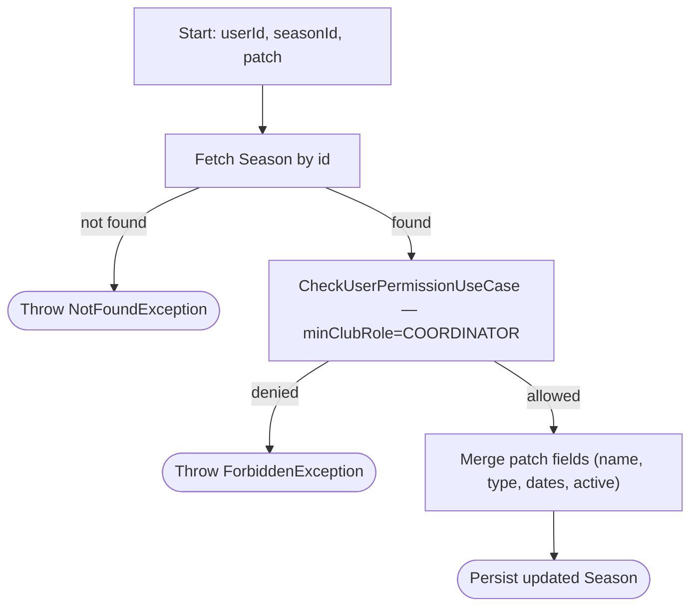

### 4.3 Create Age Groups (`CreateAgeGroupsUseCase`) — batch

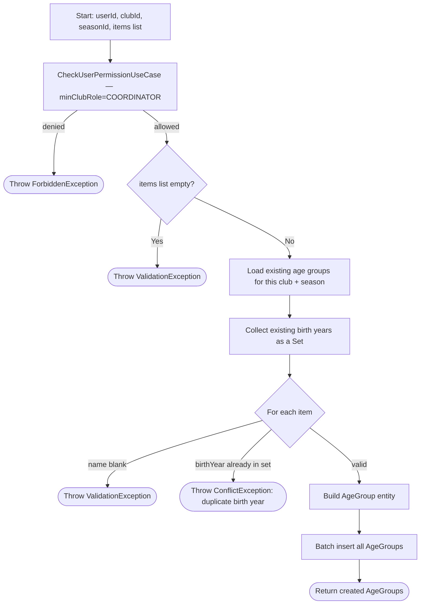

### 4.4 Update Age Group (`UpdateAgeGroupUseCase`)

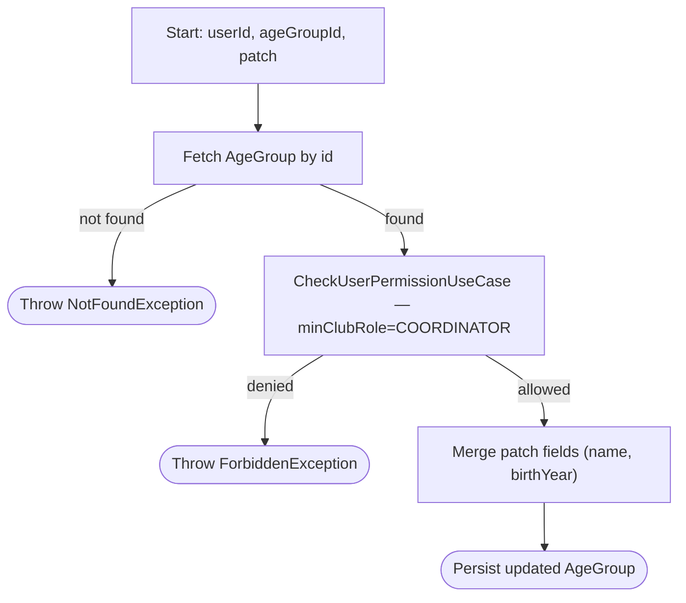

### 4.5 Create Team (`CreateTeamUseCase`)

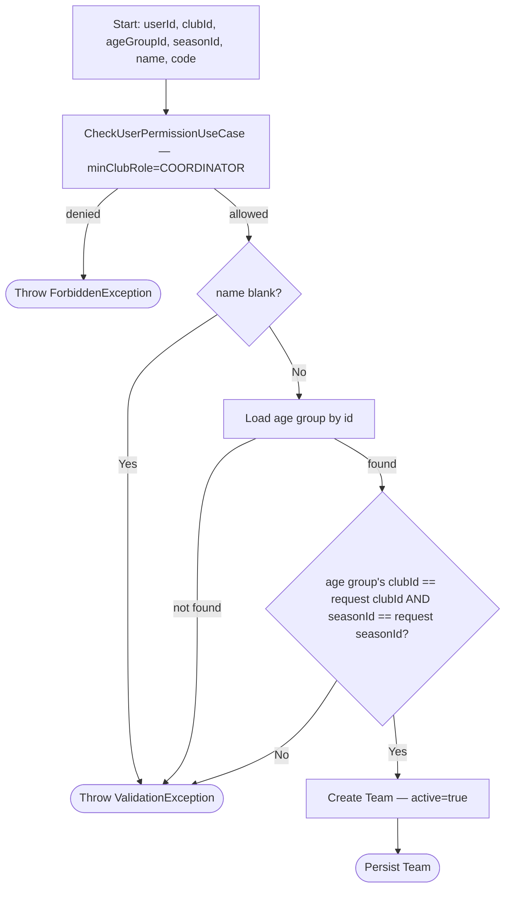

### 4.5b Create Teams (`CreateTeamsUseCase`) — batch

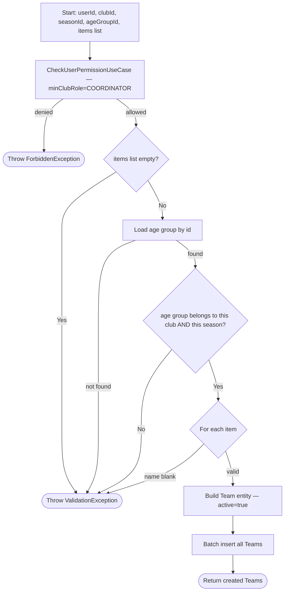

Whole batch runs in one transaction (all or nothing), mirroring `CreateAgeGroupsUseCase`. Teams have no name-uniqueness constraint, so there's no conflict branch. Covered by `CreateTeamsUseCaseTest`. The client's Create Teams screen defaults the season to the most recent one (by end date), requires an age group to be picked, and requires a name on every row before it will submit.

### 4.6 Update Team (`UpdateTeamUseCase`)

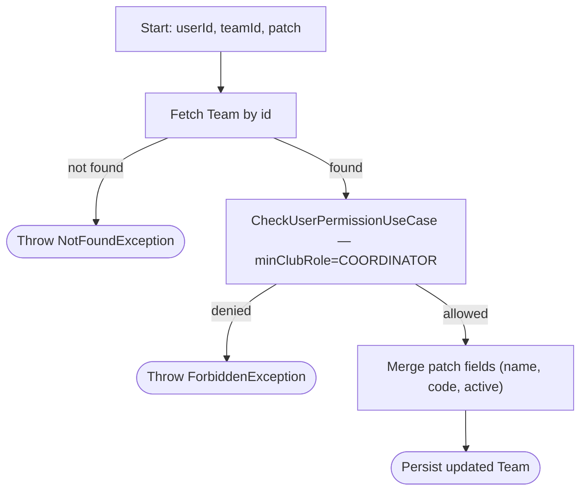

---

## 5. Player & Roster Management

### 5.1 Create Players (`CreatePlayersUseCase`) — batch, with self & parent invites

```mermaid
graph TD
    A[Start: userId, clubId, players list] --> B[CheckUserPermissionUseCase — minClubRole=COORDINATOR]
    B -- denied --> F(["Throw ForbiddenException"])
    B -- allowed --> C{Any player first/last name blank?}
    C -- Yes --> V(["Throw ValidationException"])
    C -- No --> D[Batch create Player records — active=true]
    D --> E["Collect all unique emails (players' own + all parents')"]
    E --> G[Batch find existing Users by email]
    G --> H{For each created player}
    H -- has own email, user exists --> I[Queue direct ClubMember, role MEMBER]
    H -- has own email, user missing --> J[Queue CLUB_MEMBER Invite]
    H -- no email --> SK[Skip self-invite]
    H --> L{For each parent of this player}
    L -- user exists --> M[Queue UserPlayer link + relationship]
    L -- user missing --> N["Queue PARENT_PLAYER Invite (linked to playerId)"]
    I --> O[Apply direct ClubMember additions]
    J --> P[Batch insert all Invites — player + parent]
    M --> Q[Batch insert UserPlayer links]
    N --> P
    O --> Z(["Return created Players"])
    Q --> Z
    P --> Z
```

### 5.2 Update Player (`UpdatePlayerUseCase`)

```mermaid
graph TD
    A[Start: userId, playerId, patch] --> B[Fetch Player by id]
    B -- not found --> N(["Throw NotFoundException"])
    B -- found --> C[CheckUserPermissionUseCase — minClubRole=COORDINATOR]
    C -- denied --> F(["Throw ForbiddenException"])
    C -- allowed --> D["Merge patch fields (name, birthDate, shirtNumber, photoUrl)"]
    D --> E[Persist updated Player]
    E --> G{email provided in request?}
    G -- yes, user exists --> H[Add as ClubMember, role MEMBER]
    G -- yes, user missing --> I[Create CLUB_MEMBER Invite]
    G -- no --> SK[Skip]
    H --> J{parents list provided?}
    I --> J
    SK --> J
    J -- No --> Z(["Return success"])
    J -- Yes --> K["Delete ALL existing UserPlayer links for this player"]
    K --> L["Delete ALL existing pending Invites for this player"]
    L --> M[Batch find Users by new parent emails]
    M --> P{For each new parent}
    P -- user exists --> Q[Queue UserPlayer link]
    P -- user missing --> R[Queue PARENT_PLAYER Invite]
    Q --> S[Insert links]
    R --> T[Insert invites]
    S --> Z
    T --> Z
```

The `parents` list is a **total replacement**, not a merge: every existing parent link and pending parent-invite is deleted before the new list is applied.

### 5.3 Add Players to Team (`AddPlayersToTeamUseCase`) — with age eligibility

```mermaid
graph TD
    A[Start: userId, teamId, players list] --> B[Fetch Team by id]
    B -- not found --> V0(["Throw ValidationException: Team not found"])
    B -- found --> C[CheckUserPermissionUseCase — minTeamRole=COACH, teamId]
    C -- denied --> F(["Throw ForbiddenException"])
    C -- allowed --> D["Fetch the Team's AgeGroup"]
    D -- not found --> V1(["Throw ValidationException: Age Group not found"])
    D -- found --> E[Batch fetch Player data for all requested playerIds]
    E --> G{For each requested player}
    G -- player not found --> V2(["Throw ValidationException"])
    G -- player.clubId != team.clubId --> FB(["Throw ForbiddenException: wrong club"])
    G -- "player.birthDate.year < ageGroup.birthYear" --> V3(["Throw ValidationException: too old for age group"])
    G -- eligible --> H[Build TeamPlayer link]
    H --> I[Batch insert TeamPlayer links]
    I --> Z(["Return created TeamPlayer links"])
```

### 5.4 Add Staff to Team (`AddStaffToTeamsUseCase`)

```mermaid
graph TD
    A[Start: userId, teamId, staff list] --> B[Fetch Team by id]
    B -- not found --> V(["Throw ValidationException: Team not found"])
    B -- found --> C[CheckUserPermissionUseCase — minClubRole=COORDINATOR]
    C -- denied --> F(["Throw ForbiddenException"])
    C -- allowed --> D[Batch fetch club roles for all staff userIds]
    D --> E{For each staff item}
    E -- user has no club role --> FB(["Throw ForbiddenException: must join club before team"])
    E -- user is already a club member --> G[Build TeamStaff record]
    G --> H[Batch insert TeamStaff records]
    H --> Z(["Return success"])
```

---

## 6. Opponents

### 6.1 Create Opponent (`CreateOpponentUseCase`)

```mermaid
graph TD
    A[Start: userId, clubId, name, shortName, logoUrl] --> B[CheckUserPermissionUseCase — minClubRole=COORDINATOR]
    B -- denied --> F(["Throw ForbiddenException"])
    B -- allowed --> C[Create Opponent record]
    C --> Z(["Persist Opponent"])
```

### 6.2 Update Opponent (`UpdateOpponentUseCase`)

```mermaid
graph TD
    A[Start: userId, opponentId, patch] --> B[Fetch Opponent by id]
    B -- not found --> N(["Throw NotFoundException"])
    B -- found --> C[CheckUserPermissionUseCase — minClubRole=COORDINATOR]
    C -- denied --> F(["Throw ForbiddenException"])
    C -- allowed --> D["Merge patch fields (name, shortName, logoUrl)"]
    D --> Z(["Persist updated Opponent"])
```

---

## 7. Match Management & Call-ups

### 7.1 Create Match (`CreateMatchUseCase`)

```mermaid
graph TD
    A[Start: userId, teamId, opponentId, location, dateTime, notes] --> B[Fetch Team by id]
    B -- not found --> N1(["Throw NotFoundException: Team not found"])
    B -- found --> C[CheckUserPermissionUseCase — minTeamRole=COACH, teamId]
    C -- denied --> F(["Throw ForbiddenException"])
    C -- allowed --> D[Fetch Opponent by id]
    D -- not found --> N2(["Throw NotFoundException: Opponent not found"])
    D -- found --> E{opponent.clubId != team.clubId?}
    E -- Yes --> FB(["Throw ForbiddenException: opponent belongs to another club"])
    E -- No --> G[Create Match — status SCHEDULED]
    G --> Z(["Persist Match"])
```

### 7.2 Manage Call-ups (`ManageCallUpsUseCase`) — batch replace

```mermaid
graph TD
    A[Start: userId, matchId, playerIds list] --> B[Fetch Match by id]
    B -- not found --> N(["Throw NotFoundException"])
    B -- found --> C[CheckUserPermissionUseCase — minTeamRole=COACH, teamId=match.teamId]
    C -- denied --> F(["Throw ForbiddenException"])
    C -- allowed --> D["Set call-ups for the match to exactly this playerIds list (repository owns diff/replace)"]
    D --> Z(["Return success"])
```

### 7.3 Update Call-up Status (`UpdateCallUpStatusUseCase`)

```mermaid
graph TD
    A[Start: userId, callUpId, status, notes?] --> B[Fetch CallUp by id]
    B -- not found --> N1(["Throw NotFoundException: Call-up not found"])
    B -- found --> C[Fetch Match by callUp.matchId]
    C -- not found --> N2(["Throw NotFoundException: Match not found"])
    C -- found --> D[CheckUserPermissionUseCase — minTeamRole=COACH, teamId=match.teamId]
    D -- denied --> F(["Throw ForbiddenException"])
    D -- allowed --> E[Update call-up status + notes]
    E --> Z(["Return success"])
```

Only Coach-level staff (or club Admin/Coordinator) can change a call-up's status today — there is no path yet for the Parent/Player themselves to self-confirm attendance (see §11).

---

## 8. Live Match Engine

### 8.1 Add Match Event (`AddMatchEventUseCase`)

```mermaid
graph TD
    A[Start: userId, matchId, type, minute, playerId?, opponentPlayerName?, isOpponent] --> B[Fetch Match by id]
    B -- not found --> V(["Throw ValidationException: Match not found"])
    B -- found --> C[CheckUserPermissionUseCase — minTeamRole=COACH, teamId=match.teamId]
    C -- denied --> F(["Throw ForbiddenException"])
    C -- allowed --> D[Create MatchEvent record]
    D --> E[Persist event]
    E --> G["Recalculate score from all events for this match"]
    G --> H["Publish LiveMatchUpdate(event, score) via LiveMatchBus for matchId"]
    H --> Z(["Return created event"])
```

### 8.2 Update Match Status (`UpdateMatchStatusUseCase`)

```mermaid
graph TD
    A[Start: userId, matchId, newStatus] --> B[Fetch Match by id]
    B -- not found --> N(["Throw NotFoundException"])
    B -- found --> C[CheckUserPermissionUseCase — minTeamRole=COACH, teamId=match.teamId]
    C -- denied --> F(["Throw ForbiddenException"])
    C -- allowed --> D[Update Match.status in DB]
    D --> E{Update succeeded?}
    E -- No --> R1(["Return false — no broadcast"])
    E -- Yes --> G[Recalculate current score]
    G --> H["Publish LiveMatchUpdate(score, status) via LiveMatchBus"]
    H --> R2(["Return true"])
```

Status values flow `SCHEDULED → LIVE → HALF_TIME → FINISHED` (or `CANCELLED`), but the use case does not itself validate that the requested transition is legal — any status can currently be set from any other (see §11).

### 8.3 Subscribe to Live Match Updates (`GetLiveMatchUpdatesUseCase`)

```mermaid
graph TD
    A[Start: userId, matchId] --> B[Fetch Match by id]
    B -- not found --> N(["Throw NotFoundException"])
    B -- found --> C[CheckUserPermissionUseCase — minClubRole=MEMBER]
    C -- denied --> F(["Throw ForbiddenException"])
    C -- allowed --> D[Subscribe to LiveMatchBus Flow for matchId]
    D --> Z(["Return reactive Flow of LiveMatchUpdate — bridged to a WebSocket session"])
```

Together, §8.1/§8.2 (the writers) and §8.3 (the reader) implement the hybrid "REST write, WebSocket broadcast" pattern documented in `TECHNICAL_DECISIONS.md` §6 — a REST POST persists the fact, then the same use case pushes it to every subscriber of that `matchId` on the shared `LiveMatchBus`.

---

## 9. Dashboards

### 9.1 Super Admin Dashboard (`GetSuperAdminDashboardUseCase`)

```mermaid
graph TD
    A[Start: userId] --> B[CheckUserIsAdminUseCase]
    B -- False --> F(["Throw ForbiddenException"])
    B -- True --> C[Count all Clubs]
    C --> D[Count all Users]
    D --> E["Fetch 5 most recent Clubs"]
    E --> Z(["Return totals + activeSubscriptions=0 (placeholder) + recentClubs"])
```

### 9.2 Club Admin Dashboard (`GetClubAdminDashboardUseCase`)

```mermaid
graph TD
    A[Start: userId, clubId] --> B[CheckUserPermissionUseCase — minClubRole=COORDINATOR]
    B -- denied --> F(["Throw ForbiddenException"])
    B -- allowed --> C[Count Teams by club]
    C --> D[Count Players by club]
    D --> E[Count Coaches by club]
    E --> G["Fetch next 10 upcoming Matches"]
    G --> H[Fetch active Seasons]
    H --> Z(["Return aggregated ClubAdminDashboard"])
```

### 9.3 Parent Dashboard (`GetParentDashboardUseCase`)

```mermaid
graph TD
    A[Start: userId] --> B["Fetch Players linked to userId as parent (UserPlayer)"]
    B --> C{Any linked children?}
    C -- No --> Z(["Return dashboard with empty children list"])
    C -- Yes --> D{For each child}
    D --> E["Fetch next 5 upcoming Matches for that player"]
    E --> G["Fetch last 5 recent Events for that player"]
    G --> H[Build ParentDashboardChild summary]
    H --> Z2(["Return ParentDashboard with all children"])
```

This is the **only** use case in the codebase that never calls `CheckUserPermissionUseCase` — by design, since it takes no `clubId`/`teamId` and is inherently scoped to whatever children are linked to the caller's own `userId`. Worth keeping in mind since it breaks the "permission check is always first" pattern used everywhere else.

---

## 10. Cross-Cutting: The Invite System, End to End

Four different use cases can *create* an `Invite`; exactly one use case *resolves* them. This is the actual, current shape of that system (only two `InviteType`s exist: `CLUB_MEMBER` and `PARENT_PLAYER` — a player's own self-invite is just a `CLUB_MEMBER` invite):

```mermaid
graph TD
    subgraph Creation points
    P1["ProvisionClubUseCase — unknown Director email"] --> INV[Create Invite row]
    P2["AddClubMembersUseCase — unknown Member emails"] --> INV
    P3["CreatePlayersUseCase — unknown Player / Parent emails"] --> INV
    P4["UpdatePlayerUseCase — unknown Player / Parent emails"] --> INV
    end
    INV --> DB[("Invites table: email, clubId, type, role?, playerId?, relationship?")]
    DB --> TRIG["Someone registers with a matching email"]
    TRIG --> S["RegisterUseCase: find pending invites by email"]
    S --> T{For each pending invite, by type}
    T -- CLUB_MEMBER --> U["Add ClubMember: clubId + role"]
    T -- PARENT_PLAYER --> V["Create UserPlayer link: userId + playerId + relationship"]
    U --> W[Delete all processed invites]
    V --> W
    W --> Z(["User is fully onboarded into every club / player they were invited to"])
```

The physical sending of the invite email is still a placeholder everywhere (`TECHNICAL_DECISIONS.md` §5) — every creation point above only ever writes a row to the `Invites` table; no outbound email/SMTP call exists yet in any use case.

---

## 11. State of the Art: Observed Gaps & Inconsistencies

Cross-referencing every use case above against `REQUIREMENTS.md` and `TECHNICAL_DECISIONS.md` surfaced a few concrete, current-code observations worth tracking:

- [ ] **`NotFoundException` is undocumented.** It's thrown throughout the codebase (`CreateMatchUseCase`, `UpdateClubUseCase`, `UpdateSeasonUseCase`, `UpdateOpponentUseCase`, `UpdatePlayerUseCase`, `UpdateTeamUseCase`, `UpdateAgeGroupUseCase`, `ManageCallUpsUseCase`, `UpdateCallUpStatusUseCase`, `UpdateMatchStatusUseCase`, most `GetMatch*`/`GetClubDetails`/`GetPlayer` use cases) but is **not** listed in `TECHNICAL_DECISIONS.md` §4's exception hierarchy table alongside `Unauthorized/Forbidden/Validation/Conflict/Database`. Its HTTP status mapping isn't documented.
- [ ] **"Not found" is modelled inconsistently for the same resource.** A missing `Team` throws `NotFoundException` in `UpdateTeamUseCase` and `CreateMatchUseCase`, but `ValidationException` in `GetTeamDetailsUseCase`, `GetTeamPlayersUseCase`, `GetTeamStaffUseCase`, `AddPlayersToTeamUseCase`, and `AddStaffToTeamsUseCase`. Similarly, a missing `Match` throws `ValidationException` in `AddMatchEventUseCase` but `NotFoundException` everywhere else a Match is looked up.
- [ ] **Pagination is still missing.** `AI_GUIDELINES.md`, `TECHNICAL_DECISIONS.md` §5 and the `REQUIREMENTS.md` roadmap all call for `limit`/`offset` pagination on list endpoints, but none of the current list use cases (`GetTeamsUseCase`, `GetPlayersUseCase`, `GetMatchesUseCase`, `GetSeasonsUseCase`, `GetOpponentsUseCase`, `GetTeamPlayersByClubUseCase`) implement it yet — this confirms the open roadmap item "API Scalability: Implement pagination for all list-based endpoints" is genuinely still pending, not just undocumented.
- [ ] **`UpdateClubMemberRoleUseCase` has no existence guard.** Unlike almost every other `Update*UseCase`, it never verifies `targetUserId` is a real user or an existing member of `clubId` before writing the new role.
- [x] **`CreateTeamUseCase` foreign-key validation.** It now loads the age group and rejects the request (`ValidationException`) if it doesn't exist, or its `clubId`/`seasonId` don't match the request — see §4.5. `CreateTeamsUseCase` (batch, §4.5b) applies the same check once for the whole batch.
- [ ] **No self-service call-up confirmation.** `UpdateCallUpStatusUseCase` requires `COACH`+ team role — there is no path for a Parent/Player to set their own call-up to "Confirmed", even though `REQUIREMENTS.md` §5 lists "Confirmed" as a call-up status a family member would set. This lines up with the still-open "Account Management" and parent-facing client roadmap items.
- [ ] **No match-status transition validation.** `UpdateMatchStatusUseCase` accepts any `MatchStatus` value from any current status — nothing stops jumping straight from `SCHEDULED` to `FINISHED`, for instance.
- [ ] **No historical/aggregated match statistics use case exists yet.** `GetMatchScoreUseCase`/`GetMatchEventsUseCase` only expose live/raw data — this matches the open `REQUIREMENTS.md` Phase 5 item "Historical match statistics (Post-match analysis)".
- [ ] **Invite emails are not sent.** Confirmed at the use-case level: every invite-creation path only writes to the `Invites` table (§10) — no email/SMTP call exists, matching the documented "Email System (Pending)" decision.


---

## 12. Database Schema: Current State of the Art

Source of truth: `server/src/main/kotlin/.../data/database/Tables.kt` (16 Exposed `Table` objects) and `DatabaseFactory.kt`. This *is* the live schema — `DatabaseFactory.init()` calls `SchemaUtils.createMissingTablesAndColumns(...)` against exactly these 16 objects on every boot, so the Kotlin below and the actual H2/Postgres tables are guaranteed to match.

### 12.1 Entity-Relationship Diagram

```mermaid
erDiagram
    USERS ||--o{ REFRESH_TOKENS : issues
    USERS ||--o{ CLUB_MEMBERS : holds
    CLUBS ||--o{ CLUB_MEMBERS : has
    CLUBS ||--o{ SEASONS : runs
    CLUBS ||--o{ AGE_GROUPS : defines
    SEASONS ||--o{ AGE_GROUPS : scopes
    CLUBS ||--o{ TEAMS : owns
    AGE_GROUPS ||--o{ TEAMS : groups
    SEASONS ||--o{ TEAMS : scopes
    CLUBS ||--o{ PLAYERS : registers
    TEAMS ||--o{ TEAM_PLAYERS : rosters
    PLAYERS ||--o{ TEAM_PLAYERS : plays_for
    TEAMS ||--o{ TEAM_STAFF : staffed_by
    USERS ||--o{ TEAM_STAFF : serves_as
    USERS ||--o{ USER_PLAYERS : guardian_of
    PLAYERS ||--o{ USER_PLAYERS : guarded_by
    CLUBS ||--o{ INVITES : issues_invite
    PLAYERS ||--o{ INVITES : optionally_linked
    CLUBS ||--o{ OPPONENTS : tracks
    CLUBS ||--o{ MATCHES : schedules
    TEAMS ||--o{ MATCHES : plays_in
    OPPONENTS ||--o{ MATCHES : faced_in
    MATCHES ||--o{ MATCH_CALL_UPS : calls_up_for
    PLAYERS ||--o{ MATCH_CALL_UPS : called_up_in
    MATCHES ||--o{ MATCH_EVENTS : logs
    PLAYERS ||--o{ MATCH_EVENTS : optionally_involved

    USERS {
        uuid id PK
        varchar email UK "255 chars"
        varchar password_hash "255 chars"
        varchar phone "50 chars, nullable"
        varchar first_name "100 chars"
        varchar last_name "100 chars"
        varchar avatar_url "500 chars, nullable"
        enum status "UserStatus, default ACTIVE"
        boolean is_platform_admin "default false"
        timestamp created_at
    }
    REFRESH_TOKENS {
        uuid id PK
        uuid user_id FK
        varchar token UK "500 chars"
        timestamp expires_at
    }
    CLUBS {
        uuid id PK
        varchar name "255 chars"
        varchar short_name "50 chars, nullable"
        varchar logo_url "500 chars, nullable"
        varchar email "255 chars, nullable"
        varchar phone "50 chars, nullable"
        varchar address "500 chars, nullable"
        enum status "ClubStatus, default ACTIVE"
        timestamp created_at
    }
    CLUB_MEMBERS {
        uuid id PK
        uuid club_id FK
        uuid user_id FK
        enum role "ClubRole"
        boolean active "default true"
    }
    SEASONS {
        uuid id PK
        uuid club_id FK
        varchar name "100 chars"
        enum type "SeasonType, default EUROPEAN_YEAR"
        date start_date
        date end_date
        boolean active "default true"
    }
    AGE_GROUPS {
        uuid id PK
        uuid club_id FK
        uuid season_id FK
        varchar name "100 chars"
        integer birth_year "default 0"
    }
    TEAMS {
        uuid id PK
        uuid club_id FK
        uuid age_group_id FK
        uuid season_id FK
        varchar name "100 chars"
        varchar code "50 chars, nullable"
        boolean active "default true"
    }
    PLAYERS {
        uuid id PK
        uuid club_id FK
        varchar first_name "100 chars"
        varchar last_name "100 chars"
        date birth_date
        integer shirt_number "nullable"
        varchar photo_url "500 chars, nullable"
        boolean active "default true"
    }
    TEAM_PLAYERS {
        uuid id PK
        uuid team_id FK
        uuid player_id FK
        date start_date
        date end_date "nullable"
        enum status "TeamPlayerStatus, default ACTIVE"
    }
    TEAM_STAFF {
        uuid id PK
        uuid team_id FK
        uuid user_id FK
        enum role "TeamRole"
    }
    USER_PLAYERS {
        uuid id PK
        uuid user_id FK
        uuid player_id FK
        enum relationship "UserPlayerRelationship"
    }
    INVITES {
        uuid id PK
        varchar email "255 chars"
        uuid club_id FK
        enum type "InviteType"
        enum role "ClubRole, nullable"
        uuid player_id FK "nullable"
        enum relationship "UserPlayerRelationship, nullable"
        timestamp created_at
    }
    OPPONENTS {
        uuid id PK
        uuid club_id FK
        varchar name "255 chars"
        varchar short_name "50 chars, nullable"
        varchar logo_url "500 chars, nullable"
    }
    MATCHES {
        uuid id PK
        uuid club_id FK
        uuid team_id FK
        uuid opponent_id FK
        varchar location "500 chars, nullable"
        timestamp date_time
        enum status "MatchStatus, default SCHEDULED"
        text notes "nullable"
    }
    MATCH_CALL_UPS {
        uuid id PK
        uuid match_id FK
        uuid player_id FK
        enum status "CallUpStatus, default CALLED_UP"
        text notes "nullable"
    }
    MATCH_EVENTS {
        uuid id PK
        uuid match_id FK
        enum type "EventType"
        integer minute
        uuid player_id FK "nullable"
        varchar opponent_player_name "255 chars, nullable"
        boolean is_opponent "default false"
        timestamp created_at
    }
```

### 12.2 Constraints & defaults worth knowing

- **Unique indexes**: `users.email`; `refresh_tokens.token`; `seasons(club_id, type, start_date, end_date)` — a club can't have two identical seasons; `age_groups(club_id, season_id, birth_year)` — one age group per birth year per club per season; `match_call_ups(match_id, player_id)` — a player can only appear once in a given match's call-up list.
- **Nullable foreign keys**: `invites.player_id` (only set for `PARENT_PLAYER` invites) and `match_events.player_id` (null when `is_opponent = true`, since the event belongs to a player on the opposing team who isn't in the `players` table).
- **No `onDelete` behavior is configured on any foreign key** — every `.references(...)` call in `Tables.kt` uses the Exposed default (`NO ACTION`). Deleting a row that still has children (e.g. a `Club` with existing `Teams`) will fail at the database level rather than cascading, nulling out, or being blocked at the application layer with a friendlier error.
- Several `enum` columns are nullable independently of their parent row's lifecycle: `club_members.role`/`team_staff.role`/`user_players.relationship` are all non-null (required at creation), while `invites.role` and `invites.relationship` are nullable because a single `Invite` row is reused for both invite shapes (see §10) and only one of the two is populated depending on `type`.

### 12.3 Enum reference

| Enum | Values | Used by |
|---|---|---|
| `UserStatus` | `ACTIVE`, `INACTIVE`, `PENDING`, `SUSPENDED` | `users.status` (default `ACTIVE`) |
| `ClubStatus` | `ACTIVE`, `INACTIVE`, `PENDING` | `clubs.status` (default `ACTIVE`) |
| `ClubRole` | `CLUB_ADMIN`(5), `COORDINATOR`(4), `MEMBER`(1) | `club_members.role`, `invites.role` |
| `TeamRole` | `COACH`(3), `STAFF`(2), `PARENT`(1), `PLAYER`(1) | `team_staff.role` |
| `SeasonType` | `CALENDAR_YEAR`, `EUROPEAN_YEAR` | `seasons.type` (default `EUROPEAN_YEAR`) |
| `TeamPlayerStatus` | `ACTIVE`, `INACTIVE`, `TRANSFERRED`, `INJURED` | `team_players.status` (default `ACTIVE`) |
| `UserPlayerRelationship` | `FATHER`, `MOTHER`, `GUARDIAN`, `OTHER` | `user_players.relationship`, `invites.relationship` |
| `InviteType` | `CLUB_MEMBER`, `PARENT_PLAYER` | `invites.type` |
| `MatchStatus` | `SCHEDULED`, `LIVE`, `HALF_TIME`, `FINISHED`, `CANCELLED` | `matches.status` (default `SCHEDULED`) |
| `CallUpStatus` | `CALLED_UP`, `CONFIRMED`, `DECLINED`, `NOT_AVAILABLE`, `STANDBY` | `match_call_ups.status` (default `CALLED_UP`) |
| `EventType` | `GOAL`, `OWN_GOAL`, `ASSIST`, `SUBSTITUTION_IN`, `SUBSTITUTION_OUT`, `YELLOW_CARD`, `RED_CARD` | `match_events.type` |

Note `TeamRole` has 4 values (`COACH`, `STAFF`, `PARENT`, `PLAYER`), not just the `COACH`/`STAFF` pair called out in `TECHNICAL_DECISIONS.md` §5 — `PARENT` and `PLAYER` exist on the enum and are used by `CheckUserPermissionUseCase`'s `minTeamRole` comparisons, but no current use case actually writes a `PARENT` or `PLAYER` row into `team_staff`.

### 12.4 Current persistence setup

- **Engine**: H2, file-based, at a path hardcoded in `DatabaseFactory.kt` (`jdbc:h2:file:/Users/ricardofrango/Dev/KMM/FootballManager/server/build/db;AUTO_SERVER=TRUE`). PostgreSQL for production is still pending, per `TECHNICAL_DECISIONS.md` §3.
- **Schema creation**: `SchemaUtils.createMissingTablesAndColumns(...)` runs on every boot, listing all 16 tables explicitly. It's additive-only — it can add a missing table or column, but never drops or alters an existing one.
- **Flyway vs. reality**: Flyway is a declared build dependency and is named as the migrations tool in `REQUIREMENTS.md` §7 and `TECHNICAL_DECISIONS.md` §3, but no Flyway migration scripts exist anywhere in the repo, and `DatabaseFactory.kt` never invokes Flyway at all. The actual mechanism today is `createMissingTablesAndColumns` plus a hardcoded block of idempotent `UPDATE ... SET status = UPPER(...)`-style statements in `DatabaseFactory.init()` that normalize legacy lowercase enum values on every startup — a hand-rolled, one-off substitute for a real migration history.
- **Connection pool**: HikariCP, `maximumPoolSize = 3`, `autoCommit = false`, isolation level `TRANSACTION_REPEATABLE_READ`.

### 12.5 Schema-level gaps observed

- [ ] No `onDelete` cascade/set-null strategy anywhere — every FK relies on the DB's default no-action behavior (see §12.2).
- [ ] The Flyway/`SchemaUtils` mismatch above: the documented migration strategy (`TECHNICAL_DECISIONS.md` §3) and the implemented one (`DatabaseFactory.kt`) have diverged.
- [ ] `AgeGroups.birth_year` has a `.default(0)` that has no real-world meaning and is never actually relied upon (`CreateAgeGroupsUseCase` always supplies an explicit value).
- [ ] The H2 JDBC URL is a hardcoded absolute path specific to one machine — it won't resolve in any other environment (a CI runner, another developer's machine, or a container) without a code change.
