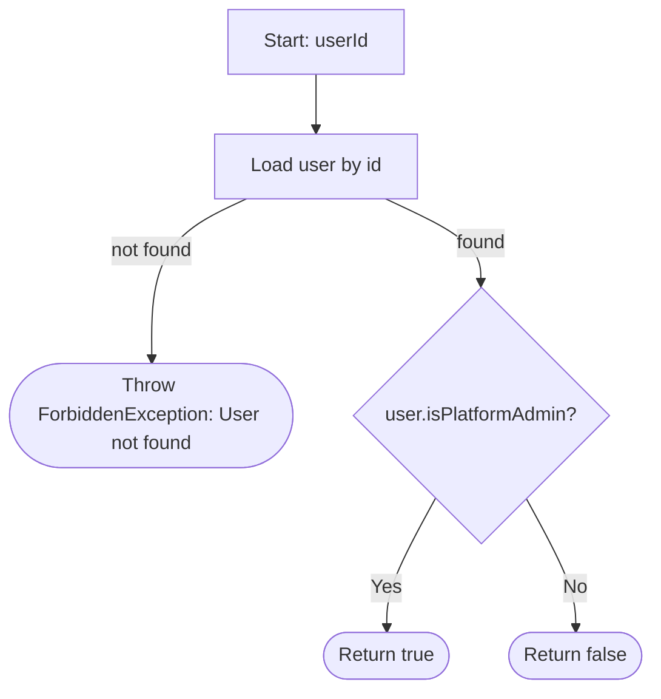
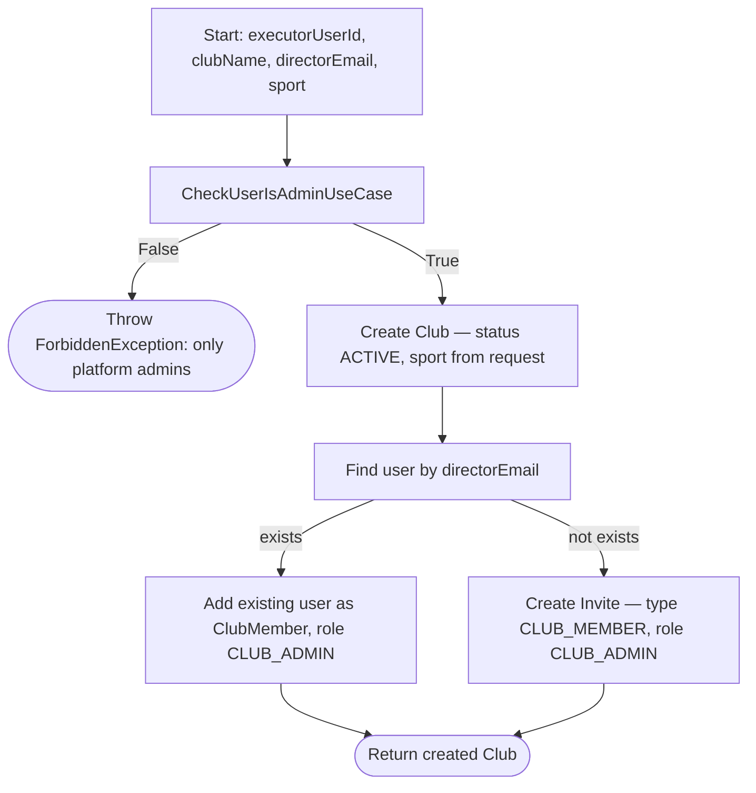
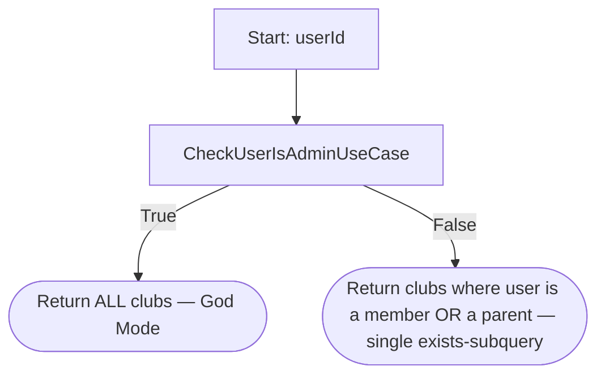
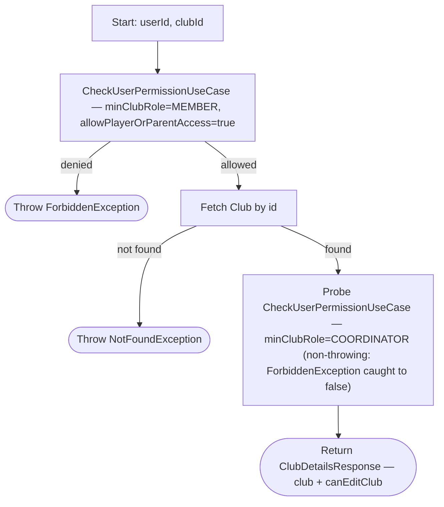
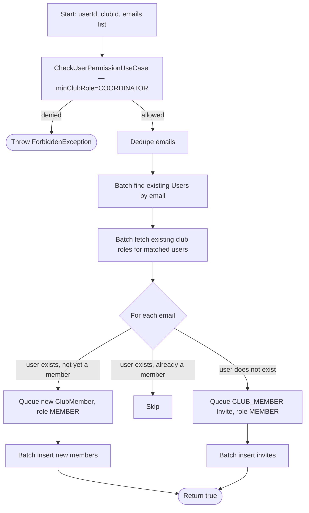
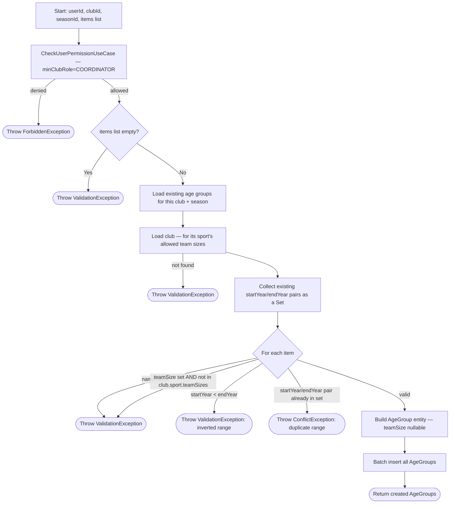
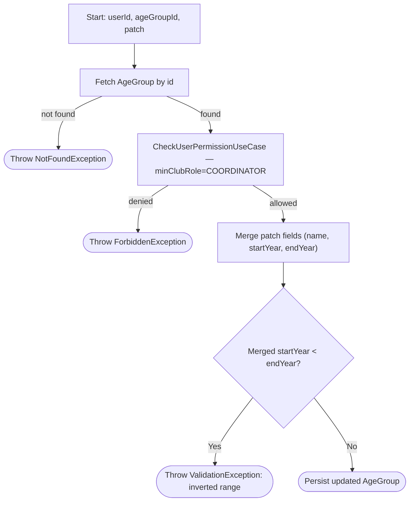
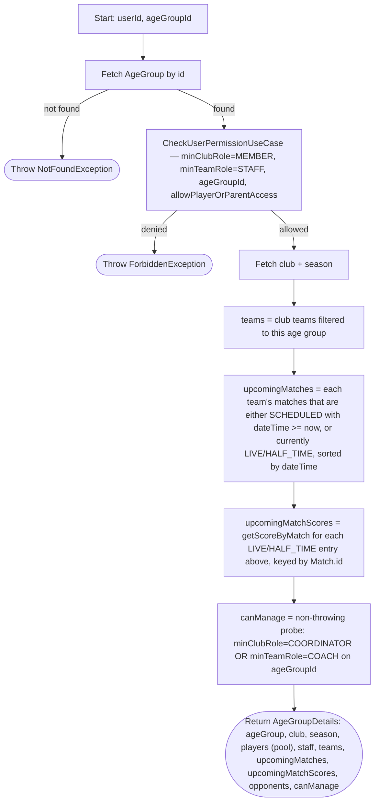
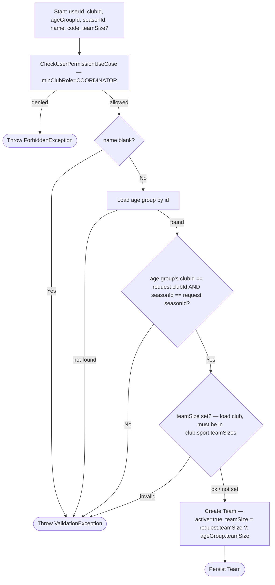

# Process Flows - Squadify Platform

This document maps every use case under `server/src/main/kotlin/.../domain/usecase` to a flowchart of its current, as-implemented logic. It complements [REQUIREMENTS.md](./REQUIREMENTS.md) (what the system should do) and [TECHNICAL_DECISIONS.md](./TECHNICAL_DECISIONS.md) (why it's built this way) with a process-level view: what each use case actually does today, branch by branch.

Generated from a read-through of all use cases on 2026-09-02. Per `AI_GUIDELINES.md`, this file should be revisited whenever a use case's business logic or flow changes.

## How to read these diagrams

- Rectangles are actions or steps.
- Diamonds are decision points taken directly from the code's `if`/`when` branches.
- Stadium shapes (`([...])`) are terminal outcomes: a return value or a thrown exception.
- Every use case wraps its body in `transactionManager.runInTransaction { }` (atomic commit/rollback) — omitted from each diagram for brevity, but assume it wraps the whole flow.

## Table of Contents

1. [Shared Building Blocks](#1-shared-building-blocks)
2. [Authentication & Session](#2-authentication--session)
3. [Platform & Club Administration](#3-platform--club-administration)
4. [Club Structure: Seasons, Age Groups, Teams](#4-club-structure-seasons-age-groups-teams)
5. [Player & Roster Management](#5-player--roster-management)
6. [Opponents](#6-opponents)
7. [Match Management & Call-ups](#7-match-management--call-ups)
8. [Live Match Engine](#8-live-match-engine)
9. [Dashboards](#9-dashboards)
10. [Cross-Cutting: The Invite System, End to End](#10-cross-cutting-the-invite-system-end-to-end)
11. [State of the Art: Observed Gaps & Inconsistencies](#11-state-of-the-art-observed-gaps--inconsistencies)
12. [Database Schema: Current State of the Art](#12-database-schema-current-state-of-the-art)

---

## 1. Shared Building Blocks

Almost every use case starts by fetching a parent resource for context, then delegates authorization to one of two shared use cases. These two flows are the backbone of the whole permission model described in `TECHNICAL_DECISIONS.md` §5.

### 1.1 `CheckUserPermissionUseCase` — the core authorization gate

```mermaid
graph TD
    A[Start: userId, clubId, minClubRole?, minTeamRole?, teamId?, ageGroupId?] --> B[Load user by id]
    B -- not found --> X1(["Throw ForbiddenException: User not found"])
    B -- found --> C{user.isPlatformAdmin?}
    C -- Yes --> ALLOW(["Allow — God Mode"])
    C -- No --> R["Resolve age-group context: ageGroupId, else team.ageGroupId for teamId"]
    R --> D[Get user's ClubRole for clubId]
    D --> E{Has a club role?}
    E -- No --> H
    E -- Yes --> F{Role is CLUB_ADMIN or COORDINATOR?}
    F -- Yes --> G{minClubRole is null OR role.level >= minClubRole.level?}
    G -- Yes --> ALLOW
    G -- No --> H
    F -- No --> I{minClubRole == MEMBER AND role.level >= MEMBER.level AND no age-group context?}
    I -- Yes --> ALLOW
    I -- No --> H{age-group context AND minTeamRole provided?}
    H -- No --> P{allowPlayerOrParentAccess?}
    H -- Yes --> J["Get user's role in the age group (age_group_staff)"]
    J --> K{role exists AND level >= minTeamRole.level?}
    K -- Yes --> ALLOW
    K -- No --> P
    P -- No --> DENY(["Throw ForbiddenException: errorMessage"])
    P -- Yes --> L["Linked players (user_players) in this club?"]
    L -- none --> DENY
    L -- some, no age-group context --> ALLOW
    L -- some --> M{a linked player is in the age group's pool (age_group_players)?}
    M -- Yes --> ALLOW
    M -- No --> DENY
```

Key behaviours baked into this one function: Platform Admins bypass everything ("God Mode"); a club-level `CLUB_ADMIN`/`COORDINATOR` role satisfies almost any check without needing a lower-level role; a plain `MEMBER` role is only sufficient when no age-group-specific check is requested; `COACH`/`STAFF` roles are validated per **age group** via `age_group_staff` (a `teamId` passed by a caller is resolved to its age group first); the opt-in player/parent path grants a read when a linked player sits in the relevant age group's pool.

### 1.2 `CheckUserIsAdminUseCase` — platform-level gate



Used directly by `ProvisionClubUseCase`, `GetClubsUseCase`, and `GetSuperAdminDashboardUseCase`.

### 1.3 The standard "permission-gated read" pattern

The majority of `Get*UseCase` classes share one exact shape:


Use cases that follow this pattern exactly (fetch-context → require at least `MEMBER` → return): `GetClubDetailsUseCase`, `GetAgeGroupsUseCase`, `GetSeasonsUseCase`, `GetTeamsUseCase`, `GetTeamDetailsUseCase` (adds aggregation + a `canManage` probe — see §4.6b), `GetTeamPlayersUseCase`, `GetAgeGroupPlayersByClubUseCase`, `GetAgeGroupStaffUseCase`, `GetPlayersUseCase`, `GetPlayerUseCase` (adds aggregation, no `canManage` probe — see §5.1b), `GetMatchesUseCase`, `GetMatchDetailsUseCase` (adds aggregation + a `canManage` probe — see §7.1b), `GetMatchEventsUseCase`, `GetMatchScoreUseCase`, `GetOpponentsUseCase`, and `GetLiveMatchUpdatesUseCase` (terminal step is "subscribe to the live bus" instead of "return data" — see §8.3).

Their individual diagrams are omitted below to avoid 15 near-identical copies; only the use cases with distinct branching logic get a dedicated diagram.

---

## 2. Authentication & Session

### 2.1 Register (`RegisterUseCase`)


### 2.2 Login (`LoginUseCase`)


### 2.3 Refresh Token (`RefreshTokenUseCase`)


Note: the repository (`findRefreshToken`) just retrieves the row as-is; the expiry decision is a business rule owned by the use case, which deletes an expired token as it rejects it. Rotation deletes the presented token on the success path too. Covered by `RefreshTokenUseCaseTest` and `JwtConfigTest`.

### 2.4 Platform Admin Seeding (`SeedPlatformAdminUseCase`) — startup, not request-driven

Runs once from `Application.module()` (right after Koin is installed), so a freshly-created or wiped **dev** database is immediately usable with no manual bootstrapping. Idempotent — never mutates an existing account.


Config comes from `ServerConfig` and is injected into the use case: `DEV` enables it by default with labelled fallback credentials (`admin@local.dev` / `admin1234`); `PRODUCTION` keeps it off unless `SEED_ADMIN_ENABLED=true`, which then makes `SEED_ADMIN_EMAIL` / `SEED_ADMIN_PASSWORD` mandatory (no password fallback in production). Covered by `SeedPlatformAdminUseCaseTest`. See `TECHNICAL_DECISIONS.md` §5.

---

## 3. Platform & Club Administration

### 3.1 Provision Club (`ProvisionClubUseCase`) — Super Admin only



### 3.2 Get Clubs (`GetClubsUseCase`)



### 3.3 Get Club Details (`GetClubDetailsUseCase`)



`canEditClub` from the same single probe above — `CreateSeasonUseCase` and `CreateAgeGroupsUseCase` enforce the identical `minClubRole=COORDINATOR` gate, so one non-throwing check covers both response fields (they're separate fields, not one shared boolean, only so either could diverge later without an API shape change). The client uses them to distinguish, when a club has zero seasons or zero age groups, an admin/coordinator ("nothing here yet, create one") from a plain member ("nothing here yet") — see §4.1 and §4.3.

### 3.3b Get Club Home (`GetClubHomeUseCase`)

The aggregate behind the club screen's default **Home** tab: stat-grid counts, one "Next up" row per team with an upcoming match, and role-scoped "Needs you" alerts. `GET /clubs/{clubId}/home`, readable by any club member.

```mermaid
graph TD
    A[Start: userId, clubId] --> B[CheckUserPermissionUseCase — minClubRole=MEMBER, allowPlayerOrParentAccess=true]
    B -- denied --> F(["Throw ForbiddenException"])
    B -- allowed --> C[Fetch club; resolve role + season (active, else latest-ending)]
    C --> D["Counts: teams, players, coaches; matchesThisWeek = club matches whose date is in the Mon–Sun week containing today"]
    D --> E["Next up: per team, soonest SCHEDULED future match → opponent name + call-up counts (total, CONFIRMED)"]
    E --> G{role >= COORDINATOR or platform admin?}
    G -- Yes --> H["alert per season age group with no COACH in age_group_staff (AGE_GROUP_NEEDS_COACH)"]
    G -- No --> I
    H --> I{coaches any season age group?}
    I -- Yes --> J["group that age group's SCHEDULED matches within 5 days that have zero call-ups, one CALLUPS_UNSENT alert per day"]
    I -- No --> Z
    J --> Z(["Return ClubHome — club, seasonName, role, counts, nextUp, alerts"])
```

Alerts carry structured parts (`ageGroupName`, `date`, `count`) rather than rendered strings, so the client formats them in the user's language. Someone who is both a coordinator and an age-group coach gets both alert types.

### 3.4 Update Club (`UpdateClubUseCase`)


### 3.5 Update Club Member Role (`UpdateClubMemberRoleUseCase`)


### 3.6 Add Club Members (`AddClubMembersUseCase`)



---

## 4. Club Structure: Seasons, Age Groups, Teams

### 4.1 Create Season (`CreateSeasonUseCase`)


The client's `DatePickerSheet` (`minDate`/`maxDate`) already keeps the start/end ordering from happening in normal use — picking an end date before the current start date (or a start date after the current end date) simply isn't offered in the picker — but the server validates it independently since the client can't be trusted alone. Covered by `CreateSeasonUseCaseTest`.

### 4.2 Update Season (`UpdateSeasonUseCase`)


### 4.3 Create Age Groups (`CreateAgeGroupsUseCase`) — batch



Each item carries a `startYear`/`endYear` birth-year span rather than a single birth year: most age groups (football) are single-year, sent as `startYear == endYear`; some (typically futsal) span two consecutive birth years to have enough players for a squad -- e.g. a Benjamins group covering 2016 and 2017 is `startYear = 2017, endYear = 2016`. Eligibility and the inferred "Sub N" name are always derived from `endYear` (the oldest birth year the group allows), exactly mirroring the old single `birthYear` field's role -- see §5.3. Each item also carries an optional `teamSize` (an a-side count like 7 or 11). It's the default the age group's teams play; a team can override it (§4.5 / §4.5b). When set it must be one of the values the club's `sport` allows (`SportType.teamSizes` — a code-level constant, not a DB config). The client's Create Age Groups screen shows a per-row span-type radio (single year vs. two years) and a per-row team-size picker seeded from the sport's largest format.

### 4.4 Update Age Group (`UpdateAgeGroupUseCase`)



### 4.4b Get Age Group Details (`GetAgeGroupDetailsUseCase`)

The aggregate behind the age-group detail screen. Follows the standard permission-gated read (§1.3) with an aggregation step and a `canManage` probe:



`opponents` is the club's full opponent list so the client can resolve `match.opponentId`. `canManage` gates the add/edit actions on the detail screen, the same way `ClubDetailsResponse.canEditClub` does. A match in progress stays in `upcomingMatches` rather than disappearing between "scheduled" and "finished" -- `upcomingMatchScores` lets the client show its running score (see `MatchRow` in `TECHNICAL_DECISIONS.md`/the client's `presentation/ui/components` package).

### 4.5 Create Team (`CreateTeamUseCase`)



`teamSize` is the a-side count this team plays. The request field is optional: when omitted the team inherits the age group's default (`ageGroup.teamSize`, itself nullable for age groups created before team sizes existed). When supplied it must be one of the club sport's allowed sizes. The client's Create Team screen pre-selects the age group's default and lets the user change it (e.g. an age group defined as 7-a-side with one team that plays 9-a-side).

### 4.5b Create Teams (`CreateTeamsUseCase`) — batch

```mermaid
graph TD
    A[Start: userId, clubId, seasonId, ageGroupId, items list] --> B[CheckUserPermissionUseCase — minClubRole=COORDINATOR]
    B -- denied --> F(["Throw ForbiddenException"])
    B -- allowed --> C{items list empty?}
    C -- Yes --> V(["Throw ValidationException"])
    C -- No --> D[Load age group by id]
    D -- not found --> V
    D -- found --> E{"age group belongs to this club AND this season?"}
    E -- No --> V
    E -- Yes --> E2[Load club — for its sport's allowed team sizes]
    E2 --> G{For each item}
    G -- name blank --> V
    G -- teamSize set AND not in club.sport.teamSizes --> V
    G -- valid --> H["Build Team entity — active=true, teamSize = item.teamSize ?: ageGroup.teamSize"]
    H --> I[Batch insert all Teams]
    I --> Z(["Return created Teams"])
```

Whole batch runs in one transaction (all or nothing), mirroring `CreateAgeGroupsUseCase`. Teams have no name-uniqueness constraint, so there's no conflict branch. Covered by `CreateTeamsUseCaseTest`. The client's Create Teams screen defaults the season to the most recent one (by end date), requires an age group to be picked, and requires a name on every row before it will submit. Each row also has a team-size picker pre-selected to the chosen age group's default (`ageGroup.teamSize`), overridable per row; an omitted `teamSize` falls back to that default server-side.

### 4.6 Update Team (`UpdateTeamUseCase`)

```mermaid
graph TD
    A[Start: userId, teamId, patch] --> B[Fetch Team by id]
    B -- not found --> N(["Throw NotFoundException"])
    B -- found --> C[CheckUserPermissionUseCase — minClubRole=COORDINATOR]
    C -- denied --> F(["Throw ForbiddenException"])
    C -- allowed --> D["Merge patch fields (name, code, active)"]
    D --> Z(["Persist updated Team"])
```

### 4.6b Get Team Details (`GetTeamDetailsUseCase`)

The aggregate behind the team detail screen. A team is only a scheduling handle, so the payload leads with its fixtures and carries the age group's pool size + staff read-only. Standard permission-gated read (§1.3) with an aggregation step and a `canManage` probe:

```mermaid
graph TD
    A[Start: userId, teamId] --> B[Fetch Team by id]
    B -- not found --> N(["Throw ValidationException"])
    B -- found --> C[CheckUserPermissionUseCase — minClubRole=MEMBER, minTeamRole=STAFF, teamId, allowPlayerOrParentAccess]
    C -- denied --> F(["Throw ForbiddenException"])
    C -- allowed --> D[Fetch club + age group + season]
    D --> G["canManage = non-throwing probe: minClubRole=COORDINATOR OR minTeamRole=COACH on teamId"]
    G --> H[matches = matchRepository.getMatchesByTeam]
    H --> I["upcomingMatches = SCHEDULED with dateTime >= now, OR currently LIVE/HALF_TIME, sorted ascending"]
    I --> I2["upcomingMatchScores = getScoreByMatch for each LIVE/HALF_TIME entry above, keyed by Match.id"]
    H --> J["recentResults = FINISHED, newest first, each paired with its scoreline from matchEventRepository.getScoreByMatch → WIN/DRAW/LOSS"]
    I2 --> K[siblingTeamNames = other teams in the same age group]
    J --> K
    K --> Z(["Return TeamDetails: team, club, ageGroup, season, poolSize, siblingTeamNames, staff, upcomingMatches, upcomingMatchScores, recentResults, opponents, canManage"])
```

`poolSize` / `staff` come from the age group (players and staff belong to it, not the team); the screen links back to the age-group detail for both. `club` is carried so a screen opened from here (e.g. Schedule Match) has the club name without another call. `opponents` is the club's full opponent list so the client can resolve `match.opponentId`. `canManage` gates the schedule-match / edit-team actions. As with the age-group screen, a live match stays in `upcomingMatches` (it hasn't reached `recentResults` yet) and `upcomingMatchScores` carries its running score.

---

## 5. Player & Roster Management

### 5.1 Create Players (`CreatePlayersUseCase`) — batch, with self & parent invites

```mermaid
graph TD
    A[Start: userId, clubId, players list] --> B[CheckUserPermissionUseCase — minClubRole=COORDINATOR]
    B -- denied --> F(["Throw ForbiddenException"])
    B -- allowed --> C{Any player first/last name blank?}
    C -- Yes --> V(["Throw ValidationException"])
    C -- No --> D["Batch create Player records — active=true (position/heightCm/weightKg/emergencyContact carried through if given, all optional)"]
    D --> E["Collect all unique emails (players' own + all parents')"]
    E --> G[Batch find existing Users by email]
    G --> H{For each created player}
    H -- has own email, user exists --> I[Queue direct ClubMember, role MEMBER]
    H -- has own email, user missing --> J[Queue CLUB_MEMBER Invite]
    H -- no email --> SK[Skip self-invite]
    H --> L{For each parent of this player}
    L -- user exists --> M[Queue UserPlayer link + relationship]
    L -- user missing --> N["Queue PARENT_PLAYER Invite (linked to playerId)"]
    I --> O[Apply direct ClubMember additions]
    J --> P[Batch insert all Invites — player + parent]
    M --> Q[Batch insert UserPlayer links]
    N --> P
    O --> Z(["Return created Players"])
    Q --> Z
    P --> Z
```

### 5.1b Get Player Profile (`GetPlayerUseCase`)

The aggregate behind the player profile screen. No longer a plain fetch-and-return: it now assembles
all-time stats and a resolved recent-events list alongside the player record.

```mermaid
graph TD
    A[Start: userId, playerId] --> B[Fetch Player by id]
    B -- not found --> N(["Throw NotFoundException"])
    B -- found --> C[CheckUserPermissionUseCase — minClubRole=MEMBER]
    C -- denied --> F(["Throw ForbiddenException"])
    C -- allowed --> D["ageGroupLabel/seasonLabel = first AgeGroup this player's pool membership resolves to (name), plus its Season's name"]
    D --> E["events = getAllEventsByPlayer, newest first"]
    E --> G["goals/assists = count of GOAL/ASSIST in events"]
    G --> H["recentEvents = first 5 of events, each resolved to its Match + Opponent name"]
    H --> I["timesCalledUp = countCallUpsByPlayer; guardiansLinked = countGuardiansByPlayer"]
    I --> J["canManage = non-throwing probe of CheckUserPermissionUseCase — minClubRole=COORDINATOR"]
    J --> Z(["Return PlayerProfile: player, ageGroupLabel, seasonLabel, goals, assists, timesCalledUp, guardiansLinked, recentEvents, canManage"])
```

Stats are all-time -- there's no season/last-5/career split yet (the client's player profile screen
only shows one fixed set of numbers). `ageGroupLabel`/`seasonLabel` are the player's actual pool
membership (real `AgeGroupPlayers` data) and that age group's season; this is distinct from the
"Sub N" text the client also shows next to the player's name/position, which it derives purely from
`Player.birthDate` and today's date (`AgeGroupDefaults.currentSeasonEndYear`/`inferredName`) with no
server round-trip. `canManage` gates the player profile screen's "Edit player" overflow action, same
pattern as `TeamDetails.canManage` / `AgeGroupDetails.canManage`.

`Player.position` is a `PlayerPosition` enum (`GOALKEEPER`/`DEFENDER`/`MIDFIELD`/`WINGER`/`STRIKER`),
and `Player` also carries `heightCm`, `weightKg`, and a free-text `emergencyContact` -- all four are
nullable and settable from Create Players (§5.1) and Update Player (§5.2); the profile screen omits
any that are absent rather than showing a placeholder.

### 5.2 Update Player (`UpdatePlayerUseCase`)

```mermaid
graph TD
    A[Start: userId, playerId, patch] --> B[Fetch Player by id]
    B -- not found --> N(["Throw NotFoundException"])
    B -- found --> C[CheckUserPermissionUseCase — minClubRole=COORDINATOR]
    C -- denied --> F(["Throw ForbiddenException"])
    C -- allowed --> D["Merge patch fields (name, birthDate, shirtNumber, photoUrl, position, heightCm, weightKg, emergencyContact)"]
    D --> E[Persist updated Player]
    E --> G{email provided in request?}
    G -- yes, user exists --> H[Add as ClubMember, role MEMBER]
    G -- yes, user missing --> I[Create CLUB_MEMBER Invite]
    G -- no --> SK[Skip]
    H --> J{parents list provided?}
    I --> J
    SK --> J
    J -- No --> Z(["Return success"])
    J -- Yes --> K["Delete ALL existing UserPlayer links for this player"]
    K --> L["Delete ALL existing pending Invites for this player"]
    L --> M[Batch find Users by new parent emails]
    M --> P{For each new parent}
    P -- user exists --> Q[Queue UserPlayer link]
    P -- user missing --> R[Queue PARENT_PLAYER Invite]
    Q --> S[Insert links]
    R --> T[Insert invites]
    S --> Z
    T --> Z
```

The `parents` list is a **total replacement**, not a merge: every existing parent link and pending parent-invite is deleted before the new list is applied.

**Client screen:** `EditPlayerScreen` (design canvas "17A"/"17B") is the first client consumer of this
use case. Reached from the player profile's overflow menu (gated on `canManage`, §5.1b), it edits every
field `UpdatePlayerRequest` supports except `photoUrl`/`email`/`parents` -- name, date of birth, shirt
number, position, height/weight, and emergency contact -- reusing Create Players' field styling. A
green banner ("Only the name and date of birth are required. The rest can wait.") shows when the
player's optional fields were never set; the pinned Save button (and a matching header checkmark) stay
disabled until the form is both valid (name + DOB present) and different from what was loaded. Saving
flags `KEY_CLUB_STRUCTURE_CHANGED` so the profile screen reloads on return, same cascade pattern as the
other create/edit screens (`AppNavigation.kt`).

### 5.3 Add Players to Age Group (`AddPlayersToAgeGroupUseCase`) — with age eligibility

Players belong to **age-group pools**, not teams. A player can be in several age groups at once (their birth-year group plus any older one they're eligible to play up into). `(age_group_id, player_id)` is unique. Which players actually appear for a given match is decided per-match via call-ups.

```mermaid
graph TD
    A[Start: userId, ageGroupId, playerIds list] --> B[Fetch AgeGroup by id]
    B -- not found --> V0(["Throw ValidationException: Age group not found"])
    B -- found --> C[CheckUserPermissionUseCase — minClubRole=COORDINATOR OR minTeamRole=COACH on ageGroupId]
    C -- denied --> F(["Throw ForbiddenException"])
    C -- allowed --> E0{playerIds empty?}
    E0 -- Yes --> V0b(["Throw ValidationException"])
    E0 -- No --> E[Batch fetch Player data + players already in this age group]
    E --> G{For each requested player}
    G -- already in this age group --> SK[skip — idempotent]
    G -- player not found --> V2(["Throw ValidationException"])
    G -- player.clubId != ageGroup.clubId --> FB(["Throw ForbiddenException: wrong club"])
    G -- "player.birthDate.year < ageGroup.endYear" --> V3(["Throw ValidationException: too old for age group"])
    G -- eligible --> H[Build AgeGroupPlayer link]
    SK --> I
    H --> I[Batch insert AgeGroupPlayer links]
    I --> Z(["Return created AgeGroupPlayer links"])
```

`GetEligiblePlayersForAgeGroupUseCase` is the read counterpart: every club player with `birthDate.year >= ageGroup.endYear` who isn't already in the group; visible to a coordinator or any age-group staff. Playing up is unbounded — a young player is eligible for any older age group, never a younger one.

Age groups carry a `startYear`/`endYear` birth-year **span**, not a single birth year (see §4.3): most (football) are single-year, with `startYear == endYear`; some (typically futsal) span two consecutive birth years to have enough players for a squad -- e.g. a Benjamins group covering 2016 and 2017 is `startYear = 2017, endYear = 2016`. Eligibility above and the inferred "Sub N" name (client-side `AgeGroupDefaults.inferredName`) are both always keyed off `endYear` -- the oldest birth year the group allows -- so a two-year group behaves exactly like the old single-birth-year field with the threshold lowered by one year; `startYear` is otherwise informational (shown in the UI, not compared against).

The client's Add Players screen has a "New player" shortcut that pushes the Create Players (register-to-club) screen; on return it reloads the eligible list so the just-registered players are pickable without leaving, and propagates the reload down to Club Details / Age Group Details.

### 5.4 Add Staff to Age Group (`AddStaffToAgeGroupUseCase`)

Coaches/support staff attach to an **age group**, not a team (`age_group_staff`). Matches are run by whoever staffs the match's team's age group.

```mermaid
graph TD
    A[Start: userId, ageGroupId, staff list] --> B[Fetch AgeGroup by id]
    B -- not found --> V(["Throw ValidationException: Age group not found"])
    B -- found --> C[CheckUserPermissionUseCase — minClubRole=COORDINATOR]
    C -- denied --> F(["Throw ForbiddenException"])
    C -- allowed --> D[Batch fetch club roles for all staff userIds]
    D --> E{For each staff item}
    E -- user has no club role --> FB(["Throw ForbiddenException: must join club first"])
    E -- user is already a club member --> G[Build AgeGroupStaff record]
    G --> H[Batch insert AgeGroupStaff records]
    H --> Z(["Return success"])
```

Since staff must already be a club member, the client's **Add Staff to Age Group** screen (reached from an age group's own "Add staff" button/menu entry) needs a way to list them: `GetClubMembersUseCase` (`GET /clubs/{clubId}/members`, same `minClubRole=COORDINATOR` gate) returns every active `ClubMemberSummary` (name, email, club role) for the picker. The screen then works like Add Players to Age Group — pick an age group, search the list, pick who to add — except each row picks a `TeamRole` (Coach/Staff) rather than being a plain toggle, and the eligible list excludes members already staffing that age group (fetched via `GetAgeGroupStaffUseCase`, `GET /age-groups/{ageGroupId}/staff`, client-side only, no new endpoint).

Someone not yet a club member can't be picked there, so that screen also has a "New staff member" shortcut to the **Create Staff** screen (Club Details overflow menu, and the shortcut above) -- this is just `AddClubMembersUseCase` (`POST /clubs/{clubId}/members`, the existing club-member-invite flow, previously unused by the client) presented as a batch-of-emails form matching Create Players' shape. An email already tied to an account is added to the club immediately as a `MEMBER`; an unknown one gets an `Invite` row (`InviteType.CLUB_MEMBER`) so they land as a `MEMBER` once they register -- no new fields, no new backend behaviour, just the client screen that was missing. Either way they then show up in Add Staff to Age Group's picker.

---

## 6. Opponents

### 6.1 Create Opponent (`CreateOpponentUseCase`)

```mermaid
graph TD
    A[Start: userId, clubId, name, shortName, logoUrl] --> B[CheckUserPermissionUseCase — minClubRole=COORDINATOR]
    B -- denied --> F(["Throw ForbiddenException"])
    B -- allowed --> C[Create Opponent record]
    C --> Z(["Persist Opponent"])
```

### 6.2 Update Opponent (`UpdateOpponentUseCase`)

```mermaid
graph TD
    A[Start: userId, opponentId, patch] --> B[Fetch Opponent by id]
    B -- not found --> N(["Throw NotFoundException"])
    B -- found --> C[CheckUserPermissionUseCase — minClubRole=COORDINATOR]
    C -- denied --> F(["Throw ForbiddenException"])
    C -- allowed --> D["Merge patch fields (name, shortName, logoUrl)"]
    D --> Z(["Persist updated Opponent"])
```

---

## 7. Match Management & Call-ups

### 7.1 Create Match (`CreateMatchUseCase`)

```mermaid
graph TD
    A[Start: userId, teamId, opponentId, location, dateTime, notes] --> B[Fetch Team by id]
    B -- not found --> N1(["Throw NotFoundException: Team not found"])
    B -- found --> C[CheckUserPermissionUseCase — minTeamRole=COACH, teamId]
    C -- denied --> F(["Throw ForbiddenException"])
    C -- allowed --> D[Fetch Opponent by id]
    D -- not found --> N2(["Throw NotFoundException: Opponent not found"])
    D -- found --> E{opponent.clubId != team.clubId?}
    E -- Yes --> FB(["Throw ForbiddenException: opponent belongs to another club"])
    E -- No --> G[Create Match — status SCHEDULED]
    G --> Z(["Persist Match"])
```

### 7.1b Get Match Details (`GetMatchDetailsUseCase`)

The aggregate behind the match screen. Standard permission-gated read (§1.3, `MEMBER` + age-group `STAFF` + linked player/parent) plus an aggregation step and a `canManage` probe:

```mermaid
graph TD
    A[Start: userId, matchId] --> B[Fetch Match by id]
    B -- not found --> N(["Throw NotFoundException"])
    B -- found --> C[CheckUserPermissionUseCase — minClubRole=MEMBER, minTeamRole=STAFF, teamId=match.teamId, allowPlayerOrParentAccess]
    C -- denied --> F(["Throw ForbiddenException"])
    C -- allowed --> D[Fetch opponent + team + age group + season]
    D --> E["callUps = call-ups for the match; poolPlayers = age group's players MINUS whoever is already called up"]
    E --> G["canManage = non-throwing probe: minClubRole=COORDINATOR OR minTeamRole=COACH on the team"]
    G --> H["score = matchEventRepository.getScoreByMatch(matchId) — 0-0 before any goals are logged"]
    H --> Z(["Return MatchDetails: match, opponent, team, ageGroup, season, callUps, poolPlayers, canManage, score"])
```

The use case composes `MatchDetails` itself now — the old `MatchRepository.getMatchDetails` (opponent + call-ups only) was removed. `poolPlayers` is the "Available" list on the call-up screen; `canManage` gates the edit sheet and call-up management, but only while the match is still open to changes -- the client additionally forces the screen read-only once `match.status == FINISHED` regardless of `canManage`, so a finished match becomes a plain record (no editing call-ups, kickoff, location, etc.). `score` feeds the FINISHED-state result banner (colored WIN/LOSS/DRAW + scoreline) on the details screen, the same rebuilt-from-events value `MatchRow` already showed in match lists.

The bottom button just opens the live match screen; starting the game and recording events all live there. If the match is already LIVE/HALF_TIME when this screen loads (tapped in from a list, or discovered on a reload), the client redirects straight to the live match screen instead of rendering the details view -- see `MatchDetailsViewModel.load()` / `AppNavigation.kt`'s `Screen.MatchDetails` route, which pops this screen off the back stack when redirecting (rather than stacking under it) so back-navigation from the live screen doesn't bounce straight back into another redirect.

### 7.1c Update Match (`UpdateMatchUseCase`)

```mermaid
graph TD
    A[Start: userId, matchId, patch (opponentId?, dateTime?, location?, notes?)] --> B[Fetch Match by id]
    B -- not found --> N1(["Throw NotFoundException"])
    B -- found --> C[CheckUserPermissionUseCase — minTeamRole=COACH, teamId=match.teamId]
    C -- denied --> F(["Throw ForbiddenException"])
    C -- allowed --> D{patch.opponentId set?}
    D -- Yes --> E[Fetch Opponent; reject if it belongs to another club]
    D -- No --> G
    E --> G["Merge non-null patch fields onto the match"]
    G --> Z(["Persist updated Match — status and call-ups are untouched"])
```

### 7.2 Manage Call-ups (`ManageCallUpsUseCase`) — batch replace

```mermaid
graph TD
    A[Start: userId, matchId, playerIds list] --> B[Fetch Match by id]
    B -- not found --> N(["Throw NotFoundException"])
    B -- found --> C[CheckUserPermissionUseCase — minTeamRole=COACH, teamId=match.teamId]
    C -- denied --> F(["Throw ForbiddenException"])
    C -- allowed --> D["Set call-ups for the match to exactly this playerIds list (repository owns diff/replace)"]
    D --> Z(["Return success"])
```

### 7.3 Update Call-up Status (`UpdateCallUpStatusUseCase`)

```mermaid
graph TD
    A[Start: userId, callUpId, status, notes?] --> B[Fetch CallUp by id]
    B -- not found --> N1(["Throw NotFoundException: Call-up not found"])
    B -- found --> C[Fetch Match by callUp.matchId]
    C -- not found --> N2(["Throw NotFoundException: Match not found"])
    C -- found --> D[CheckUserPermissionUseCase — minTeamRole=COACH, teamId=match.teamId]
    D -- denied --> F(["Throw ForbiddenException"])
    D -- allowed --> E[Update call-up status + notes]
    E --> Z(["Return success"])
```

Only Coach-level staff (or club Admin/Coordinator) can change a call-up's status today — there is no path yet for the Parent/Player themselves to self-confirm attendance (see §11).

---

## 8. Live Match Engine

### 8.0 Start Match (`StartMatchUseCase`)

```mermaid
graph TD
    A[Start: userId, matchId, startingPlayerIds, halfLengthMinutes] --> B[Fetch Match by id]
    B -- not found --> N(["Throw NotFoundException"])
    B -- found --> C[CheckUserPermissionUseCase — minTeamRole=COACH, teamId=match.teamId]
    C -- denied --> F(["Throw ForbiddenException"])
    C -- allowed --> D{"status == SCHEDULED? halfLengthMinutes > 0? startingPlayerIds non-empty, no duplicates?"}
    D -- No --> V1(["Throw ValidationException"])
    D -- Yes --> E[Fetch Team — required count = team.teamSize ?: 11]
    E -- count mismatch --> V2(["Throw ValidationException"])
    E -- ok --> G[Fetch this match's call-ups]
    G -- a starter isn't CALLED_UP/CONFIRMED --> V3(["Throw ValidationException"])
    G -- ok --> H["Set isStarting=true on the starters' call-ups (false on the rest), set Match.status=LIVE + halfLengthMinutes + kickoffAt=now"]
    H --> I["Publish LiveMatchUpdate(score, status=LIVE) via LiveMatchBus"]
    I --> Z(["Return success"])
```

This is the "KICK OFF" action on the live match console's pre-kickoff screen (client, see below): it locks in the Starting XI (everyone else called up becomes the bench) and the half length in one write, then flips the match live. The a-side count comes from `Team.teamSize` (falling back to 11 for teams recorded before that field existed — see the team-size flows in §4.3/§4.5). It also stamps `Match.kickoffAt` with the wall-clock instant of kickoff — the client derives the live running clock from this timestamp rather than any locally-ticking counter (see §8.4).

### 8.1 Add Match Event (`AddMatchEventUseCase`)

```mermaid
graph TD
    A[Start: userId, matchId, type, minute, playerId?, opponentPlayerName?, isOpponent] --> B[Fetch Match by id]
    B -- not found --> V(["Throw ValidationException: Match not found"])
    B -- found --> C[CheckUserPermissionUseCase — minTeamRole=COACH, teamId=match.teamId]
    C -- denied --> F(["Throw ForbiddenException"])
    C -- allowed --> D[Create MatchEvent record]
    D --> E[Persist event]
    E --> G["Recalculate score from all events for this match"]
    G --> H["Publish LiveMatchUpdate(event, score) via LiveMatchBus for matchId"]
    H --> Z(["Return created event"])
```

### 8.1b Delete Match Event (`DeleteMatchEventUseCase`)

```mermaid
graph TD
    A[Start: userId, matchId, eventId] --> B[Fetch Match by id]
    B -- not found --> N1(["Throw NotFoundException"])
    B -- found --> C[CheckUserPermissionUseCase — minTeamRole=COACH, teamId=match.teamId]
    C -- denied --> F(["Throw ForbiddenException"])
    C -- allowed --> D[Fetch Event by id]
    D -- not found --> N2(["Throw NotFoundException"])
    D -- event.matchId != matchId --> V(["Throw ValidationException"])
    D -- ok --> E[Delete event]
    E --> G[Recalculate score]
    G --> H["Publish LiveMatchUpdate(score, deletedEventId) via LiveMatchBus"]
    H --> Z(["Return success"])
```

Removes a mis-logged goal, card, or substitution row. The client always confirms with the user first (see below — "Confirms only on Full time and event deletion").

### 8.2 Update Match Status (`UpdateMatchStatusUseCase`)

```mermaid
graph TD
    A[Start: userId, matchId, newStatus] --> B[Fetch Match by id]
    B -- not found --> N(["Throw NotFoundException"])
    B -- found --> C[CheckUserPermissionUseCase — minTeamRole=COACH, teamId=match.teamId]
    C -- denied --> F(["Throw ForbiddenException"])
    C -- allowed --> T{"newStatus in VALID_MATCH_STATUS_TRANSITIONS[match.status]?"}
    T -- No --> V(["Throw ValidationException"])
    T -- Yes --> D[Update Match.status in DB]
    D --> E{Update succeeded?}
    E -- No --> R1(["Return false — no broadcast"])
    E -- Yes --> F{"newStatus == LIVE and previous status == HALF_TIME?"}
    F -- Yes --> F2["Set Match.secondHalfStartedAt = now"]
    F -- No --> G
    F2 --> G[Recalculate current score]
    G --> H["Publish LiveMatchUpdate(score, status) via LiveMatchBus"]
    H --> R2(["Return true"])
```

Status values flow `SCHEDULED → LIVE → HALF_TIME → FINISHED` (or `CANCELLED`). The use case now validates the transition against `VALID_MATCH_STATUS_TRANSITIONS`: `SCHEDULED → CANCELLED` only (kickoff, i.e. `SCHEDULED → LIVE`, stays exclusive to `StartMatchUseCase`, §8.0 — this is a real HTTP route in its own right, `MatchRoutes.kt`, so without this guard a caller could set a match LIVE here directly and skip `StartMatchUseCase`'s starting-line-up/half-length validation entirely); `LIVE → {HALF_TIME, FINISHED, CANCELLED}`; `HALF_TIME → {LIVE, FINISHED, CANCELLED}`; `FINISHED`/`CANCELLED` are terminal. An invalid transition throws `ValidationException`. (Previously this list closed with "but the use case does not itself validate that the requested transition is legal — any status can currently be set from any other," per §11 — now fixed there too.)

On the specific `HALF_TIME → LIVE` transition (resuming for the second half), this use case also stamps `Match.secondHalfStartedAt` with the wall-clock instant — so the client's running clock can pick up from the first half's nominal length instead of restarting at 0 (see §8.4).

### 8.3 Subscribe to Live Match Updates (`GetLiveMatchUpdatesUseCase`)

```mermaid
graph TD
    A[Start: userId, matchId] --> B[Fetch Match by id]
    B -- not found --> N(["Throw NotFoundException"])
    B -- found --> C[CheckUserPermissionUseCase — minClubRole=MEMBER]
    C -- denied --> F(["Throw ForbiddenException"])
    C -- allowed --> D[Subscribe to LiveMatchBus Flow for matchId]
    D --> Z(["Return reactive Flow of LiveMatchUpdate — bridged to a WebSocket session"])
```

Together, §8.0–§8.2 (the writers) and §8.3 (the reader) implement the hybrid "REST write, WebSocket broadcast" pattern documented in `TECHNICAL_DECISIONS.md` §6 — a REST POST persists the fact, then the same use case pushes it to every subscriber of that `matchId` on the shared `LiveMatchBus`.

### 8.4 Client: the Live Match Console

`LiveMatchScreen` (design canvas artboard "16") is one screen whose layout is entirely driven by `Match.status`:

- **SCHEDULED** — pre-kickoff: a half-length picker and a Starting XI/Bench picker built from the match's called-up/confirmed players, gated on picking exactly `Team.teamSize` (fallback 11) starters. "KICK OFF" calls §8.0.
- **LIVE / HALF_TIME** — the console: a scoreline (tapping a score logs an unattributed/opponent goal via §8.1), Squad and Events tabs, and a HALF TIME / FULL TIME action bar (§8.2, confirmed with a dialog first). The Squad tab's On pitch / Bench / Sent off split is *derived client-side* from the Starting XI (`MatchCallUp.isStarting`) replayed against the event log (substitutions move a player between On pitch/Bench, a red card moves them to Sent off) — nothing extra is persisted for this. Tapping a player opens a sheet to log a goal/assist/card, or substitute (a two-step tap: pick the player, then who they swap with) — bench players can't be tapped for goals/cards, only brought on. Deleting a logged event (§8.1b) asks for confirmation first, matching "Confirms only on Full time and event deletion."
- **FINISHED / CANCELLED** — a read-only full-time summary: final score, a WIN/LOSS/DRAW/CANCELLED badge, and the same event timeline reused from the Events tab (delete disabled here).

Every mutating action applies its own REST response to local state immediately, so the coach driving the match never waits on the socket; `GetLiveMatchUpdatesUseCase`'s WebSocket (§8.3) is a second, best-effort listener that folds in changes from other devices watching the same match and is not retried if it drops. The running clock (shown as `MM:SS`) is derived, not locally ticked: it's computed client-side as `now - Match.kickoffAt`, or once the second half has started, `halfLengthMinutes + (now - Match.secondHalfStartedAt)` — recomputed every second and on every recomposition, so it's correct across navigation/app restarts and unaffected by the device's timezone (`Instant` subtraction is timezone-agnostic). "Set minute" applies a local-only offset on top of this derived value rather than overwriting it, so the offset itself resets (recomputing fresh from the persisted timestamps) if the screen is reopened. Everything that matters for the record — score, events, status, the Starting XI, and now the kickoff/second-half timestamps — is server-authoritative. The club-details match list's live badge (`MatchesTab`) shows a coarser whole-minutes count (e.g. "12'", no seconds) derived from the same `kickoffAt`.

---

## 9. Dashboards

### 9.1 Super Admin Dashboard (`GetSuperAdminDashboardUseCase`)

```mermaid
graph TD
    A[Start: userId] --> B[CheckUserIsAdminUseCase]
    B -- False --> F(["Throw ForbiddenException"])
    B -- True --> C[Count all Clubs]
    C --> D[Count all Users]
    D --> E["Fetch 5 most recent Clubs"]
    E --> Z(["Return totals + activeSubscriptions=0 (placeholder) + recentClubs"])
```

### 9.2 Club Admin Dashboard (`GetClubAdminDashboardUseCase`)

```mermaid
graph TD
    A[Start: userId, clubId] --> B[CheckUserPermissionUseCase — minClubRole=COORDINATOR]
    B -- denied --> F(["Throw ForbiddenException"])
    B -- allowed --> C[Count Teams by club]
    C --> D[Count Players by club]
    D --> E[Count Coaches by club]
    E --> G["Fetch next 10 upcoming Matches"]
    G --> H[Fetch active Seasons]
    H --> Z(["Return aggregated ClubAdminDashboard"])
```

### 9.3 Parent Dashboard (`GetParentDashboardUseCase`)

```mermaid
graph TD
    A[Start: userId] --> B["Fetch Players linked to userId as parent (UserPlayer)"]
    B --> C{Any linked children?}
    C -- No --> Z(["Return dashboard with empty children list"])
    C -- Yes --> D{For each child}
    D --> E["Fetch next 5 upcoming Matches for that player"]
    E --> G["Fetch last 5 recent Events for that player"]
    G --> H[Build ParentDashboardChild summary]
    H --> Z2(["Return ParentDashboard with all children"])
```

This is the **only** use case in the codebase that never calls `CheckUserPermissionUseCase` — by design, since it takes no `clubId`/`teamId` and is inherently scoped to whatever children are linked to the caller's own `userId`. Worth keeping in mind since it breaks the "permission check is always first" pattern used everywhere else.

---

## 10. Cross-Cutting: The Invite System, End to End

Four different use cases can *create* an `Invite`; exactly one use case *resolves* them. This is the actual, current shape of that system (only two `InviteType`s exist: `CLUB_MEMBER` and `PARENT_PLAYER` — a player's own self-invite is just a `CLUB_MEMBER` invite):

```mermaid
graph TD
    subgraph Creation points
    P1["ProvisionClubUseCase — unknown Director email"] --> INV[Create Invite row]
    P2["AddClubMembersUseCase — unknown Member emails"] --> INV
    P3["CreatePlayersUseCase — unknown Player / Parent emails"] --> INV
    P4["UpdatePlayerUseCase — unknown Player / Parent emails"] --> INV
    end
    INV --> DB[("Invites table: email, clubId, type, role?, playerId?, relationship?")]
    DB --> TRIG["Someone registers with a matching email"]
    TRIG --> S["RegisterUseCase: find pending invites by email"]
    S --> T{For each pending invite, by type}
    T -- CLUB_MEMBER --> U["Add ClubMember: clubId + role"]
    T -- PARENT_PLAYER --> V["Create UserPlayer link: userId + playerId + relationship"]
    U --> W[Delete all processed invites]
    V --> W
    W --> Z(["User is fully onboarded into every club / player they were invited to"])
```

The physical sending of the invite email is still a placeholder everywhere (`TECHNICAL_DECISIONS.md` §5) — every creation point above only ever writes a row to the `Invites` table; no outbound email/SMTP call exists yet in any use case.

---

## 11. State of the Art: Observed Gaps & Inconsistencies

Cross-referencing every use case above against `REQUIREMENTS.md` and `TECHNICAL_DECISIONS.md` surfaced a few concrete, current-code observations worth tracking:

- [ ] **`NotFoundException` is undocumented.** It's thrown throughout the codebase (`CreateMatchUseCase`, `UpdateClubUseCase`, `UpdateSeasonUseCase`, `UpdateOpponentUseCase`, `UpdatePlayerUseCase`, `UpdateTeamUseCase`, `UpdateAgeGroupUseCase`, `ManageCallUpsUseCase`, `UpdateCallUpStatusUseCase`, `UpdateMatchStatusUseCase`, most `GetMatch*`/`GetClubDetails`/`GetPlayer` use cases) but is **not** listed in `TECHNICAL_DECISIONS.md` §4's exception hierarchy table alongside `Unauthorized/Forbidden/Validation/Conflict/Database`. Its HTTP status mapping isn't documented.
- [ ] **"Not found" is modelled inconsistently for the same resource.** A missing `Team` throws `NotFoundException` in `UpdateTeamUseCase` and `CreateMatchUseCase`, but `ValidationException` in `GetTeamDetailsUseCase`, `GetTeamPlayersUseCase`, `GetAgeGroupStaffUseCase`, `AddPlayersToAgeGroupUseCase`, and `AddStaffToAgeGroupUseCase`. Similarly, a missing `Match` throws `ValidationException` in `AddMatchEventUseCase` but `NotFoundException` everywhere else a Match is looked up.
- [ ] **Pagination is still missing.** `AI_GUIDELINES.md`, `TECHNICAL_DECISIONS.md` §5 and the `REQUIREMENTS.md` roadmap all call for `limit`/`offset` pagination on list endpoints, but none of the current list use cases (`GetTeamsUseCase`, `GetPlayersUseCase`, `GetMatchesUseCase`, `GetSeasonsUseCase`, `GetOpponentsUseCase`, `GetAgeGroupPlayersByClubUseCase`) implement it yet — this confirms the open roadmap item "API Scalability: Implement pagination for all list-based endpoints" is genuinely still pending, not just undocumented.
- [x] **`UpdateClubMemberRoleUseCase` has no existence guard.** Unlike almost every other `Update*UseCase`, it never verified `targetUserId` is a real user or an existing member of `clubId` before writing the new role.
  **Fixed:** `updateMemberRole` already reported whether it matched a row (`> 0`); the use case now checks that result and throws `NotFoundException` instead of silently returning `false` for a non-member. See `UpdateClubMemberRoleUseCaseTest`.
- [x] **`CreateTeamUseCase` foreign-key validation.** It now loads the age group and rejects the request (`ValidationException`) if it doesn't exist, or its `clubId`/`seasonId` don't match the request — see §4.5. `CreateTeamsUseCase` (batch, §4.5b) applies the same check once for the whole batch.
- [ ] **No self-service call-up confirmation.** `UpdateCallUpStatusUseCase` requires `COACH`+ team role — there is no path for a Parent/Player to set their own call-up to "Confirmed", even though `REQUIREMENTS.md` §5 lists "Confirmed" as a call-up status a family member would set. This lines up with the still-open "Account Management" and parent-facing client roadmap items.
- [x] **No match-status transition validation.** `UpdateMatchStatusUseCase` accepted any `MatchStatus` value from any current status — nothing stopped jumping straight from `SCHEDULED` to `FINISHED`, and (a sharper version of the same gap) a coach could set `SCHEDULED -> LIVE` through this use case directly, completely bypassing `StartMatchUseCase`'s starting-line-up/half-length validation, since it's a separately exposed route (`MatchRoutes.kt`), not something `StartMatchUseCase` delegates to.
  **Fixed:** added an explicit transition table (`VALID_MATCH_STATUS_TRANSITIONS`) -- `SCHEDULED -> CANCELLED` only (kickoff stays exclusive to `StartMatchUseCase`); `LIVE -> {HALF_TIME, FINISHED, CANCELLED}`; `HALF_TIME -> {LIVE, FINISHED, CANCELLED}`; `FINISHED`/`CANCELLED` are terminal. An invalid transition now throws `ValidationException`. See `UpdateMatchStatusUseCaseTest`.
- [ ] **No historical/aggregated match statistics use case exists yet.** `GetMatchScoreUseCase`/`GetMatchEventsUseCase` only expose live/raw data — this matches the open `REQUIREMENTS.md` Phase 5 item "Historical match statistics (Post-match analysis)".
- [ ] **Invite emails are not sent.** Confirmed at the use-case level: every invite-creation path only writes to the `Invites` table (§10) — no email/SMTP call exists, matching the documented "Email System (Pending)" decision.


---

## 12. Database Schema: Current State of the Art

Source of truth: `server/src/main/kotlin/.../data/database/Tables.kt` (16 Exposed `Table` objects) and `DatabaseFactory.kt`. This *is* the live schema — `DatabaseFactory.init()` calls `SchemaUtils.createMissingTablesAndColumns(...)` against exactly these 16 objects on every boot, so the Kotlin below and the actual Postgres tables are guaranteed to match.

### 12.1 Entity-Relationship Diagram

```mermaid
erDiagram
    USERS ||--o{ REFRESH_TOKENS : issues
    USERS ||--o{ CLUB_MEMBERS : holds
    CLUBS ||--o{ CLUB_MEMBERS : has
    CLUBS ||--o{ SEASONS : runs
    CLUBS ||--o{ AGE_GROUPS : defines
    SEASONS ||--o{ AGE_GROUPS : scopes
    CLUBS ||--o{ TEAMS : owns
    AGE_GROUPS ||--o{ TEAMS : groups
    SEASONS ||--o{ TEAMS : scopes
    CLUBS ||--o{ PLAYERS : registers
    AGE_GROUPS ||--o{ AGE_GROUP_PLAYERS : pools
    PLAYERS ||--o{ AGE_GROUP_PLAYERS : eligible_for
    AGE_GROUPS ||--o{ AGE_GROUP_STAFF : staffed_by
    USERS ||--o{ AGE_GROUP_STAFF : serves_as
    USERS ||--o{ USER_PLAYERS : guardian_of
    PLAYERS ||--o{ USER_PLAYERS : guarded_by
    CLUBS ||--o{ INVITES : issues_invite
    PLAYERS ||--o{ INVITES : optionally_linked
    CLUBS ||--o{ OPPONENTS : tracks
    CLUBS ||--o{ MATCHES : schedules
    TEAMS ||--o{ MATCHES : plays_in
    OPPONENTS ||--o{ MATCHES : faced_in
    MATCHES ||--o{ MATCH_CALL_UPS : calls_up_for
    PLAYERS ||--o{ MATCH_CALL_UPS : called_up_in
    MATCHES ||--o{ MATCH_EVENTS : logs
    PLAYERS ||--o{ MATCH_EVENTS : optionally_involved

    USERS {
        uuid id PK
        varchar email UK "255 chars"
        varchar password_hash "255 chars"
        varchar phone "50 chars, nullable"
        varchar first_name "100 chars"
        varchar last_name "100 chars"
        varchar avatar_url "500 chars, nullable"
        enum status "UserStatus, default ACTIVE"
        boolean is_platform_admin "default false"
        timestamp created_at
    }
    REFRESH_TOKENS {
        uuid id PK
        uuid user_id FK
        varchar token UK "500 chars"
        timestamp expires_at
    }
    CLUBS {
        uuid id PK
        varchar name "255 chars"
        varchar short_name "50 chars, nullable"
        varchar logo_url "500 chars, nullable"
        varchar email "255 chars, nullable"
        varchar phone "50 chars, nullable"
        varchar address "500 chars, nullable"
        enum status "ClubStatus, default ACTIVE"
        enum sport "SportType, default FOOTBALL"
        timestamp created_at
    }
    CLUB_MEMBERS {
        uuid id PK
        uuid club_id FK
        uuid user_id FK
        enum role "ClubRole"
        boolean active "default true"
    }
    SEASONS {
        uuid id PK
        uuid club_id FK
        varchar name "100 chars"
        enum type "SeasonType, default EUROPEAN_YEAR"
        date start_date
        date end_date
        boolean active "default true"
    }
    AGE_GROUPS {
        uuid id PK
        uuid club_id FK
        uuid season_id FK
        varchar name "100 chars"
        integer start_year "default 0 — younger/more recent birth year; == end_year for single-year groups"
        integer end_year "default 0 — older birth year; eligibility is always checked against this"
        integer team_size "nullable — default a-side count for this age group's teams"
    }
    TEAMS {
        uuid id PK
        uuid club_id FK
        uuid age_group_id FK
        uuid season_id FK
        varchar name "100 chars"
        varchar code "50 chars, nullable"
        boolean active "default true"
        integer team_size "nullable — a-side count this team plays"
    }
    PLAYERS {
        uuid id PK
        uuid club_id FK
        varchar first_name "100 chars"
        varchar last_name "100 chars"
        date birth_date
        integer shirt_number "nullable"
        varchar photo_url "500 chars, nullable"
        boolean active "default true"
        enum position "PlayerPosition, nullable"
        integer height_cm "nullable"
        integer weight_kg "nullable"
        varchar emergency_contact "255 chars, nullable -- free text, no structured contact model yet"
    }
    AGE_GROUP_PLAYERS {
        uuid id PK
        uuid age_group_id FK
        uuid player_id FK
    }
    AGE_GROUP_STAFF {
        uuid id PK
        uuid age_group_id FK
        uuid user_id FK
        enum role "TeamRole"
    }
    USER_PLAYERS {
        uuid id PK
        uuid user_id FK
        uuid player_id FK
        enum relationship "UserPlayerRelationship"
    }
    INVITES {
        uuid id PK
        varchar email "255 chars"
        uuid club_id FK
        enum type "InviteType"
        enum role "ClubRole, nullable"
        uuid player_id FK "nullable"
        enum relationship "UserPlayerRelationship, nullable"
        timestamp created_at
    }
    OPPONENTS {
        uuid id PK
        uuid club_id FK
        varchar name "255 chars"
        varchar short_name "50 chars, nullable"
        varchar logo_url "500 chars, nullable"
    }
    MATCHES {
        uuid id PK
        uuid club_id FK
        uuid team_id FK
        uuid opponent_id FK
        varchar location "500 chars, nullable"
        timestamp date_time
        enum status "MatchStatus, default SCHEDULED"
        text notes "nullable"
        integer half_length_minutes "nullable -- set at kickoff by StartMatchUseCase"
        timestamp kickoff_at "nullable -- wall-clock instant of kickoff, set by StartMatchUseCase"
        timestamp second_half_started_at "nullable -- wall-clock instant the 2nd half resumed, set by UpdateMatchStatusUseCase on HALF_TIME -> LIVE"
    }
    MATCH_CALL_UPS {
        uuid id PK
        uuid match_id FK
        uuid player_id FK
        enum status "CallUpStatus, default CALLED_UP"
        text notes "nullable"
        boolean is_starting "default false -- Starting XI at kickoff, set by StartMatchUseCase"
    }
    MATCH_EVENTS {
        uuid id PK
        uuid match_id FK
        enum type "EventType"
        integer minute
        uuid player_id FK "nullable"
        varchar opponent_player_name "255 chars, nullable"
        boolean is_opponent "default false"
        timestamp created_at
    }
```

### 12.2 Constraints & defaults worth knowing

- **Unique indexes**: `users.email`; `refresh_tokens.token`; `seasons(club_id, type, start_date, end_date)` — a club can't have two identical seasons; `age_groups(club_id, season_id, start_year, end_year)` — one age group per birth-year span per club per season (an overlapping-but-not-identical span isn't blocked, e.g. two ranges sharing a birth year); `age_group_players(age_group_id, player_id)` — a player is in an age group at most once (makes "same player on two teams in one age group" impossible); `match_call_ups(match_id, player_id)` — a player can only appear once in a given match's call-up list.
- **Nullable foreign keys**: `invites.player_id` (only set for `PARENT_PLAYER` invites) and `match_events.player_id` (null when `is_opponent = true`, since the event belongs to a player on the opposing team who isn't in the `players` table).
- **No `onDelete` behavior is configured on any foreign key** — every `.references(...)` call in `Tables.kt` uses the Exposed default (`NO ACTION`). Deleting a row that still has children (e.g. a `Club` with existing `Teams`) will fail at the database level rather than cascading, nulling out, or being blocked at the application layer with a friendlier error.
- Several `enum` columns are nullable independently of their parent row's lifecycle: `club_members.role`/`age_group_staff.role`/`user_players.relationship` are all non-null (required at creation), while `invites.role` and `invites.relationship` are nullable because a single `Invite` row is reused for both invite shapes (see §10) and only one of the two is populated depending on `type`.

### 12.3 Enum reference

| Enum | Values | Used by |
|---|---|---|
| `UserStatus` | `ACTIVE`, `INACTIVE`, `PENDING`, `SUSPENDED` | `users.status` (default `ACTIVE`) |
| `ClubStatus` | `ACTIVE`, `INACTIVE`, `PENDING` | `clubs.status` (default `ACTIVE`) |
| `SportType` | `FOOTBALL`, `FUTSAL` | `clubs.sport` (default `FOOTBALL`); required in `ProvisionClubRequest`. Each constant also carries a code-level `teamSizes: List<Int>` (FOOTBALL → 4/5/7/9/11, FUTSAL → 4/5) — the allowed a-side counts for `age_groups.team_size` / `teams.team_size`; not persisted, not configurable per club. |
| `ClubRole` | `CLUB_ADMIN`(5), `COORDINATOR`(4), `MEMBER`(1) | `club_members.role`, `invites.role` |
| `TeamRole` | `COACH`(3), `STAFF`(2) | `age_group_staff.role` |
| `SeasonType` | `CALENDAR_YEAR`, `EUROPEAN_YEAR` | `seasons.type` (default `EUROPEAN_YEAR`) |
| `UserPlayerRelationship` | `FATHER`, `MOTHER`, `GUARDIAN`, `OTHER` | `user_players.relationship`, `invites.relationship` |
| `InviteType` | `CLUB_MEMBER`, `PARENT_PLAYER` | `invites.type` |
| `MatchStatus` | `SCHEDULED`, `LIVE`, `HALF_TIME`, `FINISHED`, `CANCELLED` | `matches.status` (default `SCHEDULED`) |
| `CallUpStatus` | `CALLED_UP`, `CONFIRMED`, `DECLINED`, `NOT_AVAILABLE`, `STANDBY` | `match_call_ups.status` (default `CALLED_UP`) |
| `EventType` | `GOAL`, `OWN_GOAL`, `ASSIST`, `SUBSTITUTION_IN`, `SUBSTITUTION_OUT`, `YELLOW_CARD`, `RED_CARD` | `match_events.type` |
| `PlayerPosition` | `GOALKEEPER`, `DEFENDER`, `MIDFIELD`, `WINGER`, `STRIKER` | `players.position` (nullable) |

`TeamRole` is now `COACH`/`STAFF` only — the unused `PARENT`/`PLAYER` values were removed when coaches/staff moved from teams to age groups (`age_group_staff`). Players and family members are modelled entirely through `age_group_players` / `user_players` and never appear in a staff table. The enum keeps the name `TeamRole` for now; `CheckUserPermissionUseCase`'s `minTeamRole` parameter is interpreted as the minimum age-group staff role.

### 12.4 Current persistence setup

- **Engine**: PostgreSQL, both dev and production. H2 has been removed entirely. The connection is built from `ServerConfig.kt`'s `DATABASE_HOST`/`DATABASE_PORT`/`DATABASE_USER`/`DATABASE_PASSWORD`/`DATABASE_NAME` env vars — host and password are required explicitly when `APP_ENV=production` (no silent fallback), while the database name defaults per environment (`squadify_dev` / `squadify_production`), so dev and production stay isolated even against the same Postgres server. `docker-compose.yml` at the repo root provides a local Postgres matching the dev defaults.
- **Schema creation**: `SchemaUtils.createMissingTablesAndColumns(...)` runs on every boot, listing all tables explicitly. It's additive-only — it can add a missing table or column, but never drops or alters an existing one. One hand-written exception: `DatabaseFactory.init()` runs a raw, idempotent SQL block right after schema creation that backfills `age_groups.start_year`/`end_year` from the old single `birth_year` column (if it still exists) and then drops that column — the one-off migration for the birth-year-range change (§4.3/§5.3). It's a no-op once `birth_year` is gone, so it's safe to leave running on every boot rather than being a real migration-history mechanism.
- **Flyway vs. reality**: Flyway is still a declared build dependency, but no Flyway migration scripts exist anywhere in the repo, and `DatabaseFactory.kt` never invokes Flyway at all. The actual mechanism today is `createMissingTablesAndColumns` plus the one hand-written backfill above — there's still no real schema history/rollback story, just ad hoc raw SQL when a change needs more than "add a column."
- **Connection pool**: HikariCP, `maximumPoolSize = 3` in dev / `10` in production, `autoCommit = false`, isolation level `TRANSACTION_REPEATABLE_READ`.

### 12.5 Schema-level gaps observed

- [ ] No `onDelete` cascade/set-null strategy anywhere — every FK relies on the DB's default no-action behavior (see §12.2).
- [ ] The Flyway/`SchemaUtils` mismatch above: Flyway is still an unused dependency; `createMissingTablesAndColumns` remains the only real migration mechanism, with no schema history/rollback story.
- [ ] `AgeGroups.start_year`/`end_year` each have a `.default(0)` that has no real-world meaning and is never actually relied upon for a normal insert (`CreateAgeGroupsUseCase` always supplies explicit values) — the default exists only as the "not yet migrated" sentinel the one-off `birth_year` backfill above checks for.
