# Process Flows - Squadify Platform

This document maps every use case under `server/src/main/kotlin/.../domain/usecase` to a flowchart of its current, as-implemented logic. It complements [REQUIREMENTS.md](./REQUIREMENTS.md) (what the system should do) and [TECHNICAL_DECISIONS.md](./TECHNICAL_DECISIONS.md) (why it's built this way) with a process-level view: what each use case actually does today, branch by branch.

Generated from a read-through of all use cases on 2026-09-02. Per `AI_GUIDELINES.md`, this file should be revisited whenever a use case's business logic or flow changes.

## How to read these diagrams

- Rectangles are actions or steps.
- Diamonds are decision points taken directly from the code's `if`/`when` branches.
- Stadium shapes (`([...])`) are terminal outcomes: a return value or a thrown exception.
- Every use case wraps its body in `transactionManager.runInTransaction { }` (atomic commit/rollback) — omitted from each diagram for brevity, but assume it wraps the whole flow.

## Table of Contents

1. [Shared Building Blocks](#1-shared-building-blocks)
2. [Authentication & Session](#2-authentication--session)
3. [Platform & Club Administration](#3-platform--club-administration)
4. [Club Structure: Seasons, Age Groups, Teams](#4-club-structure-seasons-age-groups-teams)
5. [Player & Roster Management](#5-player--roster-management)
6. [Opponents](#6-opponents)
7. [Match Management & Call-ups](#7-match-management--call-ups)
8. [Live Match Engine](#8-live-match-engine)
9. [Dashboards](#9-dashboards)
10. [Cross-Cutting: The Invite System, End to End](#10-cross-cutting-the-invite-system-end-to-end)
11. [State of the Art: Observed Gaps & Inconsistencies](#11-state-of-the-art-observed-gaps--inconsistencies)
12. [Database Schema: Current State of the Art](#12-database-schema-current-state-of-the-art)

---

## 1. Shared Building Blocks

Almost every use case starts by fetching a parent resource for context, then delegates authorization to one of two shared use cases. These two flows are the backbone of the whole permission model described in `TECHNICAL_DECISIONS.md` §5.

### 1.1 `CheckUserPermissionUseCase` — the core authorization gate

```mermaid
graph TD
    A[Start: userId, clubId, minClubRole?, minAgeGroupRole?, configurablePermission?, teamId?, ageGroupId?] --> B[Load user by id]
    B -- not found --> X1(["Throw ForbiddenException: User not found"])
    B -- found --> C{user.isPlatformAdmin?}
    C -- Yes --> ALLOW(["Allow — God Mode"])
    C -- No --> CL{"configurablePermission is club-level (MANAGE_PLAYER_STATUS)?"}
    CL -- Yes --> CLR["Required club role: the club's override minClubRole, else COORDINATOR"]
    CLR --> CLK{"user's ClubRole level >= required?"}
    CLK -- Yes --> ALLOW
    CLK -- No --> DENY
    CL -- No --> R["Resolve age-group context: ageGroupId, else team.ageGroupId for teamId"]
    R --> D[Get user's ClubRole for clubId]
    D --> E{Has a club role?}
    E -- No --> RESOLVE
    E -- Yes --> F{Role is CLUB_ADMIN or COORDINATOR?}
    F -- Yes --> G{minClubRole is null OR role.level >= minClubRole.level?}
    G -- Yes --> ALLOW
    G -- No --> RESOLVE
    F -- No --> I{minClubRole == MEMBER AND role.level >= MEMBER.level AND no age-group context?}
    I -- Yes --> ALLOW
    I -- No --> RESOLVE["configurablePermission given? resolve effective minAgeGroupRole: club's override if a row exists (its minAgeGroupRole as-is, even null) else the action's default; else use the literal minAgeGroupRole as passed"]
    RESOLVE --> H{age-group context AND effective minAgeGroupRole not null?}
    H -- No --> P{allowPlayerOrParentAccess?}
    H -- Yes --> J["Get user's role in the age group (age_group_staff)"]
    J --> K{role exists AND level >= effective minAgeGroupRole.level?}
    K -- Yes --> ALLOW
    K -- No --> P
    P -- No --> DENY(["Throw ForbiddenException: errorMessage"])
    P -- Yes --> L["Linked players (user_players) in this club?"]
    L -- none --> DENY
    L -- some, no age-group context --> ALLOW
    L -- some --> M{a linked player is in the age group's pool (age_group_players)?}
    M -- Yes --> ALLOW
    M -- No --> DENY
```

Key behaviours baked into this one function: Platform Admins bypass everything ("God Mode"); a club-level `CLUB_ADMIN`/`COORDINATOR` role satisfies almost any check without needing a lower-level role; a plain `MEMBER` role is only sufficient when no age-group-specific check is requested; `COACH`/`STAFF` roles are validated per **age group** via `age_group_staff` (a `teamId` passed by a caller is resolved to its age group first); the opt-in player/parent path grants a read when a linked player sits in the relevant age group's pool. `configurablePermission` (mutually exclusive with a literal `minAgeGroupRole` at any one call site) resolves the effective staff-role threshold from the club's own `ClubPermissionOverrides` setting instead of a hardcoded constant — see `TECHNICAL_DECISIONS.md` §35 for the full configurable-permissions design, including which actions are (and deliberately aren't) configurable, and the `ClubPermissionRepository.getOverride` row-exists-vs-null distinction that a naive `?:` chain would get wrong. A **club-level** configurable action (`ConfigurablePermission.isClubLevel`, today only `MANAGE_PLAYER_STATUS`) is checked before all of that: its setting is a minimum **club** role (`minClubRole`: `COORDINATOR` by default, or `CLUB_ADMIN`), it replaces the caller's `minClubRole`, and no age-group role passes it (`TECHNICAL_DECISIONS.md` §55).

### 1.2 `CheckUserIsAdminUseCase` — platform-level gate


Used directly by `ProvisionClubUseCase`, `GetClubsUseCase`, and `GetSuperAdminDashboardUseCase`.

### 1.3 The standard "permission-gated read" pattern

The majority of `Get*UseCase` classes share one exact shape:


Use cases that follow this pattern exactly (fetch-context → require at least `MEMBER` → return): `GetClubDetailsUseCase`, `GetAgeGroupsUseCase`, `GetSeasonsUseCase`, `GetTeamsUseCase`, `GetTeamDetailsUseCase` (adds aggregation + a `canManageMatch` probe — see §4.6b), `GetTeamPlayersUseCase`, `GetAgeGroupPlayersByClubUseCase`, `GetAgeGroupStaffUseCase`, `GetPlayersUseCase`, `GetPlayerUseCase` (adds aggregation + a `canEditPlayer` probe — see §5.1b), `GetMatchesUseCase`, `GetMatchDetailsUseCase` (adds aggregation + `canManageMatch`/`canManageCallUps`/`canManageLiveMatch` probes — see §7.1b), `GetMatchEventsUseCase`, `GetMatchScoreUseCase`, `GetOpponentsUseCase`, `GetLiveMatchUpdatesUseCase` (terminal step is "subscribe to the live bus" instead of "return data" — see §8.3), and `GetClubMatchesUpdatesUseCase` (same, but with no match to fetch first and no `matchId` context — see §8.5).

Their individual diagrams are omitted below to avoid 15 near-identical copies; only the use cases with distinct branching logic get a dedicated diagram.

---

## 2. Authentication & Session

### 2.1 Register (`RegisterUseCase`)

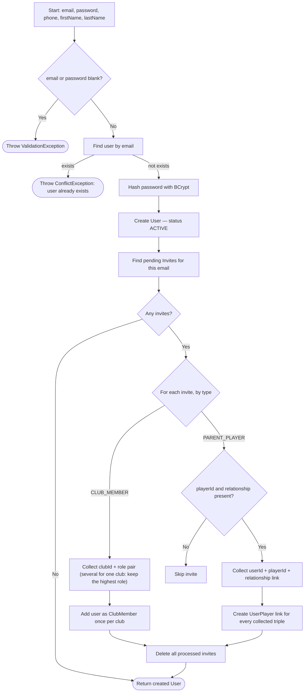

### 2.2 Login (`LoginUseCase`)

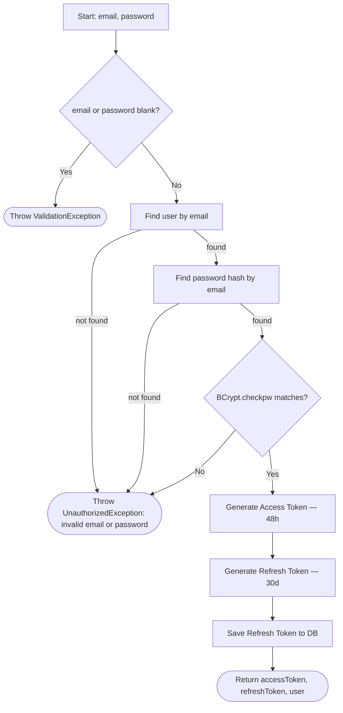

### 2.3 Refresh Token (`RefreshTokenUseCase`)


Note: the repository (`findRefreshToken`) just retrieves the row as-is; the expiry decision is a business rule owned by the use case, which deletes an expired token as it rejects it. Rotation deletes the presented token on the success path too. Covered by `RefreshTokenUseCaseTest` and `JwtConfigTest`.

### 2.4 Platform Admin Seeding (`SeedPlatformAdminUseCase`) — startup, not request-driven

Runs once from `Application.module()` (right after Koin is installed), so a freshly-created or wiped **dev** database is immediately usable with no manual bootstrapping. Idempotent — never mutates an existing account.

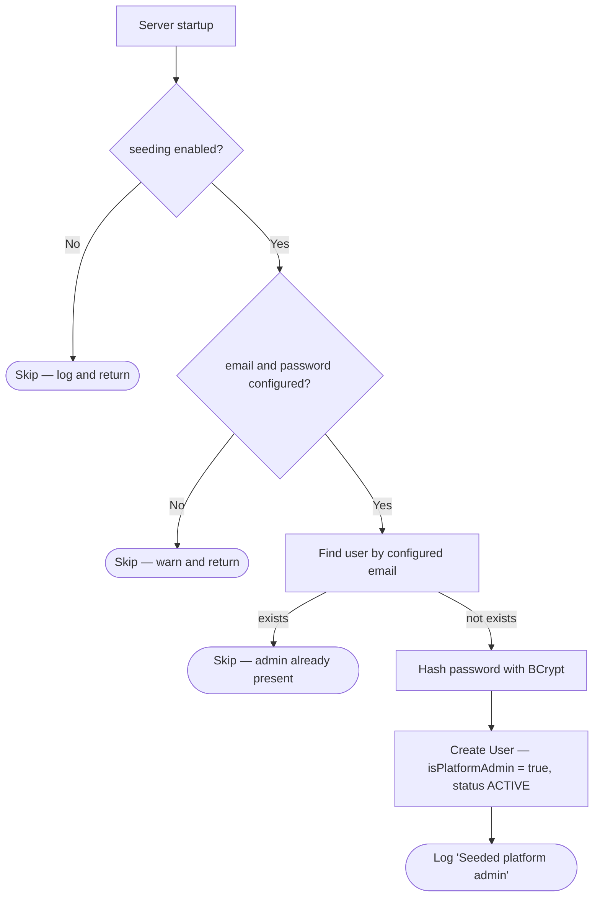

Config comes from `ServerConfig` and is injected into the use case: `DEV` enables it by default with labelled fallback credentials (`admin@local.dev` / `admin1234`); `PRODUCTION` keeps it off unless `SEED_ADMIN_ENABLED=true`, which then makes `SEED_ADMIN_EMAIL` / `SEED_ADMIN_PASSWORD` mandatory (no password fallback in production). Covered by `SeedPlatformAdminUseCaseTest`. See `TECHNICAL_DECISIONS.md` §5.

### 2.5 Push Notification Token Registration (`RegisterFcmTokenUseCase` / `RemoveFcmTokenUseCase`)

First piece of push notifications (Android, per the developer -- see `TECHNICAL_DECISIONS.md` §21). No
`CheckUserPermissionUseCase` call in either use case: `userId` always comes from the caller's own JWT
(`call.userId`, never a client-supplied parameter), so there's no cross-user access to guard against --
the route's `authenticate("auth-jwt")` block is the entire authorization boundary.

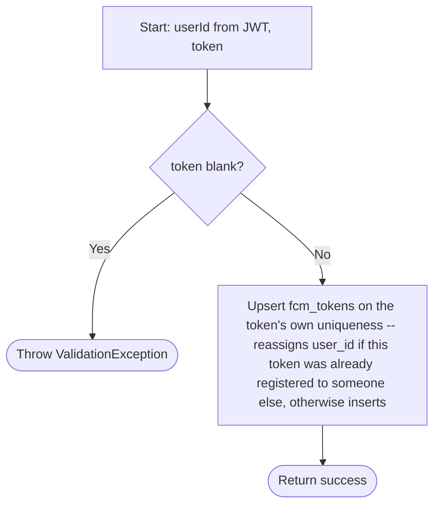

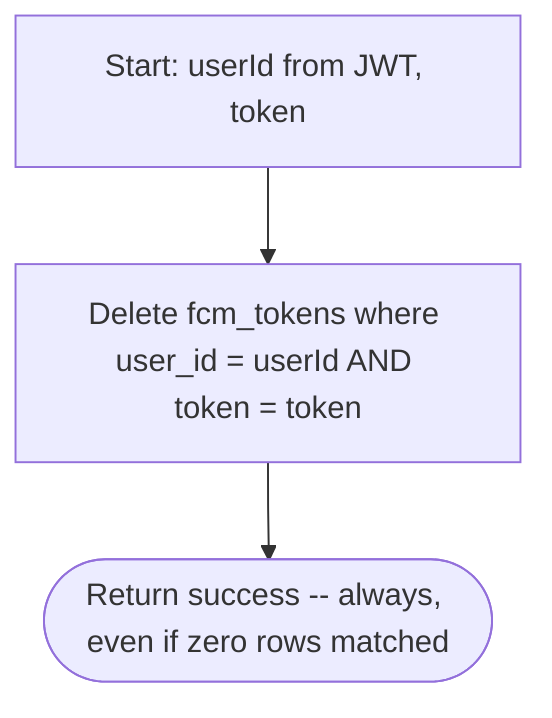

`POST /v1/fcm-tokens` registers the caller's device; `DELETE /v1/fcm-tokens` (token in the body, not the
path -- FCM tokens are opaque strings up to ~4096 chars, not idiomatic as a URL segment) removes it,
called by the client as part of its own logout flow. There is no server-side "logout" concept otherwise
-- the client's `LogoutUseCase` just clears its local session (see §2.2's login/refresh pair; nothing
revokes a refresh token early today) -- so token removal is deliberately its own explicit, idempotent
endpoint the client calls itself, rather than something bolted onto a logout use case that doesn't exist
yet. Removing an unknown or already-removed token, or one that belongs to a different user (e.g. called
after the upsert above already reassigned it elsewhere), is a no-op, not an error -- a client's logout
flow never has to branch on this succeeding.

Verified against a real running server, not just compilation: registered a token as one user, re-registered
the identical token value as a second user (confirmed exactly one row, reassigned), confirmed the first
user's delete attempt was a no-op (row untouched), confirmed the second (actual owner) user's delete
removed it, confirmed a repeat delete stayed a no-op success, and confirmed an unauthenticated request is
rejected (401) and a blank token is rejected (400). Covered by `RegisterFcmTokenUseCaseTest` and
`RemoveFcmTokenUseCaseTest`.

### 2.6 Get Current User (`GetCurrentUserUseCase`)

Backs the Account screen's own profile load. No `CheckUserPermissionUseCase` call, same reasoning as §2.5: `userId` is always the caller's own JWT subject, never a parameter, so there's no cross-user access to guard.

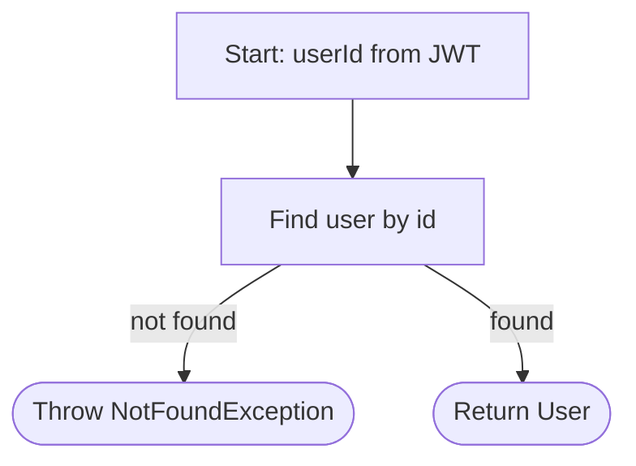

### 2.7 Update Profile (`UpdateProfileUseCase`)

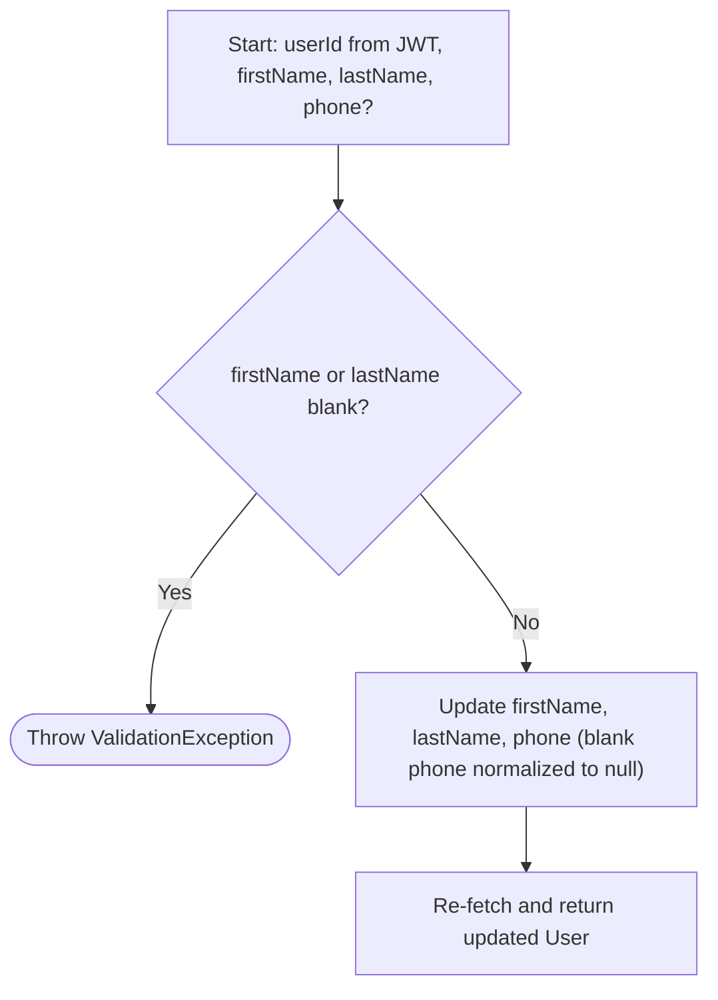

`email`, `status`, and `isPlatformAdmin` aren't fields on `UpdateProfileRequest` at all — there's no self-service path to them through this use case, by construction rather than by an extra check.

### 2.7b Own Profile Photo (`UploadUserAvatarUseCase` / `DeleteUserAvatarUseCase` / `GetUserAvatarUseCase`)

`PUT /users/me/avatar` (raw PNG or JPEG body, at most 5 MB) → `PhotoResponse(photoUrl)`; `DELETE /users/me/avatar` (204); `GET /users/{userId}/avatar/{imageId}.png` (cached for good). Storage key `users/{userId}/avatar/{imageId}.png`; `users.avatar_url` holds the same path under the API. See `TECHNICAL_DECISIONS.md` §57.

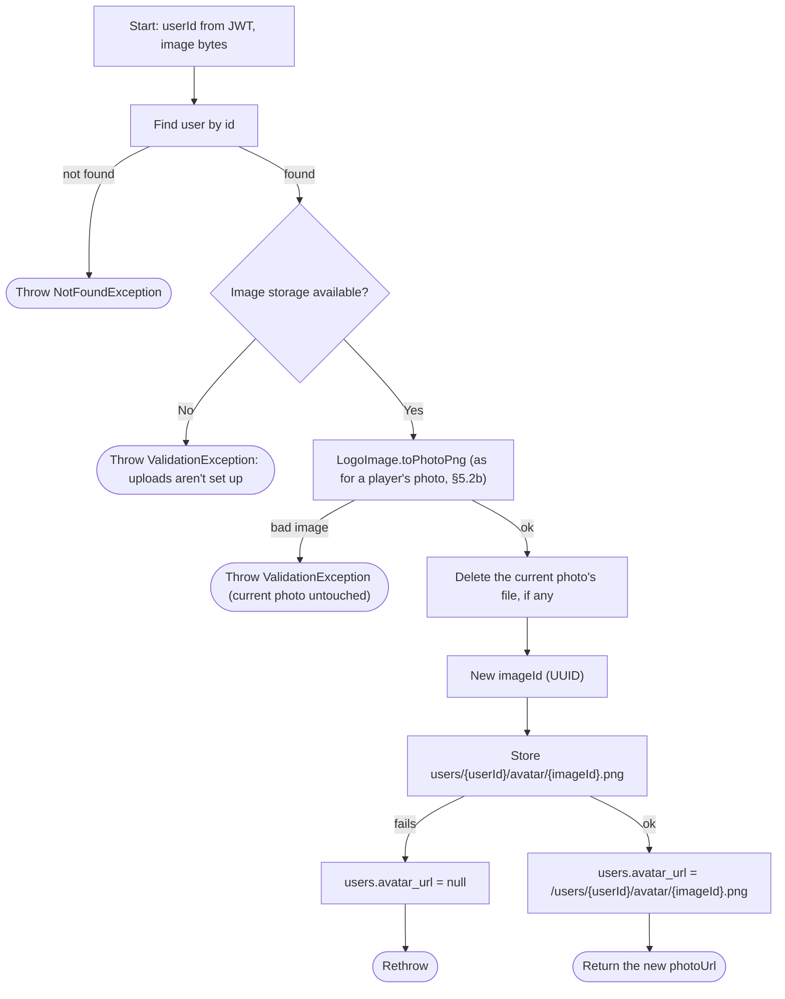

Self-service only: the JWT's user, never a path id. Delete removes the file and clears `avatar_url`. Get is the one route that names another user: any signed-in user, but only that user's **current** image id. It's an adult's photo shown next to their name, and the random id is only handed out with the user's details.

### 2.8 Change Password (`ChangePasswordUseCase`)

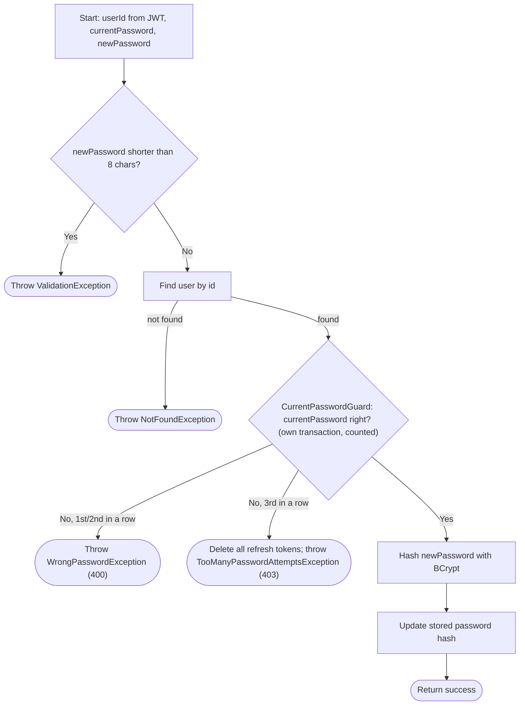

Same `BCrypt.checkpw` gate `LoginUseCase` uses for the current-password check, so a stolen access token alone can't be used to lock the real account owner out. Both use cases covered by `UpdateProfileUseCaseTest`/`ChangePasswordUseCaseTest`. A wrong current password is a 400 (not a 401, which the app would treat as an expired session), and the third in a row signs the user out everywhere (`CurrentPasswordGuard`). See `TECHNICAL_DECISIONS.md` §33 and §50.

### 2.9 Forgot Password: Request a Code (`RequestPasswordResetUseCase`)

`POST /auth/password-reset/request` (public). **202** when a code was sent (or one from the last minute is still pending), **404** when the email has no active account.

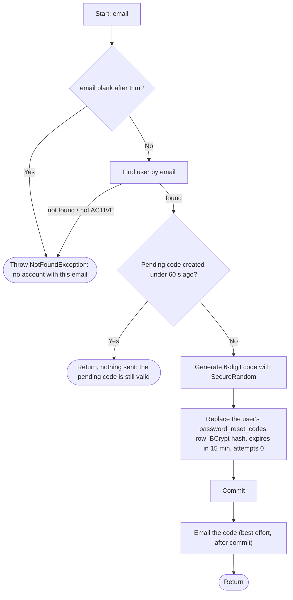

### 2.10 Forgot Password: Set a New Password (`ResetPasswordUseCase`)

`POST /auth/password-reset/confirm` (public): email, code, newPassword. **204** on success.

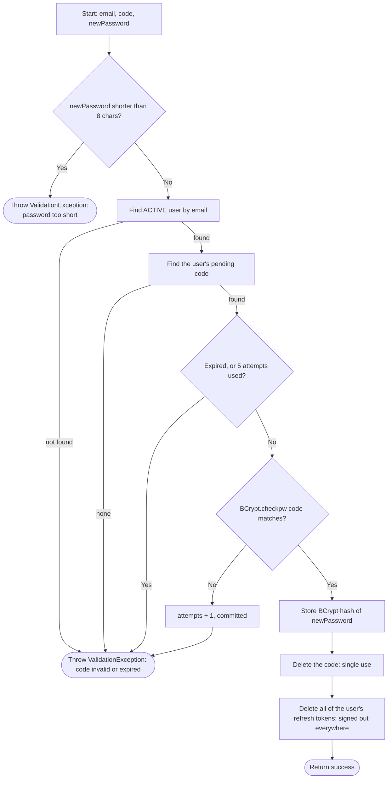

On confirm, every failure past the length check is the same 400 with the same message. The request step does say when an email has no account (404): Register already reveals that ("User with this email already exists"), so hiding it here protected nothing and only left users waiting for an email that never comes. Covered by `PasswordResetUseCasesTest`. See `TECHNICAL_DECISIONS.md` §48.

### 2.11 Change Email: Request a Code (`RequestEmailChangeUseCase`)

`POST /users/me/email/request` (authenticated): newEmail, currentPassword. **202** when a code was sent.

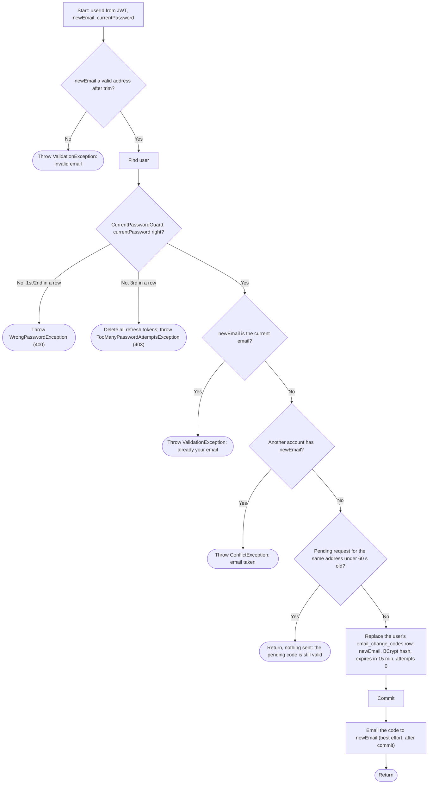

### 2.12 Change Email: Confirm (`ConfirmEmailChangeUseCase`)

`POST /users/me/email/confirm` (authenticated): code, refreshToken (the caller's own). **200** with the updated `User`.

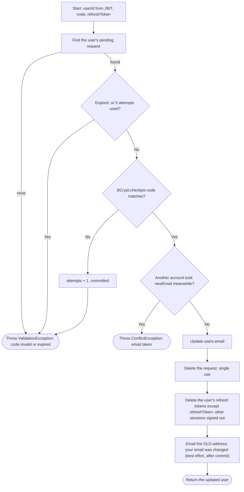

Covered by `EmailChangeUseCasesTest`. See `TECHNICAL_DECISIONS.md` §49.

---

## 3. Platform & Club Administration

### 3.1 Provision Club (`ProvisionClubUseCase`) — Super Admin only

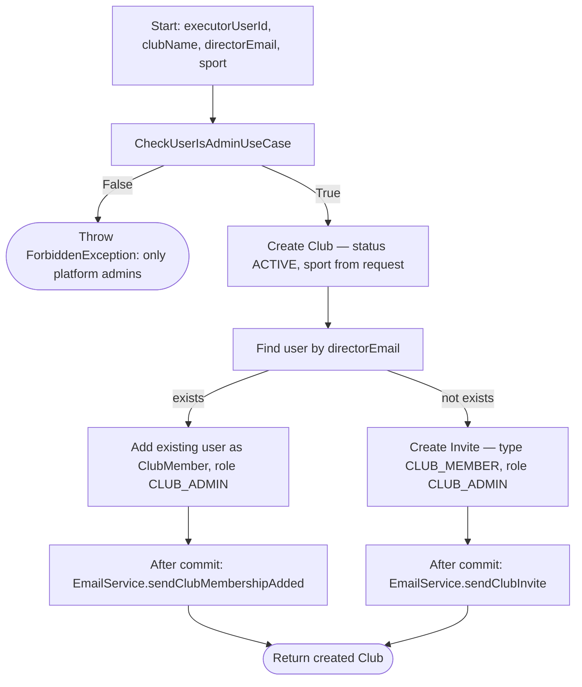

Email is sent after the transaction commits, not inside it (see TECHNICAL_DECISIONS.md §14) — a failed/slow send never rolls back the club or the membership/invite.

### 3.2 Get Clubs (`GetClubsUseCase`)


### 3.3 Get Club Details (`GetClubDetailsUseCase`)

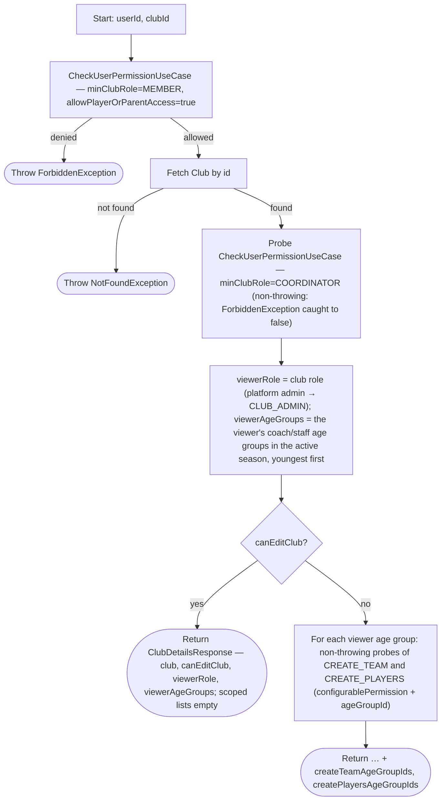

The viewer fields feed the club's **More** panel (design 37):
- **Account header:** `viewerRole` and `viewerAgeGroups` give the role chip, e.g. "Coach · Sub-15, Sub-17".
- **Scoped create actions:** the two id lists are where a non-coordinator may create teams or add players. They come from the same club-configurable permissions the create endpoints enforce (Coach level by default), so the panel only offers what the server will accept. It opens Create Teams / Create Players with that age group.

`canEditClub` from the same single probe above — `CreateSeasonUseCase` and `CreateAgeGroupsUseCase` enforce the identical `minClubRole=COORDINATOR` gate, so one non-throwing check covers both response fields (they're separate fields, not one shared boolean, only so either could diverge later without an API shape change). The client uses them to distinguish, when a club has zero seasons or zero age groups, an admin/coordinator ("nothing here yet, create one") from a plain member ("nothing here yet") — see §4.1 and §4.3.

### 3.3b Get Club Home (`GetClubHomeUseCase`)

The aggregate behind the club screen's default **Home** tab: stat-grid counts, one "Next up" row per team with an upcoming match, and role-scoped "Needs you" alerts. `GET /v1/clubs/{clubId}/home`, readable by any club member.

```mermaid
graph TD
    A[Start: userId, clubId] --> B[CheckUserPermissionUseCase — minClubRole=MEMBER, allowPlayerOrParentAccess=true]
    B -- denied --> F(["Throw ForbiddenException"])
    B -- allowed --> C[Fetch club; resolve role + season (active, else latest-ending)]
    C --> D["Counts: teams, players, coaches; matchesThisWeek = club matches whose date is in the Mon–Sun week containing today"]
    D --> E["Next up: per team, soonest SCHEDULED future match → opponent name and logo + call-up count (count not shown since rows use MatchRow)"]
    E --> G{role >= COORDINATOR or platform admin?}
    G -- Yes --> H["alert per season age group with no COACH in age_group_staff (AGE_GROUP_NEEDS_COACH)"]
    G -- No --> I
    H --> I["Call-up teams: every season team for admins/coordinators/platform admins; otherwise the teams of age groups where the caller's staff role clears the club's MANAGE_CALL_UPS setting"]
    I --> J["one CALLUPS_UNSENT alert per day for those teams' SCHEDULED matches within 5 days that have zero call-ups, listing those matches (id, team, opponent)"]
    J --> K2["Report teams: same rule with the club's MANAGE_MATCH setting"]
    K2 --> K["one MATCH_REPORT_PENDING alert per FINISHED match of those teams with a fullTimeMinute and no completed report (one batched report lookup), oldest first"]
    K --> Z(["Return ClubHome — club, seasonName, role, counts, nextUp, alerts"])
```

Alerts carry structured parts (`ageGroupName`, `date`, `count`, and for a pending report `matchId`/`teamName`/`opponentName`) rather than rendered strings, so the client formats them in the user's language. Someone who is both a coordinator and an age-group coach gets every alert type.

`MATCH_REPORT_PENDING` is the post-match report to-do (§8.6).
- **Who sees it:** admins, coordinators and platform admins see every pending report in the club; they should know everything pending, per the developer. Age-group staff see their own age groups' reports when their role clears the club's `MANAGE_MATCH` setting, i.e. when they could fill the report in (Coach by default). `CALLUPS_UNSENT` follows the same rule with `MANAGE_CALL_UPS`. Tapping a `CALLUPS_UNSENT` to-do opens its match. A day with several matches expands into one row per match, each of which opens its match.
- **When it clears:** once the report is completed.
- **Tapping it:** opens that match.
- **Older matches:** matches finished before post-match stats existed (no `fullTimeMinute`) never show up, so the list isn't flooded with old fixtures.

### 3.4 Update Club (`UpdateClubUseCase`)

```mermaid
graph TD
    A[Start: userId, clubId, patch fields] --> B{name is blank (non-null but empty/whitespace)?}
    B -- Yes --> V(["Throw ValidationException"])
    B -- No --> T{theme AND clearTheme both sent?}
    T -- Yes --> V
    T -- No --> TV{"theme sent and it breaks ClubThemeRules? (not #RRGGBB; main colour under 3:1 against white; second colour not lighter or under 3:1 against the main)"}
    TV -- Yes --> V
    TV -- No --> C[Fetch Club by id]
    C -- not found --> N(["Throw NotFoundException"])
    C -- found --> D[CheckUserPermissionUseCase — minClubRole=COORDINATOR]
    D -- denied --> F(["Throw ForbiddenException"])
    D -- allowed --> E["Merge patch fields over existing (null = keep current, incl. stadiumLocation and theme); clearTheme removes both colours; colours saved in capitals"]
    E --> Z(["Persist updated Club"])
```

**Club colours (`theme`).** A `ClubTheme` is both colours or none, so one colour on its own can't be sent; the database refuses it too (`chk_clubs_theme_pair`). The rules live in the shared `ClubThemeRules`, so the app checks them as the user picks and the server checks them again on save. A request without `theme` keeps the current colours, so an app that predates them can't wipe them. See `TECHNICAL_DECISIONS.md` §58.

(Corrected from an earlier revision of this doc that said `minClubRole=CLUB_ADMIN` — the code has required only `COORDINATOR` since admin/coordinator were made fully equivalent short of billing; see `UpdateClubUseCaseTest`.) `stadiumLocation` — where home matches are actually played, when that differs from the official `address` — is edited from the client's Edit Club Details screen (Club Details' "More" menu); see `TECHNICAL_DECISIONS.md` §32. `logoUrl` in the request is ignored: the logo is only set by uploading it (§3.4c).

### 3.4c Club Logo (`UploadClubLogoUseCase` / `DeleteClubLogoUseCase` / `GetClubLogoUseCase`)

`PUT /clubs/{clubId}/logo` (raw PNG or JPEG body, at most 5 MB) → `LogoResponse(logoUrl)`; `DELETE /clubs/{clubId}/logo` (204); `GET /clubs/{clubId}/logo/{imageId}.png` (the image, `Cache-Control: private, max-age=31536000, immutable`). Storage key `clubs/{clubId}/logo/{imageId}.png`; `clubs.logo_url` holds the same path under the API. See `TECHNICAL_DECISIONS.md` §57.

```mermaid
graph TD
    A[Start: userId, clubId, image bytes] --> B[Fetch Club by id]
    B -- not found --> N(["Throw NotFoundException"])
    B -- found --> C[CheckUserPermissionUseCase — minClubRole=COORDINATOR]
    C -- denied --> F(["Throw ForbiddenException"])
    C -- allowed --> S{Image storage available?}
    S -- No --> V0(["Throw ValidationException: uploads aren't set up"])
    S -- Yes --> P["LogoImage.toPng: PNG/JPEG only, ≤ 5 MB, ≤ 6000×6000; fit in 512×512 (never enlarged), centred on a transparent square, PNG"]
    P -- bad image --> V(["Throw ValidationException (current logo untouched)"])
    P -- ok --> D["Delete the current logo's file, if any"]
    D --> G["New imageId (UUID)"]
    G --> PUT["Store clubs/{clubId}/logo/{imageId}.png"]
    PUT -- fails --> X["clubs.logo_url = null"] --> E(["Rethrow"])
    PUT -- ok --> U["clubs.logo_url = /clubs/{clubId}/logo/{imageId}.png"]
    U --> Z(["Return the new logoUrl"])
```

The old file is deleted **before** the new one is stored, so files never pile up, and every upload gets a new id, so a cached logo can never be stale. If storing the new one fails, the club is left with no logo rather than a link to a deleted file. Delete: same gate; removes the file and clears `logo_url`. Get: anyone who can see the club (`minClubRole=MEMBER`, `allowPlayerOrParentAccess`, like §3.3), and only the club's **current** image id; an old id is a 404.

**Public logo, for push notifications** (`GetPublicClubLogoUseCase`): `GET /v1/public/clubs/{clubId}/logo/{imageId}.png`, the one image route with no sign-in. Android downloads a notification's image itself. Club not found, or `imageId` isn't its current one → 404; otherwise the bytes (`Cache-Control: public, immutable`). Every push of a club with a logo carries this address as its image, when the server knows its public URL (`PUBLIC_BASE_URL` / `RAILWAY_PUBLIC_DOMAIN`, or locally the machine's LAN address). See `TECHNICAL_DECISIONS.md` §57.

### 3.4b Get / Update Club Permissions (`GetClubPermissionsUseCase` / `UpdateClubPermissionsUseCase`)

The Edit Club Details screen's "Permissions" tab — see `TECHNICAL_DECISIONS.md` §35 for the full design (which actions are configurable, and why three of them gained a `minClubRole` floor they never had before as part of this change).

```mermaid
graph TD
    A[Start: userId, clubId] --> B[CheckUserPermissionUseCase — minClubRole=MEMBER]
    B -- denied --> F(["Throw ForbiddenException"])
    B -- allowed --> C[Fetch this club's explicit overrides]
    C --> D["For each ConfigurablePermission value: the override if a row exists, else the action's default (defaultSetting: minAgeGroupRole, or minClubRole = COORDINATOR for a club-level action)"]
    D --> Z(["Return one ClubPermissionSetting per action"])
```

```mermaid
graph TD
    A2[Start: userId, clubId, settings list] --> B2[CheckUserPermissionUseCase — minClubRole=COORDINATOR, no configurablePermission]
    B2 -- denied --> F2(["Throw ForbiddenException"])
    B2 -- allowed --> C2{Any duplicate action in the settings list?}
    C2 -- Yes --> V2(["Throw ValidationException"])
    C2 -- No --> CV{"A club-level action without minClubRole COORDINATOR/CLUB_ADMIN (or with a minAgeGroupRole), or an age-group action with a minClubRole?"}
    CV -- Yes --> V3(["Throw ValidationException"])
    CV -- No --> K2["Add back the current override of any club-level action left out of the request"]
    K2 --> CH{"A club-level action's minClubRole changes?"}
    CH -- Yes --> AD[CheckUserPermissionUseCase — minClubRole=CLUB_ADMIN]
    AD -- denied --> F3(["Throw ForbiddenException: only admins"])
    AD -- allowed --> D2
    CH -- No --> D2["Delete all of this club's existing overrides, then insert the settings"]
    D2 --> Z2(["Return success"])
```

Update is deliberately a full replace, not a per-action patch — the client always submits the whole
8-action form. `GET` is readable by any club member; `PATCH` is fixed at `minClubRole=COORDINATOR` with no
`configurablePermission` involved anywhere in its own check — changing a setting is never itself one of
the settings. The exception is a **club-level** action (who disables and reactivates players): only a
`CLUB_ADMIN` may change it, so a coordinator can't undo an admin's "Admins only". A coordinator can still
save the rest of the form with it unchanged, and leaving it out of the request keeps it (an older app that
doesn't know the action can't reset it). The Permissions tab shows it read-only to coordinators.

### 3.5 Update Club Member Role (`UpdateClubMemberRoleUseCase`)

`PATCH /v1/clubs/{clubId}/members/{memberUserId}` (body `UpdateClubMemberRoleRequest`, 204).

```mermaid
graph TD
    A[Start: userId, clubId, targetUserId, newRole] --> B[CheckUserPermissionUseCase — minClubRole=COORDINATOR]
    B -- denied --> F(["Throw ForbiddenException"])
    B -- allowed --> C[Load club members]
    C -- target not a member --> NF(["Throw NotFoundException"])
    C -- member --> D{"Touches Admin? (newRole or current role is CLUB_ADMIN)"}
    D -- yes, caller not CLUB_ADMIN / platform admin --> F2(["Throw ForbiddenException — only admins grant or remove Admin"])
    D -- no / caller is admin --> E{"Demoting the only CLUB_ADMIN?"}
    E -- yes --> CF(["Throw ConflictException — the club needs at least one admin"])
    E -- no --> G[Update role in club_members]
    G --> Z(["Return success"])
```

Coordinators can move people between Member and Coordinator; only admins can grant or remove Admin
(design 34). An admin can demote themselves only while another admin exists.

### 3.6 Add Club Members (`AddClubMembersUseCase`)

`AddClubMembersRequest.role` (default `MEMBER`) is the club role for every email in the batch: Member or
Coordinator. Admin is rejected with `ValidationException` -- Admin is only granted to someone who has
joined (§3.5).

```mermaid
graph TD
    A[Start: userId, clubId, emails list, role] --> B[CheckUserPermissionUseCase — minClubRole=COORDINATOR]
    B -- denied --> F(["Throw ForbiddenException"])
    B -- allowed --> R{role == CLUB_ADMIN?}
    R -- yes --> V(["Throw ValidationException"])
    R -- no --> C[Dedupe emails]
    C --> D[Batch find existing Users by email]
    D --> E[Batch fetch existing club roles for matched users]
    E --> G{For each email}
    G -- user exists, not yet a member --> H[Queue new ClubMember with role]
    G -- user exists, already a member --> SKIP[Skip]
    G -- user does not exist --> I[Queue CLUB_MEMBER Invite with role]
    H --> J[Batch insert new members]
    I --> K[Batch insert invites]
    J --> L["After commit: EmailService.sendClubMembershipAdded per new member, and a push to their devices — PushLink.club(clubId)"]
    K --> M["After commit: EmailService.sendClubInvite per invited email"]
    L --> Z(["Return true"])
    M --> Z
```

Same after-commit timing as 3.1 above — see TECHNICAL_DECISIONS.md §14.

### 3.7 Club Members Overview (`GetClubMembersOverviewUseCase`)

`GET /v1/clubs/{clubId}/members/overview` -- the Club settings Members tab (design 34).

```mermaid
graph TD
    A[Start: userId, clubId] --> B[CheckUserPermissionUseCase — minClubRole=COORDINATOR]
    B -- denied --> F(["Throw ForbiddenException"])
    B -- allowed --> C[Club members with name, email, phone, role, account created]
    C --> D["Age-group staff roles across every season (current season first)"]
    D --> E["User–player links in the club, with the player's age group in the active season"]
    E --> G["Pending CLUB_MEMBER invites, newest first"]
    G --> Z(["Return ClubMembersOverview — members, pendingInvites, viewerUserId, viewerRole"])
```

`viewerRole` is the caller's club role (a platform admin reads as `CLUB_ADMIN`), so the client can lock
the Admin option for coordinators without a second request.

### 3.7b Remove Club Member (`RemoveClubMemberUseCase`)

`DELETE /v1/clubs/{clubId}/members/{memberUserId}` (204).

```mermaid
graph TD
    A[Start: userId, clubId, targetUserId] --> B[CheckUserPermissionUseCase — minClubRole=COORDINATOR]
    B -- denied --> F(["Throw ForbiddenException"])
    B -- allowed --> S{targetUserId == userId?}
    S -- yes --> V(["Throw ValidationException — leaving is a different flow"])
    S -- no --> C[Load club members]
    C -- target not a member --> NF(["Throw NotFoundException"])
    C -- member --> D{Target is CLUB_ADMIN?}
    D -- yes, caller not CLUB_ADMIN / platform admin --> F2(["Throw ForbiddenException — only admins remove an admin"])
    D -- yes, it's the only admin --> CF(["Throw ConflictException — the club needs at least one admin"])
    D -- no / allowed --> E["Delete their age_group_staff rows in every age group of the club (all seasons)"]
    E --> G[Delete the club_members row]
    G --> Z(["Return success"])
```

Their account and their `user_players` parent/guardian links stay: being a player's parent doesn't depend
on a club role. The membership row is deleted rather than deactivated, so the unique (club, user)
constraint lets them be invited again later.

### 3.8 Resend / Cancel Club Invite (`ManageClubInviteUseCase`)

`POST /v1/clubs/{clubId}/invites/{inviteId}/resend` and `DELETE /v1/clubs/{clubId}/invites/{inviteId}`.

```mermaid
graph TD
    A[Start: userId, clubId, inviteId] --> B[CheckUserPermissionUseCase — minClubRole=COORDINATOR]
    B -- denied --> F(["Throw ForbiddenException"])
    B -- allowed --> C{"Invite exists, CLUB_MEMBER, for this club?"}
    C -- no --> NF(["Throw NotFoundException"])
    C -- yes, resend --> R["After commit: EmailService.sendClubInvite"]
    C -- yes, cancel --> D[Delete invite]
    R --> Z(["Return success"])
    D --> Z
```

---

## 4. Club Structure: Seasons, Age Groups, Teams

### 4.1 Create Season (`CreateSeasonUseCase`)

```mermaid
graph TD
    A[Start: userId, clubId, type, startDate, endDate, name?] --> B[CheckUserPermissionUseCase — minClubRole=COORDINATOR]
    B -- denied --> F(["Throw ForbiddenException"])
    B -- allowed --> V{startDate > endDate?}
    V -- Yes --> VN(["Throw ValidationException: start date after end date"])
    V -- No --> C[Find existing season with same club + type + dates]
    C -- exists --> CN(["Throw ConflictException: duplicate season"])
    C -- not exists --> D{name provided?}
    D -- Yes --> H[Use provided name]
    D -- No --> E{Season type?}
    E -- EUROPEAN_YEAR --> E1["Infer name as YY/YY (start/end year)"]
    E -- CALENDAR_YEAR --> E2[Infer name as start year]
    H --> I[Create Season — active=true]
    E1 --> I
    E2 --> I
    I --> Z(["Persist Season"])
```

The client's `DatePickerSheet` (`minDate`/`maxDate`) already keeps the start/end ordering from happening in normal use — picking an end date before the current start date (or a start date after the current end date) simply isn't offered in the picker — but the server validates it independently since the client can't be trusted alone. Covered by `CreateSeasonUseCaseTest`.

### 4.2 Update Season (`UpdateSeasonUseCase`)

```mermaid
graph TD
    A[Start: userId, seasonId, patch] --> B[Fetch Season by id]
    B -- not found --> N(["Throw NotFoundException"])
    B -- found --> C[CheckUserPermissionUseCase — minClubRole=COORDINATOR]
    C -- denied --> F(["Throw ForbiddenException"])
    C -- allowed --> D["Merge patch fields (name, type, dates, active)"]
    D --> Z(["Persist updated Season"])
```

### 4.3 Create Age Groups (`CreateAgeGroupsUseCase`) — batch

```mermaid
graph TD
    A[Start: userId, clubId, seasonId, items list] --> B[CheckUserPermissionUseCase — minClubRole=COORDINATOR]
    B -- denied --> F(["Throw ForbiddenException"])
    B -- allowed --> C{items list empty?}
    C -- Yes --> V(["Throw ValidationException"])
    C -- No --> D[Load existing age groups for this club + season]
    D --> D2[Load club — for its sport's allowed team sizes]
    D2 -- not found --> V2b(["Throw ValidationException"])
    D2 --> E[Collect existing startYear/endYear spans as the taken ranges]
    E --> G{For each item}
    G -- name blank --> V2(["Throw ValidationException"])
    G -- startYear < endYear --> V2c(["Throw ValidationException: inverted range"])
    G -- teamSize set AND not in club.sport.teamSizes --> V2(["Throw ValidationException"])
    G -- "shares any birth year with a taken span (in the DB, or an earlier item in this request) — birthYearsOverlap" --> CR[Note the item's index as clashing; don't mark its range taken]
    G -- valid --> H[Mark range as taken; build AgeGroup entity — teamSize nullable]
    CR --> G
    H --> G
    G -- all items checked --> K{any clashing items?}
    K -- Yes --> CN(["Throw ConflictException(rows = every clashing index, 0-based) — 409 ErrorResponse.rows"])
    K -- No --> I[Batch insert all AgeGroups]
    I --> Z(["Return created AgeGroups"])
```

Every clashing item is reported, not only the first. The 409's `ErrorResponse.rows` lists them (0-based, in request order), so Create age groups marks each of those rows in red and names them in its message. Within the batch, the later of two items sharing a year is the one reported. The other row checks (blank name, inverted range, invalid team size) still stop at the first, and the screen prevents them before submitting.

Each item carries a `startYear`/`endYear` birth-year span rather than a single birth year: most age groups (football) are single-year, sent as `startYear == endYear`; some (typically futsal) span two consecutive birth years to have enough players for a squad -- e.g. a Benjamins group covering 2016 and 2017 is `startYear = 2017, endYear = 2016`. Eligibility and the inferred "Sub N" name are always derived from `endYear` (the oldest birth year the group allows), exactly mirroring the old single `birthYear` field's role -- see §5.3. Each item also carries an optional `teamSize` (an a-side count like 7 or 11). It's the default the age group's teams play; a team can override it (§4.5 / §4.5b). When set it must be one of the values the club's `sport` allows (`SportType.teamSizes` — a code-level constant, not a DB config). The client's Create Age Groups screen shows a per-row span-type radio (single year vs. two years) and a per-row team-size picker seeded from the sport's largest format.

### 4.4 Update Age Group (`UpdateAgeGroupUseCase`)

```mermaid
graph TD
    A[Start: userId, ageGroupId, patch] --> B[Fetch AgeGroup by id]
    B -- not found --> N(["Throw NotFoundException"])
    B -- found --> C[CheckUserPermissionUseCase — minClubRole=COORDINATOR]
    C -- denied --> F(["Throw ForbiddenException"])
    C -- allowed --> NB{name blank?}
    NB -- yes --> V0(["Throw ValidationException"])
    NB -- no --> D["Merge patch fields (name trimmed, startYear, endYear, teamSize)"]
    D --> E{Merged startYear < endYear?}
    E -- Yes --> V(["Throw ValidationException: inverted range"])
    E -- No --> TS{"teamSize not in club.sport.teamSizes?"}
    TS -- yes --> V2(["Throw ValidationException"])
    TS -- no --> S{Span changed?}
    S -- no --> Z(["Persist updated AgeGroup"])
    S -- yes --> DUP{"Shares any birth year with another age group in the season? (birthYearsOverlap)"}
    DUP -- yes --> C1(["Throw ConflictException"])
    DUP -- no --> OUT{"endYear raised and a pool player born before it?"}
    OUT -- yes --> C2(["Throw ConflictException: remove them from the pool first"])
    OUT -- no --> Z
```

The same rules as creating (§4.3) apply -- including that no birth year may sit in two age groups of the
same season: any overlap collides, not only an identical span (a single-year 2011 group and a 2011-2010
group both claim 2011). `birthYearsOverlap` in `common/.../Models.kt` is that rule, shared by create,
update and the client. Plus one rule of its own: since eligibility is
`birthDate.year >= endYear`, raising `endYear` could silently shut out players already in the pool, so
that's refused with the count. `teamSize` here is only the default for teams created from now on --
existing teams keep their own (edit those in §4.6). The client's **Edit age group** screen (Age Group
Details ⋮, shown by `AgeGroupDetails.canEditAgeGroup`) applies the same checks before saving: years
used by the season's other age groups are left out of the pickers, and a span that would shut players
out is explained in amber and can't be saved.

### 4.4b Get Age Group Details (`GetAgeGroupDetailsUseCase`)

The aggregate behind the age-group detail screen. Follows the standard permission-gated read (§1.3) with an aggregation step and four independent, non-throwing permission probes -- each matching the real gate its action's own use case enforces, rather than one literal check standing in for several at once (see TECHNICAL_DECISIONS.md §35/§37's "reshuffled taxonomy" notes on why bundling these caused real button-visibility bugs):

```mermaid
graph TD
    A[Start: userId, ageGroupId] --> B[Fetch AgeGroup by id]
    B -- not found --> N(["Throw NotFoundException"])
    B -- found --> C[CheckUserPermissionUseCase — minClubRole=MEMBER, minAgeGroupRole=STAFF, ageGroupId, allowPlayerOrParentAccess]
    C -- denied --> F(["Throw ForbiddenException"])
    C -- allowed --> D[Fetch club + season]
    D --> E[teams = club teams filtered to this age group]
    E --> G["upcomingMatches = each team's matches that are either SCHEDULED with dateTime >= now, or currently LIVE/HALF_TIME, sorted by dateTime"]
    G --> G2["upcomingMatchScores = getScoreByMatch for each LIVE/HALF_TIME entry above, keyed by Match.id"]
    G2 -.-> G3["recentResults = each team's FINISHED matches, newest first, with scores (Matches tab)"]
    G2 --> H["canAddStaff = non-throwing probe: minClubRole=COORDINATOR only (no team-role path)"]
    H --> H1["canCreateTeam = non-throwing probe of configurablePermission=CREATE_TEAM on ageGroupId"]
    H1 --> H2["canManageMatch = non-throwing probe of configurablePermission=MANAGE_MATCH on ageGroupId -- schedule match"]
    H2 --> H3["canAssignPlayersToAgeGroup = non-throwing probe of configurablePermission=ASSIGN_PLAYERS_TO_AGE_GROUP on ageGroupId -- add players"]
    H3 --> Z(["Return AgeGroupDetails: ageGroup, club, season, players (pool), staff, teams, upcomingMatches, upcomingMatchScores, recentResults, opponents, canAddStaff, canEditAgeGroup, canCreateTeam, canManageMatch, canAssignPlayersToAgeGroup"])
```

`opponents` is the club's full opponent list so the client can resolve `match.opponentId`. `canAddStaff` gates "Add staff" (permanently coordinator/admin-only, not club-configurable, the same way `ClubDetailsResponse.canEditClub` is), and `canEditAgeGroup` (the same probe, §4.4's gate) gates "Edit age group"; `canCreateTeam` gates "Create team" (`ConfigurablePermission.CREATE_TEAM`, defaults to Coach -- moved here from the fixed bucket in §37, since a coach who'd just set up an age group had no way to add a second team to it themselves); `canManageMatch` gates "Create match"; `canAssignPlayersToAgeGroup` gates "Add players" -- these last three are club-configurable and can each diverge from the coordinator-only default independently. A match in progress stays in `upcomingMatches` rather than disappearing between "scheduled" and "finished" -- `upcomingMatchScores` lets the client show its running score (see `MatchRow` in `TECHNICAL_DECISIONS.md`/the client's `presentation/ui/components` package).

### 4.4c Get Age Group Season Record (`GetAgeGroupSeasonRecordUseCase`)

`GET /age-groups/{ageGroupId}/season-record`, behind Age Group Details' Stats and Members tabs (design 33). It's a separate call from §4.4b, so a failure stays inside those tabs.

```mermaid
graph TD
    A[Start: userId, ageGroupId] --> B[Fetch AgeGroup by id]
    B -- not found --> N(["Throw NotFoundException"])
    B -- found --> C[CheckUserPermissionUseCase — same gate as §4.4b]
    C -- denied --> F(["Throw ForbiddenException"])
    C -- allowed --> R["canSeeRatings = non-throwing probe of the report's read gate: COORDINATOR / age-group STAFF"]
    R --> T["teams = the age group's teams, by name; each built by buildTeamSeasonRecord (shared with §4.6c)"]
    T --> Z(["Return AgeGroupSeasonRecord: ageGroupId, teams (TeamSeasonRecord each), pool (id, name, number, position), canSeeRatings"])
```

Everything on screen is derived on the client by shared code (`SeasonStats.kt`):
- **`combined(filter)`:** every team's matches as one record ("Age group · 13 played").
- **`poolMinutes(filter)`:** each pool player in one of four minute bands (300'+, 100–299', 1–99', none).
  - A player used by two teams is counted once, with combined minutes.
  - An unused substitute counts as 0.
  - It also counts how many pool players played for more than one team.
- **`memberSeasons()`:** each player's apps, minutes and the teams he played for (Members tab).
- **`averageRating()` / `playersUsed()`:** per team, for the Teams tab cards.

### 4.5 Create Team (`CreateTeamUseCase`)

```mermaid
graph TD
    A[Start: userId, clubId, ageGroupId, seasonId, name, code, teamSize?] --> C{name blank?}
    C -- Yes --> V(["Throw ValidationException"])
    C -- No --> D[Load age group by id]
    D -- not found --> V2(["Throw NotFoundException"])
    D -- found --> E{"age group's clubId == request clubId AND seasonId == request seasonId?"}
    E -- No --> V
    E -- Yes --> B["CheckUserPermissionUseCase — minClubRole=COORDINATOR, configurablePermission=CREATE_TEAM, ageGroupId"]
    B -- denied --> F(["Throw ForbiddenException"])
    B -- allowed --> E2{"teamSize set? — load club, must be in club.sport.teamSizes"}
    E2 -- invalid --> V
    E2 -- ok / not set --> G["Create Team — active=true, teamSize = request.teamSize ?: ageGroup.teamSize"]
    G --> H["Fetch every active ClubMember of clubId; flatten their FcmTokenRepository tokens"]
    H --> I["Transaction commits"]
    I --> J{"Any token found?"}
    J -- Yes --> K["PushNotificationService.sendTeamCreated(tokens, PushLink.team(clubId, team.id), [team.name], ageGroupName, clubName) — every club member, not just this age group's staff"]
    J -- No --> Z
    K --> Z(["Return created Team"])
```

The age group is loaded and validated to actually belong to the request's `clubId`/`seasonId` **before** the permission check, not after -- that check trusts the supplied `ageGroupId` to resolve the caller's age-group-staff role, so an unvalidated one would let a coach of Club A's age group spoof permission to create a team in Club B (same guard as `CreatePlayersUseCase`). `configurablePermission=CREATE_TEAM` (§37 in TECHNICAL_DECISIONS.md, defaults to Coach) means an age-group coach can create a team in their own age group without needing a club coordinator/admin. `teamSize` is the a-side count this team plays. The request field is optional: when omitted the team inherits the age group's default (`ageGroup.teamSize`, itself nullable for age groups created before team sizes existed). When supplied it must be one of the club sport's allowed sizes. The client's Create Team screen pre-selects the age group's default and lets the user change it (e.g. an age group defined as 7-a-side with one team that plays 9-a-side). The club is now always fetched (previously only when `teamSize` was set) -- also needed for the push's club name.

### 4.5b Create Teams (`CreateTeamsUseCase`) — batch

```mermaid
graph TD
    A[Start: userId, clubId, seasonId, ageGroupId, items list] --> C{items list empty?}
    C -- Yes --> V(["Throw ValidationException"])
    C -- No --> D[Load age group by id]
    D -- not found --> V2(["Throw NotFoundException"])
    D -- found --> E{"age group belongs to this club AND this season?"}
    E -- No --> V
    E -- Yes --> B["CheckUserPermissionUseCase — minClubRole=COORDINATOR, configurablePermission=CREATE_TEAM, ageGroupId"]
    B -- denied --> F(["Throw ForbiddenException"])
    B -- allowed --> E2[Load club — for its sport's allowed team sizes]
    E2 --> G{For each item}
    G -- name blank --> V
    G -- teamSize set AND not in club.sport.teamSizes --> V
    G -- valid --> H["Build Team entity — active=true, teamSize = item.teamSize ?: ageGroup.teamSize"]
    H --> I[Batch insert all Teams]
    I --> J["Fetch every active ClubMember of clubId; flatten their FcmTokenRepository tokens"]
    J --> K["Transaction commits"]
    K --> L{"Any token found?"}
    L -- Yes --> M["PushNotificationService.sendTeamCreated(tokens, link: one team → PushLink.team, several → PushLink.ageGroup, createdTeams.map{name}, ageGroupName, clubName) — one push for the whole batch, every club member"]
    L -- No --> Z
    M --> Z(["Return created Teams"])
```

Whole batch runs in one transaction (all or nothing), mirroring `CreateAgeGroupsUseCase`. Teams have no name-uniqueness constraint, so there's no conflict branch. Covered by `CreateTeamsUseCaseTest`. Same age-group-validated-before-permission-check ordering as the single-team case above, and the same `configurablePermission=CREATE_TEAM` gate. The client's Create Teams screen defaults the season to the most recent one (by end date), requires an age group to be picked, and requires a name on every row before it will submit. Each row also has a team-size picker pre-selected to the chosen age group's default (`ageGroup.teamSize`), overridable per row; an omitted `teamSize` falls back to that default server-side. The batch's push lists every created team's name in one notification rather than sending one push per team.

### 4.6 Update Team (`UpdateTeamUseCase`)

```mermaid
graph TD
    A[Start: userId, teamId, patch] --> B[Fetch Team by id]
    B -- not found --> N(["Throw NotFoundException"])
    B -- found --> C["CheckUserPermissionUseCase — minClubRole=COORDINATOR, minAgeGroupRole=COACH (this team)"]
    C -- denied --> F(["Throw ForbiddenException"])
    C -- allowed --> V{"name blank, or teamSize not in club.sport.teamSizes?"}
    V -- yes --> VE(["Throw ValidationException"])
    V -- no --> D["Merge patch fields (name trimmed, code, active, teamSize)"]
    D --> Z(["Persist updated Team"])
```

`teamSize` is the a-side format (how many players start a match), checked at kickoff by
`StartMatchUseCase` -- not a squad size, which is never stored. Changing it doesn't touch matches
already played. The client's **Edit team** screen (Team Details ⋮) edits the name and team size;
`TeamDetails.canEditTeam` (§4.6b) is the same gate as a non-throwing probe, so the menu item only shows
where saving would work.

### 4.6a Delete Team (`DeleteTeamUseCase`)

```mermaid
graph TD
    A[Start: userId, teamId] --> B[Fetch Team by id]
    B -- not found --> N(["Throw NotFoundException"])
    B -- found --> C["CheckUserPermissionUseCase — minClubRole=COORDINATOR, configurablePermission=CREATE_TEAM, ageGroupId=team.ageGroupId"]
    C -- denied --> F(["Throw ForbiddenException"])
    C -- allowed --> M["Read the team's match ids (only to announce them)"]
    M --> D["Delete the Team row — ON DELETE CASCADE (V21) removes its matches and each match's call-ups, events, player stats and report"]
    D --> P["After commit: publish ClubMatchesUpdate(deletedMatchId) per match on the club bus"]
    P --> Z(["Return the number of matches deleted"])
```

Every match goes, **played ones too** -- unlike §7.2b, which refuses to delete a FINISHED match. Removing
the team is the deliberate, bigger action, and its matches can't exist without it. The players stay: they
belong to the age group's pool, not to the team. Same gate as creating a team (`CREATE_TEAM`, coach-tier by
default), so whoever can add teams to the age group can remove them. Exposed as `DELETE /teams/{teamId}`.
The client's **Edit team** screen shows "Delete team" when `TeamDetails.canDeleteTeam` (§4.6b, the same gate
as a probe); its confirmation counts `TeamDetails.matchCount` ("This team has 12 matches. They will be
deleted too…"). After deleting, the app leaves Edit team and Team Details for the age group, which reloads.

### 4.6b Get Team Details (`GetTeamDetailsUseCase`)

The aggregate behind the team detail screen. A team is only a scheduling handle, so the payload leads with its fixtures and carries the age group's pool size + staff read-only. Standard permission-gated read (§1.3) with an aggregation step and a `canManageMatch` probe:

```mermaid
graph TD
    A[Start: userId, teamId] --> B[Fetch Team by id]
    B -- not found --> N(["Throw ValidationException"])
    B -- found --> C[CheckUserPermissionUseCase — minClubRole=MEMBER, minAgeGroupRole=STAFF, teamId, allowPlayerOrParentAccess]
    C -- denied --> F(["Throw ForbiddenException"])
    C -- allowed --> D[Fetch club + age group + season]
    D --> G["canManageMatch = non-throwing probe of configurablePermission=MANAGE_MATCH on teamId"]
    G --> H[matches = matchRepository.getMatchesByTeam]
    H --> I["upcomingMatches = SCHEDULED with dateTime >= now, OR currently LIVE/HALF_TIME, sorted ascending"]
    I --> I2["upcomingMatchScores = getScoreByMatch for each LIVE/HALF_TIME entry above, keyed by Match.id"]
    H --> J["recentResults = FINISHED, newest first, each paired with its scoreline from matchEventRepository.getScoreByMatch → WIN/DRAW/LOSS"]
    I2 --> K[siblingTeamNames = other teams in the same age group]
    J --> K
    K --> Z(["Return TeamDetails: team, club, ageGroup, season, poolSize, siblingTeamNames, staff, upcomingMatches, upcomingMatchScores, recentResults, opponents, canManageMatch, canViewMembers, canEditTeam"])
```

`poolSize` / `staff` come from the age group (players and staff belong to it, not the team); the screen links back to the age-group detail for both. `club` is carried so a screen opened from here (e.g. Schedule Match) has the club name without another call. `opponents` is the club's full opponent list so the client can resolve `match.opponentId`. `canEditTeam` mirrors §4.6's gate (coordinator+, or this team's coach) and shows "Edit team". `canViewMembers` (a non-throwing `minClubRole=COORDINATOR` probe, the members overview's own gate, §3.7) makes the staff chips open Member details. `canManageMatch` gates the schedule-match action. As with the age-group screen, a live match stays in `upcomingMatches` (it hasn't reached `recentResults` yet) and `upcomingMatchScores` carries its running score.

### 4.6c Get Team Season Record (`GetTeamSeasonRecordUseCase`)

`GET /teams/{teamId}/season-record`, behind Team Details' Season record and Team leaders cards (design 31). It's a separate call from §4.6b, so a failure stays inside those cards. A team belongs to one season, so this is that season's record.

```mermaid
graph TD
    A[Start: userId, teamId] --> B[Fetch Team by id]
    B -- not found --> N(["Throw NotFoundException"])
    B -- found --> C[CheckUserPermissionUseCase — same gate as §4.6b: MEMBER, minAgeGroupRole=STAFF, teamId, allowPlayerOrParentAccess]
    C -- denied --> F(["Throw ForbiddenException"])
    C -- allowed --> R["canSeeRatings = non-throwing probe of the report's read gate: minClubRole=COORDINATOR, minAgeGroupRole=STAFF, teamId"]
    R --> M["matches = the team's FINISHED matches, newest first, each with its score (getScoreByMatch) and type"]
    M --> L["playerLines = match_player_stats of those matches (getByMatches): minutes, goals, assists, rating"]
    L --> K{"canSeeRatings AND the match's report is completed?"}
    L -.-> L4["each line also carries started; players carry shirtNumber + position (for the Members tab)"]
    K -- Yes --> L2[keep the rating]
    K -- No --> L3[rating = null]
    L2 --> Z(["Return TeamSeasonRecord: teamId, seasonId, seasonName, matches, playerLines, players (id + name), canSeeRatings"])
    L3 --> Z
```

The W/D/L record, form, goals and team leaders are all derived on the client from these rows by shared code (`SeasonStats.kt`: `totals(filter)`, `leaders(filter)`), so the All / Official / Tournament / Friendly filter needs no round trip. The rules:
- **Filter:** each type has its own segment: Official is Championship, then Tournament and Friendly. Matches with no type count only under All.
- **Form:** the last five matches in the filter, most recent first.
- **Appearances:** every called-up player has a stats line, so an unused substitute has a 0-minute line. An appearance is a start or at least one minute (`played`), and only appearances count toward apps (this applies to player totals too, §5.1c).
- **Members tab (design 32):** `squad(filter, sort)` lists only the players who played for *this* team within the filter. Players called up without ever coming on go into a separate group with their call-up count. Sorting is by Apps, Minutes, Goals, Rating or Name, with ties broken by name.
- **Leaders:** the top three per category (goals, assists, minutes, and average rating for staff only).
  - Players on zero are left out.
  - Ties share a rank (1, 1, 1, 4), ordered by name.
  - The rating board needs at least two rated matches per player.

### 4.6d Get Full Stats (`GetFullStatsUseCase`)

`GET /teams/{teamId}/full-stats` and `GET /age-groups/{ageGroupId}/full-stats`, behind the Full stats table (opened from Team leaders and the age group's Stats tab). It sends the season's raw rows; the table is derived on the client by shared code (`FullStats.kt`).

```mermaid
graph TD
    A[Start: userId, teamId or ageGroupId] --> B[Fetch the team / age group]
    B -- not found --> N(["Throw NotFoundException"])
    B -- found --> C[CheckUserPermissionUseCase — same gate as Team / Age Group Details: MEMBER, minAgeGroupRole=STAFF, allowPlayerOrParentAccess]
    C -- denied --> F(["Throw ForbiddenException"])
    C -- allowed --> R["canSeeRatings = non-throwing probe: coordinators/admins or the age group's staff (requireRateTraining)"]
    R --> T["Either way, the age group's data: teams = every team of the age group, by name"]
    T --> M["matches = those teams' FINISHED matches, each with its score and type"]
    M --> L["lines = match_player_stats of those matches, only players in the age group's current pool: minutes, goals, assists, cards; rating only if canSeeRatings AND the report is completed"]
    L --> P["players = the whole pool"]
    P --> G{"canSeeRatings?"}
    G -- Yes --> G1["trainings = the age group's ended, not cancelled sessions with their ratings"]
    G -- No --> G2["trainings = empty"]
    G1 --> Z(["Return FullStatsData: title (the age group's name), season (id, name, dates), teams, matches, lines, trainings, players, canSeeRatings"])
    G2 --> Z
```

The client's `table(query)` rules:
- **Query:** a date range (inclusive; open for the whole season), the match type (as §4.6c's filter; trainings count whatever the type) and one team or none (the whole age group). Entering from a team preselects that team; from the age group, none.
- **Rows:** with no team, the whole pool; with a team, the players who played for it this season (a start or 1+ minute), whatever the other filters.
- **Totals** (games, goals, assists, minutes, cards, won/drawn/lost) count only the games the player played in the query.
- **Games ranking:** the average of the player's rated games. **Training ranking:** the average of their training ratings, leaving Absent (0) out.
- **Final ranking:** every game and training rating together, each counting once, divided by how many there are (not the average of the two averages).
- **Sorting** by any column; players with no value (unrated) always go last, ties by name. The Player column sorts by name, A to Z first.

---

## 5. Player & Roster Management

### 5.1 Create Players (`CreatePlayersUseCase`) — batch, with self & parent invites

```mermaid
graph TD
    A[Start: userId, clubId, players list, ageGroupId?] --> AG{ageGroupId supplied?}
    AG -- Yes --> AGF[Fetch AgeGroup by id]
    AGF -- not found --> N0(["Throw NotFoundException"])
    AGF -- found, wrong club --> FB0(["Throw ForbiddenException"])
    AGF -- found, right club --> B
    AG -- No --> B[CheckUserPermissionUseCase — minClubRole=COORDINATOR, configurablePermission=CREATE_PLAYERS, ageGroupId]
    B -- denied --> F(["Throw ForbiddenException"])
    B -- allowed --> C{Any player first/last name blank?}
    C -- Yes --> V(["Throw ValidationException"])
    C -- No --> D["Batch create Player records — active=true (position/heightCm/weightKg/emergencyContact carried through if given, all optional)"]
    D --> E["Collect all unique emails (players' own + all parents')"]
    E --> G[Batch find existing Users by email]
    G --> H{For each created player}
    H -- has own email, user exists --> I[Queue direct ClubMember, role MEMBER]
    H -- has own email, user missing --> J[Queue CLUB_MEMBER Invite]
    H -- no email --> SK[Skip self-invite]
    H --> L{For each parent of this player}
    L -- user exists --> M[Queue UserPlayer link + relationship]
    L -- user missing --> N["Queue PARENT_PLAYER Invite (linked to playerId)"]
    I --> O[Apply direct ClubMember additions]
    J --> P[Batch insert all Invites — player + parent]
    M --> Q[Batch insert UserPlayer links]
    N --> P
    O --> Z(["Return created Players"])
    Q --> Z
    P --> Z
```

`ageGroupId` is optional: the "+ Add new player" shortcut on Add Players to Age Group passes the selected age group, so that age group's coach can create players through `ConfigurablePermission.CREATE_PLAYERS` (defaults to Coach). It's checked against `clubId` before the permission check to block cross-club spoofing. The club-roster entry points send no `ageGroupId`, so they stay coordinator-only. See `TECHNICAL_DECISIONS.md` §31/§35.

### 5.1b Get Player Profile (`GetPlayerUseCase`)

The aggregate behind the player profile screen. No longer a plain fetch-and-return: it now assembles
all-time stats and a resolved recent-events list alongside the player record.

```mermaid
graph TD
    A[Start: userId, playerId] --> B[Fetch Player by id]
    B -- not found --> N(["Throw NotFoundException"])
    B -- found --> C[CheckUserPermissionUseCase — minClubRole=MEMBER]
    C -- denied --> F(["Throw ForbiddenException"])
    C -- allowed --> D["ageGroupLabel/seasonLabel = first AgeGroup this player's pool membership resolves to (name), plus its Season's name"]
    D --> E["events = getAllEventsByPlayer, newest first"]
    E --> G["goals/assists = count of GOAL/ASSIST in events"]
    G --> H["recentEvents = first 5 of events, each resolved to its Match + Opponent name"]
    H --> I["timesCalledUp = countCallUpsByPlayer; guardiansLinked = countGuardiansByPlayer"]
    I --> J["canEditPlayer = non-throwing probe of configurablePermission=EDIT_PLAYER on this player's primary age group"]
    J --> Z(["Return PlayerProfile: player, ageGroupLabel, seasonLabel, goals, assists, timesCalledUp, guardiansLinked, recentEvents, canEditPlayer"])
```

Stats are all-time -- there's no season/last-5/career split yet (the client's player profile screen
only shows one fixed set of numbers). `ageGroupLabel`/`seasonLabel` are the player's actual pool
membership (real `AgeGroupPlayers` data) and that age group's season; this is distinct from the
"Sub N" text the client also shows next to the player's name/position, which it derives purely from
`Player.birthDate` and today's date (`AgeGroupDefaults.currentSeasonEndYear`/`inferredName`) with no
server round-trip. `canEditPlayer` gates the player profile screen's "Edit player" overflow action --
a non-throwing probe of the same club-configurable gate `UpdatePlayerUseCase` actually enforces, not a
fixed coordinator-only check (see TECHNICAL_DECISIONS.md §35).

`Player.position` is a `PlayerPosition` enum (`GOALKEEPER`/`DEFENDER`/`MIDFIELD`/`WINGER`/`STRIKER`),
and `Player` also carries `heightCm`, `weightKg`, and a free-text `emergencyContact` -- all four are
nullable and settable from Create Players (§5.1) and Update Player (§5.2); the profile screen omits
any that are absent rather than showing a placeholder.

### 5.1c Get Player Season Stats (`GetPlayerSeasonStatsUseCase`)

`GET /players/{playerId}/season-stats`, behind Player Details' Season stats card and its Matches list (design 30). It replaces the profile's all-time Goals / Assists / Called up cards and Recent events list: the client no longer shows those §5.1b fields, though they're still in the payload. It's loaded separately from §5.1b, so a failure stays inside the card.

```mermaid
graph TD
    A[Start: userId, playerId] --> B[Fetch Player by id]
    B -- not found --> N(["Throw NotFoundException"])
    B -- found --> C[CheckUserPermissionUseCase — minClubRole=MEMBER, as §5.1b]
    C -- denied --> F(["Throw ForbiddenException"])
    C -- allowed --> D["Load the club's matches, teams, seasons, opponents; the player's stats lines (getByPlayer)"]
    D --> R["canRate[team] = probe of the report's read gate (COORDINATOR / age-group STAFF) for each team he has lines in"]
    R --> E["Each line → PlayerSeasonMatch (with the team's name, e.g. 'Sub-15 A'), grouped by the season of the match's team; rating kept only if canRate[team] AND the report is completed"]
    E --> P["preStats = FINISHED matches he was called up for with no full-time minute (before stats existed), counted per season"]
    P --> S["seasons = the seasons of his age-group pools ∪ seasons with lines or preStats, newest first (by startDate)"]
    S --> Z(["Return PlayerSeasonStats: seasons (seasonName, teamNames, matches newest first, preStatsMatchCount), currentSeasonId (the active season, else the newest), canSeeRatings"])
```

`canSeeRatings` is true when he has lines with a team whose ratings the caller may read, or when the caller is staff of one of his age groups. That way a coach gets the staff layout even before any match is rated. Players and parents get no ratings at all, and their card shows Minutes where the average rating would be.

Totals are derived on the client (`totals(filter)` in `SeasonStats.kt`). They are apps, starts, minutes, goals, assists, cards, an average rating to one decimal, and a count of untyped matches. The filter rules are the same as §4.6c.

Season and filter selection:
- The season and filter are switched locally. The filter persists across seasons.
- A season he played only before stats were recorded shows an explanation instead of zeros.
- Team Details' leaders open a player on the team's season and the current filter (`Screen.PlayerDetails(seasonId, statsFilter)`).

### 5.2 Update Player (`UpdatePlayerUseCase`)

```mermaid
graph TD
    A[Start: userId, playerId, patch incl. optional ageGroupId] --> B[Fetch Player by id]
    B -- not found --> N(["Throw NotFoundException"])
    B -- found --> AG{ageGroupId supplied?}
    AG -- Yes --> AGF[Fetch AgeGroup by id]
    AGF -- not found --> N2(["Throw NotFoundException"])
    AGF -- found, wrong club --> FB(["Throw ForbiddenException"])
    AGF -- found, right club --> C
    AG -- No --> C[CheckUserPermissionUseCase — minClubRole=COORDINATOR, configurablePermission=EDIT_PLAYER, ageGroupId]
    C -- denied --> F(["Throw ForbiddenException"])
    C -- allowed --> D["Merge patch fields (name, birthDate, shirtNumber, position, heightCm, weightKg, emergencyContact); the photo is never changed here (§5.2b)"]
    D --> E[Persist updated Player]
    E --> G{email provided in request?}
    G -- yes, user exists --> H[Add as ClubMember, role MEMBER]
    G -- yes, user missing --> I[Create CLUB_MEMBER Invite]
    G -- no --> SK[Skip]
    H --> J{parents list provided?}
    I --> J
    SK --> J
    J -- No --> Z(["Return success"])
    J -- Yes --> K["Delete ALL existing UserPlayer links for this player"]
    K --> L["Delete ALL existing pending Invites for this player"]
    L --> M[Batch find Users by new parent emails]
    M --> P{For each new parent}
    P -- user exists --> Q[Queue UserPlayer link]
    P -- user missing --> R[Queue PARENT_PLAYER Invite]
    Q --> S[Insert links]
    R --> T[Insert invites]
    S --> Z
    T --> Z
```

The `parents` list is a **total replacement**, not a merge: every existing parent link and pending parent-invite is deleted before the new list is applied.

`ageGroupId` (optional, same cross-club-validated shape as `CreatePlayersRequest.ageGroupId` — see §5.1)
lets this be authorized via `ConfigurablePermission.EDIT_PLAYER` as that age group's own coach, not just a
club-wide coordinator+ — added alongside making the action configurable (see `TECHNICAL_DECISIONS.md`
§35); before that change this use case had no age-group-staff path at all, unlike its sibling
`CreatePlayersUseCase`.

**Client screen:** `EditPlayerScreen` (design canvas "17A"/"17B") is the first client consumer of this
use case. Reached from the player profile's overflow menu (gated on `canEditPlayer`, §5.1b), it edits every
field `UpdatePlayerRequest` supports except `photoUrl`/`email`/`parents` -- name, date of birth, shirt
number, position, height/weight, and emergency contact -- reusing Create Players' field styling, and
passes the player's own `ageGroupId` (from `PlayerProfile`, resolved server-side the same way
`ageGroupLabel` already was) through on save. A green banner ("Only the name and date of birth are
required. The rest can wait.") shows when the player's optional fields were never set; the pinned Save
button (and a matching header checkmark) stay disabled until the form is both valid (name + DOB present)
and different from what was loaded. Saving flags `KEY_CLUB_STRUCTURE_CHANGED` so the profile screen
reloads on return, same cascade pattern as the other create/edit screens (`AppNavigation.kt`).

### 5.2b Player Photo (`UploadPlayerPhotoUseCase` / `DeletePlayerPhotoUseCase` / `GetPlayerPhotoUseCase`)

`PUT /players/{playerId}/photo` (raw PNG or JPEG body, at most 5 MB) → `PhotoResponse(photoUrl)`; `DELETE /players/{playerId}/photo` (204); `GET /players/{playerId}/photo/{imageId}.png` (cached for good). Storage key `players/{playerId}/photo/{imageId}.png`; `players.photo_url` holds the same path under the API. See `TECHNICAL_DECISIONS.md` §57.

```mermaid
graph TD
    A[Start: userId, playerId, image bytes] --> B[Fetch Player by id]
    B -- not found --> N(["Throw NotFoundException"])
    B -- found --> C["CheckUserPermissionUseCase — minClubRole=COORDINATOR, configurablePermission=EDIT_PLAYER, ageGroupId = the player's age group"]
    C -- denied --> F(["Throw ForbiddenException"])
    C -- allowed --> S{Image storage available?}
    S -- No --> V0(["Throw ValidationException: uploads aren't set up"])
    S -- Yes --> P["LogoImage.toPhotoPng: PNG/JPEG only, ≤ 5 MB, ≤ 6000×6000; the centred square, at most 512×512 (never enlarged)"]
    P -- bad image --> V(["Throw ValidationException (current photo untouched)"])
    P -- ok --> D["Delete the current photo's file, if any"]
    D --> G["New imageId (UUID)"]
    G --> PUT["Store players/{playerId}/photo/{imageId}.png"]
    PUT -- fails --> X["players.photo_url = null"] --> E(["Rethrow"])
    PUT -- ok --> U["players.photo_url = /players/{playerId}/photo/{imageId}.png"]
    U --> Z(["Return the new photoUrl"])
```

The gate is Edit player's (`PlayerProfile.canEdit`): the player's own age group comes from the server, so the app sends none. Delete: same gate; removes the file and clears `photo_url`. Get: the club's members (`minClubRole=MEMBER`, like the player's profile, §5.1b; players are usually minors, so not every family in the club), and only the **current** image id. `CreatePlayer.photoUrl` and `UpdatePlayerRequest.photoUrl` are ignored, and saving the player never touches `photo_url`.

### 5.3 Add Players to Age Group (`AddPlayersToAgeGroupUseCase`) — with age eligibility

Players belong to **age-group pools**, not teams. A player can be in several age groups at once (their birth-year group plus any older one they're eligible to play up into). `(age_group_id, player_id)` is unique. Which players actually appear for a given match is decided per-match via call-ups.

```mermaid
graph TD
    A[Start: userId, ageGroupId, playerIds list] --> B[Fetch AgeGroup by id]
    B -- not found --> V0(["Throw ValidationException: Age group not found"])
    B -- found --> C[CheckUserPermissionUseCase — minClubRole=COORDINATOR, configurablePermission=ASSIGN_PLAYERS_TO_AGE_GROUP, ageGroupId]
    C -- denied --> F(["Throw ForbiddenException"])
    C -- allowed --> E0{playerIds empty?}
    E0 -- Yes --> V0b(["Throw ValidationException"])
    E0 -- No --> E[Batch fetch Player data + players already in this age group]
    E --> G{For each requested player}
    G -- already in this age group --> SK[skip — idempotent]
    G -- player not found --> V2(["Throw ValidationException"])
    G -- player.clubId != ageGroup.clubId --> FB(["Throw ForbiddenException: wrong club"])
    G -- "player.birthDate.year < ageGroup.endYear" --> V3(["Throw ValidationException: too old for age group"])
    G -- eligible --> H[Build AgeGroupPlayer link]
    SK --> I
    H --> I[Batch insert AgeGroupPlayer links]
    I --> Z(["Return created AgeGroupPlayer links"])
```

A **disabled** player (§5.3b) is refused (`ValidationException`) and never listed as eligible.

`GetEligiblePlayersForAgeGroupUseCase` is the read counterpart: every **active** club player with `birthDate.year >= ageGroup.endYear` who isn't already in the group; visible to a coordinator or any age-group staff. Playing up is unbounded — a young player is eligible for any older age group, never a younger one.

Age groups carry a `startYear`/`endYear` birth-year **span**, not a single birth year (see §4.3): most (football) are single-year, with `startYear == endYear`; some (typically futsal) span two consecutive birth years to have enough players for a squad -- e.g. a Benjamins group covering 2016 and 2017 is `startYear = 2017, endYear = 2016`. Eligibility above and the inferred "Sub N" name (client-side `AgeGroupDefaults.inferredName`) are both always keyed off `endYear` -- the oldest birth year the group allows -- so a two-year group behaves exactly like the old single-birth-year field with the threshold lowered by one year; `startYear` is otherwise informational (shown in the UI, not compared against).

The client's Add Players screen has a "New player" shortcut that pushes the Create Players (register-to-club) screen; on return it reloads the eligible list so the just-registered players are pickable without leaving, and propagates the reload down to Club Details / Age Group Details.

### 5.3a Remove Player from Age Group (`RemovePlayerFromAgeGroupUseCase`)

```mermaid
graph TD
    A[Start: userId, ageGroupId, playerId] --> B[Fetch AgeGroup by id]
    B -- not found --> N(["Throw NotFoundException"])
    B -- found --> C[CheckUserPermissionUseCase — minClubRole=COORDINATOR, configurablePermission=ASSIGN_PLAYERS_TO_AGE_GROUP, ageGroupId]
    C -- denied --> F(["Throw ForbiddenException"])
    C -- allowed --> D{"Delete the age_group_players link"}
    D -- no link --> N2(["Throw NotFoundException: not in this age group"])
    D -- deleted --> U["dropFromUpcomingCallUps: the age group's teams' SCHEDULED matches lose them from the call-up"]
    U --> Z(["Done (204)"])
```

Out of the pool, **not out of the club**: the player row stays active. Same gate as adding players (§5.3). Only the link goes, so every match they played keeps their call-up, events and stats line, and Match Details still shows them. The age group's and teams' season stats are built from the **current pool** (`buildTeamSeasonRecord` keeps only pool players' lines; the pool-minutes card and training stats read the pool), so the player drops out of those; the team's W/D/L and goals come from the matches and don't change. Matches that haven't started lose them from the call-up; started and finished ones keep it. `DELETE /age-groups/{ageGroupId}/players/{playerId}`. Client: a ✕ on each pool row of Age Group Details → Members (only with `canAssignPlayersToAgeGroup`), behind a confirmation that says they stay in the club.

### 5.3b Disable Player (`DisablePlayerUseCase`)

```mermaid
graph TD
    A[Start: userId, playerId] --> B[Fetch Player by id]
    B -- not found --> N(["Throw NotFoundException"])
    B -- found --> C[CheckUserPermissionUseCase — configurablePermission=MANAGE_PLAYER_STATUS, club-level]
    C -- denied --> F(["Throw ForbiddenException"])
    C -- allowed --> D["players.active = false"]
    D --> U["dropFromUpcomingCallUps across every team of the club: SCHEDULED matches lose them from the call-up"]
    U --> Z(["Done (204)"])
```

"Removing" a player from the club: nothing is deleted and they **stay in their age groups' pools**. The player is disabled and leaves the call-ups of matches that haven't started; started and finished matches keep theirs. The club's Players screen keeps listing them, faded, tagged "Disabled" and sorted last, and Age Group Details → Members lists them in their own "Disabled" section below the active pool (faded, with a red "Disabled" chip, and a line saying they can't be called up), with the pool heading counting only the active players. While disabled they aren't offered in a match's "Available" list (`GetMatchDetailsUseCase.poolPlayers` skips them) and can't be newly called up (§7.2). Behind the club-level `MANAGE_PLAYER_STATUS` setting: admins and coordinators by default, or admins only if the admin says so; a coach of one age group never can. A disabled player can't be added to another pool (§5.3). `POST /players/{playerId}/disable`. Client: a ✕ on each active row of the club's Players screen when `ClubDetailsResponse.canManagePlayerStatus`, behind a confirmation. Undone by §5.3c.

### 5.3c Reactivate Player (`ReactivatePlayerUseCase`)

```mermaid
graph TD
    A[Start: userId, playerId] --> B[Fetch Player by id]
    B -- not found --> N(["Throw NotFoundException"])
    B -- found --> C[CheckUserPermissionUseCase — configurablePermission=MANAGE_PLAYER_STATUS, club-level]
    C -- denied --> F(["Throw ForbiddenException"])
    C -- allowed --> D{"Already active?"}
    D -- yes --> Z(["Done (204), nothing changes"])
    D -- no --> E["players.active = true"]
    E --> Z
```

Undoes §5.3b: the player is active again, in the same pools they never left, so they can be called up and added to other pools again. The upcoming call-ups they were dropped from aren't restored. Same gate as disabling. `POST /players/{playerId}/reactivate`. Client: a green "Reactivate" on each disabled row of the club's Players screen when `canManagePlayerStatus`, with no confirmation; a snackbar confirms, and the row moves back among the active players.

### 5.4 Add Staff to Age Group (`AddStaffToAgeGroupUseCase`)

Coaches/support staff attach to an **age group**, not a team (`age_group_staff`). Matches are run by whoever staffs the match's team's age group.

```mermaid
graph TD
    A[Start: userId, ageGroupId, staff list] --> B[Fetch AgeGroup by id]
    B -- not found --> V(["Throw NotFoundException: Age group not found"])
    B -- found --> C[CheckUserPermissionUseCase — minClubRole=COORDINATOR]
    C -- denied --> F(["Throw ForbiddenException"])
    C -- allowed --> D[Batch fetch club roles for all staff userIds]
    D --> E{For each staff item}
    E -- user has no club role --> FB(["Throw ForbiddenException: must join club first"])
    E -- user is already a club member --> G[Build AgeGroupStaff record]
    G --> H[Batch insert AgeGroupStaff records]
    H --> I["After commit: EmailService.sendAgeGroupStaffAdded per staff added, and a push to their devices — PushLink.ageGroup(clubId, ageGroupId)"]
    I --> Z(["Return success"])
```

Every staff member added here already has an account (club membership is a precondition — see the ForbiddenException branch above), so this is always the "existing user" email, never an invite. Sent after commit, same timing as §3.1/§3.6 — see TECHNICAL_DECISIONS.md §14.

Since staff must already be a club member, the client's **Add Staff to Age Group** screen (reached from an age group's own "Add staff" button/menu entry) needs a way to list them: `GetClubMembersUseCase` (`GET /v1/clubs/{clubId}/members`, same `minClubRole=COORDINATOR` gate) returns every active `ClubMemberSummary` (name, email, club role) for the picker. The screen then works like Add Players to Age Group — pick an age group, search the list, pick who to add — except each row picks a `AgeGroupRole` (Coach/Staff) rather than being a plain toggle, and the eligible list excludes members already staffing that age group (fetched via `GetAgeGroupStaffUseCase`, `GET /v1/age-groups/{ageGroupId}/staff`, client-side only, no new endpoint).

Someone not yet a club member can't be picked there, so that screen also has a "New staff member" shortcut to the **Create Staff** screen (Club Details overflow menu, and the shortcut above) -- this is just `AddClubMembersUseCase` (`POST /v1/clubs/{clubId}/members`, the existing club-member-invite flow, previously unused by the client) presented as a batch-of-emails form matching Create Players' shape. An email already tied to an account is added to the club immediately as a `MEMBER`; an unknown one gets an `Invite` row (`InviteType.CLUB_MEMBER`) so they land as a `MEMBER` once they register -- no new fields, no new backend behaviour, just the client screen that was missing. Either way they then show up in Add Staff to Age Group's picker.

---

## 6. Opponents

### 6.1 Create Opponent (`CreateOpponentUseCase`)

```mermaid
graph TD
    A[Start: userId, clubId, name, shortName, stadiumName, stadiumAddress, contactEmail, contactPhone, notes, ageGroupId?] --> AG{ageGroupId supplied?}
    AG -- Yes --> AGF[Fetch AgeGroup by id]
    AGF -- not found --> N(["Throw NotFoundException"])
    AGF -- found, wrong club --> FB(["Throw ForbiddenException"])
    AGF -- found, right club --> B
    AG -- No --> B[CheckUserPermissionUseCase — minClubRole=COORDINATOR, configurablePermission=CREATE_OPPONENT, ageGroupId]
    B -- denied --> F(["Throw ForbiddenException"])
    B -- allowed --> V{name blank after trimming?}
    V -- Yes --> VE(["Throw ValidationException"])
    V -- No --> DUP{"another opponent of the club has this name, ignoring case?"}
    DUP -- Yes --> CF(["Throw ConflictException (409)"])
    DUP -- No --> SN{"shortName, trimmed and uppercased, longer than 5?"}
    SN -- Yes --> VE2(["Throw ValidationException"])
    SN -- No --> C["Create Opponent record (optional fields trimmed, blank ones null; no logo, a sent logoUrl is ignored)"]
    C --> Z(["Persist Opponent"])
```

The name and short-name rules live in `OpponentRules.kt`, shared with editing. There's no database
constraint for the unique name, since clubs may already have duplicates from before; the check is in the
use case.

Same cross-club-validated, age-group-scoped `ageGroupId` shape as `CreatePlayersUseCase` (§5.1) — a
coordinator+ can always create club-wide; an age-group coach only for that specific age group's opponents.
`CREATE_OPPONENT`'s minimum staff role is configurable per club — see `TECHNICAL_DECISIONS.md` §35.

### 6.2 Update Opponent (`UpdateOpponentUseCase`)

```mermaid
graph TD
    A[Start: userId, opponentId, patch incl. optional ageGroupId] --> B[Fetch Opponent by id]
    B -- not found --> N(["Throw NotFoundException"])
    B -- found --> AG{ageGroupId supplied?}
    AG -- Yes --> AGF[Fetch AgeGroup by id]
    AGF -- not found --> N2(["Throw NotFoundException"])
    AGF -- found, wrong club --> FB(["Throw ForbiddenException"])
    AGF -- found, right club --> C
    AG -- No --> C[CheckUserPermissionUseCase — minClubRole=COORDINATOR, configurablePermission=EDIT_OPPONENT, ageGroupId]
    C -- denied --> F(["Throw ForbiddenException"])
    C -- allowed --> V{name given and blank after trimming?}
    V -- Yes --> VE(["Throw ValidationException"])
    V -- No --> DUP{"name changed (ignoring case) and another opponent of the club has it?"}
    DUP -- Yes --> CF(["Throw ConflictException (409)"])
    DUP -- No --> D["Merge patch fields: null keeps a field, a blank optional field clears it; shortName uppercased, at most 5; the logo is never changed here"]
    D --> Z(["Persist updated Opponent"])
```

`ageGroupId`, added alongside making `EDIT_OPPONENT` configurable (`TECHNICAL_DECISIONS.md` §35), gives
this the same age-group-coach path its sibling `CreateOpponentUseCase` already had — previously
coordinator-only, no staff path at all. The client's Edit opponent screen (design 38e) sends every field,
so a field the user emptied is cleared. It's opened from Opponent details, with no age-group context.

### 6.3 Get Opponent List (`GetOpponentListUseCase`)

```mermaid
graph TD
    A[Start: userId, clubId, ageGroupId?] --> AG{ageGroupId supplied?}
    AG -- Yes --> AGF[Fetch AgeGroup by id]
    AGF -- not found --> N(["Throw NotFoundException"])
    AGF -- found, wrong club --> FB(["Throw ForbiddenException"])
    AGF -- found, right club --> B
    AG -- No --> B[CheckUserPermissionUseCase — minClubRole=MEMBER, minAgeGroupRole=COACH, ageGroupId]
    B -- denied --> F(["Throw ForbiddenException"])
    B -- allowed --> C["Club name; the club's opponents sorted by name"]
    C --> D["canCreate: non-throwing probe — minClubRole=COORDINATOR, configurablePermission=CREATE_OPPONENT, ageGroupId"]
    D --> Z(["Return OpponentList: clubName, opponents, canCreate"])
```

`GET /opponents/list` feeds the Opponents screen (design 38) in both its modes: picking an opponent for a
match, and browsing them from the More panel. Who may read it is the same as `GetOpponentsUseCase`, including
the age-group coach path. The client searches and groups the list itself, so there's no paging: a club has
dozens of opponents, not thousands.

### 6.4 Get Opponent Details (`GetOpponentDetailsUseCase`)

```mermaid
graph TD
    A[Start: userId, opponentId] --> B[Fetch Opponent by id]
    B -- not found --> N(["Throw NotFoundException"])
    B -- found --> C[CheckUserPermissionUseCase — minClubRole=MEMBER]
    C -- denied --> F(["Throw ForbiddenException"])
    C -- allowed --> D["canEdit: non-throwing probe — minClubRole=COORDINATOR, configurablePermission=EDIT_OPPONENT"]
    D --> E["Club name; every match against them, newest first (getMatchesByOpponent)"]
    E --> G["Scores of the LIVE / HALF_TIME / FINISHED ones, in one query (getScoresByMatches)"]
    G --> H["The teams of those matches; the club's seasons"]
    H --> Z(["Return OpponentDetails: opponent, clubName, matches, scores, teams, seasons, canEdit"])
```

`GET /opponents/{opponentId}` feeds Opponent details (design 38f). The client works out the head-to-head
for whichever season is picked from `matches`, `scores` and each team's season, so changing season needs no
request. `getScoresByMatches` reads the goal events of all the matches at once instead of one query per match.

### 6.5 Opponent Logo (`UploadOpponentLogoUseCase` / `DeleteOpponentLogoUseCase` / `GetOpponentLogoUseCase`)

`PUT /opponents/{opponentId}/logo?ageGroupId=` (raw PNG or JPEG body, at most 5 MB) → `LogoResponse(logoUrl)`; `DELETE /opponents/{opponentId}/logo?ageGroupId=` (204); `GET /opponents/{opponentId}/logo/{imageId}.png` (the image, cached for good). Storage key `opponents/{opponentId}/logo/{imageId}.png`; `opponents.logo_url` holds the same path under the API. See `TECHNICAL_DECISIONS.md` §57.

```mermaid
graph TD
    A[Start: userId, opponentId, ageGroupId?, image bytes] --> B[Fetch Opponent by id]
    B -- not found --> N(["Throw NotFoundException"])
    B -- found --> AG{ageGroupId supplied?}
    AG -- Yes --> AGF[Fetch AgeGroup by id]
    AGF -- not found --> N2(["Throw NotFoundException"])
    AGF -- found, wrong club --> FB(["Throw ForbiddenException"])
    AGF -- found, right club --> C
    AG -- No --> C[CheckUserPermissionUseCase — minClubRole=COORDINATOR, configurablePermission=EDIT_OPPONENT, ageGroupId]
    C -- denied --> F(["Throw ForbiddenException"])
    C -- allowed --> S{Image storage available?}
    S -- No --> V0(["Throw ValidationException: uploads aren't set up"])
    S -- Yes --> P["LogoImage.toPng (as for the club logo, §3.4c)"]
    P -- bad image --> V(["Throw ValidationException (current logo untouched)"])
    P -- ok --> D["Delete the current logo's file, if any"]
    D --> G["New imageId (UUID)"]
    G --> PUT["Store opponents/{opponentId}/logo/{imageId}.png"]
    PUT -- fails --> X["opponents.logo_url = null"] --> E(["Rethrow"])
    PUT -- ok --> U["opponents.logo_url = /opponents/{opponentId}/logo/{imageId}.png"]
    U --> Z(["Return the new logoUrl"])
```

The same rules as the club logo (§3.4c), behind Edit opponent's gate (§6.2): `EDIT_OPPONENT`, with `ageGroupId` letting that age group's coaches in. Delete: same gate; removes the file and clears `logo_url`. Get: anyone who can see the opponent's club (`minClubRole=MEMBER`, `allowPlayerOrParentAccess`), and only the **current** image id.

In the app the logo is part of the Create / Edit opponent form and is saved with it, after the other fields: on create, the opponent is created first and the logo uploaded to it (with the form's `ageGroupId`). If the logo fails, the opponent stays saved and the form carries on as an edit of it, so trying again only redoes the logo.

---

## 7. Match Management & Call-ups

### 7.1 Create Match (`CreateMatchUseCase`)

```mermaid
graph TD
    A[Start: userId, teamId, opponentId, location, dateTime, notes, type, halves] --> B[Fetch Team by id]
    B -- not found --> N1(["Throw NotFoundException: Team not found"])
    B -- found --> C[CheckUserPermissionUseCase — minClubRole=COORDINATOR, configurablePermission=MANAGE_MATCH, teamId]
    C -- denied --> F(["Throw ForbiddenException"])
    C -- allowed --> D[Fetch Opponent by id]
    D -- not found --> N2(["Throw NotFoundException: Opponent not found"])
    D -- found --> E{opponent.clubId != team.clubId?}
    E -- Yes --> FB(["Throw ForbiddenException: opponent belongs to another club"])
    E -- No --> HV{"halves not 1 or 2?"}
    HV -- Yes --> VH(["Throw ValidationException"])
    HV -- No --> G["Create Match — status SCHEDULED, type = request.type (FRIENDLY / CHAMPIONSHIP / TOURNAMENT), halves = request.halves (default 2)"]
    G --> H[Persist Match]
    H --> I["Transaction commits"]
    I --> J["NotifyMatchEventUseCase(match.id, SCHEDULED) — best-effort push to every club member (§8.2b)"]
    J --> Z(["Return created Match"])
```

**Match type.** Every new match is typified as Friendly, Championship or Tournament (`MatchType`):
- **On the server:** `CreateMatchRequest.type` is required.
- **On Schedule match:** a required selector with no default, so "Schedule match" stays disabled until a type is picked. Tapping it anyway flags the missing type.
- **Changing it:** the type can be changed later from the match's edit sheet (`UpdateMatchRequest.type`). That isn't a schedule change, so it sends no push.
  - A finished or cancelled match can't be edited at all, type included (`UpdateMatchUseCase` → 409).
- **Older matches:** matches scheduled before this have no type (`matches.match_type` is nullable, `V9`). Managers of a still-editable match see "Not set" with a "Set type" link; otherwise it shows "—".

**Halves.** A match is played in 2 halves (the default) or 1 -- some youth fixtures are a single 20/25/30-minute period with no interval (`Match.halves`, `V10`; every match recorded before it was backfilled to 2).
- **Where it's set:** Schedule match has a "2 halves · 1 half" control, defaulting to 2 halves. The edit sheet offers it too, but only before kickoff, because the number of halves drives the live console. Changing it after kickoff is a 409.
- **Shown on Match Details:** a single-period match shows "1 half" next to the date.
- **On the live console:** a one-half match has no half time. The action bar only offers Full time, the clock reads "MATCH" instead of "1ST HALF", and pre-kickoff asks for the "Match length". The server refuses HALF_TIME for it (§8.2).

### 7.1b Get Match Details (`GetMatchDetailsUseCase`)

The aggregate behind the match screen. Standard permission-gated read (§1.3, `MEMBER` + age-group `STAFF` + linked player/parent) plus an aggregation step and three independent, non-throwing permission probes (`canManageMatch`, `canManageCallUps`, `canManageLiveMatch`), each resolved against the exact `configurablePermission` its own action's use case enforces rather than a literal role check that can drift out of sync with a club's actual configuration (see TECHNICAL_DECISIONS.md §35's "reshuffled taxonomy" note -- this replaced an earlier two-flag `canManage`/`canManageMatchDay` design that used hardcoded thresholds and could show/hide the wrong buttons once a club overrode any of the three):

```mermaid
graph TD
    A[Start: userId, matchId] --> B[Fetch Match by id]
    B -- not found --> N(["Throw NotFoundException"])
    B -- found --> C[CheckUserPermissionUseCase — minClubRole=MEMBER, minAgeGroupRole=STAFF, teamId=match.teamId, allowPlayerOrParentAccess]
    C -- denied --> F(["Throw ForbiddenException"])
    C -- allowed --> D[Fetch opponent + team + age group + season]
    D --> E["callUps = call-ups for the match; poolPlayers = age group's players MINUS whoever is already called up"]
    E --> G["canManageMatch = non-throwing probe of configurablePermission=MANAGE_MATCH on the team"]
    G --> G2["canManageCallUps = non-throwing probe of configurablePermission=MANAGE_CALL_UPS on the team"]
    G2 --> G3["canManageLiveMatch = non-throwing probe of configurablePermission=MANAGE_LIVE_MATCH on the team"]
    G3 --> H["score = matchEventRepository.getScoreByMatch(matchId) — 0-0 before any goals are logged"]
    H --> R{"status == FINISHED and caller clears the report read gate (COORDINATOR, or age-group STAFF)?"}
    R -- Yes --> R2["report = MatchReportSummary: status NOT_STARTED/DRAFT/COMPLETED, updatedAt, updatedByName, ratedPlayers / ratablePlayers, canEdit = canManageMatch"]
    R -- No --> R3["report = null"]
    R2 --> RC["The record (FINISHED only): events = every event; playerStats = match_player_stats rows (none stored: MatchPlayerStatsCalculator over call-ups + events), ratings blanked unless the report is completed; lineupChanges = match_lineup_changes; canSeeMatchRecord = true"]
    R3 --> RM["The record (FINISHED only): events = the goals (GOAL, OWN_GOAL) and the ASSISTs linked to them; playerStats and lineupChanges empty; canSeeMatchRecord = false"]
    RC --> Z(["Return MatchDetails: match, opponent, team, ageGroup, season, callUps, poolPlayers, canManageMatch, canManageCallUps, canManageLiveMatch, score, report, clubLogoUrl (the club's logo, for the header), canSeeMatchRecord, events, playerStats, lineupChanges"])
    RM --> Z
```

**A finished match's record** (`TECHNICAL_DECISIONS.md` §66): before full time `events`, `playerStats` and `lineupChanges` are empty. Once it's FINISHED, the report's readers (coordinators/admins and the age group's staff, the same gate as the report card) get all of it, and the app shows tabs in the bottom bar instead of the call-up: General (the report card and the details), Stats (each player who played: ranking, minutes, goals, assists, cards; who never came on listed under it), Events (filter: all, goals, substitutions, cards; by half) and Timeline (the pitch at each change, `matchTimeline` in `common/model/MatchTimeline.kt`, with a slider). Anyone else (members, players, parents) gets only the goals and their assists, and two tabs: General (the details) and Events (the goals).

The use case composes `MatchDetails` itself now — the old `MatchRepository.getMatchDetails` (opponent + call-ups only) was removed. `poolPlayers` is the "Available" list on the call-up screen. `canManageMatch` gates just the edit sheet -- changing the match's own date/time/location/notes -- and the delete-match menu item. `canManageCallUps` gates managing the pre-match squad list. `canManageLiveMatch` gates entering the live match console and every action inside it (kickoff, clock, logging/deleting events, status changes) -- see §19 in `TECHNICAL_DECISIONS.md` for the original coach-vs-staff rationale and §35 for how all three are now independently club-configurable. All three are further gated client-side: the client forces the screen read-only once `match.status == FINISHED` regardless of any flag, so a finished match becomes a plain record (no editing call-ups, kickoff, location, etc.), and the live match console itself hides (not just disables) every action a viewer's `canManageLiveMatch` doesn't clear, showing a read-only notice instead. `report` drives the Match report card (§8.6), so the match screen needs no second request for it. It's null for players and parents, and for any match that hasn't finished. `score` feeds the FINISHED-state result banner (colored WIN/LOSS/DRAW + scoreline) on the details screen, the same rebuilt-from-events value `MatchRow` already showed in match lists.

The bottom button just opens the live match screen; starting the game and recording events all live there. If the match is already LIVE/HALF_TIME when this screen loads (tapped in from a list, or discovered on a reload), the client redirects straight to the live match screen instead of rendering the details view -- see `MatchDetailsViewModel.load()` / `AppNavigation.kt`'s `Screen.MatchDetails` route, which pops this screen off the back stack when redirecting (rather than stacking under it) so back-navigation from the live screen doesn't bounce straight back into another redirect.

**Venue** (`MatchVenue`, V24): HOME, AWAY or NEUTRAL, saved from `CreateMatchRequest.venue`. The app requires it; one from an app that predates it arrives null and is saved as HOME. In the app, picking it prefills the location: the club's ground (stadium location, else address) at home, the opponent's stadium address (else its name) away, and nothing on neutral ground. The location can still be edited. Wherever a match is shown with both sides, the home side goes first (left of the score, on top in a list), and our club goes first on neutral ground (`MatchVenue.ourSideFirst()`). See `TECHNICAL_DECISIONS.md` §63.

### 7.1c Update Match (`UpdateMatchUseCase`)

```mermaid
graph TD
    A[Start: userId, matchId, patch (opponentId?, dateTime?, location?, notes?, type?, halves?)] --> B[Fetch Match by id]
    B -- not found --> N1(["Throw NotFoundException"])
    B -- found --> C[CheckUserPermissionUseCase — minClubRole=COORDINATOR, configurablePermission=MANAGE_MATCH, teamId=match.teamId]
    C -- denied --> F(["Throw ForbiddenException"])
    C -- allowed --> S{"status FINISHED or CANCELLED?"}
    S -- Yes --> X(["Throw ConflictException (409) — a closed match can't be edited"])
    S -- No --> HV{"patch.halves not 1 or 2? or changed after kickoff?"}
    HV -- "not 1 or 2" --> VH(["Throw ValidationException"])
    HV -- "changed, status != SCHEDULED" --> CH(["Throw ConflictException (409)"])
    HV -- No --> D{patch.opponentId set?}
    D -- Yes --> E[Fetch Opponent; reject if it belongs to another club]
    D -- No --> G
    E --> G["Merge non-null patch fields onto the match"]
    G --> H{"opponentId, dateTime, or location actually changed value?"}
    H --> I[Persist updated Match — status and call-ups are untouched]
    I --> J["Transaction commits"]
    J --> K{"Did a schedule field change?"}
    K -- Yes --> L["NotifyMatchEventUseCase(matchId, RESCHEDULED) — best-effort push to every club member (§8.2b)"]
    K -- "No (notes/type-only edit)" --> Z
    L --> Z(["Return success"])
```


`venue`: null keeps the match's, like the other fields. `location`: null keeps it, but a blank one now clears it, so moving a match to neutral ground in Edit match leaves it empty.
### 7.2 Manage Call-ups (`ManageCallUpsUseCase`) — batch replace

```mermaid
graph TD
    A[Start: userId, matchId, playerIds list] --> B[Fetch Match by id]
    B -- not found --> N(["Throw NotFoundException"])
    B -- found --> C[CheckUserPermissionUseCase — minClubRole=COORDINATOR, configurablePermission=MANAGE_CALL_UPS, teamId=match.teamId]
    C -- denied --> F(["Throw ForbiddenException"])
    C -- allowed --> DA{"A player not already called up is disabled (players.active = false)?"}
    DA -- Yes --> V(["Throw ValidationException"])
    DA -- No --> D["Set call-ups for the match to exactly this playerIds list (repository owns diff/replace)"]
    D --> Z(["Return success"])
```

The same single write handles both adding and removing -- the client sends the full desired list (current call-ups minus/plus one player) and the repository diffs it against what's stored (§7.2's Exposed implementation). `MatchDetailsScreen`'s call-up rows each carry a remove ("−") button, the "Available" pool rows an add ("+") button, both wired to this one endpoint -- see `MatchDetailsViewModel.onAddToCallUp`/`onRemoveFromCallUp`. A disabled player (§5.3b) can't be newly called up; one already in the list (e.g. a played match's) can stay.


**In the app** (Match details): the call-up is built on screen and sent in one call by "Save call-up". There's no request per added or removed player any more, so a failed save leaves the draft in place with an error. The app asks for at least the team's size (11 without one) before saving; the server doesn't check it here, only at kickoff. See `TECHNICAL_DECISIONS.md` §62.
### 7.2b Delete Match (`DeleteMatchUseCase`)

```mermaid
graph TD
    A[Start: userId, matchId] --> B[Fetch Match by id]
    B -- not found --> N(["Throw NotFoundException"])
    B -- found --> C[CheckUserPermissionUseCase — minClubRole=COORDINATOR, configurablePermission=MANAGE_MATCH, teamId=match.teamId]
    C -- denied --> F(["Throw ForbiddenException"])
    C -- allowed --> ST{match.status == FINISHED?}
    ST -- Yes --> CF(["Throw ConflictException: a played match can't be deleted"])
    ST -- No --> G["Delete the Match row — ON DELETE CASCADE (V21) removes its call-ups and events"]
    G --> Z(["Return success"])
```

Same `MANAGE_MATCH` gate as scheduling/editing a match -- deliberately a **separate**, coach-tier-by-default
configurable action from both the pre-match call-ups in §7.2 (`MANAGE_CALL_UPS`, also coach-tier by
default) and the live-match operations in §8.0/§8.1/§8.1b/§8.2 (`MANAGE_LIVE_MATCH`, staff-tier by
default; see TECHNICAL_DECISIONS.md §19 for the original coach-vs-staff split, and §35 for how all three are
now per-club configurable). Its call-ups and events go with it through
`ON DELETE CASCADE` on their `match_id` foreign keys (`V21`; before that the use case cleared both by hand,
first). Exposed via `DELETE /matches/{matchId}` (`MatchRoutes.kt`), reachable
from `MatchDetailsScreen`'s top-right overflow menu (a `ConfirmDialog` -- see `presentation.ui.components`
-- gates the actual call, since this is irreversible).

**A played match can't be deleted.** Once a match is `FINISHED` it has happened: its events, player stats
(§8.2f) and report (§8.6) hang off it, so the use case rejects the delete with `ConflictException` (409),
and the client hides the overflow menu for a finished match. Any match that never ended stays deletable,
whether it's still scheduled (even past its date), cancelled, or live/at half-time. Covered by
`DeleteMatchUseCaseTest`.

**Removed: `UpdateCallUpStatusUseCase`.** A call-up used to carry a 5-value attendance status
(`CALLED_UP`/`CONFIRMED`/`DECLINED`/`NOT_AVAILABLE`/`STANDBY`), settable only by Coach-level staff (or
club Admin/Coordinator) -- there was never a path for the Parent/Player themselves to self-confirm
attendance. Since parents/players are out of scope for v1.0.0 (per the developer), that status was
never actually settable to anything other than `CALLED_UP` by anyone -- so it, its use case, and its
route (`PATCH /matches/call-ups/{callUpId}/status`) were removed outright rather than kept as unreachable
code. `CallUpStatus` is now a single-value enum (see §12's schema reference) -- being called up is
binary, no per-player status shown anywhere in the client.

---

## 8. Live Match Engine

### 8.0 Start Match (`StartMatchUseCase`)

```mermaid
graph TD
    A[Start: userId, matchId, startingPlayerIds, halfLengthMinutes, formation?] --> B[Fetch Match by id]
    B -- not found --> N(["Throw NotFoundException"])
    B -- found --> C[CheckUserPermissionUseCase — minClubRole=COORDINATOR, configurablePermission=MANAGE_LIVE_MATCH, teamId=match.teamId]
    C -- denied --> F(["Throw ForbiddenException"])
    C -- allowed --> D{"status == SCHEDULED? halfLengthMinutes > 0? startingPlayerIds non-empty, no duplicates?"}
    D -- No --> V1(["Throw ValidationException"])
    D -- Yes --> E[Fetch Team — required count = team.teamSize ?: 11]
    E -- count mismatch --> V2(["Throw ValidationException"])
    E -- ok --> G[Fetch this match's call-ups]
    G -- a starter isn't in the call-up list --> V3(["Throw ValidationException"])
    G -- ok --> PL{"Anyone placed on the pitch (pitchSlot set)?"}
    PL -- "Yes, and the starters aren't exactly them" --> V4(["Throw ValidationException"])
    PL -- "No (an app from before the pitch view), or they match" --> FO{"formation given?"}
    FO -- "Yes, but it doesn't add up to teamSize with the goalkeeper" --> V5(["Throw ValidationException"])
    FO -- "Yes and valid / No: the saved one, else the team size's default" --> H["Set isStarting=true on the starters' call-ups (false on the rest), set Match.status=LIVE + halfLengthMinutes + kickoffAt=now + formation and startingFormation"]
    H --> H2["Keep the starting arrangement in match_lineup_changes (minute 0, period 1): the starters' pitch slots, or autoArrangeSlots by position if nobody was placed"]
    H2 --> I["Publish LiveMatchUpdate(score, status=LIVE) via LiveMatchBus"]
    I --> J["Transaction commits"]
    J --> K["NotifyMatchEventUseCase(matchId, KICKOFF) — best-effort push to every club member (§8.2b)"]
    K --> Z(["Return success"])
```

This is the "KICK OFF" action on the live match console's pre-kickoff pitch (client, see §8.4): it locks in the Starting XI (everyone else called up becomes the bench), the half length and the formation in one write, then flips the match live. The starters are the players placed on the pitch (§8.0b); the formation is also kept as `startingFormation`, which prefills the match report's tactic (§8.6). The a-side count comes from `Team.teamSize` (falling back to 11 for teams recorded before that field existed — see the team-size flows in §4.3/§4.5). It also stamps `Match.kickoffAt` with the wall-clock instant of kickoff — the client derives the live running clock from this timestamp rather than any locally-ticking counter (see §8.4).

### 8.0b Set Match Line-up (`SetMatchLineupUseCase`) — the live pitch view

`PUT /v1/matches/{matchId}/lineup` with `SetMatchLineupRequest(formation, slots)`, `slots` being position → player id. A formation is "D-M-A" (defenders-midfielders-attackers) adding up to the team size with the goalkeeper. Positions are numbered 0 (the goalkeeper), then defence, midfield and attack, each zone left to right (`common/model/Formation.kt`).

```mermaid
graph TD
    A[Start: userId, matchId, formation, slots] --> B[Fetch Match by id]
    B -- not found --> N(["Throw NotFoundException"])
    B -- found --> C[CheckUserPermissionUseCase — minClubRole=COORDINATOR, configurablePermission=MANAGE_LIVE_MATCH, teamId=match.teamId]
    C -- denied --> F(["Throw ForbiddenException"])
    C -- allowed --> D{"status FINISHED or CANCELLED?"}
    D -- Yes --> V1(["Throw ValidationException"])
    D -- No --> E["Fetch Team — teamSize ?: 11; parseFormation(formation, teamSize)"]
    E -- "doesn't add up" --> V2(["Throw ValidationException"])
    E -- ok --> G{"Every position in 0 until teamSize, no player twice, every player called up?"}
    G -- No --> V3(["Throw ValidationException"])
    G -- Yes --> H{"Kicked off (not SCHEDULED)?"}
    H -- "Yes, and someone placed isn't on the pitch now (playerMinutes over the events)" --> V4(["Throw ValidationException"])
    H -- "No / all on the pitch" --> I["matches.formation = formation; clear every call-up's pitch_slot, then set the given ones"]
    I --> K{"LIVE or HALF_TIME?"}
    K -- "Yes" --> K2["Add a match_lineup_changes row: the formation and slots, minute = the match clock (elapsedMatchSeconds / 60; at half time the first half's end minute), period = 2 once the second half is on, else 1"]
    K -- "No (placing the starters)" --> J
    K2 --> J["Publish LiveMatchUpdate(score, match, lineup) via LiveMatchBus"]
    J --> Z(["Return the MatchLineup"])
```

Before kickoff, positions can be left empty (the coach is still placing players); kickoff itself needs them all (§8.0). Substitutions and red cards don't come through here. Each device works out who stands where from the saved arrangement and the events (`currentPitchSlots`): the player coming on takes the position of the one going off, a sent-off player leaves an empty position, and anyone on the pitch without a position takes the first free one. A match kicked off before the pitch view has no arrangement; its starters are placed by their positions (`autoArrangeSlots`). Changing formation keeps every player's position number (2-3-1 → 1-3-2 moves position 2 into midfield and position 5 up front).

Every arrangement saved during the game is also kept (`match_lineup_changes`, V26), with the one at kickoff (§8.0), so a finished match can be replayed on its Timeline tab (§7.1b). `matchTimeline` replays them with the substitutions and red cards in the order they were logged; arrangements saved at the same minute with nothing in between are one entry.

### 8.1 Add Match Event (`AddMatchEventUseCase`)

```mermaid
graph TD
    A[Start: userId, matchId, type, minute, playerId?, opponentPlayerName?, isOpponent] --> B[Fetch Match by id]
    B -- not found --> V(["Throw ValidationException: Match not found"])
    B -- found --> C[CheckUserPermissionUseCase — minClubRole=COORDINATOR, configurablePermission=MANAGE_LIVE_MATCH, teamId=match.teamId]
    C -- denied --> F(["Throw ForbiddenException"])
    C -- allowed --> LV{"match.status is LIVE or HALF_TIME?"}
    LV -- No --> VL(["Throw ValidationException: events only while live"])
    LV -- Yes --> AS{"assistPlayerId given?"}
    AS -- Yes --> AV{"type == GOAL by one of our players, assister != scorer, assister called up?"}
    AV -- No --> VA(["Throw ValidationException"])
    AV -- Yes --> D
    AS -- No --> D["Create MatchEvent record — period = 2 if LIVE with secondHalfStartedAt set, else 1"]
    D --> E["Persist event; if an assist was given, also persist an ASSIST at the same minute/period with relatedEventId = the goal"]
    E --> G["Recalculate score from all events for this match"]
    G --> H["Publish LiveMatchUpdate(event, score) via LiveMatchBus for matchId"]
    H --> H2["Publish ClubMatchesUpdate(score) via ClubMatchesBus for match.clubId (§8.5)"]
    H2 --> I["Transaction commits"]
    I --> J{"type == GOAL or OWN_GOAL?"}
    J -- Yes --> K["NotifyMatchEventUseCase(matchId, GOAL) — best-effort push to every club member (§8.2b)"]
    J -- No --> Z
    K --> Z(["Return created event"])
```

### 8.1b Delete Match Event (`DeleteMatchEventUseCase`)

```mermaid
graph TD
    A[Start: userId, matchId, eventId] --> B[Fetch Match by id]
    B -- not found --> N1(["Throw NotFoundException"])
    B -- found --> C[CheckUserPermissionUseCase — minClubRole=COORDINATOR, configurablePermission=MANAGE_LIVE_MATCH, teamId=match.teamId]
    C -- denied --> F(["Throw ForbiddenException"])
    C -- allowed --> LV{"match.status is LIVE or HALF_TIME?"}
    LV -- No --> VL(["Throw ValidationException: events only while live"])
    LV -- Yes --> D[Fetch Event by id]
    D -- not found --> N2(["Throw NotFoundException"])
    D -- event.matchId != matchId --> V(["Throw ValidationException"])
    D -- ok --> E["Delete any ASSIST linked to it (relatedEventId == eventId), then the event itself"]
    E --> G[Recalculate score]
    G --> H["Publish LiveMatchUpdate(score, deletedEventId) via LiveMatchBus"]
    H --> H2["Publish ClubMatchesUpdate(score) via ClubMatchesBus for match.clubId (§8.5)"]
    H2 --> Z(["Return success"])
```

Events can only be added (§8.1) or removed (here) while the match is `LIVE` or `HALF_TIME`. Before kickoff there is nothing to log, and once the match is `FINISHED` its player stats are frozen from these events (§8.2f), so they can't change afterwards.

Removes a mis-logged goal, card, or substitution row. The client always confirms with the user first (see below — "Confirms only on Full time and event deletion").

### 8.2 Update Match Status (`UpdateMatchStatusUseCase`)

```mermaid
graph TD
    A[Start: userId, matchId, newStatus] --> B[Fetch Match by id]
    B -- not found --> N(["Throw NotFoundException"])
    B -- found --> C[CheckUserPermissionUseCase — minClubRole=COORDINATOR, configurablePermission=MANAGE_LIVE_MATCH, teamId=match.teamId]
    C -- denied --> F(["Throw ForbiddenException"])
    C -- allowed --> T{"newStatus in VALID_MATCH_STATUS_TRANSITIONS[match.status]?"}
    T -- No --> V(["Throw ValidationException"])
    T -- Yes --> OH{"newStatus == HALF_TIME and match.halves == 1?"}
    OH -- Yes --> VO(["Throw ValidationException — a one-half match has no half time"])
    OH -- No --> D[Update Match.status in DB]
    D --> E{Update succeeded?}
    E -- No --> R1(["Return false — no broadcast"])
    E -- Yes --> F{"newStatus == LIVE and previous status == HALF_TIME?"}
    F -- Yes --> F2["Set Match.secondHalfStartedAt = now"]
    F -- No --> HT{"newStatus == HALF_TIME?"}
    HT -- Yes --> HT2["Set Match.firstHalfEndMinute = elapsedMatchSeconds / 60"]
    HT -- No --> FT{"newStatus == FINISHED?"}
    FT -- Yes --> FT2["Set Match.fullTimeMinute (from the break: firstHalfEndMinute; else elapsedMatchSeconds / 60)"]
    FT2 --> FT3["MatchPlayerStatsCalculator over call-ups + events; replace match_player_stats rows (§8.2f)"]
    FT -- No --> G
    HT2 --> G
    FT3 --> G
    F2 --> G[Recalculate current score]
    G --> H["Publish LiveMatchUpdate(score, status) via LiveMatchBus"]
    H --> R2b["Transaction commits"]
    R2b --> R3{"Which transition?"}
    R3 -- "HALF_TIME→LIVE" --> R4["NotifyMatchEventUseCase(matchId, SECOND_HALF_STARTED)"]
    R3 -- "→HALF_TIME" --> R5["NotifyMatchEventUseCase(matchId, HALF_TIME)"]
    R3 -- "→FINISHED" --> R6["NotifyMatchEventUseCase(matchId, FULL_TIME)"]
    R3 -- "→CANCELLED" --> R7["NotifyMatchEventUseCase(matchId, CANCELLED)"]
    R4 --> R2
    R5 --> R2
    R6 --> R2
    R7 --> R2
```

Status values flow `SCHEDULED → LIVE → HALF_TIME → FINISHED` (or `CANCELLED`). The use case now validates the transition against `VALID_MATCH_STATUS_TRANSITIONS`: `SCHEDULED → CANCELLED` only (kickoff, i.e. `SCHEDULED → LIVE`, stays exclusive to `StartMatchUseCase`, §8.0 — this is a real HTTP route in its own right, `MatchRoutes.kt`, so without this guard a caller could set a match LIVE here directly and skip `StartMatchUseCase`'s starting-line-up/half-length validation entirely); `LIVE → {HALF_TIME, FINISHED, CANCELLED}`; `HALF_TIME → {LIVE, FINISHED, CANCELLED}`; `FINISHED`/`CANCELLED` are terminal. An invalid transition throws `ValidationException`. (Previously this list closed with "but the use case does not itself validate that the requested transition is legal — any status can currently be set from any other," per §11 — now fixed there too.)

On the specific `HALF_TIME → LIVE` transition (resuming for the second half), this use case also stamps `Match.secondHalfStartedAt` with the wall-clock instant — so the client's running clock can pick up from the first half's nominal length instead of restarting at 0 (see §8.4). That same transition is also how it distinguishes a second-half restart from a first-ever kickoff notification (which never reaches this use case at all — see §8.0) when deciding which push to send, per §8.2b. `CANCELLED` (from either `SCHEDULED`, `LIVE`, or `HALF_TIME`) also notifies now, alongside the three live-match transitions — a cancelled fixture is arguably the most notification-worthy of all of them.

The `→ HALF_TIME` and `→ FINISHED` transitions also record the match-clock minute each ended on (`Match.firstHalfEndMinute` / `fullTimeMinute`, the same floor(seconds / 60) unit as event minutes, so stoppage time is included). Finishing straight from the break (no second half) uses `firstHalfEndMinute` as full time, since the clock stopped when the first half did. `→ FINISHED` also freezes the per-player stats (§8.2f) in the same transaction.

### 8.2f Post-Match Player Stats (`MatchPlayerStatsCalculator`)

The minutes rules below live in `playerMinutes` (`common/.../model/MatchMinutes.kt`), shared with the
live match console (§8.4), which runs the same walk with the running clock's minute as the end of
the current half -- so the live numbers and the stored ones can never disagree.

Not a route. It's a pure calculator run by `UpdateMatchStatusUseCase` on the `→ FINISHED` transition. It writes one `match_player_stats` row per called-up player:

```mermaid
graph TD
    A["Start: finished match, call-ups, events"] --> B["Halves as match-clock ranges: 1st = 0..firstHalfEndMinute; 2nd = halfLengthMinutes..fullTimeMinute (only if the 2nd half started)"]
    B --> C{For each called-up player}
    C --> D["onPitch = isStarting"]
    D --> E["For each half: walk the player's SUBSTITUTION_IN / SUBSTITUTION_OUT / RED_CARD events, in minute order, clamped into the half"]
    E --> F["IN while off: start counting at that minute. OUT or RED while on: add minute - start, stop counting"]
    F --> G["At the half's end, still on: add end - start. State carries over the break"]
    G --> H["goals / assists / ownGoals / yellowCards / redCards = counts of the player's own (non-opponent) events"]
    H --> Z(["MatchPlayerStats: started, minutesPlayed, counts; rating = null"])
```

- **Which half an event belongs to** comes from `MatchEvent.period`, which `AddMatchEventUseCase` records when the event is logged: 1 while the first half is live or during the break, 2 once the second half has started. The minute alone can't tell, because first-half stoppage minutes (46', 47') overlap second-half ones. A substitution logged during the break is period 1, so it counts at the end of the first half and the player coming on gets the whole second half.
  - **Why not timestamps:** comparing `createdAt` with `secondHalfStartedAt` would be wrong, because that field is the clock's reference point and moves with pause/resume and "Set minute". An end-to-end run caught a half-time substitution being credited to the second half that way.
  - **Older events:** events logged before `period` existed still fall back to that timestamp comparison.
- **Worked example:** 45-minute halves, the first ending at 47' and the second at 93'. A player who plays the whole match gets 47 + 48 = 95 minutes.
- **Fallbacks:** if either end minute is missing, it falls back to the nominal half length.
- **Why storing a snapshot is safe:** it is computed once and never goes stale. A finished match's events can't change (§8.1/§8.1b), and a finished match can't be deleted (§7.2b). `rating` is the only column written afterwards, by the match report (§8.6).
- **Tests:** covered by `MatchPlayerStatsCalculatorTest` and `UpdateMatchStatusUseCaseTest`.

### 8.2b Notify Match Event (`NotifyMatchEventUseCase`)

```mermaid
graph TD
    A["Start: matchId, event (SCHEDULED/RESCHEDULED/CANCELLED/KICKOFF/HALF_TIME/SECOND_HALF_STARTED/FULL_TIME/GOAL)"] --> B["Open a new transaction (the trigger's own already closed)"]
    B --> C[Fetch Match by id]
    C -- not found --> X(["Return — nothing to notify with"])
    C -- found --> D[Fetch Team by match.teamId]
    D -- not found --> X
    D -- found --> E[Fetch Opponent by match.opponentId]
    E -- not found --> X
    E -- found --> F["Fetch every active ClubMember of match.clubId"]
    F --> G["FcmTokenRepository.getTokensForUsers(memberIds), flatten to one token list"]
    G -- empty --> X
    G -- non-empty --> H["Recalculate current score"]
    H --> I["Transaction closes"]
    I --> J{"Which event?<br/>(every send carries PushLink.match(match.clubId, matchId))"}
    J -- SCHEDULED --> K0a["PushNotificationService.sendMatchScheduled"]
    J -- RESCHEDULED --> K0b["PushNotificationService.sendMatchRescheduled"]
    J -- CANCELLED --> K0c["PushNotificationService.sendMatchCancelled"]
    J -- KICKOFF --> K1["PushNotificationService.sendMatchKickedOff"]
    J -- HALF_TIME --> K2["PushNotificationService.sendHalfTime"]
    J -- SECOND_HALF_STARTED --> K3["PushNotificationService.sendSecondHalfStarted"]
    J -- FULL_TIME --> K4["PushNotificationService.sendMatchFinished"]
    J -- GOAL --> K5["PushNotificationService.sendGoalScored, with GoalPush: whose goal (an own goal counts for the other side), our scorer's name if credited, and the picture: the scorer's photo (signed, 24 h) or the opponent's logo"]
    K0a --> Z(["Return"])
    K0b --> Z
    K0c --> Z
    K1 --> Z
    K2 --> Z
    K3 --> Z
    K4 --> Z
    K5 --> Z
```

Not a route — a shared orchestrator called by §7.1 (a match created), §7.1c (a match's schedule edited), §8.0, §8.1, and §8.2 after their own transaction has already committed, so it opens a transaction of its own purely to read the data the push needs (see `TECHNICAL_DECISIONS.md` §24). Wrapped in a top-level try/catch that logs and swallows any exception (a not-found match, a repository throwing, a push send failing) — this must never propagate back to the use case that triggered it, the same "best-effort" contract as `EmailService`/`PushNotificationService` elsewhere. Recipients are **every active club member**, not scoped to the match's own age group — deliberately broader than the view/edit permissions the rest of the match domain enforces (§7–§8.2); see the developer's note on this in `TECHNICAL_DECISIONS.md` §24. Originally scoped to just the five live-match moments (hence the class's earlier name, `NotifyMatchEventUseCase`) — renamed once the three schedule-change events made "live match" no longer an accurate description of everything it sends.

**The club's logo on a push** (`TECHNICAL_DECISIONS.md` §57). When the push's club has a logo and the server knows its public URL, the notification carries the public logo address (§3.4c) as its image. Android shows it in the background, and the app sets it as the large icon in the foreground. Without one, the push is unchanged.

**A match's notification** (`TECHNICAL_DECISIONS.md` §57). Every push goes as FCM data only (`PushMessage`), and the app draws it. A match's pushes become one chat-style notification per match, "<team> vs <opponent>", one line per event. Lines from our team (kickoff, half-time, second half, full-time, schedule changes, a goal with no scorer) carry the club's logo. Our goal credited to a player is a line from the scorer, with their photo through a signed link that runs out after 24 hours. Their goal (or our own goal) is a line from the opponent, with their logo. Every goal line reads "Goal! A 2 - 1 B".

**Public opponent logo and scorer photo** (`GetPublicOpponentLogoUseCase`, `GetPublicPlayerPhotoUseCase`): `GET /v1/public/opponents/{id}/logo/{imageId}.png` serves the current logo to anyone. `GET /v1/public/players/{id}/photo/{imageId}.png?exp=…&sig=…` serves the current photo only with a valid, unexpired `PublicImageLinks` signature; a missing, forged or expired one, or an old image id → 404.

**Where tapping a push goes** (`TECHNICAL_DECISIONS.md` §56). Every push carries a `PushLink` as its FCM data: the club, plus the most specific of an age group, a team or a match. Every match push opens the match (Match details), including a cancelled or finished one. Being added as staff, or several teams being created at once, opens the age group. One team being created opens that team. Being added to a club opens the club. The app opens the club's screen under the target: My clubs → club → target, or club → target for a single-club user.

### 8.2c Pause Match (`PauseMatchUseCase`)

```mermaid
graph TD
    A[Start: userId, matchId] --> B[Fetch Match by id]
    B -- not found --> N(["Throw NotFoundException"])
    B -- found --> C[CheckUserPermissionUseCase — minClubRole=COORDINATOR, configurablePermission=MANAGE_LIVE_MATCH, teamId=match.teamId]
    C -- denied --> F(["Throw ForbiddenException"])
    C -- status != LIVE --> V1(["Throw ValidationException"])
    C -- pausedAt already set --> V2(["Throw ValidationException"])
    C -- allowed, LIVE, not already paused --> D["MatchRepository.pauseMatch(matchId, now)"]
    D --> E["Publish LiveMatchUpdate(score, match=updated) via LiveMatchBus for matchId"]
    E --> F2["Publish ClubMatchesUpdate(match=updated) via ClubMatchesBus for match.clubId (§8.5)"]
    F2 --> Z(["Return success"])
```

Freezes the running clock for a mid-half stoppage (injury, weather) without a proper HALF_TIME transition — the match stays LIVE the whole time; only `Match.pausedAt` changes. Same match-day permission gate as kicking off / changing status (§8.0/§8.2, open to staff, not just the coach). See `TECHNICAL_DECISIONS.md` §29 for why this is a timestamp field rather than a new `MatchStatus` value.

A pause never outlives its half: ending the first half, starting the second, and full time (§8.2) all clear `pausedAt`. The half-time minute is read from the paused clock (the half ended where play stopped), and the second half starts running at once from the half length, with no Resume needed.

### 8.2d Resume Match (`ResumeMatchUseCase`)

```mermaid
graph TD
    A[Start: userId, matchId] --> B[Fetch Match by id]
    B -- not found --> N(["Throw NotFoundException"])
    B -- found --> C[CheckUserPermissionUseCase — minClubRole=COORDINATOR, configurablePermission=MANAGE_LIVE_MATCH, teamId=match.teamId]
    C -- denied --> F(["Throw ForbiddenException"])
    C -- status != LIVE --> V1(["Throw ValidationException"])
    C -- pausedAt is null --> V2(["Throw ValidationException"])
    C -- allowed, LIVE, paused --> D["pauseDuration = now - pausedAt"]
    D --> E{"secondHalfStartedAt set?"}
    E -- yes --> F1["Shift secondHalfStartedAt forward by pauseDuration; kickoffAt untouched"]
    E -- no --> F2b["Shift kickoffAt forward by pauseDuration"]
    F1 --> G["MatchRepository.resumeMatch(matchId, kickoffAt, secondHalfStartedAt) — pausedAt cleared"]
    F2b --> G
    G --> H["Publish LiveMatchUpdate(score, match=updated) via LiveMatchBus for matchId"]
    H --> I["Publish ClubMatchesUpdate(match=updated) via ClubMatchesBus for match.clubId (§8.5)"]
    I --> Z(["Return success"])
```

Un-freezes the clock by shifting whichever of `kickoffAt`/`secondHalfStartedAt` is currently driving `elapsedMatchSeconds` (§8.4) forward by however long the stoppage lasted, so the clock continues from where it paused instead of jumping forward by the pause duration. No separate "total paused time" field — shifting the reference timestamp bakes the pause in permanently, and clearing `pausedAt` is enough.

### 8.2e Set Match Minute (`SetMatchMinuteUseCase`)

```mermaid
graph TD
    A[Start: userId, matchId, minute] --> B[Fetch Match by id]
    B -- not found --> N(["Throw NotFoundException"])
    B -- found --> C[CheckUserPermissionUseCase — minClubRole=COORDINATOR, configurablePermission=MANAGE_LIVE_MATCH, teamId=match.teamId]
    C -- denied --> F(["Throw ForbiddenException"])
    C -- status != LIVE --> V1(["Throw ValidationException"])
    C -- minute < 0 --> V2(["Throw ValidationException"])
    C -- allowed --> D["at = match.pausedAt ?: now"]
    D --> E{"secondHalfStartedAt set?"}
    E -- yes --> F1["newSecondHalfStartedAt = at - (targetSeconds - halfLengthSeconds); kickoffAt untouched"]
    E -- no --> F2["newKickoffAt = at - targetSeconds; secondHalfStartedAt stays null"]
    F1 --> G["MatchRepository.adjustMatchClock(matchId, kickoffAt, secondHalfStartedAt) — pausedAt NOT touched"]
    F2 --> G
    G --> H["Publish LiveMatchUpdate(score, match=updated) via LiveMatchBus for matchId"]
    H --> I["Publish ClubMatchesUpdate(match=updated) via ClubMatchesBus for match.clubId (§8.5)"]
    I --> Z(["Return success"])
```

A manual correction to the running clock (the touchline coach nudging it to match the referee's watch) — server-persisted and broadcast like every other clock mutation above, replacing an earlier client-only version that applied the correction as a local overlay never sent to the server at all (see `TECHNICAL_DECISIONS.md` §29's addendum for the bug report and full rationale). Solves for an absolute target rather than a relative shift (§8.2d solves "shift forward by however long the pause lasted"; this solves "make `elapsedMatchSeconds` equal to `minute` right now") — using `match.pausedAt` in place of `now` when paused, so a frozen display can be corrected without accidentally resuming it. `adjustMatchClock` is a distinct repository method from `resumeMatch` specifically because it must leave `pausedAt` untouched, unlike resuming.

### 8.3 Subscribe to Live Match Updates (`GetLiveMatchUpdatesUseCase`)

```mermaid
graph TD
    A[Start: userId, matchId] --> B[Fetch Match by id]
    B -- not found --> N(["Throw NotFoundException"])
    B -- found --> C[CheckUserPermissionUseCase — minClubRole=MEMBER]
    C -- denied --> F(["Throw ForbiddenException"])
    C -- allowed --> D[Subscribe to LiveMatchBus Flow for matchId]
    D --> Z(["Return reactive Flow of LiveMatchUpdate — bridged to a WebSocket session"])
```

Together, §8.0–§8.2 (the writers) and §8.3 (the reader) implement the hybrid "REST write, WebSocket broadcast" pattern documented in `TECHNICAL_DECISIONS.md` §6 — a REST POST persists the fact, then the same use case pushes it to every subscriber of that `matchId` on the shared `LiveMatchBus`.

### 8.4 Client: the Live Match Console

`LiveMatchScreen` (design canvas artboard "16") is one screen whose layout is entirely driven by `Match.status`:

- **SCHEDULED** — pre-kickoff, straight on the pitch (the live pitch view; there's no separate set-up screen, and no app bar: the system back leaves). Every position starts empty:
  - Tapping an empty one picks a called-up player for it. Tapping a placed player offers Take off the pitch, Put in instead (a bench player) or Swap places with (another placed player). Tapping a bench player puts them in the first empty position; with every position taken, it opens a sheet to pick who they come in for (that player goes to the bench). A sheet about a player (a placed one, or a bench one being put in) is headed with their photo, name and number.
  - Holding a player (a short vibration as they're picked up) and dragging moves them: bench → a position places them (whoever stood there goes to the bench), position → position swaps, position → a bench player replaces, position → the bench takes them off.
  - Each change is saved at once (§8.0b) and shown on every device; a refused save puts the pitch back.
  - The formation chip sits in a corner of the pitch, always at the bottom: upright the bottom-right corner, lying down the bottom corner at our goal's end; tapping it opens a sheet ("Futebol 9" beside the title): type "D-M-A" (each digit gets its dash added, "2" → "2-", and the dash can be deleted) or pick one of the formations listed in order (2-3-3 before 3-2-3); it can't be applied unless it adds up, and the error says so. The half-length chip ("30 min": 20 / 25 / 30 / 40 / 45) sits in the other corner at our end (bottom-left upright, top corner lying down).
  - On top, the matchup: home crest and name, "vs" over the kickoff date and time, away name and crest (lying down, home over away at the top of the column beside the pitch).
  - "SAVE" and "KICK OFF" side by side (bottom bar; lying down, Kick off over Save at the bottom of that column), with no hint under them. Save keeps the starting team to kick off later, and is off until the pitch differs from how the screen opened: it waits for the last change to reach the server, then leaves the screen (a refused change keeps the coach there with the error). Kick off unlocks once every position is filled, and calls §8.0 with the placed players and the formation.
  - A player taken out of the call-up before kickoff (§7.2) loses their position with their call-up row, so it's left empty and everyone else keeps theirs.
- **LIVE / HALF_TIME** — the console (design 36, framed as the "Squadify Pitch View" canvas draws it). There's no app bar (the developer, 2026-10-23: room for the pitch; the system back leaves), so a scoreboard card sits at the top: a clock band (the half label, the clock and a round pause/resume button, §8.2c/§8.2d) over a row of home crest and name, two score boxes, and away name and crest. Tapping a score box logs an unattributed/opponent goal via §8.1. While paused, the band, clock and button turn amber, with "PAUSED" replacing the half label; stoppage shows as "1ST HALF · +2"; at half time the band reads "HALF TIME · 1st half · 30+2'". The clock itself is tappable to correct it (§8.2e, a sheet with −1/+1 and direct entry). Neither pause nor the correction asks for confirmation (reversible); both only exist while `status == LIVE`. Pitch (opened first), Squad and Events as underline tabs, and the action bar: HALF TIME + FULL TIME in the first half, **only FULL TIME once the second half has started -- or from the start in a one-half match (`Match.halves == 1`, whose clock reads "MATCH")**, and only START 2ND HALF at half time (half time and full time still confirm). The Squad tab's On pitch / Bench / Sent off split and every player's minutes come from `playerMinutes` (§8.2f) over the Starting XI and the event log, with the running clock's minute as the end of the current half -- nothing extra is persisted. Each row shows minutes so far, a bar for the share of the match played (minutes ÷ match minutes so far: full for someone who's played every minute, grey for someone who hasn't played), the current spell ("on for 18'", amber past 15') or "off since 9'", and amber "below share" / "Not played yet" flags, against the fair share (elapsed match minutes × players on the pitch ÷ players called up; "below" is under 60% of it). No flags before 5', and no share line, flags or half-time plan when nobody is on the bench. The bench sorts fewest minutes first (or by shirt number). Substitutions are unlimited and in any direction: tapping a pitch player opens goal/assist/card/substitute; substitute (or tapping a bench player) lists the candidates with their minutes -- the bench fewest-first, or the pitch longest-on first -- and a pick swaps at once, confirmed by a line above the squad. At half time the counts are first-half totals including stoppage, with a card naming the three furthest below the share. The **Pitch tab** shows who stands where now (§8.0b): each player's photo (or the placeholder), number, name, a minutes bar (when the share is shown) and a booking mark; the bench in a row under it, unlabelled; anyone sent off listed apart, their position left empty. Tapping a player opens the same sheet, now headed with the photo, "#10 · Midfield · 37' on the pitch", plus Change position (swap with someone, or move to an empty position). Every step after it (who comes on or goes off, who assisted, swap with) is headed with that player's photo, and lists the others with theirs. Tapping an empty position asks who moves there; tapping a bench player asks who goes off. Dragging a bench player onto someone on the pitch (or the other way round) substitutes them, the player coming on taking that position; two on the pitch dragged together swap places; someone on the pitch dragged to the bench asks who comes on. The formation can be changed mid-game the same way as before kickoff (the chip beside the goalkeeper), keeping position numbers. The pitch faces the scoreboard: our goal at the bottom upright, and lying down on our scoreboard side (left at home or on neutral ground, right away); a flip button there turns the pitch round on that device only, never the scoreboard. In landscape (the developer's layout, 2026-10-23), the left side has the tabs on top and the tab under them: on Pitch, the pitch drawn across with the bench in a row under it (as upright) and the flip button on the pitch's far top corner; on Squad, On pitch / Bench side by side. The right side is the scoreboard as a column (the clock band on top, then the home side's row over the away side's, each crest, name and score) with the match buttons stacked under it. No back button: system back. Before kickoff, lying down, the kick-off button is a column to the right of the pitch. The player sheet is a photo header ("#10 · Midfield · 37' on the pitch", OK to close) over coloured tiles, two to a row: Goal (green) and Own goal, Yellow and Red, then Substitution and Change position each across the width. Deleting a logged event (§8.1b) asks for confirmation first.
- **FINISHED / CANCELLED** — the full-time summary, in the app's light look (grey screen) rather than the dark console, with no app bar: a header in the club's colour (or the default) with each side's crest and name, home on the left, the score between them (a cancelled match shows "vs · Cancelled"), and each side's goals under it ("12' Tomás Silva"; theirs by minute, or "52' Name (OG)" for one of ours into our own net). At the bottom, Leave beside "Fill in report" / "View report" when the report card is available (§8.6). No result badge, "Full time" label or minutes table.

Every mutating action applies its own REST response to local state immediately, so the coach driving the match never waits on the socket; `GetLiveMatchUpdatesUseCase`'s WebSocket (§8.3) is a second, best-effort listener that folds in changes from other devices watching the same match and is not retried if it drops. The one exception is Pause/Resume (§8.2c/§8.2d): rather than compute the new local state itself, the client refetches `MatchDetails` after either action, since the server is the sole time authority (both the pause instant and the resume-time shift math happen server-side, with no client clock trusted for either) — see `TECHNICAL_DECISIONS.md` §29.

**Quick actions in a row stay in step** (a de-sync seen in a real game, 2026-10-24, fixed in `LiveMatchViewModel`): a swap or substitution made before the previous one's reply came back started moving the wrong players, since each swap sends the whole pitch worked out from what the screen shows.
- **Lineup saves go one at a time, in order.** The pitch updates at once; taps made while a save is in flight collapse into the latest arrangement, sent when it returns.
- **An older echo is ignored.** While a save is pending, or until the socket echoes the one we last sent, a socket lineup that isn't ours is dropped (the socket delivers in order, so nothing older follows ours). Another device's change is taken in after that.
- **Actions run one at a time, after any pending lineup save, and apply a change onto the latest state** instead of restoring a snapshot from when they were tapped. A finished substitution no longer wipes a swap made while it was sending, and two substitutions' OUT/IN events can't interleave (they're paired by minute and order, see `currentPitchSlots`).
- **A refused lineup save reloads the server's pitch** rather than putting back the arrangement from before that tap, which also discarded later taps.

The running clock (shown as `MM:SS`) is `elapsedMatchSeconds(match, now)` -- in the console, with `now` on the server's clock (`MatchDetails.serverNow` and `estimateServerClockOffset`, so the device's own clock being a few seconds off doesn't shift it; the second half always restarts at exactly the half length), a pure function in `common/model/Models.kt` shared by this screen and the club Matches list's live badge (`MatchRow`, via `MatchesTab`) so the two can never disagree: `now - Match.kickoffAt`, or once the second half has started, `halfLengthMinutes + (now - Match.secondHalfStartedAt)` -- and if `Match.pausedAt` is set, `now` is substituted with the frozen `pausedAt` instant so the value stops advancing. Recomputed every second (this screen) or every 15 seconds (the coarser whole-minutes list badge) and on every recomposition, so it's correct across navigation/app restarts and unaffected by the device's timezone (`Instant` subtraction is timezone-agnostic). The clock correction (§8.2e, opened by tapping the clock) is a server-persisted correction, not a local overlay -- `LiveMatchViewModel.onSetMinute` refetches `MatchDetails` after the call commits, the same "server is the sole time authority" pattern as Pause/Resume. Everything that matters for the record — score, events, status, the Starting XI, and the kickoff/second-half/paused timestamps — is server-authoritative.

### 8.5 Subscribe to Club Matches Updates (`GetClubMatchesUpdatesUseCase`)

```mermaid
graph TD
    A[Start: userId, clubId] --> B[CheckUserPermissionUseCase — minClubRole=MEMBER]
    B -- denied --> F(["Throw ForbiddenException"])
    B -- allowed --> D[Subscribe to ClubMatchesBus Flow for clubId]
    D --> Z(["Return reactive Flow of ClubMatchesUpdate — bridged to a WebSocket session"])
```

The club-scoped counterpart to §8.3, mirroring it exactly but for the whole fixture list rather than one match's own event log — see `TECHNICAL_DECISIONS.md` §28 for the full design rationale (why a second bus/route instead of extending `LiveMatchBus`, what publishes to it, and the connect/disconnect lifecycle below). Unlike §8.3, there's no match to fetch first — the gate is a plain club-membership check against `clubId` directly. `CreateMatchUseCase` (§7.1), `UpdateMatchUseCase` (§7.1c), `DeleteMatchUseCase` (§7.2b), `StartMatchUseCase` (§8.0), `UpdateMatchStatusUseCase` (§8.2), `PauseMatchUseCase` (§8.2c), `ResumeMatchUseCase` (§8.2d), and `SetMatchMinuteUseCase` (§8.2e) each publish a `ClubMatchesUpdate(match=...)` or `ClubMatchesUpdate(deletedMatchId=...)` to `ClubMatchesBus` after their own transaction commits, alongside (not instead of) the push notifications and, where applicable, the `LiveMatchBus` publish those same use cases already made. `AddMatchEventUseCase` (§8.1) and `DeleteMatchEventUseCase` (§8.1b) additionally publish `ClubMatchesUpdate(score=...)` per goal, so the list's score badges update live too, without a full `Match` in the payload since nothing else about the row changed.

**Client**: `MatchesTab` opens this socket (via `ObserveClubMatchesUseCase` → `ClubDetailsViewModel.connectToClubMatchesUpdates`) for as long as it's on screen — a `DisposableEffect(details.club.id)` connects (and triggers a REST refresh via `refreshMatches`) when the composable enters composition, and disconnects when it leaves. Because `MatchesTab` is only composed while the Matches tab is selected, Navigation-Compose's normal dispose-on-navigate-away/recompose-on-return behavior doubles as the connect/disconnect trigger: switching to a different tab, or opening a match from the list into §8.4's live console, closes the socket; returning to the Matches tab (including back from that match screen) reopens it and re-fetches the list over REST first, since the socket carries no backlog for whatever changed while it was disconnected.

### 8.6 Match Report (`GetMatchReportUseCase` / `SaveMatchReportUseCase`)

The coach's post-match report for a `FINISHED` match. It has two parts:
- **Free text:** tactic, positive aspects, less positive aspects, aspects to improve, and team notes for our team; tactic, strengths, weaknesses, best players, and additional info for the opponent.
  Until the report is first saved, our tactic shows the formation the match kicked off in (`Match.startingFormation`, §8.0), and it's saved with the report. After that the report's own tactic stands, even cleared (`ReportFields.from`).
- **Ratings:** a 0-10 rating per called-up player, stored on that player's `match_player_stats` row (§8.2f).

`GET` / `PUT /v1/matches/{matchId}/report`.

```mermaid
graph TD
    A[Start: userId, matchId] --> B[Fetch Match by id]
    B -- not found --> N(["Throw NotFoundException"])
    B -- found --> C["CheckUserPermissionUseCase — minClubRole=COORDINATOR, minAgeGroupRole=STAFF, teamId (no player/parent access)"]
    C -- denied --> F(["Throw ForbiddenException"])
    C -- allowed --> D{status == FINISHED?}
    D -- No --> V(["Throw ValidationException"])
    D -- Yes --> E["playerStats = match_player_stats rows joined to the call-up's players"]
    E --> G["canEdit = non-throwing probe of configurablePermission=MANAGE_MATCH on the team"]
    G --> Z(["Return MatchReportDetails: match, report (null until first saved), updatedByName, playerStats, canEdit"])
```

```mermaid
graph TD
    A2[Start: userId, matchId, SaveMatchReportRequest] --> B2[Fetch Match by id]
    B2 -- not found --> N2(["Throw NotFoundException"])
    B2 -- found --> C2["CheckUserPermissionUseCase — minClubRole=COORDINATOR, configurablePermission=MANAGE_MATCH, teamId"]
    C2 -- denied --> F2(["Throw ForbiddenException"])
    C2 -- allowed --> D2{status == FINISHED?}
    D2 -- No --> V2(["Throw ValidationException"])
    D2 -- Yes --> E2{"ratings: each player once, each 0-10 or null, each player has a stats row?"}
    E2 -- No --> V2
    E2 -- Yes --> G2["Upsert match_reports (blank text becomes null). completedAt = existing ?: (complete ? now : null)"]
    G2 --> H2["updateRatings on match_player_stats"]
    H2 --> Z2(["Return MatchReport"])
```

- **Who can read it:** coordinators/admins and the match's age-group staff only. Players and parents can't, even though they can read the rest of the match, because the report holds ratings and the coach's notes.
- **Who can write it:** anyone who clears `MANAGE_MATCH`, the same configurable permission as scheduling and editing the match (Coach by default).
- **Drafts and completion:** saving with `complete = false` keeps a draft, and the report stays in the Home tab's to-do (§3.3b) until it's completed. Once completed it stays completed, and remains editable.
- **Tests:** covered by `GetMatchReportUseCaseTest` and `SaveMatchReportUseCaseTest`.
- **Response extras:** `MatchReportDetails` also carries `teamName`, `opponentName` and `updatedByName` for the screen header and its "Last updated … by …" line.

**Client:** Match Details' report card opens `MatchReportScreen`:
- **"Fill in report":** opens the editor.
- **"View report":** opens the read view, with Edit available to whoever can edit.
- **Returning:** the first successful save flags the screen that opened the report, so the card and Home's to-do update. It flags right away, not on exit, because the system back button leaves without going through the screen's back handler. See `TECHNICAL_DECISIONS.md` §41 for the screen design.

---

## 9. Dashboards

### 9.1 Super Admin Dashboard (`GetSuperAdminDashboardUseCase`)

```mermaid
graph TD
    A[Start: userId] --> B[CheckUserIsAdminUseCase]
    B -- False --> F(["Throw ForbiddenException"])
    B -- True --> C[Count all Clubs]
    C --> D[Count all Users]
    D --> E["Fetch 5 most recent Clubs"]
    E --> Z(["Return totals + activeSubscriptions=0 (placeholder) + recentClubs"])
```

### 9.2 Club Admin Dashboard (`GetClubAdminDashboardUseCase`)

```mermaid
graph TD
    A[Start: userId, clubId] --> B[CheckUserPermissionUseCase — minClubRole=COORDINATOR]
    B -- denied --> F(["Throw ForbiddenException"])
    B -- allowed --> C[Count Teams by club]
    C --> D[Count Players by club]
    D --> E[Count Coaches by club]
    E --> G["Fetch next 10 upcoming Matches"]
    G --> H[Fetch active Seasons]
    H --> Z(["Return aggregated ClubAdminDashboard"])
```

### 9.3 Parent Dashboard (`GetParentDashboardUseCase`)

```mermaid
graph TD
    A[Start: userId] --> B["Fetch Players linked to userId as parent (UserPlayer)"]
    B --> C{Any linked children?}
    C -- No --> Z(["Return dashboard with empty children list"])
    C -- Yes --> D{For each child}
    D --> E["Fetch next 5 upcoming Matches for that player"]
    E --> G["Fetch last 5 recent Events for that player"]
    G --> H[Build ParentDashboardChild summary]
    H --> Z2(["Return ParentDashboard with all children"])
```

This is the **only** use case in the codebase that never calls `CheckUserPermissionUseCase` — by design, since it takes no `clubId`/`teamId` and is inherently scoped to whatever children are linked to the caller's own `userId`. Worth keeping in mind since it breaks the "permission check is always first" pattern used everywhere else.

---

## 9b. Training Planning

### 9b.1 Get Training Plans (`GetTrainingPlansUseCase`)

```mermaid
graph TD
    A[Start: userId, ageGroupId] --> B[Fetch AgeGroup by id]
    B -- not found --> N(["Throw NotFoundException"])
    B -- found --> C["CheckUserPermissionUseCase — minClubRole=MEMBER, minAgeGroupRole=STAFF, ageGroupId (no player/parent path)"]
    C -- denied --> F(["Throw ForbiddenException"])
    C -- allowed --> D["canEdit: non-throwing probe — minClubRole=COORDINATOR, configurablePermission=MANAGE_TRAINING, ageGroupId"]
    D --> Z(["Return TrainingPlans: ageGroup, clubName, season, every plan of the age group, canEdit"])
```

`GET /age-groups/{ageGroupId}/training-plans`. The plans are few (one season plan, at most ~10 months and
~45 weeks), so they all come at once and the screens work out each card, month list and week list on the device.
Players and parents never see plans.

### 9b.2 Save Training Plan (`SaveTrainingPlanUseCase`)

```mermaid
graph TD
    A[Start: userId, ageGroupId, level, periodStart, focus, objectives, notes, intensity, phases] --> B[Fetch AgeGroup by id]
    B -- not found --> N(["Throw NotFoundException"])
    B -- found --> C[CheckUserPermissionUseCase — minClubRole=COORDINATOR, configurablePermission=MANAGE_TRAINING, ageGroupId]
    C -- denied --> F(["Throw ForbiddenException"])
    C -- allowed --> P{"periodStart is the season's start (SEASON), the 1st of a month it touches (MONTH), or the Monday of a week overlapping it (WEEK)?"}
    P -- No --> V1(["Throw ValidationException"])
    P -- Yes --> Q{"month/week without a focus, intensity on a non-week, or phases on a non-season?"}
    Q -- Yes --> V2(["Throw ValidationException"])
    Q -- No --> R{"a phase without a name, ending before it starts, or outside the season?"}
    R -- Yes --> V3(["Throw ValidationException"])
    R -- No --> S["Trim the text, drop blank objectives; a one-day key-date range becomes a single date"]
    S --> T["Upsert by (age group, level, periodStart): keep the existing plan's id"]
    T --> Z(["Return the saved TrainingPlan"])
```

Missing plans also surface on the club Home (`GetClubHomeUseCase`): for each age group of the current season
the user may plan (`MANAGE_TRAINING`), one alert per missing season / current-month / current-week plan, dated
from the period's start.

`PUT /age-groups/{ageGroupId}/training-plans`. The period rules live in `common/model/TrainingPlans.kt`
(`monthStarts`, `weekStarts`, `isPeriodStart`), shared with the app. Weeks run Monday–Sunday, and a week that
crosses two months belongs to the month of its Monday.

### 9b.3 Get Training Sessions (`GetTrainingSessionsUseCase`)

```mermaid
graph TD
    A[Start: userId, ageGroupId] --> B[Fetch AgeGroup by id]
    B -- not found --> N(["Throw NotFoundException"])
    B -- found --> C["CheckUserPermissionUseCase — minClubRole=MEMBER, minAgeGroupRole=STAFF, ageGroupId, allowPlayerOrParentAccess=true"]
    C -- denied --> F(["Throw ForbiddenException"])
    C -- allowed --> D["canEdit (MANAGE_TRAINING) and canRate (coordinator, or coach/staff of the age group): non-throwing probes"]
    D --> E["Every session of the age group by date; exercise counts in one query; the canceller's name for cancelled ones"]
    E --> Z(["Return TrainingSessions: ageGroup, clubName, season, stadiumLocation, country, sessions, canEdit, canRate"])
```

Players and parents of the age group see sessions; the rating fields are staff-only.

### 9b.4 Create Training Sessions in Bulk (`CreateTrainingSessionsUseCase.preview` / `.create`)

```mermaid
graph TD
    A[Start: userId, ageGroupId, slots, startDate, endDate, location, includeHolidays, confirmReplacingContent] --> B[Fetch AgeGroup, check MANAGE_TRAINING]
    B -- denied --> F(["Throw ForbiddenException"])
    B -- allowed --> V{"no slot, a slot without weekdays or ending before it starts, or the period backwards?"}
    V -- Yes --> VE(["Throw ValidationException"])
    V -- No --> G["Every date in the period on a slot's weekday (plannedSessions); the club country's national holidays kept as skipped unless includeHolidays"]
    G --> M{"more than 400 sessions?"}
    M -- Yes --> VE2(["Throw ValidationException"])
    M -- No --> R["Mark each one that lands on an existing session's date and start time, with that session's exercise and rating counts"]
    R --> P{preview?}
    P -- Yes --> Z1(["Return the preview, nothing changed"])
    P -- No --> C{"a replaced session has content and not confirmReplacingContent?"}
    C -- Yes --> CF(["Throw ConflictException (409)"])
    C -- No --> D["Delete the replaced sessions (with their content), insert the new ones in one batch"]
    D --> Z2(["Return how many were created"])
```

### 9b.6 Exercises (`TrainingExercisesUseCase`)

`GET /age-groups/{id}/exercises` is the age group's library for its staff and coordinators, most used first.
Creating (`POST`) and editing (`PATCH /exercises/{id}`) need `MANAGE_TRAINING`: a name, and a duration that's a
positive number of minutes when given. `PUT /training-sessions/{id}/exercises` sets a session's exercises in
order (adding, removing and reordering in one go), behind `MANAGE_TRAINING`: only the age group's own exercises,
each once, and not while the session is cancelled. Deleting or replacing a session deletes its exercise links;
the library keeps the exercises.

### 9b.7 Player Ratings (`TrainingRatingsUseCase`)

```mermaid
graph TD
    A[Start: userId, sessionId, ratings] --> B[Fetch session and its AgeGroup]
    B -- not found --> N(["Throw NotFoundException"])
    B -- found --> C["requireRateTraining — COORDINATOR, or STAFF+ of the age group (never players or parents)"]
    C -- denied --> F(["Throw ForbiddenException"])
    C -- allowed --> O{"session ended (its end time passed) and not cancelled?"}
    O -- No --> V1(["Throw ValidationException"])
    O -- Yes --> P{"every player in the age group's pool, every rating 0–10 with one decimal?"}
    P -- No --> V2(["Throw ValidationException"])
    P -- Yes --> S["Upsert the given ratings (as tenths), delete those sent as null"]
    S --> Z(["Return the pool and the ratings"])
```

`GET`/`PUT /training-sessions/{id}/ratings`. A rating of 0 means "did not take part", so ratings double as
attendance. The Training tab and session details carry each session's rated count and its average without the
Absent ones, for those who rate only. The club Home adds `TRAINING_RATINGS_PENDING`: one row per ended,
non-cancelled session with players of its age group still unrated, for admins/coordinators and the age group's
coaches and staff, oldest first.

### 9b.8 Training Stats (`TrainingStatsUseCase`)

`GET /age-groups/{id}/training-stats` (staff only) returns the pool, every session that has ended and wasn't
cancelled, and their ratings in one query, so the app works out attendance and averages for the whole season or
one month. `GET /players/{id}/training-stats` returns, per season, the player's attended sessions out of the
ended ones and the average without Absent, only for the age groups the viewer rates (empty otherwise).

### 9b.5 One Session (`GetTrainingSessionUseCase`, `SaveTrainingSessionUseCase`, `ChangeTrainingSessionUseCase`)

`GET /training-sessions/{id}` has the same read gate as the Training tab (players and parents too) and returns
the session, its age group, season, pool size, and the week and month plans it falls in (only for those who
rate, since plans are staff-only).

Adding or editing one session (`POST /age-groups/{id}/training-sessions`, `PATCH /training-sessions/{id}`)
checks `MANAGE_TRAINING` and that it ends after it starts. The date isn't bound by the season (its dates are
the association's calendar; clubs often train past its end), nor is a bulk period. A session at
the same date and start time is replaced, as in bulk creation. Cancelling (`POST .../cancel`) keeps the session
and its content and records who and when; restoring clears that; deleting removes it with its content. All
behind `MANAGE_TRAINING`.

---

## 10. Cross-Cutting: The Invite System, End to End

Four different use cases can *create* an `Invite`; exactly one use case *resolves* them. This is the actual, current shape of that system (only two `InviteType`s exist: `CLUB_MEMBER` and `PARENT_PLAYER` — a player's own self-invite is just a `CLUB_MEMBER` invite):

```mermaid
graph TD
    subgraph Creation points
    P1["ProvisionClubUseCase — unknown Director email"] --> INV[Create Invite row]
    P2["AddClubMembersUseCase — unknown emails, as Member or Coordinator"] --> INV
    P3["CreatePlayersUseCase — unknown Player / Parent emails"] --> INV
    P4["UpdatePlayerUseCase — unknown Player / Parent emails"] --> INV
    end
    INV --> DB[("Invites table: email, clubId, type, role?, playerId?, relationship?")]
    DB --> TRIG["Someone registers with a matching email"]
    TRIG --> S["RegisterUseCase: find pending invites by email"]
    S --> T{For each pending invite, by type}
    T -- CLUB_MEMBER --> U["Add ClubMember: clubId + role"]
    T -- PARENT_PLAYER --> V["Create UserPlayer link: userId + playerId + relationship"]
    U --> W[Delete all processed invites]
    V --> W
    W --> Z(["User is fully onboarded into every club / player they were invited to"])
```

The physical sending of the invite email is wired up for **P1/P2 only** (`ProvisionClubUseCase`, `AddClubMembersUseCase`) via `EmailService`/Resend, sent after the transaction commits — see `TECHNICAL_DECISIONS.md` §14. **P3/P4** (`CreatePlayersUseCase`, `UpdatePlayerUseCase` — the `PARENT_PLAYER` invite path) still only ever write a row to the `Invites` table with no email, since players/parents are explicitly out of scope for now (per the developer, v1.0.0 testing covers admin/coordinator/coach/staff only). Pending `CLUB_MEMBER` invites are visible and manageable from Club settings → Members (§3.7): listed with their intended role, resendable (the same email again) and cancellable (§3.8). `PARENT_PLAYER` invites are still not shown anywhere. `AddStaffToAgeGroupUseCase` (§5.4) also sends email but never creates an `Invite` — every age-group staff addition requires an existing club member, so that path is always the "already has an account" notification, never the registration-invite one.

---

## 11. State of the Art: Observed Gaps & Inconsistencies

Cross-referencing every use case above against `REQUIREMENTS.md` and `TECHNICAL_DECISIONS.md` surfaced a few concrete, current-code observations worth tracking:

- [x] **`NotFoundException` is undocumented.** It's thrown throughout the codebase (`CreateMatchUseCase`, `UpdateClubUseCase`, `UpdateSeasonUseCase`, `UpdateOpponentUseCase`, `UpdatePlayerUseCase`, `UpdateTeamUseCase`, `UpdateAgeGroupUseCase`, `ManageCallUpsUseCase`, `UpdateCallUpStatusUseCase`, `UpdateMatchStatusUseCase`, most `GetMatch*`/`GetClubDetails`/`GetPlayer` use cases) but was **not** listed in `TECHNICAL_DECISIONS.md` §4's exception hierarchy table alongside `Unauthorized/Forbidden/Validation/Conflict/Database`.
  **Fixed:** added `NotFoundException` (DATA_003 -> 404) to that table.
- [x] **"Not found" is modelled inconsistently for the same resource.** A missing `Team` threw `NotFoundException` in `UpdateTeamUseCase` and `CreateMatchUseCase`, but `ValidationException` in `GetTeamDetailsUseCase`, `GetTeamPlayersUseCase`, `GetAgeGroupStaffUseCase`, `AddPlayersToAgeGroupUseCase`, and `AddStaffToAgeGroupUseCase`. Similarly, a missing `Match` threw `ValidationException` in `AddMatchEventUseCase` but `NotFoundException` everywhere else a Match is looked up.
  **Fixed:** standardized on `NotFoundException` (404) for every "an entity looked up by ID doesn't exist" case, whether it's the primary resource or one referenced in the request (e.g. a `clubId`/`ageGroupId` on a create payload) -- 17 call sites across 11 use cases converted from `ValidationException` (400): `AddMatchEventUseCase`, `CreateAgeGroupsUseCase`, `CreateTeamsUseCase` (×2), `CreateTeamUseCase` (×2), `AddStaffToAgeGroupUseCase`, `AddPlayersToAgeGroupUseCase` (×2), `GetPlayersUseCase`, `GetTeamPlayersUseCase`, `GetAgeGroupStaffUseCase`, `GetEligiblePlayersForAgeGroupUseCase`, `GetTeamDetailsUseCase` (×4). Relationship-consistency checks on an entity that *was* found (e.g. "Age group does not belong to this club/season") correctly stayed `ValidationException` -- only genuine missing-entity lookups moved. None of these branches had test coverage before (confirmed by grepping the whole test tree for `"not found"` -- zero hits); added targeted tests for all 17, including new test files for the 5 use cases (`AddMatchEventUseCase`, `AddStaffToAgeGroupUseCase`, `GetTeamPlayersUseCase`, `GetAgeGroupStaffUseCase`, `GetEligiblePlayersForAgeGroupUseCase`) that had no test file at all.
- [ ] **Pagination is still missing.** `AI_GUIDELINES.md`, `TECHNICAL_DECISIONS.md` §5 and the `REQUIREMENTS.md` roadmap all call for `limit`/`offset` pagination on list endpoints, but none of the current list use cases (`GetTeamsUseCase`, `GetPlayersUseCase`, `GetMatchesUseCase`, `GetSeasonsUseCase`, `GetOpponentsUseCase`, `GetAgeGroupPlayersByClubUseCase`) implement it yet — this confirms the open roadmap item "API Scalability: Implement pagination for all list-based endpoints" is genuinely still pending, not just undocumented.
- [x] **`UpdateClubMemberRoleUseCase` has no existence guard.** Unlike almost every other `Update*UseCase`, it never verified `targetUserId` is a real user or an existing member of `clubId` before writing the new role.
  **Fixed:** `updateMemberRole` already reported whether it matched a row (`> 0`); the use case now checks that result and throws `NotFoundException` instead of silently returning `false` for a non-member. See `UpdateClubMemberRoleUseCaseTest`.
- [x] **`CreateTeamUseCase` foreign-key validation.** It now loads the age group and rejects the request (`ValidationException`) if it doesn't exist, or its `clubId`/`seasonId` don't match the request — see §4.5. `CreateTeamsUseCase` (batch, §4.5b) applies the same check once for the whole batch.
- [x] **No self-service call-up confirmation.** `UpdateCallUpStatusUseCase` required `COACH`+ team role — there was no path for a Parent/Player to set their own call-up to "Confirmed", even though `REQUIREMENTS.md` §5 used to list "Confirmed" as a call-up status a family member would set.
  **Resolved by removing the feature, not building it:** since parents/players are out of scope for v1.0.0 and nothing had ever set a call-up to anything other than `CALLED_UP`, the whole attendance-status concept (`UpdateCallUpStatusUseCase`, its route, `CallUpStatus`'s other 4 values) was removed rather than kept as unreachable code waiting for a parent feature that doesn't exist yet. Being called up is now binary -- see §7.2, `TECHNICAL_DECISIONS.md`.
- [x] **No match-status transition validation.** `UpdateMatchStatusUseCase` accepted any `MatchStatus` value from any current status — nothing stopped jumping straight from `SCHEDULED` to `FINISHED`, and (a sharper version of the same gap) a coach could set `SCHEDULED -> LIVE` through this use case directly, completely bypassing `StartMatchUseCase`'s starting-line-up/half-length validation, since it's a separately exposed route (`MatchRoutes.kt`), not something `StartMatchUseCase` delegates to.
  **Fixed:** added an explicit transition table (`VALID_MATCH_STATUS_TRANSITIONS`) -- `SCHEDULED -> CANCELLED` only (kickoff stays exclusive to `StartMatchUseCase`); `LIVE -> {HALF_TIME, FINISHED, CANCELLED}`; `HALF_TIME -> {LIVE, FINISHED, CANCELLED}`; `FINISHED`/`CANCELLED` are terminal. An invalid transition now throws `ValidationException`. See `UpdateMatchStatusUseCaseTest`.
- [x] **No historical/aggregated match statistics use case exists yet.** `GetMatchScoreUseCase`/`GetMatchEventsUseCase` only expose live/raw data — this matches the open `REQUIREMENTS.md` Phase 5 item "Historical match statistics (Post-match analysis)".
  **Fixed:** per-player stats lines are written for every finished match (`MatchPlayerStatsCalculator`, §8.2f), and are read back through the match report (§8.6), a player's season stats (`GetPlayerSeasonStatsUseCase`, §5.1c), a team's season record (`GetTeamSeasonRecordUseCase`, §4.6c) and an age group's season record (`GetAgeGroupSeasonRecordUseCase`, §4.4c). The live console now shows the same minutes while the match runs and at full time (§8.4).
- [ ] **Some client affordances are still inert.** These are shown on purpose, matching the designs, but do nothing yet:
  - ~~**Login:** "Forgot password?" has no flow.~~ Fixed: emailed 6-digit code (§2.9, §2.10).
  - ~~**Club settings:** "Add logo" does nothing.~~ Fixed: club logo upload (§3.4c). Opponent logos are still inert.
  - ~~**Account:** "Change email" is likewise non-functional.~~ Fixed: code sent to the new address (§2.11, §2.12).
- [ ] **The club Matches list's live badge uses the device clock.** The live console counts on the server's clock (`MatchDetails.serverNow`, §8.4), but `MatchRow`'s badge still uses `now` from the device. It only shows whole minutes, so a few seconds of drift rarely shows. Fixing it would need the server's time on the matches list too.
- [x] **Invite emails are not sent.** Every invite-creation path used to only write to the `Invites` table (§10), with no email call anywhere.
  **Partly fixed:** `ProvisionClubUseCase`/`AddClubMembersUseCase` now send emails via Resend (`TECHNICAL_DECISIONS.md` §14). The `PARENT_PLAYER` paths (`CreatePlayersUseCase`/`UpdatePlayerUseCase`) still send nothing, on purpose, since parents/players are out of scope for now.


---

## 12. Database Schema: Current State of the Art

Source of truth: `server/src/main/kotlin/.../data/database/Tables.kt` (20 Exposed `Table` objects, describing the schema for query-building) **and** the versioned SQL files under `server/src/main/resources/db/migration/` (which actually create/alter it — see `TECHNICAL_DECISIONS.md` §34). `DatabaseFactory.init()` runs Flyway against those files on every boot, so the diagram below and the real Postgres tables are guaranteed to match *as long as every `Tables.kt` change ships with a matching new migration file* — unlike the old `SchemaUtils.createMissingTablesAndColumns` approach, Flyway does not infer schema changes from `Tables.kt` automatically.

### 12.1 Entity-Relationship Diagram

```mermaid
erDiagram
    USERS ||--o{ REFRESH_TOKENS : issues
    USERS ||--o| PASSWORD_RESET_CODES : "pending reset"
    USERS ||--o| EMAIL_CHANGE_CODES : "pending email change"
    USERS ||--o{ FCM_TOKENS : registers
    USERS ||--o{ CLUB_MEMBERS : holds
    CLUBS ||--o{ CLUB_MEMBERS : has
    CLUBS ||--o{ CLUB_PERMISSION_OVERRIDES : configures
    CLUBS ||--o{ SEASONS : runs
    CLUBS ||--o{ AGE_GROUPS : defines
    SEASONS ||--o{ AGE_GROUPS : scopes
    CLUBS ||--o{ TEAMS : owns
    AGE_GROUPS ||--o{ TEAMS : groups
    SEASONS ||--o{ TEAMS : scopes
    CLUBS ||--o{ PLAYERS : registers
    AGE_GROUPS ||--o{ AGE_GROUP_PLAYERS : pools
    PLAYERS ||--o{ AGE_GROUP_PLAYERS : eligible_for
    AGE_GROUPS ||--o{ AGE_GROUP_STAFF : staffed_by
    AGE_GROUPS ||--o{ TRAINING_PLANS : plans
    AGE_GROUPS ||--o{ TRAINING_SESSIONS : trains
    AGE_GROUPS ||--o{ TRAINING_EXERCISES : library
    TRAINING_SESSIONS ||--o{ TRAINING_SESSION_EXERCISES : runs
    TRAINING_EXERCISES ||--o{ TRAINING_SESSION_EXERCISES : used_in
    TRAINING_SESSIONS ||--o{ TRAINING_RATINGS : rated_in
    PLAYERS ||--o{ TRAINING_RATINGS : rated
    USERS ||--o{ TRAINING_SESSIONS : cancels
    USERS ||--o{ TRAINING_PLANS : updates
    USERS ||--o{ AGE_GROUP_STAFF : serves_as
    USERS ||--o{ USER_PLAYERS : guardian_of
    PLAYERS ||--o{ USER_PLAYERS : guarded_by
    CLUBS ||--o{ INVITES : issues_invite
    PLAYERS ||--o{ INVITES : optionally_linked
    CLUBS ||--o{ OPPONENTS : tracks
    CLUBS ||--o{ MATCHES : schedules
    TEAMS ||--o{ MATCHES : "plays_in (cascade)"
    OPPONENTS ||--o{ MATCHES : faced_in
    MATCHES ||--o{ MATCH_CALL_UPS : "calls_up_for (cascade)"
    PLAYERS ||--o{ MATCH_CALL_UPS : called_up_in
    MATCHES ||--o{ MATCH_EVENTS : "logs (cascade)"
    MATCHES ||--o{ MATCH_PLAYER_STATS : "summarizes (cascade)"
    MATCHES ||--o{ MATCH_LINEUP_CHANGES : "replays (cascade)"
    PLAYERS ||--o{ MATCH_PLAYER_STATS : played_in
    MATCHES ||--o| MATCH_REPORTS : "reported_in (cascade)"
    USERS ||--o{ MATCH_REPORTS : last_edited
    PLAYERS ||--o{ MATCH_EVENTS : optionally_involved

    USERS {
        uuid id PK
        varchar email UK "255 chars"
        varchar password_hash "255 chars"
        varchar phone "50 chars, nullable"
        varchar first_name "100 chars"
        varchar last_name "100 chars"
        varchar avatar_url "500 chars, nullable"
        enum status "UserStatus, default ACTIVE"
        boolean is_platform_admin "default false"
        timestamp created_at
        int password_check_failures "default 0; wrong current passwords in a row, sign-out at 3"
    }
    REFRESH_TOKENS {
        uuid id PK
        uuid user_id FK
        varchar token UK "500 chars"
        timestamp expires_at
    }
    EMAIL_CHANGE_CODES {
        uuid user_id PK "FK users; one pending request per user"
        varchar new_email "255 chars"
        varchar code_hash "255 chars, BCrypt of the 6-digit code"
        timestamp expires_at "created_at + 15 min"
        int attempts "default 0; dead at 5"
        timestamp created_at
    }
    PASSWORD_RESET_CODES {
        uuid user_id PK "FK users; one pending code per user"
        varchar code_hash "255 chars, BCrypt of the 6-digit code"
        timestamp expires_at "created_at + 15 min"
        int attempts "default 0; dead at 5"
        timestamp created_at
    }
    FCM_TOKENS {
        uuid id PK
        uuid user_id FK
        varchar token UK "4096 chars -- unique on the token alone, not (user_id, token); see Tables.kt"
        timestamp created_at
    }
    CLUBS {
        uuid id PK
        varchar name "255 chars"
        varchar short_name "50 chars, nullable"
        varchar logo_url "500 chars, nullable -- /clubs/{id}/logo/{imageId}.png, set only by the logo upload (§3.4c)"
        varchar email "255 chars, nullable"
        varchar phone "50 chars, nullable"
        varchar address "500 chars, nullable"
        varchar stadium_location "500 chars, nullable -- where home matches are played, if different from address"
        varchar country "2 chars, default PT -- ISO code, for public holidays (V16)"
        enum status "ClubStatus, default ACTIVE"
        enum sport "SportType, default FOOTBALL"
        timestamp created_at
        varchar theme_primary_color "7 chars, nullable -- #RRGGBB, the club's main colour (V23)"
        varchar theme_secondary_color "7 chars, nullable -- #RRGGBB, its lighter second colour (V23)"
    }
    CLUB_MEMBERS {
        uuid id PK
        uuid club_id FK
        uuid user_id FK
        enum role "ClubRole"
        boolean active "default true"
    }
    CLUB_PERMISSION_OVERRIDES {
        uuid id PK
        uuid club_id FK
        varchar permission "ConfigurablePermission, unique with club_id"
        varchar min_team_role "AgeGroupRole, nullable -- null means coordinator-only"
        varchar min_club_role "ClubRole, nullable -- club-level actions only: COORDINATOR or CLUB_ADMIN (V22)"
    }
    SEASONS {
        uuid id PK
        uuid club_id FK
        varchar name "100 chars"
        enum type "SeasonType, default EUROPEAN_YEAR"
        date start_date
        date end_date
        boolean active "default true"
    }
    AGE_GROUPS {
        uuid id PK
        uuid club_id FK
        uuid season_id FK
        varchar name "100 chars"
        integer start_year "default 0 — younger/more recent birth year; == end_year for single-year groups"
        integer end_year "default 0 — older birth year; eligibility is always checked against this"
        integer team_size "nullable — default a-side count for this age group's teams"
    }
    TEAMS {
        uuid id PK
        uuid club_id FK
        uuid age_group_id FK
        uuid season_id FK
        varchar name "100 chars"
        varchar code "50 chars, nullable"
        boolean active "default true"
        integer team_size "nullable — a-side count this team plays"
    }
    PLAYERS {
        uuid id PK
        uuid club_id FK
        varchar first_name "100 chars"
        varchar last_name "100 chars"
        date birth_date
        integer shirt_number "nullable"
        varchar photo_url "500 chars, nullable"
        boolean active "default true"
        enum position "PlayerPosition, nullable"
        integer height_cm "nullable"
        integer weight_kg "nullable"
        varchar emergency_contact "255 chars, nullable -- free text, no structured contact model yet"
    }
    AGE_GROUP_PLAYERS {
        uuid id PK
        uuid age_group_id FK
        uuid player_id FK
    }
    AGE_GROUP_STAFF {
        uuid id PK
        uuid age_group_id FK
        uuid user_id FK
        enum role "AgeGroupRole"
    }
    USER_PLAYERS {
        uuid id PK
        uuid user_id FK
        uuid player_id FK
        enum relationship "UserPlayerRelationship"
    }
    INVITES {
        uuid id PK
        varchar email "255 chars"
        uuid club_id FK
        enum type "InviteType"
        enum role "ClubRole, nullable"
        uuid player_id FK "nullable"
        enum relationship "UserPlayerRelationship, nullable"
        timestamp created_at
    }
    OPPONENTS {
        uuid id PK
        uuid club_id FK
        varchar name "255 chars"
        varchar short_name "50 chars, nullable"
        varchar logo_url "500 chars, nullable"
        varchar stadium_name "255 chars, nullable"
        varchar stadium_address "500 chars, nullable"
        varchar contact_email "255 chars, nullable"
        varchar contact_phone "50 chars, nullable"
        text notes "nullable"
    }
    MATCHES {
        uuid id PK
        uuid club_id FK
        uuid team_id FK
        uuid opponent_id FK
        varchar location "500 chars, nullable"
        timestamp date_time
        enum status "MatchStatus, default SCHEDULED"
        text notes "nullable"
        integer halves "1 or 2, default 2 (V10; existing matches backfilled to 2)"
        varchar venue "HOME / AWAY / NEUTRAL, not null, default HOME (V24; existing matches became HOME)"
        integer half_length_minutes "nullable -- set at kickoff by StartMatchUseCase"
        timestamp kickoff_at "nullable -- wall-clock instant of kickoff, set by StartMatchUseCase"
        timestamp second_half_started_at "nullable -- wall-clock instant the 2nd half resumed, set by UpdateMatchStatusUseCase on HALF_TIME -> LIVE"
        timestamp paused_at "nullable -- wall-clock instant the clock was frozen, set by PauseMatchUseCase, cleared by ResumeMatchUseCase"
        integer first_half_end_minute "nullable -- match-clock minute the first half ended, set on LIVE -> HALF_TIME"
        integer full_time_minute "nullable -- match-clock minute at full time, set on -> FINISHED; its presence marks a match with stored player stats"
        varchar formation "nullable -- the live pitch view's formation now, D-M-A (V25); null means the team size's default"
        varchar starting_formation "nullable -- the formation at kickoff, set by StartMatchUseCase; prefills the report's tactic (V25)"
    }
    MATCH_CALL_UPS {
        uuid id PK
        uuid match_id FK
        uuid player_id FK
        enum status "CallUpStatus -- single value (CALLED_UP), see enum reference table"
        text notes "nullable"
        boolean is_starting "default false -- Starting XI at kickoff, set by StartMatchUseCase"
        integer pitch_slot "nullable -- position on the live pitch view (0 = goalkeeper, then defence, midfield, attack), set by SetMatchLineupUseCase (V25); null for the bench"
    }
    MATCH_EVENTS {
        uuid id PK
        uuid match_id FK
        enum type "EventType"
        integer minute
        uuid player_id FK "nullable"
        varchar opponent_player_name "255 chars, nullable"
        boolean is_opponent "default false"
        timestamp created_at
        integer period "nullable -- 1 or 2, the half it happened in, recorded when logged"
        uuid related_event_id FK "nullable -- an ASSIST's GOAL (V8)"
    }
    MATCH_PLAYER_STATS {
        uuid id PK
        uuid match_id FK
        uuid player_id FK
        boolean started
        integer minutes_played
        integer goals "default 0"
        integer assists "default 0"
        integer own_goals "default 0"
        integer yellow_cards "default 0"
        integer red_cards "default 0"
        integer rating "nullable -- 0-10, set by the coach's match report"
    }
    MATCH_LINEUP_CHANGES {
        uuid id PK
        uuid match_id FK "indexed"
        integer minute "match clock when saved"
        integer period "1 or 2"
        varchar formation "20 chars, e.g. 2-3-1"
        text slots "JSON, slot -> player id"
        timestamp created_at "replay order"
    }
    MATCH_REPORTS {
        uuid id PK
        uuid match_id FK "unique -- one report per match"
        text tactic "nullable -- free text, e.g. 4-4-2"
        text positive_aspects "nullable"
        text less_positive_aspects "nullable"
        text aspects_to_improve "nullable"
        text team_notes "nullable"
        text opponent_tactic "nullable -- free text, e.g. 3-5-2 (V7)"
        text opponent_strengths "nullable"
        text opponent_weaknesses "nullable"
        text opponent_best_players "nullable"
        text opponent_additional_info "nullable"
        timestamp completed_at "nullable -- null while pending (Home tab to-do)"
        timestamp updated_at
        uuid updated_by FK
    }
    TRAINING_PLANS {
        uuid id PK
        uuid age_group_id FK
        varchar level "SEASON / MONTH / WEEK"
        date period_start "season start, 1st of the month, or the week's Monday"
        varchar focus "255 chars, nullable -- required for months and weeks"
        text objectives "JSON list of strings"
        text notes "nullable"
        varchar intensity "nullable -- LOW / MEDIUM / HIGH, weeks only"
        text phases "JSON list -- season only"
        timestamp updated_at
        uuid updated_by FK
    }
    TRAINING_SESSIONS {
        uuid id PK
        uuid age_group_id FK
        date date
        time start_time
        time end_time
        varchar location "500 chars, nullable"
        text notes "nullable"
        timestamp cancelled_at "nullable -- set while cancelled"
        uuid cancelled_by FK "nullable"
        timestamp created_at
    }
    TRAINING_EXERCISES {
        uuid id PK
        uuid age_group_id FK
        varchar name "255 chars"
        text description "nullable"
        integer duration_minutes "nullable, > 0"
        text objectives "nullable"
        timestamp created_at
    }
    TRAINING_SESSION_EXERCISES {
        uuid session_id PK, FK
        uuid exercise_id PK, FK
        integer position "order in the session"
    }
    TRAINING_RATINGS {
        uuid session_id PK, FK
        uuid player_id PK, FK
        integer rating_tenths "0-100 (CHECK); 0 = did not take part"
        timestamp updated_at
        uuid updated_by FK
    }
```

### 12.2 Constraints & defaults worth knowing

- **Unique indexes**: `users.email`; `refresh_tokens.token`; `password_reset_codes.user_id` (the primary key, so a new Forgot-password request replaces the pending code, `V11__password_reset_codes.sql`); `email_change_codes.user_id` (likewise for Change email, `V12__email_change_codes.sql`); `club_members(club_id, user_id)` — one membership per user per club (`V3__unique_club_members.sql`); both add-member repository methods insert with `ON CONFLICT DO NOTHING`, so re-adding an existing member keeps their current row and role rather than duplicating or downgrading it; `fcm_tokens.token` — deliberately on the token alone rather than `(user_id, token)`, since a token identifies one app install, not one user; a registration endpoint that gets the same token again (shared device, or a re-login without reinstalling) should reassign the existing row's `user_id` rather than insert a duplicate; `seasons(club_id, type, start_date, end_date)` — a club can't have two identical seasons; `age_groups(club_id, season_id, start_year, end_year)` — one age group per birth-year span per club per season (an overlapping-but-not-identical span isn't blocked, e.g. two ranges sharing a birth year); `age_group_players(age_group_id, player_id)` — a player is in an age group at most once (makes "same player on two teams in one age group" impossible); `match_call_ups(match_id, player_id)` — a player can only appear once in a given match's call-up list; `match_call_ups(match_id, pitch_slot) WHERE pitch_slot IS NOT NULL` — one player per position on the pitch (`unique_match_pitch_slot`, `V25__match_lineup.sql`; `setLineup` clears every position before setting them, so a swap never collides); `match_player_stats(match_id, player_id)` — one stats line per player per match; `match_reports.match_id` — one report per match; `training_plans(age_group_id, level, period_start)` — one plan per period (`V15__training_plans.sql`); `training_sessions(age_group_id, date, start_time)` — one session per age group, date and start time, so creating another replaces it (`V17__training_sessions.sql`). A `CHECK` keeps `match_player_stats.rating` NULL or between 0 and 10.
- **Club colours** (`V23__club_theme.sql`): `chk_clubs_theme_pair` keeps `clubs.theme_primary_color` and `theme_secondary_color` both set or both NULL, and `chk_clubs_theme_format` keeps each one an upper-case `#RRGGBB`. The contrast rules are checked in `UpdateClubUseCase`, not the database.
- **Nullable foreign keys**: `invites.player_id` (only set for `PARENT_PLAYER` invites) and `match_events.player_id` (null when `is_opponent = true`, since the event belongs to a player on the opposing team who isn't in the `players` table).
- **`ON DELETE CASCADE` on the team → match chain** (`V21__cascade_team_and_match_deletes.sql`): `matches.team_id` → `teams`, and `match_id` on `match_call_ups`, `match_events`, `match_player_stats`, `match_lineup_changes` (`V26__match_lineup_changes.sql`) and `match_reports` → `matches`. Deleting a team takes its matches and everything under them (§4.6a); deleting a match takes its children (§7.2b). `matches` is the only table with a `team_id`: players and staff hang off the age group, not the team. `match_events.related_event_id` (an assist pointing at its goal) stays `NO ACTION`; a match's events are deleted in one cascaded statement, where that check passes.
- **Every other foreign key has no `onDelete` behavior** — the Exposed default (`NO ACTION`). Deleting a row that still has children (e.g. a `Club` with existing `Teams`) fails at the database level rather than cascading, nulling out, or being blocked at the application layer with a friendlier error.
- Several `enum` columns are nullable independently of their parent row's lifecycle: `club_members.role`/`age_group_staff.role`/`user_players.relationship` are all non-null (required at creation), while `invites.role` and `invites.relationship` are nullable because a single `Invite` row is reused for both invite shapes (see §10) and only one of the two is populated depending on `type`.

### 12.3 Enum reference

| Enum | Values | Used by |
|---|---|---|
| `UserStatus` | `ACTIVE`, `INACTIVE`, `PENDING`, `SUSPENDED` | `users.status` (default `ACTIVE`) |
| `ClubStatus` | `ACTIVE`, `INACTIVE`, `PENDING` | `clubs.status` (default `ACTIVE`) |
| `SportType` | `FOOTBALL`, `FUTSAL` | `clubs.sport` (default `FOOTBALL`); required in `ProvisionClubRequest`. Each constant also carries a code-level `teamSizes: List<Int>` (FOOTBALL → 4/5/7/9/11, FUTSAL → 4/5) — the allowed a-side counts for `age_groups.team_size` / `teams.team_size`; not persisted, not configurable per club. |
| `ClubRole` | `CLUB_ADMIN`(5), `COORDINATOR`(4), `MEMBER`(1) | `club_members.role`, `invites.role` |
| `AgeGroupRole` | `COACH`(3), `STAFF`(2) | `age_group_staff.role` |
| `SeasonType` | `CALENDAR_YEAR`, `EUROPEAN_YEAR` | `seasons.type` (default `EUROPEAN_YEAR`) |
| `UserPlayerRelationship` | `FATHER`, `MOTHER`, `GUARDIAN`, `OTHER` | `user_players.relationship`, `invites.relationship` |
| `InviteType` | `CLUB_MEMBER`, `PARENT_PLAYER` | `invites.type` |
| `MatchStatus` | `SCHEDULED`, `LIVE`, `HALF_TIME`, `FINISHED`, `CANCELLED` | `matches.status` (default `SCHEDULED`) |
| `CallUpStatus` | `CALLED_UP` (single value -- see §7.2/§11) | `match_call_ups.status` (default and only `CALLED_UP`) |
| `EventType` | `GOAL`, `OWN_GOAL`, `ASSIST`, `SUBSTITUTION_IN`, `SUBSTITUTION_OUT`, `YELLOW_CARD`, `RED_CARD` | `match_events.type` |
| `TrainingPlanLevel` | `SEASON`, `MONTH`, `WEEK` | `training_plans.level` |
| `TrainingIntensity` | `LOW`, `MEDIUM`, `HIGH` | `training_plans.intensity` (weeks only) |
| `PlayerPosition` | `GOALKEEPER`, `DEFENDER`, `MIDFIELD`, `WINGER`, `STRIKER` | `players.position` (nullable) |

`AgeGroupRole` is now `COACH`/`STAFF` only — the unused `PARENT`/`PLAYER` values were removed when coaches/staff moved from teams to age groups (`age_group_staff`). Players and family members are modelled entirely through `age_group_players` / `user_players` and never appear in a staff table. The enum keeps the name `AgeGroupRole` for now; `CheckUserPermissionUseCase`'s `minAgeGroupRole` parameter is interpreted as the minimum age-group staff role.

### 12.4 Current persistence setup

- **Engine**: PostgreSQL, both dev and production. H2 has been removed entirely. The connection is built from `ServerConfig.kt`'s `DATABASE_HOST`/`DATABASE_PORT`/`DATABASE_USER`/`DATABASE_PASSWORD`/`DATABASE_NAME` env vars — host and password are required explicitly when `APP_ENV=production` (no silent fallback), while the database name defaults per environment (`squadify_dev` / `squadify_production`), so dev and production stay isolated even against the same Postgres server. `docker-compose.yml` at the repo root provides a local Postgres matching the dev defaults.
- **Schema creation / migrations**: Flyway, run from `DatabaseFactory.init()` on every boot (`baselineOnMigrate(true)`, `baselineVersion("1")`) against `server/src/main/resources/db/migration/` — currently `V1__baseline.sql` (the 17 original tables), `V2__club_permission_overrides.sql`, `V3__unique_club_members.sql`, `V4__match_player_stats.sql`, `V5__match_reports.sql`, `V6__match_event_period.sql`, `V7__match_report_opponent_tactic.sql`, `V8__match_event_assist_link.sql`, and so on up to `V26__match_lineup_changes.sql` (see the folder for the full list). An existing untracked database is baselined at V1 without re-running it; an empty one runs V1 in full. This replaced `SchemaUtils.createMissingTablesAndColumns` — see `TECHNICAL_DECISIONS.md` §34. Every schema change now needs a new `V<n>__description.sql` alongside the `Tables.kt` edit.
- **Legacy backfill**: right after Flyway, `DatabaseFactory.init()` still runs a raw, idempotent SQL block that backfills `age_groups.start_year`/`end_year` from the old single `birth_year` column (if it still exists) and then drops that column (§4.3/§5.3). It's a no-op once `birth_year` is gone. It was deliberately left outside the migration chain because there's no way to confirm every environment has already run it.
- **Connection pool**: HikariCP, `maximumPoolSize = 3` in dev / `10` in production, `autoCommit = false`, isolation level `TRANSACTION_REPEATABLE_READ`.

### 12.5 Schema-level gaps observed

- [ ] No `onDelete` cascade/set-null strategy outside the team → match chain (cascaded since `V21`) — every other FK relies on the DB's default no-action behavior (see §12.2).
- [x] The Flyway/`SchemaUtils` mismatch: **fixed**, since Flyway is now the real migration mechanism (§12.4, `TECHNICAL_DECISIONS.md` §34). There are still no down/rollback scripts, as Flyway Community only supports forward migrations.
- [ ] `AgeGroups.start_year`/`end_year` each have a `.default(0)` that has no real-world meaning and is never actually relied upon for a normal insert (`CreateAgeGroupsUseCase` always supplies explicit values) — the default exists only as the "not yet migrated" sentinel the one-off `birth_year` backfill above checks for.
