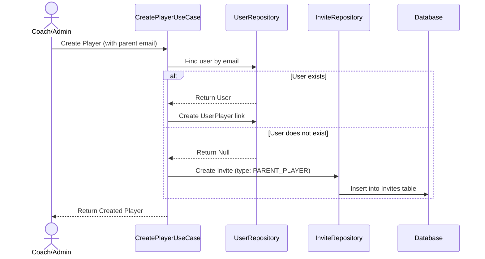
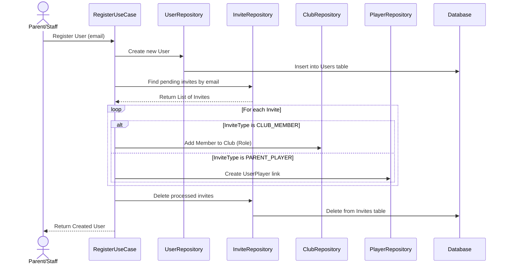
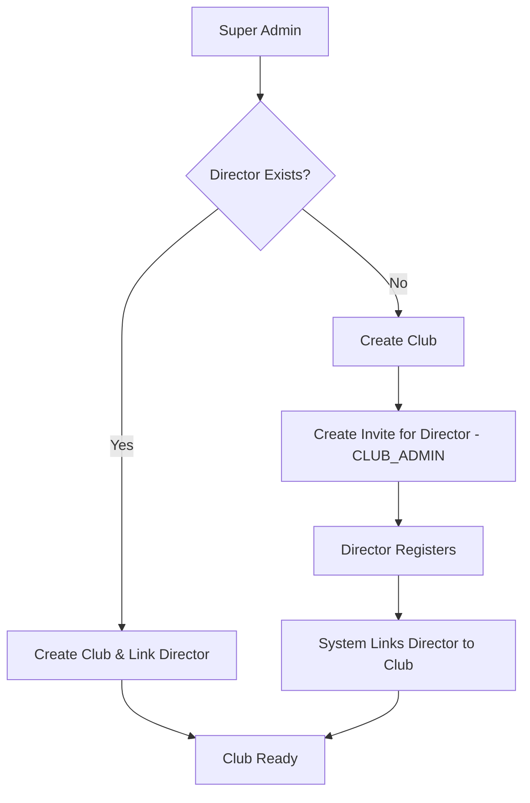
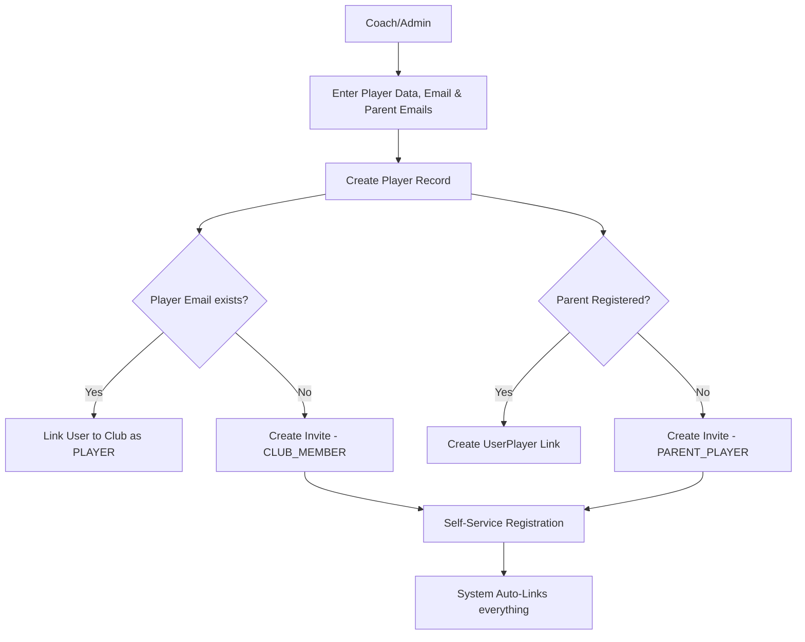
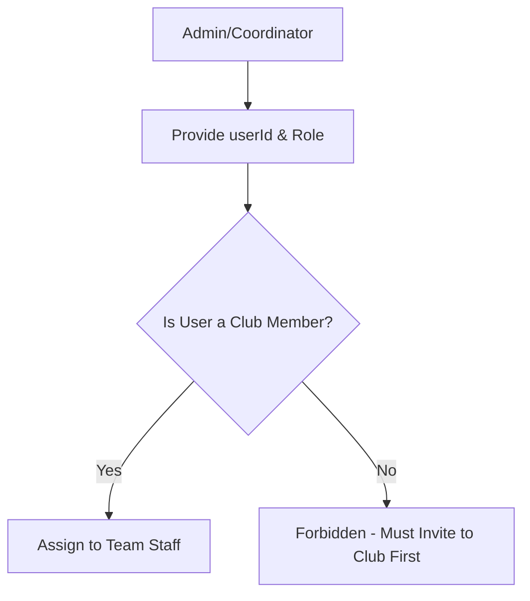
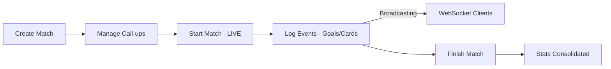
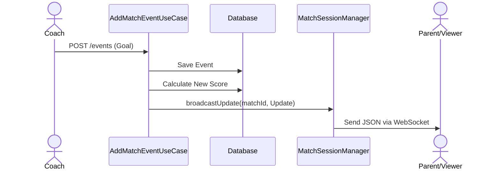

# Technical Decisions - Squadify Platform

This document records the architectural patterns, libraries, and design principles adopted in this project.

## 1. Architectural Pattern: Clean Architecture
We follow a layered architecture to ensure separation of concerns, testability, and independence from frameworks.

### Layers:
- **Domain**: The core of the application. Contains **Entities**, **Repository Interfaces**, and **Use Cases**. It has no dependencies on external libraries (except for core language features).
    - *Use Cases*: Represent a single business action. Each Use Case class MUST have only one public operation, typically using the `operator fun invoke`.
- **Data**: Responsible for data persistence and external API communication. Contains **Repository Implementations**, **Exposed Tables**, and **Database Configuration**.
- **Presentation**: The entry point for users. In the `:server`, this means **Ktor Routes**. In the `:app`, it will be **Compose UI** and **ViewModels**.
- **Core**: A shared module (`:core`) containing models and utilities used by both the Backend and Frontend. Exceptions (`SquadifyException` and subtypes) are server-only and live in `:server`, not here -- the client never catches them, it uses `ApiException` (keyed off the HTTP status code) instead. The actual shared model source files live in `:common`, a plain-JVM module with no Kotlin Multiplatform targets (see section 9) -- `:core` sources those same files into its `commonMain` rather than duplicating them, so client apps still see identical types.

## 2. Dependency Injection: Koin
We use **Koin** for dependency injection because it is lightweight, KMP-friendly, and uses a DSL-based configuration that fits perfectly with Kotlin.
- Modules are defined in `di/AppModule.kt`.
- Use Cases and Repositories are registered and injected into Routes/Controllers.

## 3. Database Layer: JetBrains Exposed (v1)
We use **Exposed** as our SQL ORM.
- **Version 1.4.0+**: We use the latest stable version (using the `v1` package structure).
- **DSL Approach**: We prefer the Type-safe DSL for building queries.
- **Aggregation Efficiency**: When fetching lists that depend on multiple conditions (e.g., getting clubs where a user is either a member OR a parent), we use the `exists` operator with subqueries to perform the logic in a single SQL command. This avoids multiple round-trips to the database and improves performance.
- **PostgreSQL, dev and production alike**: H2 has been removed entirely -- both environments now connect to a real PostgreSQL instance via HikariCP, differing only in *which* database they point at. `ServerConfig.kt` resolves the connection from environment variables (`DATABASE_HOST`, `DATABASE_PORT`, `DATABASE_USER`, `DATABASE_PASSWORD`, `DATABASE_NAME`): `DATABASE_HOST`/`DATABASE_PASSWORD` are required explicitly when `APP_ENV=production` (the server refuses to start rather than fall back to a local default), while `DATABASE_NAME` defaults per environment -- `squadify_dev` locally, `squadify_production` in production -- so the two never collide even against the same Postgres server. `docker-compose.yml` at the repo root spins up a local Postgres matching the dev defaults (`docker compose up -d`), so `./gradlew :server:run` still works with no further setup.
- **Multi-Tenancy**: Every club-specific table contains a `clubId` to ensure data isolation.
- **Atomic Transactions**: We use a `TransactionManager` service in the Domain layer to orchestrate complex operations spanning multiple repositories. This ensures that a Use Case is either fully committed or completely rolled back in case of failure, maintaining data integrity (e.g., creating a player and their invitations must be an atomic unit).
- **Concurrency**: All database operations are wrapped in a `dbQuery` utility using `suspendTransaction` to ensure they don't block the Ktor threads.

## 4. Shared Models & Serialization
- **kotlinx.serialization**: Used for all JSON encoding/decoding. All status and type fields use Enums for type safety.
- **kotlinx-datetime**: Used for handling dates and times. Logical dates (like season start/end) use `LocalDate`, while audit timestamps use `kotlin.time.Instant`.
- **Error Handling**: A standardized system based on a custom `SquadifyException` hierarchy. 
    - **Exception Types**:
        - `UnauthorizedException` (AUTH_001 -> 401): Authentication failures.
        - `ForbiddenException` (AUTH_002 -> 403): RBAC/Permission violations.
        - `WrongPasswordException` (AUTH_003 -> 400): the current password asked for by Change password / Change email is wrong. Deliberately not a 401, since the client treats any 401 as an expired session (§50).
        - `TooManyPasswordAttemptsException` (AUTH_004 -> 403): the third wrong current password in a row; the user has been signed out everywhere (§50).
        - `ValidationException` (VAL_001 -> 400): Business rule or request format violations.
        - `ConflictException` (DATA_001 -> 409): Duplicate resources or state conflicts.
        - `DatabaseException` (DATA_002 -> 500): Persistence layer failures.
        - `IllegalIdFormatException` (VAL_002 -> 400): A path/body value that should be a UUID isn't
          one (stale client, typo'd URL, malformed request). Thrown by `String.toUuid()`
          (`server/.../util/UuidParsing.kt`), which every repository uses instead of calling
          `Uuid.parse` directly -- see `ISSUES TO FIX.md`, "Unguarded `Uuid.parse(...)` everywhere".
        - `NotFoundException` (DATA_003 -> 404): An entity looked up by ID doesn't exist -- the
          primary resource in the request, or one it references (e.g. a `clubId`/`ageGroupId` on a
          create payload). See `PROCESS_FLOWS.md` §11 for the standardization pass that made this
          consistent across every use case.
    - **Mapping**: Ktor's `StatusPages` plugin converts these to a consistent `ErrorResponse` JSON body.
    - **Security**: Unhandled exceptions (`Throwable`) are masked as "An internal server error occurred" to avoid leaking system internals.

## 5. Security & Authentication
- **JWT (JSON Web Tokens)**: Used for stateless authentication.
    - **Access Tokens**: 48 hours (raised from 1 hour, see §38), with automatic refresh-and-retry on a 401 client-side.
    - **Refresh Tokens**: Long-lived (30 days) stored in the database for session renewal. `RefreshTokenUseCase` treats "not past its stored expiry" as a business rule it owns: the repository (`findRefreshToken`) just returns the row, and the use case rejects (and deletes) a token whose `expires_at` has passed, the same way it rejects an unknown one. Each successful refresh rotates the token (old row deleted, new 30-day row saved).
    - **Signing Secret**: The HMAC signing key is **not** in source. `JwtConfig` reads it from `ServerConfig.jwtSecret` (see *Environment Configuration* below), which sources the `JWT_SECRET` environment variable. In `PRODUCTION` the server refuses to start if it is unset; in `DEV` it falls back to a clearly-labelled placeholder so a plain `./gradlew run` works with no setup. The `issuer` and `audience` claims remain compile-time constants in `JwtConfig` — they are not secret and do not vary by environment.
- **BCrypt**: Used for hashing passwords before storage.
- **Platform-Admin Seeding (startup)**: `SeedPlatformAdminUseCase` runs once when the Ktor module boots (invoked from `Application.module()` right after Koin is installed) and guarantees a platform-admin ("superuser") account exists, so a freshly-created or wiped **dev** database is usable immediately with no manual bootstrapping step. It is **idempotent**: it only creates the account when no user with the configured email exists, and never mutates an existing account (so it cannot silently escalate a normal user that happens to share the email). A normal restart against an intact database is a no-op. Configuration lives in `ServerConfig` and is injected into the use case (which stays free of environment lookups): in `DEV` it is enabled by default with clearly-labelled fallback credentials (`admin@local.dev` / `admin1234`, overridable via `SEED_ADMIN_EMAIL` / `SEED_ADMIN_PASSWORD`); in `PRODUCTION` it is disabled unless `SEED_ADMIN_ENABLED=true` is set explicitly, and then `SEED_ADMIN_EMAIL` and `SEED_ADMIN_PASSWORD` are both required — there is never a password fallback in production. Covered by `SeedPlatformAdminUseCaseTest`.
- **Environment Configuration**: `config/ServerConfig.kt` is the single place server-side runtime config is resolved. It exposes an `AppEnvironment` enum (`DEV` / `PRODUCTION`, selected from the `APP_ENV` variable, defaulting to `DEV`) and reads secrets/tunables from real environment variables so nothing sensitive lives in source: the JWT signing secret, the PostgreSQL connection details (see §3), and the platform-admin seeding credentials/toggle (see *Platform-Admin Seeding* above). This mirrors, on the server, the `AppConfig` dev/prod split already used on the client (§10).
- **Hierarchical RBAC**: Permissions are managed through a centralized `CheckUserPermissionUseCase` using a level-based system:
    - **Role Levels**: `CLUB_ADMIN` (5), `COORDINATOR` (4), `COACH` (3), `STAFF` (2). (`MEMBER` is club-level, level 1.)
    - **Global vs Age-Group Scope**: `CLUB_ADMIN` and `COORDINATOR` have global access to all club resources. `COACH` and `STAFF` are scoped to specific **age groups** they are assigned to (verified via `age_group_staff`). Players and family members are not roles here — their read access flows from a linked player being in the relevant age group's pool (`age_group_players`). A `teamId` passed to `CheckUserPermissionUseCase` is resolved to its age group before these checks.
    - **Platform Admin**: A global `isPlatformAdmin` flag bypasses all local club checks ("God Mode").
- **Permission Check Priority (Check Once, Fail Fast)**: To optimize performance and prevent unnecessary database access, authorization validation MUST be the **absolute first** operation performed in a Use Case. 
    - **Rule**: Validation must occur as soon as all necessary context (like `clubId` or `teamId`) is available, and before any state-changing logic or extensive data fetching.
    - **Practice**: If a Use Case requires metadata from a resource to determine the team context, the resource is fetched first, followed immediately by a single granular permission check. This prevents redundant calls to the security layer and unnecessary business logic execution for unauthorized users.
- **Security Testing**: The permission logic is covered by a suite of unit tests (`CheckUserPermissionUseCaseTest`) to prevent regression in access control.
- **Resource Management**: Support for partial updates (PATCH) to manage resource states (e.g., active/inactive status for teams, seasons and players).
- **Match-Opponent Relationship**: Matches are linked to a dedicated `Opponents` table rather than using simple strings. This ensures data consistency across the club and allows for richer opponent data (e.g., logos).
- **Pagination**: To ensure scalability and performance as data grows (e.g., hundreds of players or matches), list-based endpoints (GET) will implement a standard pagination strategy using `limit` and `offset` (or `page`) query parameters. This prevents excessive memory consumption and slow response times.
- **Email System**: Sent via Resend for club and age-group association notifications (see §14). Parent/player invites (`PARENT_PLAYER`) still only write an `Invites` row with no email, since parents/players are out of scope for now.

## 6. Real-Time Communication: WebSockets
We use **WebSockets** for delivering instantaneous updates during live matches (Live Score).

- **Implementation**: Ktor's `WebSockets` plugin with `KotlinxWebsocketSerializationConverter` for typed JSON communication.
- **Session Management**: A `MatchSessionManager` handles active connections, grouping them by `matchId`.
- **Hybrid Flow**: Events are recorded via a standard **REST POST** request (for reliability and ACID persistence) and then **broadcasted** to all connected WebSocket clients for that specific match.
- **Auto-Cleanup**: Sessions are automatically removed from the manager upon disconnection or transmission failure.
- **Client**: The KMP client connects via `ktor-client-websockets` (`WebSockets` plugin + `KotlinxWebsocketSerializationConverter`, same JSON config as the REST `ContentNegotiation`), authenticating with the JWT as a `?token=` query param (browser WebSockets can't send custom headers). `MatchRepositoryImpl.observeLiveMatch` exposes it as a cold `Flow<LiveMatchUpdate>`. It's a best-effort second channel, not the primary path: `LiveMatchViewModel` applies every mutating action's own REST response to local state immediately, and does not retry the socket if it drops — see PROCESS_FLOWS.md §8.4.

## 7. Invite System
We use a generic asynchronous invitation system to handle associations for users who may not yet be registered on the platform.

### Flow 1: Creation of an Invite (e.g., Parent-Player Association)

### Flow 2: Resolution of Invites during Registration

## 8. High-Level System Flows

### 8.1. Club Provisioning Flow
How a new club is onboarded onto the platform by the Super Admin.

### 8.2. Player Creation & Parent Association Flow
The process of adding athletes and linking their guardians.

### 8.3. Age-Group Staff Assignment Flow
Coaches and technical staff must be club members before joining an age group.

### 8.4. Match Day Lifecycle
This flow describes the operational lifecycle of a match.

### 8.5. Real-Time Event Broadcasting
Detailed view of how a match event reaches the viewers.

## 9. Project Structure (KMP)
- `:server`: Ktor backend. Depends on `:common` directly, not `:core`. Owns `SquadifyException` and its
  subtypes directly (`server/.../exception/SquadifyException.kt`) -- these are never used client-side.
- `:common`: Plain-JVM module (no KMP targets) holding the model source files shared with the client
  apps (request/response DTOs, etc). Exists so building `:server` never needs to configure a Kotlin
  Multiplatform target (Android, iOS, JS, Wasm) -- Gradle fully configures a project's build script for
  any dependent to build it, so depending on the multiplatform `:core` directly would force every
  server build to configure Android tooling just to resolve dependencies, even though the server never
  touches it.
- `:core`: Shared logic and models, exposed to the client apps across all KMP targets. Its `commonMain`
  sources the same files from `:common` (via `srcDir`, not a project dependency -- `commonMain` can't
  depend on a plain-JVM module) so there is no duplication.
- `:app:shared`: Shared UI components and logic (Compose Multiplatform).
- `:app:androidApp`, `:app:iosApp`, `:app:webApp`: Platform-specific entry points.

## 10. Client Architecture (KMP)
The client follows a modern multiplatform architecture to share as much logic as possible while providing native performance and UI.

- **UI Framework**: **Compose Multiplatform** for sharing UI code across Android, iOS, Desktop, and Web.
- **Navigation**: **androidx.navigation:navigation-compose** (KMP version) for type-safe navigation using Kotlin Serialization.
- **Dependency Injection**: **Koin** for managing ViewModels and services.
- **Environment Configuration**: An `AppConfig` interface is used to manage environment-specific variables like `baseUrl`. This allows switching between `dev` and `prod` configurations without changing business logic.
- **Session Management (Persistence)**: We use the **russhwolf:multiplatform-settings** library to store session tokens (`accessToken`, `refreshToken`) persistently across app launches. 
    - **Session Refresh**: On every app launch (via the `SplashScreen`), the system attempts to refresh the access token using the stored `refreshToken`. If successful, the user proceeds to the Dashboard with updated credentials. Only a `401` from the refresh endpoint (refresh token unknown, expired or revoked) clears the session and redirects to Login. Any other failure (no network, server unreachable, a 5xx) keeps the stored session and lets the user in, so being offline at app start never logs anyone out. The next screen shows its own retryable error, and the authenticated client (§38) refreshes on the next 401 once the server is reachable. Covered by `CheckAndRefreshSessionUseCaseTest`.
- **State Management**: **MVVM (Model-View-ViewModel)** pattern using `androidx.lifecycle:lifecycle-viewmodel` (KMP).
    - **State Pattern**: UI state is modeled using `sealed classes` (e.g., `LoginUiState`) to ensure type safety and mutually exclusive states (Idle, Loading, etc.). Each screen has its own state file (e.g., `LoginUiState.kt`) in the same package as the screen.
    - **State Updates**: We prefer using `_state.update { ... }` over direct assignment (`_state.value = ...`) to ensure thread-safe updates to the `MutableStateFlow`.
    - **Navigation Events**: Navigation is treated as a "one-shot" event (Side Effect) using a dedicated `SharedFlow` (e.g., `navigationEvent`) and specific event classes. This prevents re-triggering navigation when returning to a screen.
    - **Feature Packaging**: Components belonging to the same feature (Screen, ViewModel, UiState) are kept in the same package (e.g., `presentation.ui.login`) to improve discoverability and cohesion.
    - **Shared Components**: `presentation.ui.components` holds Composables reused across more than one feature package -- `PrimaryLoadingButton` (the standard full-width submit button with a loading-spinner state), `FMTopBar` (the dark toolbar with an optional subtitle and trailing actions slot), `DatePickerSheet` (a bottom-sheet `DatePicker` with optional `minDate`/`maxDate` bounds), `EmptyStateCallToAction` (the icon+title+subtitle+button "nothing here yet" layout used by `ClubDetailsScreen`'s no-seasons/no-age-groups states), and `MatchRow` (the one match-list-row look for every match state -- SCHEDULED, LIVE/HALF_TIME, FINISHED, CANCELLED -- used by the club Matches tab, Age Group Details' "Next games", and Team Details' upcoming/results lists; takes a `Match` plus an optional `teamName` and `MatchScore?`, since a match never carries its own score). `PlayerPosition.labelRes()` (`PlayerPositionLabel.kt`) is the one position-to-string-resource mapping, used by Edit Player, the player profile, and every player-list row. A row shows the position as a small caption under the name only when it's set; a player with no position keeps the name-only row, vertically centered. New UI that repeats an existing screen's exact layout/styling a second time should be extracted here rather than copied.
    - **Keyboard actions in forms**: the keyboard key walks through a form instead of only closing the keyboard.
      - **Every field but the last** uses `ImeAction.Next`, which moves focus to the next field.
      - **The last text field** uses `ImeAction.Done` with `submitKeyboardActions { … }` (`components/KeyboardSubmit.kt`). That closes the keyboard and runs what the form's main button runs (Sign in, Create account, Save, Create …), with the same "can submit" guard.
      - **Row-based create forms** (teams, age groups, staff): only the last row submits; earlier rows go to the next row.
      - **When a picker comes next**, the key opens the picker instead. In Create players, the last name opens the date-of-birth picker.
      - **Multi-line fields** (notes, report texts) keep Enter as a new line, so the single-line field before them uses Next.
      - **Left alone:** search boxes keep the default action.
      - **Email before a role choice:** in the invite sheet the key only closes the keyboard, so it can't submit before a role is picked.
    - **Returning a Result to the Previous Screen**: When a screen needs to signal something back to the screen that pushed it (e.g. "a season was just created, reload"), use the standard Compose Navigation pattern: the pushed screen sets a value on `navController.previousBackStackEntry?.savedStateHandle`, and the previous screen's `composable<...> { backStackEntry -> ... }` block reads it via `backStackEntry.savedStateHandle.getStateFlow(key, default)`, clearing it once consumed. Needed because Koin scopes a screen's `ViewModel` to its back-stack entry, so popping back to a screen reuses its existing (now stale) state rather than re-running the `ViewModel`'s `init`.
- **Typed HTTP Errors**: `HttpClientExtensions.handleResponse()` (used by every repository) throws `ApiException(statusCode, code, message)` for any non-2xx response, carrying the HTTP status and the server's `ErrorResponse.code` (see §4's exception table) instead of a bare `Exception(message)`. This lets a ViewModel branch on *what kind* of failure occurred (e.g. a 409 conflict getting special handling) without pattern-matching the message text -- which per `AI_GUIDELINES.md` "No Raw Exception Messages in UI" a screen shouldn't be displaying verbatim anyway.
- **Network failures are Exceptions everywhere**: on web, Ktor's fetch engine reports a request that never got a response (no connection, server down, blocked by the browser) as a `kotlin.Error` ("Fail to fetch"), which isn't an `Exception`, so it got past every view model's `catch (e: Exception)` and crashed the app (seen submitting a match report). The public client installs `mapNetworkErrors()` (`HttpClientExtensions.kt`), an `HttpResponseValidator` that rethrows any non-`Exception` from a request as `NetworkException`. The authenticated client is derived from the public one, so it inherits this. Screens then show their usual "couldn't save/load" copy. Tested in `NetworkErrorMappingTest`.
- **CORS (web only)**: `Application.configureCors` allows the one origin in `WEBAPP_BASE_URL` and the methods GET, POST, PUT, PATCH and DELETE with the Authorization and Content-Type headers. Every method a repository sends must be listed: the browser refuses anything else at the preflight, and the app only sees "Failed to fetch". PUT was missing, so saving a match report, a training plan, or session ratings and exercises failed on web, while Android and iOS (no CORS) worked. Checked by `CorsTest`.
- **Communication**: Ktor Client (`ktor-client-cio` + `ktor-client-content-negotiation`) handles REST communication; `ktor-client-websockets` handles the live match updates socket (§6).

## 11. Mobile & Client Guidelines: Aligning with Current Google Guidance

This section records the current (2026) Google/JetBrains-recommended approach for Compose Multiplatform / Android development, cross-checked against what this project's `gradle/libs.versions.toml` and `app/` modules actually do today. Each point below states the guidance, then this project's real current status against it — some are already satisfied, some are open work.

### 11.1 UI toolkit: Jetpack Compose

Compose is Google's default and recommended UI toolkit; the XML View system is legacy, maintenance-only. **Status: already the case.** This project is fully on Compose Multiplatform (`composeMultiplatform = "1.11.1"`) across all four client targets (`app/androidApp`, `app/shared` for iOS, `app/desktopApp`, `app/webApp`) — there is no View-based UI anywhere in the codebase.

### 11.2 Design system: Material 3

Use `androidx.compose.material3` (the Compose Multiplatform equivalent: `org.jetbrains.compose.material3`), not the legacy `material` (M2) artifact. **Status: already the case** — `material3 = "1.9.0"` is the only Material dependency declared, consumed from `app/shared`'s `commonMain`.

"Material 3 Expressive" is not a separate library or an opt-in mode to switch on — it's the current direction of the `material3` artifact itself (updated theming, motion, shape, and typography, aligned with Android 16's visual language). Staying current on `material3` releases *is* adopting it; there's no separate migration step.

The **Compose Styles API** is a newer (2026) mechanism for building a styleable design system: `Modifier.styleable()` layers three levels of styling — component defaults, theme-level overrides, and call-site overrides — with `MutableStyleState` handling state-based styling (pressed/disabled/hovered) automatically. It replaces passing individual hardcoded style parameters (`backgroundColor`, `shape`, etc.) into every composable. **Status: not yet adopted** — this project's shared `presentation/ui` components currently take individual parameters rather than a centralized `Style`/`ComponentStyles` object. Worth evaluating once the shared component library grows past a handful of screens; not a blocker today.

### 11.3 Architecture

The existing pattern (§10: Screen + `UiState` + `ViewModel`, MVVM/UDF, sealed-class states, one-shot navigation via `SharedFlow`) is correct and matches current guidance. Refinements to fold in:

- Collect state with `collectAsStateWithLifecycle()` rather than plain `collectAsState()`, so screens stop collecting `StateFlow` updates while not visible (lifecycle-aware collection). Verify this is consistently used wherever a `ViewModel`'s `state: StateFlow<UiState>` is collected in a `@Composable`.
- DI via Koin is the right call, confirmed: Hilt is Android-only (annotation-processor based, no iOS/Web/Desktop target), so it can't be used in a module shared across all four client targets the way Koin already is (`koin-core`, `koin-compose`, `koin-compose-viewmodel`).
- Coroutines + Flow everywhere is already the pattern in use (`kotlinx-coroutines`, `_state.update { }`, per §10).
- Google's [Now in Android](https://github.com/android/nowinandroid) sample remains the canonical reference for this architecture style (MVVM, UDF, modularization) — useful as a pattern reference, but it's Android-only, not KMP, so treat it as a reference for *shape*, not a literal template, given this project's shared module spans Android, iOS, Desktop, and Web.

### 11.4 Navigation: Navigation 3

`androidx.navigation3` inverts the ownership model from Navigation 2: instead of the library owning one internal back stack, the app owns it directly as a plain observable list (`rememberNavBackStack`, backed by `SnapshotStateList`). As of Compose Multiplatform 1.10+, it has first-class support across **all** Compose Multiplatform targets — Android, iOS, Desktop, and Web — which lines up with this project's four client targets. JetBrains' own docs describe adopting it as "less a migration, more a rewrite" of navigation, not a version bump, so it should be scoped as its own dedicated piece of work rather than folded into an unrelated feature.

**Status: not yet adopted.** This project is still on `navigation-compose` 2.9.2 (`navigation = "2.9.2"`, Navigation 2.x) in `app/shared`. Two concrete things to plan for before migrating, both confirmed from official docs:

- **Serialization on non-JVM targets**: Android's route serialization relies on reflection, which doesn't work on iOS/Web. Migrating requires registering every route type explicitly via polymorphic serialization in a `SavedStateConfiguration` — this is the detail most likely to cause friction here specifically, since this project targets iOS and Web in addition to Android.
- **Web back-button support isn't fully built in yet** — integrating the `webApp` target's browser back button currently needs a separate `navigation3-browser` library, with official integration still pending upstream.

### 11.5 Adaptive UI (do this from day one)

Support phones, foldables, tablets, and desktop from the start, using window size classes, `material3-adaptive`, multi-pane layouts, and adaptive navigation (bottom bar on compact width ↔ navigation rail on expanded width). Retrofitting this after screens are built single-layout is significantly more expensive than designing for it upfront.

**Status: not started.** No `material3-adaptive` dependency exists in `libs.versions.toml`, and no window-size-class logic exists in the codebase today. Given this project already ships a `desktopApp` target (inherently a large-width surface) alongside phone-sized Android/iOS targets, this is a real, current gap rather than a future nice-to-have — the guidance to do it "from day one" applies directly, since screens are actively being built without it right now.

### 11.6 Edge-to-edge (mandatory)

Android 15 (API 35) enforces edge-to-edge by default but still allowed an app-level opt-out (`windowOptOutEdgeToEdgeEnforcement`). Android 16 (API 36) removes that opt-out entirely — an app targeting API 36+ cannot suppress edge-to-edge at all.

**Status: mostly already in place.** This project already compiles/targets API 37 (`android-compileSdk = "37"`, `android-targetSdk = "37"`) — past the point where opting out is even possible — and `MainActivity` already calls `enableEdgeToEdge()`. What hasn't been verified screen-by-screen is whether every screen's content properly consumes `WindowInsets` (e.g. via `Scaffold`'s built-in inset handling) instead of assuming safe margins around system bars. Worth a deliberate pass once Navigation 3 (§11.4) and adaptive layouts (§11.5) land, since both restructure how the top-level scaffold is built.

### 11.7 Build & tooling

- **Kotlin 2.x with the K2 compiler**: already the case — `kotlin = "2.4.10"`, which is on a K2-only release line (K1 has been fully retired by this point in the 2.x series). No action needed.
- **Gradle Kotlin DSL + version catalog**: already the case — every module uses `.kts`, and all dependency versions are centralized in `gradle/libs.versions.toml`.
- **targetSdk 35/36, minSdk 24+**: already exceeded — this project compiles and targets API 37 with `minSdk = 24`.
- **Baseline Profiles + R8 full mode for release**: **not yet configured.** `app/androidApp`'s release build type currently sets `isMinifyEnabled = false` despite specifying ProGuard files, and no Baseline Profile module or dependency exists anywhere in the project. This is a concrete, current gap against the guidance, not just an unstarted aspiration.
- **AGP 9 for pure-Android modules**: **already done, and done correctly.** AGP 9 (`agp = "9.3.1"`) dropped support for combining the standard Kotlin Multiplatform Gradle plugin with `com.android.application`/`com.android.library` — the required fix is to split a pure Android app module (using `com.android.application`) from a KMP-aware shared module (using the newer `com.android.kotlin.multiplatform.library` plugin with a `kotlin.android { }` block, instead of `com.android.library` + `kotlin.androidTarget { }`). That is exactly the shape this project already has: `app/androidApp` uses `libs.plugins.androidApplication`, while `app/shared` uses `libs.plugins.androidMultiplatformLibrary`. No migration needed here — this project is ahead of where the guidance assumes most KMP projects currently are.

### 11.8 Open items against this guidance

- [ ] Adopt `material3-adaptive` + window size classes; add adaptive navigation (bottom bar ↔ navigation rail) — nothing exists yet (§11.5).
- [ ] Plan and execute the Navigation 2 → Navigation 3 migration, budgeting specifically for polymorphic route serialization on iOS/Web (§11.4).
- [ ] Enable R8 full mode (`isMinifyEnabled = true` with an appropriate `proguard-rules.pro`) and add a Baseline Profile for `app/androidApp`'s release build (§11.7).
- [ ] Audit screen-level composables for correct `WindowInsets` consumption now that edge-to-edge is unavoidable at the targeted API level (§11.6).
- [ ] Evaluate the Compose Styles API for the shared design system once `presentation/ui` grows past its current size (§11.2) — not urgent today.

**Sources**: [Compose Multiplatform 1.10.0 release notes](https://blog.jetbrains.com/kotlin/2026/01/compose-multiplatform-1-10-0/) · [Navigation 3 in Compose Multiplatform](https://kotlinlang.org/docs/multiplatform/compose-navigation-3.html) · [Navigation 3 — Android Developers](https://developer.android.com/guide/navigation/navigation-3) · [Updating multiplatform projects to AGP 9](https://kotlinlang.org/docs/multiplatform/multiplatform-project-agp-9-migration.html) · [Material Design 3 in Compose — Android Developers](https://developer.android.com/develop/ui/compose/designsystems/material3) · [Jetpack Compose Styles API](https://developer.android.com/agents/skills/jetpack-compose/theming/styles/skill) · [Behavior changes: apps targeting Android 16](https://developer.android.com/about/versions/16/behavior-changes-16) · [Now in Android sample](https://github.com/android/nowinandroid)

## 12. Crash Reporting & Distribution: Firebase (Android-only for now)

`app/androidApp` is registered with Firebase project `squadify-958d3` (`google-services.json` checked in --
it's not a secret, it only carries public app identifiers). Two products are wired up so far, both
Android-only since neither Crashlytics nor App Distribution supports the desktop/web targets, and iOS
(`app/iosApp` -- a real Xcode project, see the "Environment-Based App Config" section) hasn't been
registered with Firebase yet either -- that's a real, separate gap, not something blocked on the app
existing:

- **Crashlytics**: `firebase-bom` + `firebase-crashlytics` dependency, plus the `google-services` and
  `firebase.crashlytics` Gradle plugins. Fully automatic once the app initializes -- no code changes needed
  for basic crash reporting.
- **App Distribution**: authenticates non-interactively via a service-account key (Firebase App Distribution
  Admin role), so `./gradlew app:androidApp:appDistributionUploadRelease` builds and uploads a release with
  no login step. The `release` build type's `firebaseAppDistribution { serviceCredentialsFile = ... }` block
  points at `app/androidApp/firebase-service-account.json` -- a local-only file, gitignored, never committed.
  Releases go to the `squadify-testers` group (`groups = "squadify-testers"` in the same block) -- manage
  membership in the Firebase console under App Distribution -> Testers & Groups.

## 13. Web Client Deployment: Docker + nginx

`app/webApp/Dockerfile` builds and serves the web client, deployed as its own Railway service alongside
`:server` (see `server/Dockerfile`). Build context is the repo root, same reasoning as `:server`'s
Dockerfile: `settings.gradle.kts`'s `include(...)` requires every listed project directory to physically
exist in the build context (verified -- omitting one fails with "Configuring project ':x' without an
existing directory is not allowed"), regardless of `--configure-on-demand`.

- **Build target**: `composeCompatibilityBrowserDistribution` -- a Wasm build with an automatic Kotlin/JS
  fallback bundled into one static output, so the app runs in any modern browser regardless of Wasm GC
  support. The build stage still needs the Android SDK (same as the pre-`:common`-split `:server`
  Dockerfile) purely to let Gradle configure `:app:shared` -> `:core`'s Android target, even though
  nothing Android-specific is compiled -- `:app:webApp` doesn't get the same clean-dependency split
  `:server` has, since it genuinely needs `:app:shared`'s KMP-compiled output.
- **`--configure-on-demand` is deliberately NOT used** for this build -- Gradle warns the js/wasmJs
  targets don't support it.
- **Runtime**: a plain `nginx:alpine` image serving the static bundle (`app/webApp/nginx.conf`), with a
  `try_files ... /index.html` SPA fallback and gzip enabled for the large `.js`/`.wasm` assets. No JDK,
  Gradle, Android SDK, or Node in the final image.
- **Real memory requirement discovered building this**: `kotlin.daemon.jvmargs` needed raising from
  3072M to 4096M in the root `gradle.properties` -- the Compose-for-Web compile (pulls in Skiko) hits
  "Not enough memory to run compilation" below that, independent of Docker/CI specifics. Also fixed a
  latent bug in both Dockerfiles: neither copied `gradle.properties` into the build context, so this
  setting (and any other project-level Gradle property) was silently never applied inside the container
  -- `:server`'s build happened to still succeed on Gradle/Kotlin's smaller defaults given its lighter
  compile, but this was luck, not correctness.

## 14. Association Notification Email: EmailService + Resend

`domain/service/EmailService.kt` is a best-effort, must-never-throw interface (`ResendEmailService` is
the only implementation, `data/service/`) sending three notifications, all triggered from the same
places the underlying association already happens -- `ProvisionClubUseCase`, `AddClubMembersUseCase`,
`AddStaffToAgeGroupUseCase`:

- **Existing user directly added** to a club or age-group staff -> a "you've been added" email.
- **No account yet** (club/director invite path -- an `Invite` row is created, same as always) -> a
  "register to join" email linking to `ServerConfig.webAppBaseUrl` (a placeholder until the web client
  is deployed -- see `ISSUES TO FIX.md`). `RegisterUseCase` already resolves pending invites by email at
  registration time, so registering with the invited address is all that's needed to complete the join
  -- no new resolution logic was added for this.
- Push/in-app notifications are explicitly out of scope here (not built yet) -- email is the only
  channel implemented.

**Send timing**: every call site fetches whatever it needs (club/age-group name) *inside*
`transactionManager.runInTransaction { }` and only calls `emailService.send...()` after that block
returns. Two things forced this shape, both hit as real bugs while building this, not just design
foresight:
- A slow/failed Resend call must never roll back a club/age-group association that already succeeded --
  so the send has to happen after commit, never inside the transaction.
- Repository methods here (e.g. `ClubRepository.getClubById`) have no transaction of their own --
  they rely on an ambient one from `runInTransaction`. Calling one *after* the transaction closes throws
  (verified: this exact mistake produced a real 500 on `POST /clubs/{id}/members` during manual testing).
  The fix is fetching the name *inside* the transaction and carrying the plain value out, not the repo
  call itself.

**Resend + no domain yet**: `RESEND_API_KEY` (`ServerConfig.resendApiKey`) is optional, not
required-in-production like `jwtSecret`/`databasePassword` -- a missing key makes `ResendEmailService`
log a warning and skip the send rather than block the request or crash startup, since email here is a
notification, not a security-critical value. Without a verified sending domain, Resend only delivers
from `onboarding@resend.dev` to the Resend account's own email -- real delivery to arbitrary invitees
needs a verified domain (`RESEND_FROM_ADDRESS` env var overrides the default once one exists).

## 15. API Versioning: `/v1` Prefix

Every route is now nested under `/v1` (`Application.kt`'s `routing { route("/v1") { authRoutes(); ... } }`)
-- a single wrapper around the existing route-function calls, no changes needed in any of the 9
`*Routes.kt` files, since each is an extension function on `Route` and Ktor composes the path prefix
from whatever context they're nested in. The root health check (`GET /`) stays unversioned deliberately
-- infra/uptime monitors hit it directly and shouldn't need to know the API version.

Client-side, every repository builds its URLs as `"${appConfig.baseUrl}/..."`, so the fix is entirely at
the `AppConfig` construction site -- every environment's `baseUrl` now ends in `/v1` (see §16, "
Environment-Based App Config", for how each platform constructs its `AppConfig` today -- the
`DevAppConfig`/`ProdAppConfig` classes referenced when this section was first written no longer exist).
Every call site (including the live-match WebSocket URL, derived from the same `baseUrl` via a scheme
swap) picks up `/v1` automatically -- no changes needed in any of the ~10 `*RepositoryImpl.kt` files.

Verified against a real running server, not just compilation: the old unversioned paths now 404
(`GET /clubs` -> 404), the new `/v1` paths work end-to-end including a real WebSocket upgrade
(`GET /v1/matches/{id}/live` -> `101 Switching Protocols`, then closes with "Unauthorized" as expected
with no token), and the unversioned root health check still responds normally.

## 16. Environment-Based App Config

Three environments across every client: **dev** (a local/LAN server, for active development), **staging**
(what Firebase App Distribution builds should point at -- deploy and verify there before production),
**production** (the store release / deployed web client). `AppConfig` (`domain/config/AppConfig.kt`,
`baseUrl` + `isDebug`) is unchanged, but there is no longer a per-environment class in `app:shared`
(`DevAppConfig`/`ProdAppConfig` are gone) and no hardcoded Koin binding. `initKoin(appConfig: AppConfig, ...)`
now takes the config as a parameter, constructed via the single `data class DefaultAppConfig` -- **each
platform's own entry point builds it and passes it in**, using whatever mechanism that platform's real
build-variant system offers:

- **Android** (`app/androidApp`): three product flavors (`dev`/`staging`/`prod`), each setting a
  `BASE_URL` via `buildConfigField`. `SquadifyApplication.onCreate()` reads `BuildConfig.BASE_URL`/
  `BuildConfig.DEBUG` and passes them to `initKoin`. `dev`/`staging` carry an `applicationIdSuffix`
  (`.dev`/`.stg`; `prod` stays bare, for the real Play Store listing) -- originally *not* suffixed at
  all, but that let a device that had ever run more than one flavor be handed the *same* FCM
  registration token across them (Firebase scopes a token by package name + project + signing cert, not
  by build variant), so a push triggered on one environment's server could land on a device someone only
  meant to test another environment on; see §24's push-notifications section. `google-services.json` is
  now registered for all three resulting package names under the one Firebase project (`squadify-958d3`).
  One consequence: Firebase App Distribution's task is no longer the flat `appDistributionUploadRelease`
  -- flavors split it into `appDistributionUploadDevRelease`/`...StagingRelease`/`...ProdRelease`
  (verified: ran `./gradlew :app:androidApp:tasks --all`, confirmed all three exist). Use
  `appDistributionUploadStagingRelease` for tester builds, per the "staging first" rule above.
  - **The `dev` host is resolved at build time, not hardcoded.** A physical device reaches the local
    server via the dev machine's LAN IP, and a hardcoded `192.168.1.84` silently broke when DHCP moved
    the machine to another address (`ConnectException` on Android while Web on `localhost` kept working).
    `build.gradle.kts` now takes `squadify.devHost` from `local.properties` if set, otherwise the first
    site-local IPv4 of an up, non-loopback interface, otherwise `10.0.2.2` (emulator). Since that address
    isn't known up front, the dev flavor has its own `src/dev/res/xml/network_security_config.xml` allowing
    cleartext; `src/main`'s (staging/prod) only allows it to `10.0.2.2`. After the IP changes, rebuild the
    dev app to pick up the new address.
- **Desktop & Web** (`app/desktopApp`, `app/webApp`): no OS/toolchain-level build-variant system, so both
  use the same pattern instead -- a `generateSquadifyConfig` Gradle task writes a small
  `internal object SquadifyBuildConfig { const val BASE_URL = ...; const val IS_DEBUG = ... }` file based
  on a `-PsquadifyEnv=dev|staging|production` Gradle property (default `dev`), wired into the module's
  main source set via `srcDir(generateSquadifyConfig)`. Each `main()` reads `SquadifyBuildConfig` and
  calls `initKoin` before starting the UI. `dev` defaults to `http://localhost:8080/v1` here (not the
  Android flavor's LAN IP) -- Desktop and a local Kotlin/JS dev server both run on the same machine as
  the backend, unlike a physical Android device on WiFi, so `localhost` is actually correct and doesn't
  go stale if the dev machine's LAN IP changes. `app/webApp/Dockerfile` passes `-PsquadifyEnv=production`
  by default (`ARG SQUADIFY_ENV`, overridable with `--build-arg SQUADIFY_ENV=staging` for a staging
  deploy).
- **iOS** (`app/iosApp`): a real, existing Xcode project (not a Gradle module, so it doesn't show up in
  `settings.gradle.kts` -- easy to miss for exactly that reason). `iOSApp.swift`'s `init()` picks
  `baseUrl`/`isDebug` via `#if DEBUG`/`#else` (Xcode's own default Debug/Release build configurations,
  present in every Xcode project) and calls `Shared`'s `KoinHelperKt.startKoinIOS(baseUrl:isDebug:)`
  (`app/shared/src/iosMain/.../KoinHelper.kt`), which constructs a `DefaultAppConfig` and calls
  `initKoin`. Only two tiers for now (dev/production, not a third "staging"), since adding a real
  Staging Xcode Build Configuration + scheme is safest done interactively in Xcode rather than by
  hand-editing `project.pbxproj` blind.
  - **A real Kotlin/Native naming gotcha hit while wiring this up**: the bridge function was originally
    named `initKoinIOS`, but Kotlin/Native's Objective-C interop generator silently prefixes any exported
    function starting with `init` with `do` (to avoid colliding with Objective-C's special initializer
    semantics) -- so the Swift-visible name became `doInitKoinIOS(...)`, not `initKoinIOS(...)`, and
    calling the expected name failed to compile with "has no member". Renamed to `startKoinIOS` to avoid
    the prefix collision entirely rather than calling the "do"-prefixed name from Swift.
  - **Verified with real Xcode builds, not just Kotlin compilation**: `xcodebuild -scheme iosApp -sdk
    iphonesimulator build` succeeded for both Debug and Release configurations (confirmed **BUILD
    SUCCEEDED** for both). Also hit and worked around a Gradle/Xcode integration staleness issue along
    the way: `linkDebugFrameworkIosSimulatorArm64` reported `UP-TO-DATE` and Xcode kept linking against a
    stale `Shared.framework` even after the Kotlin source changed, until the link task was force-rerun
    directly (`--rerun-tasks`).

`staging-api.squadify.pt`/`api.squadify.pt` are **placeholders** in every one of the above -- swapped in
once the corresponding Railway environments/custom domains actually exist (see `ISSUES TO FIX.md`).

**A real, pre-existing bug this surfaced**: Desktop and Web never called `initKoin()` at all before this
change -- any DI-injected ViewModel would have crashed at runtime on either platform. Fixed as a natural
side effect of wiring in per-platform `AppConfig` construction (every platform's `main()`/entry point now
has to call `initKoin` to get an `AppConfig` in). Also had to change `app:shared`'s `koin-core` dependency
from `implementation` to `api` -- `initKoin()`'s return type (`KoinApplication`) is part of this module's
public surface, so consumers need the class on their own compile classpath; this was only ever masked
before because nothing outside Android actually called `initKoin()`.

**A second, separate pre-existing bug found while verifying this (out of scope at the time, since fixed)**:
running the Desktop app for the first time (via `./gradlew :app:desktopApp:run`) crashed with
`IllegalArgumentException: Route ... CreateAgeGroups could not find any NavType for argument sport of
type SportType` -- Navigation-Compose's (2.x) type-safe routes have no built-in `NavType` for an enum
argument. Unrelated to Koin/AppConfig; it never surfaced before because Desktop never got far enough to
reach navigation at all. Fixed since: `Screen.CreateAgeGroups`/`Screen.CreateTeams` now carry `sport` as
`SportType.name` (a plain `String`), converted back with `SportType.valueOf()` at the destination in
`AppNavigation.kt`.

## 17. CI/CD: Staging Auto-Deploy, Manual Production Deploy

**Branch strategy** (per the developer, 2026-09-20): `develop` is the integration branch -- every PR
branches from and merges into `develop`, and that's what "staging" tracks. `main` is the release branch,
updated only when the developer deliberately merges `develop` into it; nothing deploys automatically from
`main` alone. This is what actually drives the two mechanisms below, not just a naming convention --
staging's auto-deploy triggers (both Railway's and the Android workflow's) point at `develop`, and
`deploy-production.yml` is dispatched by hand against whichever ref the developer chooses (in practice,
`main`, once a release's `develop` state has been merged there).

Split across two mechanisms, deliberately not funneled entirely through GitHub Actions:

- **Railway (server + web client), staging**: Railway's own native GitHub integration (Railway dashboard
  -> each service -> Settings -> Source), not a GitHub Actions workflow. Each staging-environment service
  is connected to this repo's `develop` branch with auto-deploy on, and Railway rebuilds/redeploys on
  every push using the same Dockerfiles already in the repo. Simpler and more reliable than reimplementing
  what Railway already does natively. Each service's **Watch Paths** setting (also Settings -> Source)
  should be scoped to what it actually depends on (server: `server/**`, `common/**`, root build files;
  web: `app/webApp/**`, `app/shared/**`, `core/**`, root build files) so a change to the *other* client
  doesn't trigger an unnecessary redeploy of a service nothing in it actually changed.
- **Android -> Firebase App Distribution, staging**: `.github/workflows/deploy-staging.yml`, triggered on
  push to `develop`, scoped with a `paths` filter to what `app/androidApp`'s build actually depends on
  (itself, `app/shared`, `core`, the version catalog/wrapper/root build files) -- added after the
  developer noticed the workflow was rebuilding and redistributing an unchanged APK on every push
  regardless of whether anything Android-relevant had changed. Railway has nothing to do with Android
  builds, so this genuinely needs a real CI job -- runs `:server:test` as a gate, then
  `android-actions/setup-android` (GitHub's own runners don't necessarily have the exact
  `compileSdk`/`build-tools` versions this project pins) and
  `./gradlew :app:androidApp:assembleStagingRelease :app:androidApp:appDistributionUploadStagingRelease`.
  The Firebase service account (`app/androidApp/firebase-service-account.json`, gitignored locally -- see
  §12) and the release keystore (`keystore/keystore.properties` + `keystore/squadify-keystore.jks`,
  gitignored -- see the Android release-signing section) are both written from repo secrets at the exact
  paths the Gradle config already expects.
- **Railway (server + web client), production**: `.github/workflows/deploy-production.yml`,
  `workflow_dispatch` only (the "Run workflow" button in the Actions tab, dispatched against `main` for a
  real release) -- deliberately not on push, per the developer. Same test gate, then the Railway CLI
  (`ghcr.io/railwayapp/cli` container, `railway up --service <name> --ci`) via a `RAILWAY_TOKEN` project
  token scoped to the production environment, following Railway's own documented CI pattern
  (https://docs.railway.com/cli/deploying). Android/iOS store publishing is deliberately out of scope
  here -- no signing/Play Console/App Store Connect pipeline exists yet (see `ISSUES TO FIX.md`).

**Required repo secrets** (Settings -> Secrets and variables -> Actions) -- all set and verified working
end-to-end against a real staging deploy: `FIREBASE_SERVICE_ACCOUNT_JSON`, `ANDROID_KEYSTORE_PROPERTIES`,
`ANDROID_KEYSTORE_BASE64` (same service account/keystore used locally), and `RAILWAY_TOKEN` (a project
token from Railway's dashboard, scoped to the production environment).

## 18. Call-up Status Simplified to Binary

`CallUpStatus` used to be a 5-value enum (`CALLED_UP`/`CONFIRMED`/`DECLINED`/`NOT_AVAILABLE`/`STANDBY`)
with a dedicated `UpdateCallUpStatusUseCase` (Coach-level staff only -- there was never a path for a
Parent/Player to self-confirm). Per the developer, removed outright rather than kept: since parents/
players are out of scope for v1.0.0, nothing had ever actually set a call-up to anything other than
`CALLED_UP` by anyone. Being called up is now binary -- `CallUpStatus` is a single-value enum (kept as
an enum, not dropped from `MatchCallUp` entirely, so a real attendance-status model is additive later
rather than a schema change).

Removed: `UpdateCallUpStatusUseCase` (server + client) and its route
(`PATCH /v1/matches/call-ups/{callUpId}/status`); `UpdateCallUpRequest`; the tap-to-cycle status chip,
confirmed/out/pending counts, and the active/standby list split on `MatchDetailsScreen`; the
`callUpsConfirmed` half of the Club Home "Next up" pill (`ClubHomeNextUp`, now just `callUpsTotal`).
`StartMatchUseCase`'s and `LiveMatchScreen`'s eligibility filters (`status == CALLED_UP ||
status == CONFIRMED`) simplified to "in the call-up list at all", since there's no other status left to
filter on.

Verified against a real running server, not just compilation: built a fresh club/season/age-group/team/
match, added two players via `ManageCallUpsUseCase`, confirmed both come back `CALLED_UP` in the match
details response, and confirmed the removed status route now 404s.

## 19. Match-Day Permissions Opened to Staff (not just Coach)

Per the developer, 2026-09-18: age-group **staff** (`TeamRole.STAFF`, level 2) can now do match-day
operations that were previously coach-only (`TeamRole.COACH`, level 3) -- managing call-ups, starting a
match, and updating its status. Lowered `minTeamRole` from `COACH` to `STAFF` in `ManageCallUpsUseCase`,
`StartMatchUseCase`, and `UpdateMatchStatusUseCase`. Deliberately **not** extended to everything
match-related: scheduling/editing a match (`CreateMatchUseCase`, `UpdateMatchUseCase`) and logging/
deleting match events (`AddMatchEventUseCase`, `DeleteMatchEventUseCase`) all stay coach-only -- the
developer explicitly scoped this to match-day operations, not the full match lifecycle.

**The `MatchDetails.canManage` flag had to split in two.** It previously gated three different things at
once in the client (`MatchDetailsScreen`/`MatchDetailsViewModel`): editing the match's own record, call-up
management, and entering the live match screen (the only path to starting a match). Since editing now
needs to stay coach-only while the other two open to staff, a single boolean could no longer represent
all three without either wrongly exposing "Edit" to staff or wrongly hiding call-ups/start-match from
them. `GetMatchDetailsUseCase` now returns two non-throwing permission probes:
- `canManage` (coach+ only, unchanged): gates the "Edit" action on the Details section only.
- `canManageMatchDay` (coach **or** staff, new): gates call-up management (the "Available" pool section,
  the squad-size hint, the inert "remind" text) and the bottom action bar that opens the live match
  screen (`onEnterLiveMatch`).

Both are still further gated by `match.status != FINISHED` client-side, same as before the split -- a
finished match stays a read-only record for everyone regardless of role. See `PROCESS_FLOWS.md` §7.1b/
§7.2/§8.0/§8.2 for the updated flowcharts and `PERMISSION_TEST_MATRIX.md`'s write-permission audit table.

Covered by `ManageCallUpsUseCaseTest` (new file), and new staff-allowed cases added to
`StartMatchUseCaseTest`, `UpdateMatchStatusUseCaseTest`, and `GetMatchDetailsUseCaseTest` (asserting
`canManageMatchDay = true` / `canManage = false` for a staff-level caller).

## 20. Delete Match, and Removing a Player from a Call-up

Per the developer, 2026-09-19: two gaps on the match details screen.

**Delete match.** No use case, repository method, or route for permanently removing a match existed
before this -- `DeleteMatchUseCase` is new (coach-only, same `minTeamRole` gate as editing a match; see
§19 for why deletion wasn't grouped with the match-day operations opened to staff). Neither
`MatchCallUps.matchId` nor `MatchEvents.matchId` has `ON DELETE CASCADE`, so the use case explicitly
clears both (`matchEventRepository.deleteEventsByMatch` -- new method -- then
`matchRepository.manageCallUps(matchId, emptyList())`, reusing the existing diff/replace write rather
than adding a bulk-clear method) before deleting the `Matches` row itself, all inside one transaction.
Exposed as `DELETE /matches/{matchId}`. Client-side: a "⋮" overflow menu in `MatchDetailsScreen`'s top
bar (visible only when `canManage`, mirroring `AgeGroupDetailsScreen`'s existing overflow-menu pattern)
with a single "Delete match" item, gated behind a confirmation dialog since it's irreversible. See
`PROCESS_FLOWS.md` §7.2b.

**Removing a call-up.** `ManageCallUpsUseCase` already supported removal at the backend (it's a batch
replace -- see §7.2's Exposed implementation, which diffs the given `playerIds` against what's stored
and deletes whatever's missing). The bug was client-only: `CallUpRow` had no remove affordance at all
(only `PoolRow`, for adding, had a button), and `MatchDetailsViewModel` had no `onRemoveFromCallUp`.
Fixed by mirroring `onAddToCallUp`'s exact optimistic-update/rollback shape in reverse, and adding a
"−" circle button to `CallUpRow` (same size/shape as `PoolRow`'s "+", red instead of green), shown only
when `canManageMatchDay`.

**Extracted a shared `ConfirmDialog`** (`presentation.ui.components`) for the delete-match confirmation,
since `LiveMatchScreen` already had an identical private `AlertDialog`-wrapping composable for its own
half-time/full-time/delete-event confirmations -- per `AI_GUIDELINES.md`'s shared-component rule, this
is now the one copy both screens use, and `LiveMatchScreen`'s private version was removed.

Covered by a new `DeleteMatchUseCaseTest` (coach succeeds and clears events/call-ups before the match
row in the correct order via `coVerifyOrder`; staff denied; not-found).

## 21. Push Notifications (Android): Server-Side Token Registration

First step, per the developer -- storage landed in an earlier commit on this branch (`fcm_tokens` table,
one user to N tokens). This adds the actual endpoints: `POST /v1/fcm-tokens` (register) and
`DELETE /v1/fcm-tokens` (remove, called by the client on logout). No client (Android) work yet -- that's
a later commit on the same branch.

**No `CheckUserPermissionUseCase` call.** Unlike every club/age-group-scoped use case, `RegisterFcmTokenUseCase`/
`RemoveFcmTokenUseCase` don't need one: `userId` always comes from the caller's own JWT (`call.userId` in
`FcmTokenRoutes.kt`), never a client-supplied parameter, so there's no cross-user resource to accidentally
expose -- the route's `authenticate("auth-jwt")` block already is the entire authorization boundary. A
user registering/removing "someone else's" token isn't a reachable code path in the first place.

**Registration is an upsert, not a plain insert** -- `ExposedFcmTokenRepository.upsertToken` uses Exposed's
`upsert(FcmTokens.token, onUpdate = { it[userId] = ... })`, conflicting on the token's own unique
constraint (see the earlier `fcm_tokens` commit's reasoning: a token identifies one app install, not one
user). The `onUpdate` lambda deliberately touches only `user_id` -- `created_at` is left alone on a
reassignment, so it keeps meaning "when this token row was first created," not silently becoming a
"last re-registered at" value under a name that says otherwise.

**Removal is idempotent by design** -- `deleteToken(userId, token)` deletes `WHERE user_id = ? AND token = ?`
in one statement (no separate existence/ownership check first) and the use case always reports success,
whether or not a row actually matched. A token that's already gone, was never registered, or now belongs
to a different user (e.g. reassigned by the upsert above) is not an error -- the client's logout flow
should never have to branch on this call's result. This is also why the token travels in the `DELETE`
request's body rather than a path segment: FCM tokens are opaque strings up to ~4096 chars, not the kind
of thing you'd want URL-encoded into a path.

**Why removal is its own endpoint, not part of a "logout" use case**: there isn't one server-side. The
client's `LogoutUseCase` (`app/shared/.../domain/usecase/LogoutUseCase.kt`) only ever clears the local
session (`SessionRepository.clearSession()`) -- no server call at all, and nothing revokes a refresh token
early today either (see §5's refresh-token rotation, which only invalidates *on use*, not on demand). Given
that, bolting FCM cleanup onto a use case that doesn't exist would mean inventing server-side logout
semantics as a side effect of a push-notification feature. Kept as its own explicit, idempotent endpoint
instead -- the client (a later commit) calls it itself as one step of its own logout sequence, before
clearing the local session.

Verified against a real running server, not just compilation (see `PROCESS_FLOWS.md` §2.5 for the full
scenario list): registered a token as one user, re-registered the identical value as a second user and
confirmed exactly one row reassigned (not duplicated), confirmed a non-owner's delete is a no-op, the real
owner's delete actually removes it, a repeat delete stays a no-op success, an unauthenticated request is
rejected, and a blank token is rejected. Covered by `RegisterFcmTokenUseCaseTest` and
`RemoveFcmTokenUseCaseTest`.

## 22. Push Notifications (Android): Client-Side Registration + Receiving

Third piece on the same branch -- §21 built the server endpoints; this wires the Android client to them
and adds the receiving side (Firebase Cloud Messaging SDK, `google-services.json` already registered --
see §12). Still Android-only: iOS/Desktop/Web get no real implementation yet.

**`PushTokenProvider`, not `expect`/`actual`.** `app/shared` needs a way to ask "what's this device's
current push token," but only Android has an answer -- the natural KMP tool for "one shared interface,
different behavior per platform" is `expect`/`actual`, but that requires an `actual` on *every* compiled
target (Android, iOS, JVM/Desktop, JS, wasmJs), meaning four throwaway `return null` files just to satisfy
the compiler. Used the pattern already established for `AppConfig` instead (§16: "each platform's own
entry point builds it and passes it in"): `PushTokenProvider` is a plain `commonMain` interface,
`initKoin` takes one as a parameter defaulting to `NoOpPushTokenProvider` (returns null), and only
`SquadifyApplication.onCreate` (Android) overrides it with a real, Firebase-backed one
(`FirebasePushTokenProvider`, wrapping `FirebaseMessaging.getInstance().token`'s Play Services `Task` in
a manual `suspendCancellableCoroutine` rather than pulling in the whole `kotlinx-coroutines-play-services`
artifact for one call). Every other platform's entry point needs zero changes.

**Where registration is triggered.** `RegisterCurrentFcmTokenUseCase` (fetch the current token via
`PushTokenProvider`, register it, swallow any failure -- same best-effort reasoning as `EmailService`,
§14) is called from two places doing the identical thing for different reasons: `LoginViewModel` right
after a fresh login, and `SplashViewModel` right after confirming an existing session is still valid on
app launch. Both already duplicate an analogous piece of logic (the single-club redirect check), so a
third small duplication here -- calling one shared use case from both -- matches the codebase's existing
tolerance for that specific kind of ViewModel-level duplication rather than introducing a new
cross-cutting mechanism (a "session established" event bus, say) to avoid it. `SquadifyMessagingService.
onNewToken` (fired by Firebase itself whenever a token is created or rotated, not just at login) also
registers directly -- same best-effort swallowing, since a background system callback has nowhere useful
to surface a failure to anyway.

**Where removal is triggered.** `RemoveFcmTokenUseCase` takes `PushTokenProvider` + `FcmTokenRepository`,
fetches the current token itself, and best-effort removes it server-side (same swallow-and-log shape as
`RegisterCurrentFcmTokenUseCase`). `LogoutUseCase` just calls it before clearing the local session --
removal has to happen first, since it's an authenticated call needing the soon-to-be-discarded access
token, but the local session is *always* cleared regardless of whether removal succeeded.
`LogoutUseCase.invoke()` is `suspend`; its one call site, `AccountViewModel.onLogoutClicked()`, was
already inside a `viewModelScope.launch { }`, so this needed no further change there.

**Notification channels (API 26+).** Four `NotificationChannelCompat`s are created up front in
`SquadifyApplication.onCreate` (`createNotificationChannels()`, using `NotificationManagerCompat` --
these handle the pre-O no-op internally, so unlike the raw platform `NotificationChannel`/
`NotificationManager` APIs this needs no manual `Build.VERSION.SDK_INT` check): `live_matches`
(`IMPORTANCE_HIGH` -- kickoff/goals/cards/full-time are time-sensitive enough to warrant a heads-up),
`age_group` and `invites` (`IMPORTANCE_DEFAULT`), and a `default` fallback. Names/descriptions are
plain string resources (`strings.xml`), shown to the user in Android's own per-app notification
settings. Which channel a given notification lands in is decided entirely by the *sender*, not the
client: FCM's own `notification.android_channel_id` payload field round-trips to the client SDK as
`RemoteMessage.Notification.channelId`, so `SquadifyMessagingService.onMessageReceived` just reads that
(`notification.channelId ?: NOTIFICATION_CHANNEL_DEFAULT`) rather than needing any client-side
classification logic -- once the server actually sends pushes (§21 built registration only, not
sending), it sets this field per notification type. A message with no channel id set at all (e.g. a
manual test push from the Firebase console, which can't set this field) falls back to `default`.

**`SquadifyMessagingService`** is instantiated by the Android OS, not Koin, so it can't take constructor-
injected dependencies the normal way -- it implements `KoinComponent` and resolves
`RegisterFcmTokenUseCase` via `by inject()` instead (Koin is already started in `SquadifyApplication.
onCreate` by the time this could ever fire). `onMessageReceived` only handles FCM's standard "notification"
payload (title/body) for now -- there's no "data" payload contract yet, since nothing server-side actually
sends a push yet (that's a later commit); tapping a shown notification just opens `MainActivity`, no deep
linking, for the same reason.

**Notification icon**: `R.drawable.ic_notification`, a hand-authored `VectorDrawable` (`res/drawable/
ic_notification.xml`) rather than `R.mipmap.ic_launcher` -- Android renders a full-color launcher icon
degraded (a white silhouette/blob) in the status bar, since it needs a proper monochrome/alpha-only
asset there. Ten equal 3.0dp dots in a 4-3-3 formation (same layout the app's launcher mark uses),
2.6dp gaps, inside the 24x24dp box's 2dp safe margin -- `fillColor` is a formality since the system
re-tints the whole shape anyway.

**`POST_NOTIFICATIONS` runtime permission.** Declaring it in the manifest is necessary but not sufficient
on API 33+ -- `MainActivity` requests it via `rememberLauncherForActivityResult` in a `LaunchedEffect` on
first composition. Token registration and message delivery both work identically whether or not this is
granted; only the *system tray display* is gated by it. `NotificationManagerCompat.notify()`'s own lint
annotation (`@RequiresPermission(conditional = true)`) requires an explicit guard on API 33+ or `lintVital`
fails the release build -- used `areNotificationsEnabled()` (covers both "permission never granted" and
"user disabled notifications for this app" in one check) rather than a raw `checkSelfPermission` call,
matching Google's own recommended idiom for this exact case.

Verified: `:app:shared:compileAndroidMain` and `:app:androidApp:compileStagingDebugKotlin` both compile
clean. `:app:androidApp:assembleStagingRelease` (the real release build, including `lintVital`) succeeds
end to end, and `apksigner verify --print-certs` on the resulting APK confirms it's signed with the real
release keystore (`CN=Squadify, O=Squadify`), not the debug one. **Not verified**: no actual device/
emulator run was performed in this environment (no way to launch and interact with the app here) -- the
permission dialog, notification display, and token registration/removal HTTP calls are all unexercised
at runtime, only compiled and statically checked. Worth a real manual pass on a device before considering
this done.

## 23. Push Notifications: Server-Side Sending (Club Membership + Age-Group Staff Added)

§21/§22 built storage and the Android client's receiving side but nothing server-side ever sent a
push. This wires the first real sends: the two "existing user added directly" events that already
trigger an email -- `EmailService.sendClubMembershipAdded` (club membership) and
`sendAgeGroupStaffAdded` (age-group staff), both §14 -- now also trigger a push, to every device the
user has a registered token for, if any.

**Firebase Admin SDK, not a hand-rolled HTTP v1 client.** Sending a real FCM push needs an OAuth2
access token obtained from a service-account key (JWT-signed, refreshed on expiry) -- rebuilding that
by hand (as was deliberately avoided for `PushTokenProvider`'s single `getToken()` call on Android, §22)
isn't the right trade here, since the server needs the *full* send API (multicast, per-token failure
detail, retries), not one call. `com.google.firebase:firebase-admin` (a plain JVM library -- works on
any JVM backend, unrelated to the Android `firebase-bom` artifacts) handles credential refresh and
exposes `FirebaseMessaging.sendEachForMulticast(MulticastMessage)`, which was confirmed against the
actual resolved jar (`javap` on `FirebaseMessaging`, `MulticastMessage.Builder`, `AndroidConfig.Builder`,
`AndroidNotification.Builder`) before writing code against it, the same rigor used for Exposed's
`upsert` (§3).

**`ServerConfig.firebaseServiceAccountJson`** follows the exact same optional/best-effort pattern as
`resendApiKey`: the raw service-account JSON content (not a file path -- there's no reliable place to
mount a file on Railway), required from `FIREBASE_SERVICE_ACCOUNT_JSON` and reused from the same
Firebase project (`squadify-958d3`) already registered for Android Crashlytics/App Distribution/FCM
(§12) -- a service account with Firebase Cloud Messaging privileges, not necessarily the same key used
for CI's App Distribution uploads (`ISSUES TO FIX.md`'s CI secret is a separate concern: GitHub Actions
vs. this server's own runtime). Blank/missing credentials are not a startup failure -- push is a
notification, not a security-critical value -- `FirebaseAdminPushNotificationService` just logs and
skips every send, verified against a real running server: `FIREBASE_SERVICE_ACCOUNT_JSON not set --
skipping push to N device(s)`.

**`FcmTokenRepository.getTokensForUsers(userIds)`** returns a `Map<String, List<String>>`, mirroring
`UserRepository.getUserRolesInClub`'s existing batch-lookup shape (one query for N users, not N
queries -- see AI_GUIDELINES.md's database-efficiency rule) -- a user absent from the result has no
registered device, which is the normal case, not an error. Both use cases (`AddClubMembersUseCase`,
`AddStaffToAgeGroupUseCase`) fetch this map *inside* the transaction (same reasoning as `clubName`: the
repository has no ambient transaction of its own once the block closes) for every newly-added existing
member/staff, then -- after the transaction commits, alongside the email sends -- call the matching
`PushNotificationService` method once per person who actually has at least one token. Anyone with no
token is simply skipped; the use case never calls the push service for them at all. `AddStaffToAgeGroupUseCase`'s
transaction block needed a small reshuffle to add this: its last expression used to be the repository
call whose `Boolean` result the whole use case returns, so the token fetch (also needing to sit inside
the transaction) had to be captured into a local `val` first, with that `val` made the block's final
expression instead.

**Channel**: `AddClubMembersUseCase`'s push sets `notification.android_channel_id` to `"invites"`;
`AddStaffToAgeGroupUseCase`'s sets it to `"age_group"` -- both via
`AndroidConfig.Builder().setNotification(AndroidNotification.builder().setChannelId(...))`, matching
`SquadifyMessagingService.NOTIFICATION_CHANNEL_INVITES`/`NOTIFICATION_CHANNEL_AGE_GROUP` on the Android
client (§22). There's no shared code between server and Android for these ids (they're an Android UI
concept, not a KMP `common` model), so each string is duplicated with a comment pointing at the other
side rather than introduced as a new shared constant for a string used in exactly two places.

Verified end to end against a real running server and Postgres, for both events (no Firebase
credentials configured, so the send itself falls back to its "skipping" log path, but every step up to
the actual FCM call is real): registered a token, had an admin add that user to a club (then, in a
second pass, as staff to an age group), and confirmed the log shows the token was found (`fcm_tokens`
query) and the push was attempted (`skipping push to 1 device(s)`); repeated both with a user who has
no registered token and confirmed no push log line appears at all for them (only the email skip).
`:server:test` passes, including a `FirebaseAdminPushNotificationServiceTest` mirroring
`ResendEmailServiceTest`'s "must never throw with no credential configured" contract test, and an
updated `AddStaffToAgeGroupUseCaseTest` covering the new constructor shape.

**Not done yet**: both association events that already send email (club membership, age-group staff)
now push too, so there's no remaining `EmailService`-has-it-but-`PushNotificationService`-doesn't gap.
In-app (non-push) notifications and iOS/Desktop/Web support are still unstarted -- see
`REQUIREMENTS.md`'s Push/In-App Notifications roadmap line.

## 24. Push Notifications: Match Events (Club-Wide, Not Association-Scoped)

A different shape of push from §23's: not tied to a specific user gaining access to something, but a
club-wide broadcast of a match's notification-worthy moments, sent to **every club member**, not just
the match's own age group's staff/players/parents. Per explicit direction from the developer: match
events are club-wide news (anyone at the club might want to know a fixture was scheduled, moved, or
just went 1-0), unlike the call-up/edit/view permissions elsewhere in the match domain, which stay
scoped to the age group. Whether match *viewing* itself should also be club-wide rather than
age-group-scoped is a separate, open question the developer raised but explicitly deferred -- not
touched by this change; see `GetMatchesUseCase`/`GetMatchDetailsUseCase` and "issues to fix.md"'s
access-control section for the current (age-group-scoped) state.

Two batches of events, added in separate passes but sharing all the same infrastructure below:
- **Live-match moments** (first): kickoff, a goal (including an own goal), half-time, the second half
  restarting, full-time.
- **Schedule changes** (second, once the developer explicitly scoped it in -- parent/player-facing
  notification ideas raised in the same conversation, like call-up alerts, were deliberately deferred
  to the roadmap instead, since the developer wants to keep focus on club features for now; see
  `REQUIREMENTS.md`): a fixture created, rescheduled (its opponent, date/time, or location actually
  changed -- a notes-only edit does *not* count as a schedule change and sends nothing), or cancelled.

**`NotifyMatchEventUseCase`** (originally `NotifyLiveMatchEventUseCase`, renamed once the schedule
events made "live match" no longer an accurate description of everything it sends -- a plain rename,
done while this was all still on the same unmerged branch, so no compatibility shim was needed), a new
kind of use case for this codebase: not exposed via any route, and not a per-user association side
effect like §23's pushes, but a shared orchestrator injected into the five use cases that can trigger
one of these moments (`CreateMatchUseCase` -> scheduled, `UpdateMatchUseCase` -> rescheduled,
`UpdateMatchStatusUseCase` -> half-time/second-half/full-time/cancelled -- distinguishing second-half
from a first-ever kickoff by the match's *previous* status, same condition already used there to decide
whether to call `markSecondHalfStarted` -- `StartMatchUseCase` -> kickoff, `AddMatchEventUseCase` ->
goal/own-goal). Precedented by `CheckUserPermissionUseCase`, which is exactly this shape (a reusable
domain-level helper constructor-injected into ~20 other use cases) -- introduced here to avoid
duplicating "fetch team/opponent names, every club member's tokens, build the message, send" five
times over, once per trigger.

**Fetch-inside-a-transaction-of-its-own, not the caller's.** Every other best-effort push/email so far
fetches its data *inside* the triggering use case's transaction, then sends *after* that transaction
closes -- because the send must never roll back a real change, but the repository calls needed to
build the message still need an ambient transaction while they run. `NotifyMatchEventUseCase` is
always called *after* its trigger's transaction has already committed, so it can't reuse that
transaction -- it opens its own (via the same injected `TransactionManager`) purely to read match/team/
opponent/token data, then sends outside that. The five trigger use cases themselves needed the same
"transaction, then a value, then a conditional post-commit call" restructuring §23 already used for
`AddClubMembersUseCase`/`AddStaffToAgeGroupUseCase` -- `StartMatchUseCase`, `AddMatchEventUseCase`, and
`CreateMatchUseCase` were previously expression-bodied (`= transactionManager.runInTransaction { ... }`
as the whole function), which had to become block-bodied to add a step after the transaction returns.
`UpdateMatchUseCase` additionally needed to compare the merged match against the original to decide
*whether* to notify at all -- `request.dateTime != null` isn't the right test (a caller could resend
the existing value), so it compares the actually-merged `opponentId`/`dateTime`/`location` against the
pre-edit match instead.

**Recipients**: `ClubRepository.getClubMembers(match.clubId)` (already existed, used by
`GetClubMembersUseCase` for the staff picker) for every active member's user id, then
`FcmTokenRepository.getTokensForUsers` (§23) flattened into one token list -- deliberately every
member's *every* device, not deduped by user, since each device is a separate real notification target.
No push is sent (the whole use case short-circuits) if nobody has a registered token at all.

**Channel**: the three live-match-adjacent moments use `"live_matches"` (matching
`SquadifyMessagingService.NOTIFICATION_CHANNEL_LIVE_MATCHES` on the Android client, §22 -- the one
channel created at `IMPORTANCE_HIGH`); the three schedule-change events use `"age_group"`
(`NOTIFICATION_CHANNEL_AGE_GROUP`) instead -- its stated purpose on the client ("Roster, staff, and
age-group updates") already covers a fixture being created, moved, or cancelled, and reusing it meant
this needed zero Android-side changes (no new channel, no `strings.xml`/`SquadifyApplication` edits).

**500-token chunking**: a single FCM `MulticastMessage` caps out at 500 recipients -- a real API limit,
not a style choice -- which the two §23 association pushes could never plausibly hit (one push per
person added) but a club-wide broadcast plausibly could for a large club. `FirebaseAdminPushNotificationService.send`
now chunks into groups of 500 and sends one `MulticastMessage` per chunk, aggregating failure-count
logging per chunk rather than assuming the token list always fits in one call.

Verified end to end against a real running server and Postgres (no Firebase credentials configured, so
each send falls back to its logged skip path, but every step up to the actual FCM call is real), across
two separate passes:
- **Live-match moments**: built a full fixture (club, season, age group, 7-a-side team, opponent, 7
  players called up), registered FCM tokens for two different club members -- the club admin, and a
  second, deliberately plain member with no age-group/team assignment at all -- then drove a match
  through kickoff, a goal, half-time, the second half, and full-time. Every one of the five actions
  logged exactly one push attempt (`skipping push to 3 device(s)`), and critically the device count
  included the plain member's token -- confirming recipients really are every club member, not just the
  ones with access to the match itself.
- **Schedule changes**: created a match (logged one push attempt), edited only its `notes` (logged
  *zero* -- confirming a non-schedule edit correctly sends nothing), edited its opponent (logged one
  push attempt), then cancelled it (logged one push attempt) -- exactly 3 attempts across 4 API calls,
  matching the expected SCHEDULED/RESCHEDULED/CANCELLED firings precisely.

`:server:test` passes, including `NotifyMatchEventUseCaseTest` (happy path per event -- all eight now,
including the three schedule ones -- no tokens found sends nothing, nonexistent match / a repository
throwing both still never propagate), `FirebaseAdminPushNotificationServiceTest` cases for every method
(plus one exercising the >500-token chunking path), a new `CreateMatchUseCaseTest` (this use case had
no test file before), and coverage added to `UpdateMatchUseCaseTest`/`UpdateMatchStatusUseCaseTest`/
`StartMatchUseCaseTest`/`AddMatchEventUseCaseTest` asserting the right event fires (or doesn't) per
scenario -- including that a notes-only `UpdateMatchUseCase` call sends nothing.

## 25. Push Notifications: Environment Isolation + Local Credential Fallback

Found by manual testing, not designed up front: with dev/staging/prod all sharing one `applicationId`
(`com.ricardofrango.squadify`, no suffix) and one Firebase project, a device that had ever run more than
one flavor could be handed the *same* FCM registration token across them -- Firebase scopes a token by
package name + project + signing cert, not by build variant/flavor. Since each server environment
already only ever sends to tokens found in its *own* database (dev/staging/prod each have separate
Postgres instances), that alone wasn't the leak: the leak was that the *same physical token* could exist
in two different environments' databases if the same device registered it against both, and Firebase
itself has no concept of "environment" to stop a send addressed to that token regardless of which
environment's server sent it -- it just delivers to whatever device that token is bound to.

**Fix, client side**: `app/androidApp/build.gradle.kts`'s `dev`/`staging` flavors now carry
`applicationIdSuffix` (`.dev`/`.stg`; `prod` stays bare) -- see §16's "Environment-Based App Config"
section for the updated description. This makes each flavor a genuinely distinct app to Firebase, so
even the same physical device produces different, non-interchangeable tokens per flavor, closing the
loophole. `google-services.json` now registers three `client` entries (one per resulting package name)
under the same Firebase project (`squadify-958d3`) -- Firebase supports multiple package names under one
project natively for exactly this multi-flavor scenario, so this didn't require creating additional
Firebase projects.

**Server side needed no code change**: Firebase Admin SDK credentials are scoped to the *project*, not
to individual apps/package names, so the one existing `FIREBASE_SERVICE_ACCOUNT_JSON` (§24) still covers
all three apps -- FCM sends are addressed by device token, not by package name, so
`FirebaseAdminPushNotificationService` never needed to know which flavor registered a given token.
Verified empirically: the same default Admin SDK service-account key already used for CI's Firebase App
Distribution uploads (`firebase-service-account.json`, `client_email` matching Firebase's
`firebase-adminsdk-<random>@<project>.iam.gserviceaccount.com` auto-provisioned pattern -- not a
narrowly-scoped "App Distribution only" credential, despite the name association) was confirmed to
already carry Cloud Messaging permission too, via a real dry-run send (`FirebaseMessaging.send(message,
dryRun = true)`) that reached Firebase's servers and got rejected only for an intentionally-fake token
(`"The registration token is not a valid FCM registration token"` -- a token-format rejection, not a
`PERMISSION_DENIED`, which is what would have happened if this credential actually lacked FCM
authorization). Confirmed again by sending a real (non-dry-run) message to an actual previously-
registered device token through the real `FirebaseAdminPushNotificationService` class and getting a
genuine `200` from `fcm.googleapis.com` -- both checks used a throwaway test class, deleted immediately
after, never committed.

**`ServerConfig.firebaseServiceAccountJson` gained a local-dev file fallback.** Requiring
`FIREBASE_SERVICE_ACCOUNT_JSON` exported in every shell before `./gradlew :server:run` works was
explicitly rejected by the developer as a permanent requirement -- the fix needed to be in code, not a
runtime habit. Mirrors the exact pattern `app/androidApp/build.gradle.kts` already uses for the release
keystore (`keystorePropertiesFile.exists()` -> use it, else fall back): when the env var isn't set,
`ServerConfig` now reads the same gitignored `firebase-service-account.json` file directly. The first
implementation of this used a single repo-root-relative path and silently never worked under the one
launch method it was actually for -- Gradle's `application`/`test` tasks default their JVM's working
directory to the `server/` *module* folder, not the repo root, even though `./gradlew` itself is
conventionally invoked from the root (confirmed empirically: `File(".").absolutePath` printed
`.../server` under both `:server:run` and `:server:test`). Fixed by trying `../firebase-service-account.json`
first (what actually resolves under Gradle's real working directory) with the bare repo-root-relative
form kept as a second candidate for any other invocation method. The env var still takes priority over
both when set, since Railway (staging/production) has no reliable place to mount a file at all -- this
fallback is local-dev-only convenience, not a replacement for the env var in deployed environments.

## 26. Push Notifications: Team Created

A gap noticed only after the match/schedule pushes existed and got compared against: `CreateTeamUseCase`
and `CreateTeamsUseCase` (batch) had no push at all, unlike every other roster/structural change in the
club (a member added, age-group staff added, a match scheduled). Same club-wide model as §24's schedule
pushes -- **every active club member**, not just the new team's own age group -- on the `"age_group"`
channel (its stated purpose, "Roster, staff, and age-group updates," already covers this).

Not routed through `NotifyMatchEventUseCase` -- there's no `matchId` here, and only two call sites (not
five), so the "fetch inside a transaction of its own after the caller's has already closed" complexity
that use case exists for wasn't needed. Both `CreateTeamUseCase` and `CreateTeamsUseCase` instead fetch
`ClubRepository.getClubMembers`/`FcmTokenRepository.getTokensForUsers` themselves, *inside* their own
existing transaction (same "fetch inside, send after" shape as `AddClubMembersUseCase`/
`AddStaffToAgeGroupUseCase`, §23), then call `PushNotificationService.sendTeamCreated` once the
transaction commits. `CreateTeamUseCase` previously only fetched the club when `teamSize` was provided
(to validate it against the club's sport); it's now fetched unconditionally, since the push needs the
club's name regardless.

**One push per invocation, not per team.** `sendTeamCreated` takes `teamNames: List<String>` so a
`CreateTeamsUseCase` batch of several teams sends a single notification listing every name, rather than
spamming one push per team created in the same request -- the same reasoning `AddClubMembersUseCase`
already applies per person added, extended here to "per API call" since a batch team-creation screen is
a single user action even though it creates N rows.

Verified end to end against a real running server and Postgres, with the real Firebase credential now
active (via §25's fallback): registered a token for a plain club member, created one team (single-team
endpoint) and then a batch of two more (batch endpoint) under the same age group, and confirmed exactly
two push attempts were logged -- one per API call, not three (one per team) -- each correctly gathering
every club member's tokens (including the admin's own accumulated tokens from earlier test sessions;
Firebase rejected those specific ones as invalid strings, logged as a failure count, not an exception,
matching the existing "log and continue" contract). `:server:test` passes, including new
`CreateTeamUseCaseTest`/`CreateTeamsUseCaseTest` cases asserting the notification fires with the right
team name(s)/age-group/club name, and that no club member having a token sends nothing.

## 27. Push Notifications: Localization (Device Locale, Not Server-Chosen)

Found via real-device testing: every push so far sent literal, hardcoded English text -- a device set
to Portuguese (the app already supports EN/PT for its own UI, `app/shared/.../composeResources/
values-pt/`) still received English notifications, since the server had no way to know or honor that.

**Rejected approach: a server-side "user locale" field.** Storing a preferred language per user (a new
`users` column, some way to set/sync it, e.g. from device locale at registration or an in-app setting)
and building each message's text server-side in the right language was the naive fix, but it invents a
whole new, redundant concept: the device *already* has a locale, already drives every other string in
the app, and could drift out of sync with a stored value the moment someone changes their phone's
language without reopening Squadify. It would also break the current one-multicast-per-event shape --
recipients with different locales would need grouping into separate sends per language, multiplying the
complexity of every trigger use case for a problem the platform already solves.

**Adopted: FCM's own localized-notification mechanism.** Confirmed both SDKs actually support this by
inspecting the real dependency jars via `javap` (the same rigor as §26's Admin SDK check) before writing
code against it: the Admin SDK's `AndroidNotification.Builder` (server side) exposes
`setBodyLocalizationKey`/`addAllBodyLocalizationArgs` (and title equivalents, unused here -- see below),
and the client SDK's `RemoteMessage.Notification` (`firebase-messaging-25.0.2.aar`, extracted and
inspected the same way) exposes the matching `getBodyLocalizationKey`/`getBodyLocalizationArgs`. The
server sends a *key* (matching an Android string resource name) plus ordered string arguments instead
of rendered text; the client resolves the key against whichever locale's resources the device is
actually running -- the exact mechanism Android already uses for every other string in the app, just
applied to notification bodies too. No new data model, no per-locale send grouping, no drift risk.

**Title is omitted entirely, not localized via a key.** `SquadifyMessagingService.onMessageReceived`
already had `notification.title ?: getString(R.string.app_name)` as a fallback (§22) -- since the app's
own name doesn't need the server's help to say correctly, `FirebaseAdminPushNotificationService` simply
never sets a title anymore, letting that existing fallback do the work locally, using whichever flavor's
`resValue`-generated `app_name` (§25) the receiving device actually has.

**Server side** (`FirebaseAdminPushNotificationService`): every `sendXxx` method builds a
`(bodyLocKey, bodyLocArgs)` pair instead of an interpolated string, still going through the same chunked
`send()` helper (unchanged signature-wise from the caller's perspective -- `PushNotificationService`'s
own method signatures didn't need to change at all, since they already carried plain data, never
pre-rendered text). FCM localization args are always strings on the wire (`addBodyLocalizationArg` only
takes `String`), so match scores are `.toString()`'d before being passed -- every corresponding Android
string resource placeholder must be `%N$s`, never `%N$d`, or `getString(id, *args)` throws a format
mismatch client-side (`%d` expects a boxed `Number`, not a `String`).

**Client side** (`SquadifyMessagingService`): a hand-maintained `Map<String, Int>`
(`BODY_LOCALIZATION_KEYS`) bridges the server's string key to a compile-time `R.string.*` id --
deliberately not `Resources.getIdentifier()` (a runtime name-based lookup Android's own lint flags as
slow and fragile). An unrecognized key, or an arg-count/format mismatch against what got sent, falls
back to the message's own literal `body` rather than dropping the notification -- keeps a manual
Firebase-console test push (which can't set `body_loc_key` at all) working exactly as before.

**Twelve message templates**, added to both `app/androidApp/src/main/res/values/strings.xml` (English,
already existed) and a brand-new `res/values-pt/strings.xml` (Portuguese -- this Android module had no
Portuguese resources at all before this) with matching `%N$s` placeholder counts: the nine match-event
bodies (§24), the two association-push bodies (§23), and both team-created variants, singular/plural
(§26). Adding `values-pt/` for the first time surfaced a real, pre-existing gap as a lint `error`, not
just this feature's own strings: the four notification-channel names/descriptions (§22) had never been
translated either, since there was nothing to compare them against until now -- translated those too in
the same change, since they're squarely inside "notifications should be localized" even though they're
shown in Android's system settings screen rather than in a push body.

**Verified**: `:app:androidApp:lintStagingRelease` (the full lint pass, not just the `lintVital` subset
that gates release builds) runs Android's own `MissingTranslation`/`StringFormatCount`/
`StringFormatMatches` checks across every locale automatically -- ran clean against all twelve new keys
plus the four now-translated channel strings, confirming every EN/PT pair has matching placeholder
counts and nothing was missed. End to end against a real running server: triggered a club-membership
push and confirmed the log now reads `Push send of push_club_membership_added had N failure(s)` --
the structured key, not literal English text -- reaching Firebase successfully (failures only because
the test token itself was a fake string, the same "reached Firebase, rejected only the token" signal
already established in §25/§26). **Not verified**: actual rendering on a real device in each language --
no way to launch and interact with the app in this environment; worth a real on-device pass (toggle the
device to Portuguese, trigger a push, confirm the Portuguese text actually renders) before considering
this fully done.

## 28. Club-Wide Matches Socket (Live-Updating the Matches Tab)

**Problem**: reported during manual testing -- a user on the club's Matches tab didn't see a new match
appear (or an existing one change status) when someone else acted on it from a different session; the
list only ever refreshed by accident, because Navigation-Compose destroys and recreates
`ClubDetailsViewModel` on every full navigation away-and-back, and that recreation was mistaken for a
refresh mechanism. The Matches list itself had zero polling and zero subscription -- it was fetched
exactly once per `ClubDetailsViewModel` instance (see the `loadClubDetails` staleness guard), unlike a
single match's own live console, which already had a dedicated per-match socket (`/matches/{matchId}/live`
-- §match-day live console sections above).

**Adopted: a second, club-scoped WebSocket** (`/clubs/{clubId}/matches/live`), deliberately mirroring the
existing per-match one rather than extending it or building a generic pub/sub layer:
- **Server**: `ClubMatchesBus` (interface) / `KotlinFlowClubMatchesBus` (in-memory impl, one
  `MutableSharedFlow` per `clubId`) mirror `LiveMatchBus`/`KotlinFlowMatchBus` exactly.
  `GetClubMatchesUpdatesUseCase` mirrors `GetLiveMatchUpdatesUseCase` (`ClubRole.MEMBER` gate, same as
  reading anything else club-scoped) and the route in `ClubRoutes.kt` mirrors `matchRoutes()`'s
  token-query-param-authenticated WS route (browser WebSockets can't set an `Authorization` header).
- **What publishes**: `CreateMatchUseCase`, `UpdateMatchUseCase`, `DeleteMatchUseCase`, `StartMatchUseCase`,
  and `UpdateMatchStatusUseCase` each call `clubMatchesBus.publish(clubId, ClubMatchesUpdate(...))` after
  their own transaction commits (same "never roll back on a slow/failed broadcast" discipline as the push
  notifications sent from the same use cases). `ClubMatchesUpdate` carries either the updated `match` (for
  a create/edit/status change) or a `deletedMatchId` (for a permanent delete) -- never both.

  **Bug found in manual testing** (kickoff/half-time/second-half/full-time all silently failed the whole
  request, not just the broadcast): `StartMatchUseCase` and `UpdateMatchStatusUseCase` originally called
  `matchRepository.getMatchById(matchId)` *after* `transactionManager.runInTransaction { ... }` returned,
  to build the updated `Match` for the broadcast. Every repository call in this codebase assumes an
  ambient Exposed transaction (`DatabaseFactory.dbQuery`/`suspendTransaction`, opened only by
  `runInTransaction`) -- calling one outside that block throws, and since this ran unconditionally inside
  the `if (success)` block, it took the entire kickoff/status-change request down with it (the DB write
  itself had already committed by then, which is exactly why the client had to leave and reopen the match
  to see the change: the REST response failed, but the mutation underneath it hadn't). Fixed two different
  ways: `UpdateMatchStatusUseCase` now builds the updated row from the `match` already loaded earlier in
  the same transaction (`match.copy(status = status)`) rather than re-fetching at all.
  `StartMatchUseCase` still needs a genuine re-fetch (`kickoffAt`/`halfLengthMinutes` are set server-side
  by `startMatch` and aren't derivable from the pre-kickoff `match`), so that re-fetch moved to run
  *inside* the transaction, with the result captured in an outer `var` and published only after commit --
  same shape as `UpdateMatchUseCase`'s `updated` capture just above.
- **Client**: `MatchRepository.observeClubMatches(clubId)` mirrors `observeLiveMatch(matchId)` (a cold
  `channelFlow` opening the socket on collection, closing on cancellation), wrapped by
  `ObserveClubMatchesUseCase`.
- **Goal-by-goal score updates**: initially scoped out, then added once manual testing showed a goal
  logged from a match's live console didn't update that match's score badge back on the Matches list.
  `AddMatchEventUseCase`/`DeleteMatchEventUseCase` now also call `clubMatchesBus.publish(match.clubId,
  ClubMatchesUpdate(score = ...))` (alongside their existing `liveMatchBus.publish` for the match's own
  console), carrying only the recomputed `MatchScore` -- not a full `Match` -- since nothing else about
  the row changed. `ClubMatchesUpdate` has three mutually-exclusive fields (`match`, `deletedMatchId`,
  `score`); exactly one is set per update, and `ClubDetailsViewModel.connectToClubMatchesUpdates`
  branches on which.

**Connect/disconnect lifecycle -- explicit requirement, not just "subscribe somewhere reasonable"**: the
socket must be open only while the Matches tab is actually on screen, closing on tab-switch-away *and* on
navigating to a specific match's own detail screen, and reconnecting (with a REST refresh alongside it,
not just a bare reconnect) when returning from that match screen. `MatchesTab` is composed only inside the
`ClubDetailsScreen`'s tab `when` (the Matches branch), so Navigation-Compose's normal
dispose-on-navigate-away / recompose-on-return behavior for that composable is exactly the connect/
disconnect signal needed -- no manual screen-level bookkeeping required. Implemented as a single
`DisposableEffect(details.club.id)` at the top of `MatchesTab`: on entry it calls both
`ClubDetailsViewModel.refreshMatches(clubId)` (REST) and `.connectToClubMatchesUpdates(clubId)` (opens the
socket), and `onDispose` calls `.disconnectFromClubMatchesUpdates()`. The REST refresh runs alongside the
reconnect, not instead of it, because the socket only pushes future events -- it carries no backlog for
whatever changed on the match while its own screen was open and the club socket was disconnected.
`ClubDetailsViewModel` holds the subscription as an explicit `clubMatchesJob: Job?` field (unlike
`LiveMatchViewModel`'s simpler `subscribed: Boolean` flag) because this ViewModel outlives a single visit
to the Matches tab -- `viewModelScope` being cleared isn't the right cancellation trigger here, tab-leave
is, so the job needs to be cancellable on its own.

**Verified**: `:server:compileKotlin`, `:server:test` (full suite, including new/updated coverage for
`GetClubMatchesUpdatesUseCase` and the publish call in each of the seven modified use cases: the original
five plus `AddMatchEventUseCase`/`DeleteMatchEventUseCase` for the goal-score follow-up),
`:app:shared:compileKotlinJvm`, `:app:androidApp:compileDevDebugKotlin` all clean. Route existence and
auth were separately confirmed against the actual running local dev server with a raw WebSocket handshake
(`curl -i -N` with `Upgrade: websocket` headers) against `/v1/clubs/{clubId}/matches/live` -- `101
Switching Protocols` followed by an `Unauthorized` close frame with no `token` query param, matching the
route's own code path exactly. (A first diagnostic attempt at this same curl check omitted the `/v1`
API-version prefix that `BASE_URL` always carries and got a plain `404` on both the new club route and the
long-established per-match one -- a mistake in the diagnostic command itself, not evidence of either being
broken; re-run with `/v1` both returned the expected handshake.) **Not verified**: an actual real-device
pass confirming the Matches tab live-updates (including the goal-score case) when a second session changes
a match (same category of gap as §27's "not verified" -- no way to drive two concurrent app sessions
against a real running server in this environment).

**Addendum -- a real crash found on a real device**: `ClubDetailsViewModel.connectToClubMatchesUpdates`
launched `observeClubMatchesUseCase(clubId).collect { ... }` inside a plain `viewModelScope.launch { }`
with no `try`/`catch` around it. When the socket's underlying TCP connection is torn down (reported: the
app backgrounded on a foldable, closing the device -- `java.net.SocketException: Software caused
connection abort` surfacing from OkHttp's `WebSocketReader` read loop), that exception propagates out of
`collect`, and since nothing catches it, it's an uncaught exception in that coroutine -- which crashes the
whole app, not just this screen (`FATAL EXCEPTION`, not a caught/logged error). `LiveMatchViewModel
.subscribeToLiveUpdates` already wrapped its own equivalent `collect` in try/catch/finally for exactly
this reason (its own doc comment: "A dropped socket is not retried... REST calls keep working
regardless") -- this was simply missed when `connectToClubMatchesUpdates` was written, not a deliberate
gap. Fixed by wrapping it the same way. No retry logic added, matching the existing pattern: `MatchesTab`
already re-connects (and REST-refreshes) whenever the tab re-enters composition, so a dropped socket
self-heals the next time the screen is genuinely revisited, same as the per-match socket always has.

## 29. Live Match Clock: Shared Formula, and Pausing It

**Two bugs found in manual testing**, both in how the club Matches list's live minute badge (`MatchRow`)
computed the running clock, independently of the live match console's own (correct) formula:

1. **`MatchRow.liveMinute(kickoff)` used only `Match.kickoffAt`**, completely ignoring
   `secondHalfStartedAt`/`halfLengthMinutes` -- so once a match reached its second half, the list kept
   counting straight through from kickoff instead of picking up the console's
   `halfLengthMinutes + (now - secondHalfStartedAt)` adjustment. Reported as: the console correctly showed
   ~30' into the second half, the list showed "3'" (the raw wall-clock minutes since kickoff for a
   short-half-length test match).
2. **`MatchRow` had no ticking mechanism at all** -- `liveMinute()` was a plain function called directly in
   composition, so the badge only advanced when something *else* forced a recomposition (a club-socket
   event, reopening the tab). Reported as "the timer doesn't update unless I leave and come back."

**Fix**: extracted the one formula both screens need into `common/model/Models.kt` as a top-level pure
function, `elapsedMatchSeconds(match: Match, now: Instant): Int` -- LiveMatchScreen's own private copy
was deleted in favor of it, and `MatchRow` was rewritten to call the same function instead of its narrower
one. The two screens now structurally cannot disagree again, unlike before when each had its own private
implementation. `MatchRow` also gained a `LaunchedEffect` tick loop (every 15s while `status == LIVE` --
coarser than the console's 1s, since this only ever displays whole minutes and a whole list of these
ticking every second would be needless recomposition churn across every row in view).

**New requirement surfaced during the same testing pass: pausing the clock.** The coach needs to freeze
the running time for a stoppage (injury, weather) shorter than a proper HALF_TIME, and that frozen state
must render identically on both the live console and the club Matches list -- the same "one formula, two
screens" principle that motivated the extraction above, extended to a third state, not just two.

**Adopted: a single nullable `Match.pausedAt: Instant?` field**, not a new `MatchStatus` value and not a
separate "total paused duration" counter:
- **Freezing**: `elapsedMatchSeconds` substitutes `pausedAt` for `now` whenever it's set, so the computed
  value simply stops advancing -- no branch needed elsewhere for "is this paused," the formula's normal
  path already produces the right (frozen) number.
- **Un-freezing**: on resume, the server computes `pauseDuration = now - pausedAt` and shifts *forward* by
  that amount whichever of `kickoffAt`/`secondHalfStartedAt` is the one currently driving the formula
  (`secondHalfStartedAt` if the second half has started, `kickoffAt` otherwise -- the other one is left
  untouched, since it's no longer part of the active calculation either way), then clears `pausedAt` back
  to null. Shifting the reference timestamp bakes the pause duration in permanently with zero extra state
  -- no running "total paused seconds" tally to maintain and keep in sync.
- **Why not a new `MatchStatus.PAUSED`**: pause/resume never changes what the match's *state* is (still
  LIVE, still mid-half) -- only whether its clock is advancing. Folding it into `MatchStatus` would have
  meant extending `VALID_MATCH_STATUS_TRANSITIONS` (§UpdateMatchStatusUseCase) with `LIVE ⇄ PAUSED` edges
  and auditing every other place that already branches on `MatchStatus` (permission checks, push
  notifications, the Matches tab's status filter) for whether PAUSED needed handling there too. A
  timestamp field sidesteps all of that: everything that already worked for a LIVE match keeps working
  unmodified, since `status` itself never changes.

**Server**: `PauseMatchUseCase`/`ResumeMatchUseCase` (new, mirroring `StartMatchUseCase`'s/
`UpdateMatchStatusUseCase`'s shape exactly -- same `TeamRole.STAFF` match-day gate, same "must be LIVE"
guard) call `MatchRepository.pauseMatch`/`resumeMatch`, then publish the updated `Match` to both
`LiveMatchBus` (the console) and `ClubMatchesBus` (§28's list broadcast) -- pause/resume needed no changes
to either bus or to `ClubMatchesUpdate`'s shape, since both already carry a whole `Match`. New routes
`POST /matches/{matchId}/pause` and `POST /matches/{matchId}/resume`, mirroring `/start`'s shape (no
request body). New `paused_at` column on `matches`, auto-created by Exposed's
`SchemaUtils.createMissingTablesAndColumns` on next server start -- no manual migration.

**A real, unrelated bug found and fixed while re-reading this code for the pause feature**:
`LiveMatchUpdate`'s old `status: MatchStatus? = null` field couldn't represent "this field is deliberately
being cleared" versus "this event didn't touch it" -- both look identical (`null`). Pause/resume would
have hit this immediately (`pausedAt` needing to go from a real Instant back to `null` on resume, over the
same kind of field). Fixed by replacing `status` with `match: Match? = null` -- the whole updated row,
swapped in wholesale -- the same reasoning `ClubMatchesUpdate` already used for exactly this reason (see
§28). `StartMatchUseCase` and `UpdateMatchStatusUseCase` (the two pre-existing publishers of a non-null
value on that field) were updated to match; `AddMatchEventUseCase`/`DeleteMatchEventUseCase` were
unaffected (they never set it).

**Client**: `LiveMatchScreen` gained a "Pause"/"Resume" text control (styled like the existing "Set
minute" tap target, no confirmation dialog -- unlike ending a half or finishing the match, this is a
low-stakes, fully reversible action) next to it, visible only while `status == LIVE`. While paused, the
clock and half-label tint amber (`CardYellow`) instead of green, and the score boxes stop accepting taps
(no goal can be logged mid-stoppage). `LiveMatchViewModel.onPauseClock`/`onResumeClock` deliberately
refetch `MatchDetails` from the server afterward rather than computing the new state locally (unlike most
of this ViewModel's other actions) -- "the game time should be server side" was an explicit requirement,
and the resume-time shift math depends on the server's own `now()` for both the pause instant and the
duration calculation, so trusting this device's clock for either would reintroduce exactly the kind of
disagreement-between-screens bug this whole section started with.

**Verified**: `:server:test` (full suite, including new coverage for `PauseMatchUseCase`/
`ResumeMatchUseCase` -- permission gate, LIVE-only guard, already-paused/not-paused guards, and the
first-half-vs-second-half branch of which timestamp shifts on resume), `:app:shared:compileKotlinJvm`,
`:app:androidApp:compileDevDebugKotlin` all clean. **Not verified**: no real-device pass confirming pause/
resume actually freezes and un-freezes the clock correctly in practice, or that the Matches list and live
console render the exact same number at the exact same moment (same category of gap as §28's "not
verified").

**Addendum -- two more bugs found in the very next round of manual testing:**

1. **The Matches list's minute badge started at "1'" instead of "0'"**: `MatchRow`'s `coerceIn(1, 130)`
   floor (inherited from the pre-extraction `liveMinute()` it replaced) forced a minimum displayed
   minute of 1 even in the first 59 seconds after kickoff. Changed to `coerceIn(0, 130)`.

2. **"Set minute" never reached the server at all.** It was a client-only `manualOffsetSeconds` value
   (`remember(details.match.id) { mutableStateOf(0) }`) added *on top of* the server-derived
   `elapsedMatchSeconds` result, deliberately documented at the time as "the intended behaviour: the
   clock is server-derived truth, not a locally remembered correction" -- which turned out to be the
   wrong call once tested: the coach expects a minute correction to be a real correction, visible to
   the club Matches list and to any other device watching the same match, not a private overlay only
   the device that set it ever sees. Confirmed by the report: a second device opening the match's own
   detail screen fresh still saw the *uncorrected* time, since nothing about the correction had ever
   left the device that made it.

   **Fixed by making it a fourth server-persisted clock mutation**, alongside kickoff/pause/resume:
   `SetMatchMinuteUseCase` (new) takes a target `minute`, computes the shift needed so that
   `elapsedMatchSeconds` evaluates to exactly that value -- at `Match.pausedAt` if currently paused (so
   a frozen display can still be corrected without side-effecting a resume), at real `now()` otherwise --
   and applies it to whichever of `kickoffAt`/`secondHalfStartedAt` is the active reference, mirroring
   `ResumeMatchUseCase`'s shift math but solving for an absolute target instead of a relative pause
   duration. New repository method `adjustMatchClock` (distinct from `resumeMatch`: it must NOT clear
   `pausedAt` as a side effect, since setting the minute while paused is a legitimate, separate action).
   New route `PATCH /matches/{matchId}/minute`. Same LIVE-only gate as pause (setting HALF_TIME's
   nonexistent clock isn't meaningful), so the client now also hides the "Set minute" control outside
   `status == LIVE`, alongside Pause/Resume, rather than showing it unconditionally as before.
   `LiveMatchViewModel.onSetMinute` refetches `MatchDetails` afterward, same as `onPauseClock`/
   `onResumeClock` and for the same reason -- the server is the sole time authority.

**Verified (addendum)**: `:server:test` (including new `SetMatchMinuteUseCaseTest` coverage: the
first-half/second-half shift-target branches, the paused-uses-frozen-instant case, the LIVE-only guard,
and rejecting a negative minute), `:app:shared:compileKotlinJvm`, `:app:androidApp:compileDevDebugKotlin`
all clean. **Not verified**: same real-device gap as above, now also covering whether a manually-set
minute actually renders correctly and consistently across both screens and a second device in practice.

## 30. Automatic Version Naming on Deploy

**Problem**: every merge to `develop` triggers a new staging deploy (`deploy-staging.yml`), but
`app/androidApp/build.gradle.kts`'s `versionCode`/`versionName` and `server/build.gradle.kts`'s `version`
were plain hardcoded literals (`2`/`"1.1.0"`/`"1.1.0"` respectively), each edited by hand independently
and never bumped by CI. Every staging build looked identical to a tester (same `versionName`, same
`versionCode`), with no way to tell two different deploys apart from the installed app alone. iOS
(`MARKETING_VERSION`/`CURRENT_PROJECT_VERSION` in the `.pbxproj`) has the same shape of hardcoded literals,
but no CI workflow builds or deploys iOS at all today, so there's nothing to automate there yet -- noted
as a gap, not addressed.

**Adopted: split the human-facing version from the build number, matching how Android/iOS's own version
schemes are already designed to work (`versionName`/`MARKETING_VERSION` for humans, `versionCode`/
`CURRENT_PROJECT_VERSION` for the platform's own strictly-increasing install-ordering requirement)** --
rather than reaching for a new tool (semantic-release, Fastlane version management, etc.) for what's
fundamentally two Gradle properties and one CI flag:

- **Single source of truth for the semantic version**: `VERSION_NAME` in root `gradle.properties`
  (`1.1.0` today) -- a deliberate, manual bump for when something actually warrants calling itself a new
  version, not tied to every merge. Root `gradle.properties` entries are automatically visible as project
  properties to every subproject, so `app/androidApp/build.gradle.kts` (`versionName`) and
  `server/build.gradle.kts` (`version`) both read the same value via `project.findProperty("VERSION_NAME")`
  instead of each carrying its own independent literal that can silently drift from the other.
- **Auto-incrementing build number**: `deploy-staging.yml`'s Gradle invocation now passes
  `-PversionCode=${{ github.run_number }}` -- the workflow's own run number, which GitHub Actions
  increments on every run for free, no new infrastructure needed. `app/androidApp/build.gradle.kts` reads
  it as `ciBuildNumber` and uses it for `versionCode`, falling back to a fixed placeholder (`1`) for local
  builds where uniqueness doesn't matter.
- **Making the change visible, not just the invisible versionCode**: the original complaint was that
  different staging deploys looked identical *to a tester*, and `versionCode` alone doesn't solve that --
  Android doesn't surface it in Settings > App info the way it surfaces `versionName`. So the `staging`
  product flavor also gets `versionNameSuffix = "-stg.${ciBuildNumber ?: "local"}"`, making every CI-built
  staging APK read e.g. `1.1.0-stg.147` -- the same number as the GitHub Actions run that produced it, so
  the two can be directly correlated. `dev` and `prod` are untouched (`prod` stays a clean `1.1.0`;
  `dev` isn't built by CI at all).
- **Why not bump `VERSION_NAME` itself per deploy instead**: that's what semantic-release-style tooling
  would do, but it conflates "a new deploy happened" with "this is meaningfully a new version" -- every
  develop merge would produce a `versionName` bump (`1.1.1`, `1.1.2`, ...) with no relationship to actual
  feature/release boundaries, which is more churn than the problem warranted. The build-number suffix
  achieves the actual goal (distinguishing deploys) without touching the deliberate semantic version at all.

**Server**: `version` in `server/build.gradle.kts` now reads from the same `VERSION_NAME`, so it can't
independently drift from Android's, but this is currently still just the Gradle module/artifact version
(e.g. the fat-jar's filename) -- not exposed anywhere at runtime (no `/version` endpoint). Unlike Android,
Railway's staging/production deploys aren't GitHub-Actions-driven at all (each Railway service auto-deploys
directly from the repo/branch per its own dashboard config -- see `deploy-staging.yml`'s and
`deploy-production.yml`'s own comments), so there's no workflow run number naturally available to inject a
build identifier the same way; making the backend's *own* deploys distinguishable the way staging Android
now is would need either a runtime `/version` endpoint reading Railway's own build-time env vars (e.g.
`RAILWAY_GIT_COMMIT_SHA`) or moving the server's deploy under GitHub Actions' control -- out of scope here,
left as a follow-up rather than half-solved.

**Verified**: built the `staging` flavor both with `-PversionCode=147` (matching the real CI invocation)
and without, and inspected the resulting APKs directly with `aapt2 dump badging` rather than trusting the
Gradle config alone -- `-PversionCode=147` produced `versionCode='147'`, `versionName='1.1.0-stg.147'`;
no property produced `versionCode='1'`, `versionName='1.1.0-stg.local'`; a `prod` build in the same session
produced the untouched `versionCode='1'`, `versionName='1.1.0'`. `:server:compileKotlin` clean with the
version property change. **Not verified**: an actual `deploy-staging.yml` run in GitHub Actions (no way to
trigger that from this environment) -- the `-PversionCode=${{ github.run_number }}` substitution itself is
standard GitHub Actions expression syntax, not something that needs its own separate verification, but the
end-to-end workflow (secrets present, Firebase upload succeeding with the new flag added) hasn't been
exercised for real.

## 31. Age-Group-Scoped Coach Access to Create Players/Opponents

**Problem**: a user manually promoted from `STAFF` to `COACH` in `age_group_staff` for one age group
(their only role anywhere -- no `club_members` row at all) got denied both creating a new player and
creating a match. Root cause traced to `CreatePlayersUseCase`/`CreateOpponentUseCase` requiring
`ClubRole.COORDINATOR` with **no** age-group-staff fallback at all, and `GetOpponentsUseCase` requiring
at least `ClubRole.MEMBER` -- so this coach couldn't even see the club's existing opponent list, pushing
them toward the "+ Add new opponent"/"+ Add new player" shortcuts (embedded in the same submit action as
creating a match/adding players -- see PERMISSION_TEST_MATRIX.md's "Opponents" and "Age groups & seasons"
sections) every time.

**First attempt (implemented, then reverted after developer review) added a club-wide fallback**: a new
`allowAnyAgeGroupTeamRole` flag on `CheckUserPermissionUseCase` that granted access if the caller coached
*any* age group in the club (`AgeGroupRepository.getBestTeamRoleInClub`), not the specific one the action
concerned. **Rejected**: too broad -- a coach of age group X could create players/opponents "for" an
unrelated age group Y just by holding a `COACH` row anywhere in the club, which the developer flagged
directly: *"if the minimum permission level is COACH, it should be provided the age group id in where we
are associating players or creating opponents to validate that that user is really a coach to the age
group he is adding changes."*

**Adopted: thread a real `ageGroupId` through instead**, reusing `CheckUserPermissionUseCase`'s existing
per-age-group `ageGroupId` parameter (the same mechanism `AddPlayersToAgeGroupUseCase` already used) --
no new permission-check machinery needed, just getting a real age-group id to the three use cases that
were missing one:
- **`CreatePlayersRequest`** gained an optional `ageGroupId: String?` field. The "+ Add new player"
  shortcut on `AddPlayersToAgeGroupScreen` now threads its *live-selected* age group (not just the
  screen's `initialAgeGroupId` -- the user may have changed the picker) through
  `onNavigateToCreatePlayers(ageGroupId)` → `Screen.CreatePlayers(clubId, clubName, ageGroupId)` →
  `CreatePlayersViewModel.onCreateClicked(clubId, players, ageGroupId)`. The standalone club-roster entry
  points (Club Details' "Add players to club" overflow item, the empty-players-state button) have no
  age-group context and keep passing `null` -- coordinator-only there, unchanged.
- **`CreateOpponentRequest`** gained the identical optional `ageGroupId: String?` field as
  `CreatePlayersRequest` (a POST body naturally carries it, same as the players request -- an earlier
  version made this a separate `ageGroupId` call parameter/query parameter instead, mirroring how
  `clubId` already isn't part of this request body; corrected after review, since that put the sibling
  players/opponents requests in two different shapes for no real reason -- see the developer's own
  framing of the fix as "inside the model as optional"). **`GetOpponentsUseCase`** is the one case that
  keeps `ageGroupId` as a separate parameter/query parameter: it's a `GET`, which has no body at all in
  this codebase's routes (`clubId` itself is already query-param-only there), so a query parameter is
  the only option. `CreateMatchViewModel`'s `Context` gained a concrete `ageGroupId` field (resolved
  directly when the screen was opened from an age group, or via `teamDetails.ageGroup.id` when opened
  from a team) and passes it into both the opponent-list fetch (as a parameter) and the inline "+ Add
  new opponent" creation (as a field on the request it builds).
- **Both `CreatePlayersUseCase` and `CreateOpponentUseCase`/`GetOpponentsUseCase` validate the supplied
  `ageGroupId` actually belongs to the request's `clubId`** (fetch the age group, `ForbiddenException` on
  a mismatch) before trusting it in the permission check -- otherwise a coach of Club A's age group could
  pair a mismatched `clubId`/`ageGroupId` to spoof authorization into Club B. `AddPlayersToAgeGroupUseCase`
  sidesteps this class of bug entirely by deriving `clubId` *from* the fetched age group rather than
  accepting both independently; these three use cases needed the explicit check since their `clubId`
  comes from elsewhere (the request body / route) for reasons unrelated to the age group.

**Verified**: `:server:test` (full suite, including new `CreatePlayersUseCaseTest`/
`CreateOpponentUseCaseTest`/`GetOpponentsUseCaseTest` -- age-group-scoped coach passes, wrong-age-group
coach denied, no-age-group-context denied for a non-coordinator, cross-club age group rejected, not-found
age group rejected, coordinator's club-wide path unaffected), `:app:shared:compileKotlinJvm`,
`:app:androidApp:compileDevDebugKotlin` all clean. **Not verified**: no real-device pass confirming the
"+ Add new player"/"+ Add new opponent" shortcuts actually succeed end-to-end for an age-group coach in
practice (same category of gap as this session's other client-facing fixes).

## 32. Edit Club Details Screen + Stadium Location

**Problem**: there was no client screen at all for editing a club's own details, even though the server
route (`PATCH /v1/clubs/{clubId}`, `UpdateClubUseCase`) already existed — the client had no
`ClubRepository.updateClub`, no use case, nothing. Built from a Claude Design mockup (two reference
screenshots) covering a tabbed "Club details" / "Permissions" screen.

**New client vertical slice, reusing the existing server endpoint as-is** (plus two small server
additions below): `ClubRepository.updateClub`/`GetClubUseCase`/`UpdateClubUseCase` (client), and a new
`EditClubScreen`/`EditClubViewModel`/`EditClubUiState`, following the same dirty-tracked,
checkmark-save-in-the-header pattern as `EditPlayerScreen`/`AccountScreen`. Reached from Club Details'
bottom "More" menu (`Screen.EditClub(clubId)` — the screen fetches the club itself via `GetClubUseCase`,
so the caller only needs to pass an id). Saving stamps the same `KEY_CLUB_STRUCTURE_CHANGED` signal the
Create* screens use, so Club Details reloads and picks up a changed name/short name on the way back.

**Two tabs, one built**: "Club details" (the editable form) and "Permissions" (an empty placeholder --
"management is coming soon" -- per the developer's explicit instruction to leave it for a later change,
once role/permission management has a real design). `EditClubUiState.Idle.selectedTab` already carries
which tab is active so wiring the second tab up later is additive, not a rework.

**New field: `Club.stadiumLocation`** — where home matches are actually played, for the (fairly common)
case where that differs from `address` (the official, administrative address; e.g. a club office vs. a
municipal stadium shared by several clubs). Modeled as a plain string, the same shape as `Match.location`
(not a structured/geocoded address), specifically so a future "default a new home match's location to the
club's stadium location" feature (mentioned by the developer as the next step, on the Create Match
screen — not implemented in this change) is a straight copy, no conversion needed. New nullable
`stadium_location varchar(500)` column on `clubs`, migrated automatically by
`SchemaUtils.createMissingTablesAndColumns` (see `PROCESS_FLOWS.md` §12) — no manual migration needed.
Threaded through `Club`/`UpdateClubRequest`/`ExposedClubRepository` the same way `address` already is,
following the same "null = keep current" patch convention (and the same pre-existing limitation: there's
no way to *clear* it back to null once set, same as every other optional field on this request).

**Small server-side tightening while touching `UpdateClubUseCase`**: a blank (non-null but
empty/whitespace) `name` in the patch is now rejected with `ValidationException` before touching the
repository — previously nothing stopped a coordinator from clearing a club's name entirely through this
endpoint. Also corrected a stale line in `PROCESS_FLOWS.md` §3.4 that said this route required
`minClubRole=CLUB_ADMIN`; the code (and `UpdateClubUseCaseTest`) has required only `COORDINATOR` since
admin/coordinator were made fully equivalent short of billing — the doc just hadn't been updated to match.

**Left non-functional, matching an established pattern**: the mockup's "Add logo" affordance and camera
icon — there's no image-upload capability anywhere in this app yet (a `logoUrl` is just a string field),
so it's rendered as a static, inert label, the same reasoning applied to the self-service Account screen's
"Change email" affordance in a parallel change. The mockup's "Reset demo" was left out entirely
(prototype-only convenience, no real counterpart).

**Verified**: `:server:test` (full suite, including new `UpdateClubUseCaseTest` cases — blank name
rejected before any repository call, coordinator can set `stadiumLocation`), `:app:shared:compileKotlinJvm`,
`:app:androidApp:compileDevDebugKotlin` all clean. **Not verified**: no real-device pass; the Permissions
tab and the Create Match auto-fill are explicitly out of scope for this change.

## 33. Self-Service Account: Profile Update + Change Password

**Problem**: the Account screen was logout-only -- there was no way for a user to fix a typo in their
own name, add a phone number, or change their password, and no backend endpoint existed to even fetch
the caller's own user record. Built from a Claude Design mockup (two reference screenshots) covering both
flows on one screen.

**New self-scoped routes**, mirroring `FcmTokenRoutes.kt`'s shape (no path parameter -- the caller is
always resolved from the JWT via the existing `call.userId` extension, never a path/query id, so there is
no way to target another user's account through this surface):
- `GET /v1/users/me` -- returns the caller's own `User`.
- `PATCH /v1/users/me` -- body `UpdateProfileRequest(firstName, lastName, phone?)`. Deliberately narrow:
  `email`, `status`, and `isPlatformAdmin` are not part of the request at all, so there's no field to
  forget to strip server-side -- they simply can't be self-service-edited through this endpoint.
- `POST /v1/users/me/password` -- body `ChangePasswordRequest(currentPassword, newPassword)`.
  `ChangePasswordUseCase` requires `currentPassword` to verify against the stored hash (`BCrypt.checkpw`,
  the same gate `LoginUseCase` uses) before accepting `newPassword` (min 8 chars, same rule the client
  enforces) -- so a stolen access token alone isn't enough to lock the real owner out of their own account.

**Client UI** (`AccountScreen`/`AccountViewModel`/`AccountUiState`) follows the same dirty-tracking
pattern as `EditPlayerScreen`: a `ProfileFormFields` `original`/`form` pair drives `isDirty`/`canSaveProfile`,
with Save as a checkmark in the top bar (green when enabled, dimmed when not). The password change is a
**second, independent** flow on the same screen -- its own `PasswordFormFields`, its own
submitting/error/success state -- so one action's in-flight state never blocks or gets clobbered by the
other. Password visibility uses the app's existing `PasswordVisibilityToggle` eye icon (already used on
Login/Register) instead of the mockup's literal "Show"/"Hide" text links, to stay consistent with the
app's established visual language. The mockup's "Reset demo" affordance was left out entirely -- it's a
design-prototype-only convenience with no real counterpart. "Change email" was first rendered as a static,
non-interactive label; it works now (§49); email itself is
shown read-only with a "Verified" badge, since `LoginUseCase` denies non-`ACTIVE` accounts outright, so
every session that can reach this screen is, by construction, already on an active, verified account.

**Verified**: `:server:test` (full suite, including new `UpdateProfileUseCaseTest`/
`ChangePasswordUseCaseTest` -- happy path, blank-field validation, wrong current password rejected, short
new password rejected without even querying the user), `:app:shared:compileKotlinJvm`,
`:app:androidApp:compileDevDebugKotlin` all clean. **Not verified**: no real-device pass, and "Change
email" has no backend behind it yet (tracked as a gap, not implemented as part of this change).

## 34. Real Database Migrations (Flyway), Replacing `SchemaUtils.createMissingTablesAndColumns`

**Problem**: `DatabaseFactory.init()` called Exposed's `SchemaUtils.createMissingTablesAndColumns(...)`
against `Tables.kt` on every boot -- convenient (a schema change was just a Kotlin edit, nothing else),
but it's a deprecated function precisely because of the risk it carries: no record of what ran or when,
no rollback, and "might lead to unpredictable state in the database if a failure occurs at any point"
(the function's own deprecation message, which points at `MigrationUtils.statementsRequiredForDatabaseMigration()`
+ a real migration tool as the replacement -- see `exposed-jdbc:1.4.0`'s `SchemaUtils.kt`). It also simply
can't do a drop or rename -- `Application.kt`'s `age_groups.birth_year → start_year/end_year` cleanup
needed a hand-written, guarded `exec()` block instead (see below).

**Adopted Flyway**, already present in the version catalog and `server/build.gradle.kts`
(`flyway-core` + `flyway-database-postgresql`, both unused until now) -- no new dependency needed, just
wiring it up:

- **`server/src/main/resources/db/migration/V1__baseline.sql`** -- the schema as it stood right before
  this change, for every one of the 17 tables. Not hand-transcribed from `Tables.kt` (too easy to get a
  type/default/nullability subtly wrong): generated by pointing the *existing* boot path
  (`SchemaUtils.createMissingTablesAndColumns`, briefly, one last time) at a genuinely empty local
  Postgres database, then `pg_dump --schema-only` on the result -- so it's byte-for-byte what the old
  mechanism actually produced, not a manual approximation. Verified by re-applying the file to a second
  empty database and diffing its `pg_dump` output against the original, statement-for-statement
  identical.
- **`DatabaseFactory.init()`** now runs `Flyway.configure().dataSource(dataSource).baselineOnMigrate(true).baselineVersion("1").load().migrate()`
  instead of the `SchemaUtils` call, still on every boot (same place, same "runs automatically, no
  separate deploy step" property as before -- confirmed no CI workflow or README referenced the old
  mechanism, so nothing else needed to change).
- **`baselineOnMigrate(true)` + `baselineVersion("1")` is the crux of adopting this on a live system**:
  every database this project already has (local dev, staging, production) already has the V1 schema,
  just not a `flyway_schema_history` table recording it. On first boot after this change, Flyway sees a
  non-empty, untracked schema and *baselines* it at version 1 -- marks V1 as already applied *without
  executing its SQL* (which would fail outright: `CREATE TABLE clubs` against a database that already has
  a `clubs` table). Only a genuinely empty database (a fresh local Postgres, a fresh CI/test run) actually
  executes `V1__baseline.sql` end-to-end. Every migration numbered above V1 always actually runs,
  everywhere, once written.
- **Verified both paths directly**, not just by reasoning about Flyway's docs: ran the server (`./gradlew
  :server:run` with `DATABASE_NAME` overridden) against (a) a brand-new empty database -- Flyway created
  `flyway_schema_history`, ran V1 for real, all 17 tables + FKs appeared, history row `version=1,
  description=baseline`; (b) a database pre-loaded with `V1__baseline.sql` directly (simulating an
  existing dev/staging/production database untouched by this change) -- Flyway baselined at version 1
  with no attempt to re-run the CREATE TABLEs, logged `Successfully baselined schema with version: 1`;
  (c) a second boot against that same now-baselined database -- silent, no-op, confirming idempotency
  across restarts, which matters since `init()` runs unconditionally every time the process starts.
- **The `age_groups.birth_year` backfill stays exactly where it was**, as a raw `exec()` right after
  `Flyway...migrate()`, deliberately *not* folded into the migration chain -- it's already guarded and
  idempotent (a no-op once `birth_year` is gone), and there's no way to confirm from this repo alone that
  every real environment has already run it, so leaving it in place is strictly safer than assuming it's
  done and removing it.
- **Going forward, a `Tables.kt` change is not enough by itself** -- unlike the old mechanism, Flyway
  does not diff `Tables.kt` against the live schema; it only runs the SQL files it's given. Every future
  schema change needs a new `V<n>__description.sql` file alongside the `Tables.kt` edit (see
  `PROCESS_FLOWS.md` §12's updated source-of-truth note). `stadium_location` (added to `Tables.kt` in §32,
  *before* this change) is already folded into `V1__baseline.sql` rather than getting its own `V2`, since
  no real environment had gone through the old auto-migrate path with it yet at the time this was written.

**Discovered, not fixed, while investigating this**: on this machine, `localhost:5432` is actually served
by a native Homebrew Postgres (`postgres:1067`, bound to `127.0.0.1`/`::1`), not the `docker-compose.yml`
Postgres container -- a more specific loopback bind wins over Docker's wildcard bind for the same port.
Both have their own separate `squadify_dev` database. `./gradlew :server:run` has therefore been talking
to the native instance all along; the Docker container (and its `squadify_postgres_data` volume) may be
sitting entirely unused. Not touched as part of this change -- worth the developer's own look before
assuming either one is "the" local dev database.

**Verified**: `:server:test` (unaffected -- no test touches a real database), plus the three live-boot
scenarios above against real local Postgres databases (not just unit tests). **Not verified**: an actual
staging/production boot after this change ships (can't be verified from this repo/session).

## 35. Configurable Club Permissions

**Problem**: every write action's minimum role was a hardcoded constant in its use case (`minTeamRole =
TeamRole.COACH`, etc.) -- fine for a single club, but the developer wants each club's admin/coordinator to
tune *some* of these thresholds themselves (e.g. "let any staff member log match events" vs. "coaches
only" vs. "coordinators only"), while others stay fixed. Design worked out with the developer over several
rounds before implementation: a full audit of every `checkUserPermissionUseCase(...)` call site first (see
`PERMISSION_TEST_MATRIX.md` §1.1/§2 for the underlying model), then the developer sorted the audited list
into three buckets.

**The three buckets, as the developer specified them:**
1. **Configurable** (a club admin/coordinator can change the minimum age-group-staff role, or disable the
   staff path entirely): creating/editing players, assigning players to an age group, creating/editing
   opponents, scheduling/editing/deleting a match, live match operations (kickoff/pause/resume/minute
   correction/call-ups/status), logging match events. Two of these (editing a player, editing an opponent)
   had **no** staff-level path at all before this change -- only `minClubRole = ClubRole.COORDINATOR` --
   inconsistent with their sibling create actions; fixed as part of adding the setting, mirroring
   `CreatePlayersUseCase`'s existing age-group-scoped, cross-club-validated `ageGroupId` pattern exactly
   (`UpdatePlayerRequest`/`UpdateOpponentRequest` both gained the same optional `ageGroupId` field). Three
   of these (scheduling/editing/deleting a match, live match operations, logging events) had **no**
   `minClubRole` floor at all -- a club admin who wasn't personally that team's coach genuinely could not
   schedule a match. Fixed alongside making them configurable: all eight configurable actions now always
   carry a fixed `minClubRole = ClubRole.COORDINATOR` floor underneath whatever the club's staff-level
   setting says, so a coordinator/admin can always act regardless of configuration.
2. **Fixed at COORDINATOR+, not configurable**: editing club details, adding members, changing member
   roles, creating/editing seasons/age groups/teams, adding staff to an age group. These change the club's
   own shape rather than its day-to-day content, and were left alone.
3. **Fixed at COORDINATOR+, explicitly non-configurable by design**: changing the permission settings
   themselves. The developer's own words: *"only coordinator and club admin can change permissions...this
   one is not configurable."* Being allowed to *do* a configurable action never implies being allowed to
   *change* its threshold -- `UpdateClubPermissionsUseCase` always checks `minClubRole = ClubRole.COORDINATOR`
   with no `configurablePermission` involved at all.

Platform admins are untouched by any of this -- `CheckUserPermissionUseCase`'s very first check
(`user.isPlatformAdmin` → "God Mode") already runs before any club-specific policy is even consulted, per
the developer's explicit confirmation that admins "do not suffer permission changes."

**Data model**: `ConfigurablePermission` (8-value enum, one per configurable action above) and
`ClubPermissionSetting(action, minTeamRole: TeamRole?)` in `common` Models.kt -- `minTeamRole = null` is a
real, distinct value meaning "coordinator-only" (the age-group-staff path disabled entirely for that
action), not "no opinion". A new `club_permission_overrides` table (`V2__club_permission_overrides.sql`,
see §34) stores only the **explicit overrides** a club has actually made: **no row for a
(club_id, permission) pair means "use `ConfigurablePermission.defaultMinTeamRole`"** (`STAFF` for live
match operations, `COACH` for the other seven, matching every action's pre-existing hardcoded behavior
exactly, so shipping this changes nothing for a club that never touches the new setting) -- a row only
gets written once a coordinator/admin actually changes something away from default.

**`CheckUserPermissionUseCase` gained one new optional parameter, `configurablePermission`, rather than
each of the 16 affected use cases resolving its own threshold and passing a literal `minTeamRole`**: the
two are mutually exclusive at a call site (pass one or the other). When `configurablePermission` is given,
it fetches the club's override (`ClubPermissionRepository.getOverride`) and uses its `minTeamRole` value
*as-is* --including `null`-- only falling back to the action's default when the override row is
genuinely absent; a bug caught during testing (see below) is a direct consequence of this "row exists but
is null" vs. "row absent" distinction being easy to collapse incorrectly with a careless `?:` chain. This
keeps the blast radius small: 14 of the 16 affected use cases needed only a one-line change to their
existing `checkUserPermissionUseCase(...)` call (swap a literal `minTeamRole =` for
`configurablePermission =`, add `minClubRole = ClubRole.COORDINATOR` to the three that lacked it); only
`CheckUserPermissionUseCase` itself gained a new constructor dependency
(`ClubPermissionRepository`) plus the two genuinely new use cases,
`GetClubPermissionsUseCase`/`UpdateClubPermissionsUseCase` (`GET`/`PATCH /v1/clubs/{clubId}/permissions`,
the latter always replacing the club's full override set rather than a per-action patch, since the client
always submits the whole 8-action form).

**A real bug found via a real test failure, not caught by review**: the first pass at bulk-updating the ~40
affected test files' `CheckUserPermissionUseCase(...)` constructor calls gave the new
`ClubPermissionRepository` dependency a relaxed mock (`mockk<ClubPermissionRepository>(relaxed = true)`)
with no explicit stub, reasoning that an unstubbed call would just be irrelevant noise for tests not
exercising the new parameter. It wasn't: MockK's relaxer, needing to return *something* for the nullable
`ClubPermissionSetting?` return type, synthesized a **non-null** object instead of returning `null` --
which this use case's logic treats as a real override, not "no override" -- and one test
(`DeleteMatchUseCaseTest.ageGroupStaffIsDenied`) started passing a caller it should have denied because
the fabricated object's `minTeamRole` field happened to resolve to a value at or below the caller's actual
role. Fixed by giving every one of those test files an explicit
`init { coEvery { clubPermissionRepository.getOverride(any(), any()) } returns null }` right after the
mock's declaration -- deterministic "no override" behavior instead of relying on relaxed-mock defaults,
which this incident shows are not safe to trust for a nullable-object return type feeding into real
authorization logic.

**Client**: the "Permissions" tab on Edit Club Details (§32's placeholder) now lists all 8 actions, each
with a label/description and a 3-way picker (Any staff / Coach only / Coordinator only), loaded alongside
the club itself and saved as its own independent action -- a separate `PrimaryLoadingButton` at the bottom
of the tab, not the header checkmark (which stays scoped to the Club Details tab only), same "two
unrelated saves on one screen" shape as `AccountScreen`'s profile vs. password split.

**A second real bug, this time only caught by a real device against a real database, not by any test**:
`GetClubPermissionsUseCase` was the one use case in this whole change that didn't wrap its body in
`transactionManager.runInTransaction { ... }` -- every other use case in this codebase does (compare
`GetOpponentsUseCase`/`GetClubMembersUseCase`), including this one's own sibling
`UpdateClubPermissionsUseCase`. The permission check still passed (`CheckUserPermissionUseCase` wraps
itself internally), but the subsequent `clubPermissionRepository.getOverrides(clubId)` call ran with no
active Exposed transaction context and threw, surfacing to the Android app as `GET
/v1/clubs/{clubId}/permissions` → 500 "An internal server error occurred" the first time the Permissions
tab was actually opened on a device against a real Postgres-backed server. `GetClubPermissionsUseCaseTest`
never had a chance to catch this: its `TransactionManager` is a trivial `object : TransactionManager {
override suspend fun <T> runInTransaction(block: suspend () -> T): T = block() }`, and its
`ClubPermissionRepository` is a plain mockk stub -- neither can fail the way a real Exposed query does
outside a real transaction, so a mocked unit test structurally cannot exercise this class of bug. Fixed by
adding the missing `transactionManager` dependency and wrapping the body, exactly like every sibling use
case already does; the discipline this reinforces is that transaction-boundary correctness is something
only a real device/DB pass (or an integration test against a real database, which this project doesn't
have) can actually verify -- not something to assume from a passing mocked test suite.

**Verified**: `:server:test` (full suite, including new `CheckUserPermissionUseCaseTest` cases for the
configurable-permission resolution -- default fallback, explicit override, coordinator-only override
correctly denying a coach who'd otherwise pass, coordinator bypass never even querying the repository --
plus new `UpdatePlayerUseCaseTest`/`UpdateOpponentUseCaseTest`/`GetClubPermissionsUseCaseTest`/
`UpdateClubPermissionsUseCaseTest`, previously untested use cases), `:app:shared:compileKotlinJvm`,
`:app:androidApp:compileDevDebugKotlin` all clean, plus three live-boot smoke tests against real local
Postgres databases (fresh DB migrates cleanly; Koin resolves all 84 definitions with no missing
dependency). **Not verified**: the Permissions tab UI itself end-to-end on a real device (the 500 above
was caught reaching it from a real device, but not re-confirmed working after the fix within this
session).

**Reshuffled taxonomy: `LOG_MATCH_EVENT` retired, `MANAGE_CALL_UPS` split out.** After the feature shipped,
the developer flagged that "Manage live matches" and "Register match events" looked like the same
permission in practice, and asked why call-ups weren't configurable at all. Working through it together
surfaced the real distinction the original 8-bucket list had missed: it isn't "live match ops" vs. "event
logging" -- it's **pre-match** vs. **live**. Pre-match covers scheduling the fixture (`MANAGE_MATCH`,
unchanged) and building the squad list for it (`MANAGE_CALL_UPS`, newly split out of what used to be
lumped under live-match ops); everything from kickoff onward -- starting XI, pause/resume, clock
correction, status changes, and logging goals/cards/substitutions -- is one continuous moment with
typically one person operating all of it, so it stays a single setting, `MANAGE_LIVE_MATCH`, which now
also absorbs what `LOG_MATCH_EVENT` used to gate (a substitution was already, mechanically, just another
`MatchEvent` row via `AddMatchEventUseCase`/`DeleteMatchEventUseCase` -- there was never a separate
substitution endpoint, so merging its permission with live-match ops changes no code path, only the
authorization threshold). The developer's own words on the default tiers: *"the default of manage live
match is staff, but the manage call-ups defaults to coach"* -- call-ups, being a pre-match, less
time-pressured action, gets the stricter coach-only-by-default treatment that six of the eight buckets
already had, while live match ops keeps the staff-permissive default from §19 (match-day operations opened
to staff so a parent-coach isn't blocked mid-game waiting on the one person with coach rank).

`ConfigurablePermission` is still an 8-value enum (`CREATE_PLAYERS`, `EDIT_PLAYER`,
`ASSIGN_PLAYERS_TO_AGE_GROUP`, `CREATE_OPPONENT`, `EDIT_OPPONENT`, `MANAGE_MATCH`, `MANAGE_CALL_UPS`,
`MANAGE_LIVE_MATCH`) -- one value removed (`LOG_MATCH_EVENT`), one added (`MANAGE_CALL_UPS`), net count
unchanged. `defaultMinTeamRole`'s logic didn't need to change at all (`STAFF` for `MANAGE_LIVE_MATCH`,
`COACH` for everything else) since `MANAGE_CALL_UPS` falls into the same "everything else" bucket that
already defaulted to `COACH`. Three use cases moved to the new enum values: `ManageCallUpsUseCase` now
passes `configurablePermission = MANAGE_CALL_UPS` (was `MANAGE_LIVE_MATCH`), `AddMatchEventUseCase` and
`DeleteMatchEventUseCase` now pass `MANAGE_LIVE_MATCH` (was `LOG_MATCH_EVENT`). Since no club had ever
overridden the old `LOG_MATCH_EVENT`/live-match settings away from their defaults yet (feature still
pre-release at this point), there was no override-migration concern -- a club's stored
`club_permission_overrides` rows key on the enum's serialized name, so this is only safe because the
renamed/removed value had zero rows in production; a later rename of a *live* configurable permission
would need an actual data migration, not just an enum edit.

Test impact: `ManageCallUpsUseCaseTest`'s STAFF-caller case flipped from a happy-path assertion to a
`ForbiddenException` assertion (`ageGroupStaffIsDeniedByDefault`), since STAFF no longer clears the new
COACH-level default bar for call-ups; the COACH-caller case needed no change. `AddMatchEventUseCaseTest`/
`DeleteMatchEventUseCaseTest` needed no changes at all -- both only ever exercised a COACH-level caller
succeeding, and moving to the more permissive `MANAGE_LIVE_MATCH` default (STAFF) doesn't break a COACH
still succeeding.

## 36. Permission-Aware UI: Fixing Stale "canManage" Flags and Adding Real Gating

**Problem, reported after §35 shipped**: the developer noticed two things live-testing the configurable
permissions feature. First, a denied action just showed a generic "something went wrong" error with no
hint that it was a permissions problem. Second -- the concrete example given was the live match
console's "Start game" button -- a user without permission to do something could still *see* the button
for it; only pressing it revealed the denial, via that same unhelpful generic error. The developer then
clarified the scope explicitly: *"what I gave you, was just an example of ui issue regarding
permissions, but the issue also happens on other screens"* -- so this was a full audit, not a
single-button fix.

**Root cause #1, a real correctness bug, not just a missing feature**: `GetMatchDetailsUseCase` computed
its client-facing visibility flags (`canManage`/`canManageMatchDay`) using **hardcoded literal
`minTeamRole` checks** (`minTeamRole = TeamRole.COACH` / `TeamRole.STAFF`) -- left over from before §35
made these actions club-configurable. The real use cases (`ManageCallUpsUseCase`, `AddMatchEventUseCase`,
etc.) all resolve their threshold via `configurablePermission`, which can be overridden per club. So the
two computations could simply disagree: a club that opened call-ups to staff, or restricted live-match
ops to coordinator-only, would show a UI whose buttons no longer matched what the server would actually
allow -- visible-but-denied in one direction, hidden-but-allowed in the other. The same bug, in the same
shape, was found in three more use cases once this pattern was known to look for: `GetAgeGroupDetailsUseCase`
(`AgeGroupDetails.canManage`, one literal check bundling four different actions with three different real
gates), `GetTeamDetailsUseCase` (`TeamDetails.canManage`, gating "Schedule match" with a literal check
instead of `MANAGE_MATCH`), and `GetPlayerUseCase` (`PlayerProfile.canManage`, a plain coordinator-only
check standing in for `EDIT_PLAYER`, which defaults to Coach).

**Fix, applied identically everywhere this pattern was found**: replace every literal `minTeamRole`
probe with a `configurablePermission` probe resolved against the *specific* action it actually gates, and
split one bundled boolean into as many independent flags as there are genuinely distinct gates -- never
let one flag's "yes" imply another's, since a club can now configure them to disagree on purpose.
Concretely:
- `MatchDetails`: `canManage`/`canManageMatchDay` (two flags) → `canManageMatch` / `canManageCallUps` /
  `canManageLiveMatch` (three flags, one per action's real `ConfigurablePermission`).
- `AgeGroupDetails`: one `canManage` → `canManageAgeGroup` (add staff / create team -- both permanently
  coordinator/admin-only, not configurable, so this one stays a plain literal `minClubRole=COORDINATOR`
  check, correctly) / `canManageMatch` (schedule match, `MANAGE_MATCH`) / `canAssignPlayersToAgeGroup`
  (add players, `ASSIGN_PLAYERS_TO_AGE_GROUP`).
- `TeamDetails`: `canManage` → `canManageMatch` (its only gated action, schedule match).
- `PlayerProfile`: `canManage` → `canEditPlayer`, now resolved with `configurablePermission = EDIT_PLAYER`
  against the player's own primary age group (needed for the age-group-staff-role lookup
  `CheckUserPermissionUseCase` requires when a `configurablePermission` is given), matching
  `UpdatePlayerUseCase`'s real gate exactly.

Every client screen consuming one of these flags was updated to the new, more specific name(s) -- this
was mostly a rename at each call site since the screens already *had* per-action visibility gates (the
UI-hiding pattern already existed for these four screens); the bug was that the flag being checked didn't
match the action being gated, not that gating was absent.

**Root cause #2: no gating at all on the live match console.** Unlike the four detail screens above,
`LiveMatchScreen`'s every action (kickoff, log goal/card/assist, substitution, pause/resume clock, set
minute, half-time/full-time, delete event) was rendered unconditionally to any viewer who could open the
screen -- even though `LiveMatchViewModel` already fetches `MatchDetails` (and therefore
`canManageLiveMatch`) for its own purposes, that field was simply never read for UI decisions. This is the
literal "Start game" complaint, but the same gap existed on every other button in that console, since
opening a *live* match (unlike a *scheduled* one) doesn't route through `MatchDetailsScreen`'s own gate at
all -- `MatchDetailsViewModel.load()` redirects straight to the live console for any club member the
moment a match's status is `LIVE`/`HALF_TIME`, permission or not, so a plain viewer legitimately lands
there and needs the screen itself to hide what they can't do. Fixed by threading `details.canManageLiveMatch`
through every action in `LiveConsoleContent`/`PreKickoffContent`: score taps, the pause/resume-clock and
set-minute row, the half-time/full-time button row, and squad-row taps (which open the log-event/
substitution sheet) are hidden outright rather than merely disabled; the events tab's delete ("✕")
affordance is passed as `null` rather than a real callback. A non-manager who lands on the console (e.g.
a plain club member the moment a match goes live) instead sees a static explanatory notice
(`msg_live_match_read_only`) where the action controls would be.

**Root cause #3: even a correctly-denied action gave no signal of *why*.** Every mutating ViewModel's
catch block (in `LiveMatchViewModel`, `MatchDetailsViewModel`, and the create/add/edit ViewModels for
players, staff, teams, matches, and age-group assignments) collapsed `ApiException` and every other
`Exception` into the same one fixed, generic string, discarding the `ApiException.statusCode` entirely --
so a 403 looked identical to a network timeout or a validation failure. Fixed with one small shared
helper, `errorMessage(e, fallback)` in `presentation/ErrorMessages.kt`: if the caught exception is an
`ApiException` with `statusCode == 403`, it always resolves to one fixed, localized
`msg_permission_denied` string ("You don't have permission to do this...") regardless of which action
failed; any other exception falls back to the caller's own existing copy, unchanged. This still follows
`AI_GUIDELINES.md` "No Raw Exception Messages in UI" -- the server's actual `ForbiddenException` message is
never shown, only this one static string -- while finally telling the user *what kind* of failure this
was. Wired into every catch block found doing this across the app (both load-failure and submit-failure
paths), not just the ones the developer happened to hit live-testing.

**Verified**: `:server:test` (full suite, including three new `GetAgeGroupDetailsUseCaseTest` cases that
directly demonstrate the old bug -- a coach clearing `canManageMatch`/`canAssignPlayersToAgeGroup` but
correctly still failing `canManageAgeGroup`, which the old single-flag design couldn't express), plus
`GetMatchDetailsUseCaseTest`/`GetTeamDetailsUseCaseTest`/`GetPlayerUseCaseTest` updated for the renamed/
split fields), `:app:shared:compileKotlinJvm`, `:app:androidApp:compileDevDebugKotlin` all clean.
**Not verified**: the live match console's read-only notice and hidden controls on a real device (this
round of fixes was verified by compilation + the server's unit suite only, unlike some earlier work in
this file that included live-device passes).

**Follow-up #1**: the same audit found the Club Details screen's bottom-nav "More" menu -- Add season,
Create age group, Create team, Create staff, Add players to club, Edit club details -- rendered every
item unconditionally, with no permission check at all. All six are permanently coordinator/admin-only
(the "Add players to club" entry point never supplies an `ageGroupId`, so `ConfigurablePermission.CREATE_PLAYERS`
resolves to the same coordinator-only outcome here in practice). Fixed by gating all but the plain
"Players" tab-switch behind `ClubDetailsUiState.Idle.canEditClub`, the same flag the screen's own
empty-state cards (`NoSeasonsState`/`NoAgeGroupsState`/`NoTeamsState`/`NoPlayersState`) already used
correctly -- the bug was one missed call site, not a missing flag.

**Follow-up #2**: the developer then asked whether the *Edit Club Details* screen itself (reached via
that menu item) should be restricted to coordinators/admins, not just the menu entry pointing to it.
It wasn't: `EditClubViewModel.load()` called the client's `GetClubUseCase`, which hit the same
`GET /clubs/{clubId}` endpoint `GetClubDetailsUseCase` backs (readable by any `MEMBER`) and then
discarded everything except `.club` -- throwing away the very `canEditClub` boolean that endpoint
already computes. `GetClubPermissionsUseCase` is deliberately open to any member too (its own doc
comment: "changing a setting is the separate, coordinator+-only `UpdateClubPermissionsUseCase`"). So a
non-coordinator who reached this screen any other way than the now-hidden menu item (a direct web deep
link, for instance) would see the fully editable club-details form and the Permissions tab, with only
the eventual Save calls failing. Fixed by having the client's `GetClubUseCase` return the full
`ClubDetailsResponse` (club + `canEditClub`) instead of narrowing it to `.club`, and having
`EditClubViewModel.load()` check `canEditClub` before rendering the form at all -- a non-editor gets the
shared `msg_permission_denied` copy in the screen's existing Error state, never the editable content.
This is the same "the flag the read endpoint already computes was being discarded" root cause as §35's
original bug, just one layer further down the client's own call chain rather than the server's.

## 37. `CREATE_TEAM` Joins the Configurable Permissions

**Problem**: after §35/§36 shipped, the developer asked to see the permissions table again and noticed
"Create Team" wasn't on it -- then reported the concrete symptom: *"I just entered the details of an age
group, and the coach cannot create additional teams to the age group."* Creating a team had been placed
in §35's bucket 2 ("fixed at COORDINATOR+, not configurable") alongside seasons/age groups/members/staff
assignment, on the reasoning that these all change the club's own shape rather than its day-to-day
content. In practice, adding a second team to an age group a coach already runs is exactly the kind of
day-to-day content-management action the other seven configurable permissions cover (creating players,
assigning them to an age group, scheduling a match, and so on) -- the original bucket placement was a
misjudgment, not a deliberate restriction the developer still wanted.

**Fix**: added `ConfigurablePermission.CREATE_TEAM` as a ninth value, defaulting to Coach like every
other "create" action (`defaultMinTeamRole`'s existing `if (MANAGE_LIVE_MATCH) STAFF else COACH` logic
needed no change). `CreateTeamUseCase`/`CreateTeamsUseCase` now pass
`configurablePermission = ConfigurablePermission.CREATE_TEAM, ageGroupId = request.ageGroupId` instead of
a literal `minClubRole = ClubRole.COORDINATOR` with no team-role path at all. This required reordering
each use case's body: the age-group-belongs-to-this-club-and-season validation now runs **before** the
permission check rather than after, since that check trusts the supplied `ageGroupId` to resolve the
caller's age-group-staff role -- doing it in the old order would let a coach of Club A's age group spoof
permission to create a team in Club B, the exact cross-club-spoofing risk `CreatePlayersUseCase` already
guards against the same way.

**Client-side fallout, the same "one bundled flag, several different real gates" shape as §36**:
`AgeGroupDetails.canManageAgeGroup` used to gate both "Add staff" (still permanently coordinator-only)
and "Create team" (now configurable) behind one literal probe. Split into `canAddStaff` (unchanged
literal check) and a new `canCreateTeam` (probes `configurablePermission = CREATE_TEAM` against this
specific age group). `AgeGroupDetailsScreen`'s "Add staff"/"Create team" section headers, empty-state
actions, and overflow-menu items were updated to each read their own correct flag instead of sharing one.
The club-level "Create team" shortcut in `ClubDetailsScreen`'s "More" menu was deliberately left gated on
`canEditClub` (coordinator-only) rather than reworked -- that entry point lets the user pick *which* age
group afterward, inside the Create Teams form, so there's no single age group to probe
`CREATE_TEAM` against in advance; a coach still reaches the now-open path through their own age group's
detail screen, which is the concrete workflow that was reported broken.

**Verified**: `:server:test` (full suite, including new `CreateTeamUseCaseTest`/`CreateTeamsUseCaseTest`
cases showing an age-group coach now succeeding and an age-group staff member still correctly denied by
default, plus updated `GetAgeGroupDetailsUseCaseTest` cases distinguishing `canAddStaff` from
`canCreateTeam` for a coach), `:app:shared:compileKotlinJvm`, `:app:androidApp:compileDevDebugKotlin` all
clean. **Not verified**: a live device pass showing the "Create team" action actually appear for a real
coach account (verified via the server's unit suite and the client's compiled type-correctness only).

## 38. Session Length and Automatic Refresh-on-401

**Problem**: the developer reported losing their session mid-match -- a live match can easily run past
an hour once warm-up, stoppages, and the post-match wrap-up are counted, and `JwtConfig`'s access token
(`ACCESS_TOKEN_VALIDITY_MS`) was only valid for 1 hour. The client's only refresh path,
`CheckAndRefreshSessionUseCase`, runs once at Splash (app cold start) -- it unconditionally mints a fresh
access token there, but nothing re-runs it later in the session, and there is no interceptor that catches
a 401 mid-request and silently retries with a refreshed token. So a session opened before a match and
still open when the access token expires mid-match has no path back to a valid token short of the user
leaving and relaunching the app.

**Fix (step 1 of 2, this change)**: bumped `ACCESS_TOKEN_VALIDITY_MS` from `1.hours` to `48.hours` --
`JwtConfigTest`'s `accessTokenExpiresOneHourOut` updated (and renamed) to assert the new 48-hour value.
The refresh token (30 days) and its own expiry/rotation logic in `RefreshTokenUseCase` are unchanged.

**Deliberately not done in this change**: automatically refreshing the session when a request comes back
401/`Token is invalid or expired` (`AUTH_001`), instead of only at app start. That's the developer's
explicitly named follow-up -- a Ktor client `Auth`/interceptor-level retry-with-refresh, not a config
constant -- and is out of scope here on purpose; 48 hours is a stopgap that covers the reported case
(a single match) without yet solving the general one (any session left open longer than the access
token's lifetime).

**Branching note**: this shipped through the normal `develop`-first flow, not directly to `main` --
confirmed with the developer after they said "on main branch": `main` was well behind `develop` (last
merge #78 vs. develop's #90+) at the time, and landing a change on `main` first would have put it ahead
of `develop` on this one commit, backwards from how every other change in this project ships (see the
branch-strategy note this repo's memory already carries).

**Verified**: `:server:test` full suite green, including the updated `JwtConfigTest`. **Not verified**:
a live device pass confirming a session actually survives 48 hours without being force-refreshed by some
other path first (e.g. app reinstall, manual logout).

**Step 2 (this change): automatic refresh-and-retry on a 401, via Ktor's own `Auth`/bearer plugin.** The
48-hour bump only raises how long a session survives *unattended* -- it doesn't fix the underlying gap the
developer named explicitly: *"we need to refresh the session automatically when we receive an
unauthorized."* Before this, the only refresh path was `CheckAndRefreshSessionUseCase`, called exactly
once from `SplashViewModel` at app cold start; nothing re-ran it later, and no code anywhere caught a 401
mid-session and retried.

**Two clients, not one.** Every repository previously shared one Koin-singleton `HttpClient`, including
`AuthRepositoryImpl` (login/register/refresh), and each repository manually read
`sessionRepository.getToken()` and attached `Authorization: Bearer $it` per call site (~60 call sites
across 10 files). Installing Ktor's `Auth` plugin directly on that single client would have made a failed
*login attempt* (bad password) indistinguishable from a *dead session*: both are a 401 with the exact
same server error code, `AUTH_001` (`UnauthorizedException`, thrown both by `LoginUseCase` for bad
credentials and by the JWT `Authentication` plugin's challenge handler for an expired/invalid token --
see `Application.kt`/`SquadifyException.kt`). Reacting to *any* 401 by force-logging-out would have wiped
the Login screen's in-progress error message every time someone mistyped their password. Fixed by
splitting into a `publicHttpClientQualifier`-tagged client (no Auth, used only by `AuthRepositoryImpl`)
and the default, unqualified `HttpClient` (used by every other repository) derived from it via
`.config { }` with `Auth` and a `HttpResponseValidator` layered on top. All ~60 manual
`token?.let { header(...) }` call sites were deleted along with the `SessionRepository` constructor
parameter they existed for (`MatchRepositoryImpl` keeps it -- its two WebSocket methods pass the token as
a URL query param, since browser WebSockets can't set an `Authorization` header, a path the `Auth` plugin
doesn't touch either way).

**The mechanism** (`createAuthenticatedHttpClient` in `AuthenticatedHttpClientFactory.kt`, pulled out of
`Koin.kt` as a standalone function specifically so it's unit-testable without a running Koin container):
`bearer { loadTokens { ... }; refreshTokens { ... }; sendWithoutRequest { true } }` -- `loadTokens`/
`refreshTokens` both read/write `SessionRepository` directly rather than trusting the plugin's own
`oldTokens` cache, since `CheckAndRefreshSessionUseCase` (Splash) refreshes independently through the
*public* client and writes straight to `SessionRepository`, which would otherwise leave the bearer
provider's in-memory cache stale until the next 401 forced it to catch up anyway. `refreshTokens` calls
`POST /auth/refresh` marked via `markAsRefreshTokenRequest()` (exempts just that one request from the
plugin's own auth-header-attaching and infinite-loop-prevention bookkeeping -- it's a member extension
function on the `RefreshTokensParams` receiver, resolved automatically from inside the nested request
builder lambda by Kotlin's two-receiver scoping, no explicit qualification or import needed) and, on any
failure (dead/revoked refresh token, or a network error reaching the endpoint at all), returns `null`
rather than duplicating any logout logic itself. Ktor's plugin then does exactly what was asked --
transparently retries the original failed request once with the new token -- with no code needed from
this app to implement the retry itself.

**"If it returns 401 again, logout"**: a single `HttpResponseValidator { validateResponse { ... } }`,
installed alongside `Auth` on the same client, is the one place that decides a session is truly dead --
`sessionRepository.clearSession()` plus a new `SessionEventBus.emitForceLogout()`. This works precisely
*because* `HttpResponseValidator` only ever observes the fully-resolved response an `execute()` call
returns to its caller -- by the time it runs, Ktor's `Auth` plugin has already exhausted its one
refresh-and-retry attempt internally (confirmed by reading Ktor 3.5.2's actual `Auth.kt`/
`BearerAuthProvider.kt` source, not just its docs -- see below), so any 401 that still reaches the
validator is final, not an intermediate one about to be retried. This also means the validator's
side effect never fires for `AuthRepositoryImpl`'s own calls (login/register/the refresh POST itself,
inasmuch as it goes through the *public* client) -- confirmed by test, see below.

**No prior "force logout from anywhere" existed.** `SplashViewModel`/`AccountViewModel` each fire their
own one-shot `NavigateToLogin` event, but nothing let arbitrary background code (like a 401 discovered
mid-request on some unrelated screen) get the user back to the Login screen. Added
`SessionEventBus` (a bare `MutableSharedFlow<Unit>`, `domain/service/SessionEventBus.kt`), collected for
the app's whole lifetime by a `LaunchedEffect` in `AppNavigation()`'s root composable (injected via
`koinInject()`, this codebase's first use of plain-singleton Compose injection -- everywhere else only
ever injects a ViewModel via `koinViewModel()`), which clears the *entire* back stack
(`popUpTo(navController.graph.id) { inclusive = true }`, not just up to Dashboard/Splash like the two
existing manual paths) and navigates to `Screen.Login`, since a forced logout can happen from literally
any screen in the app.

**Verified with real tests against a real Ktor pipeline, not by inspection alone** -- this codebase had
*zero* networking test infrastructure before this change (no `MockEngine` usage anywhere). Added
`ktor-client-mock` + `kotlinx-coroutines-test` and a new `AuthenticatedHttpClientFactoryTest` exercising
`createAuthenticatedHttpClient` directly against a `MockEngine`, with an in-memory fake
`SessionRepository`: a plain successful request is unaffected; a 401-then-successful-refresh silently
retries and succeeds, with the new tokens persisted; a 401 whose refresh call *also* fails 401s clears
the session and fires `forceLogout`; a 401 that survives even a freshly-refreshed token (Auth doesn't
retry a second time) also fires `forceLogout`; a session with no stored tokens at all sends no
`Authorization` header and any resulting 401 still fires `forceLogout`. Writing these caught two real
mistakes before they shipped, not just confirmed the design on paper:
1. The test's own mock client initially omitted `ContentNegotiation`, so `handleResponse<TokenResponse>()`
   inside `refreshTokens` silently failed to deserialize the mocked refresh response and swallowed the
   exception -- every 401 test failed with "no retry ever attempted" until the test's client was given
   the same plugins the real "public" client has.
2. One test asserted the refreshed access token was still present in `SessionRepository` *after* a retry
   that itself still came back 401 -- wrong: `clearSession()` (fired by the validator, since the final
   response the caller sees is still 401) correctly wipes it again immediately after, so the test's own
   expectation was the bug, not the production code.

Also confirmed empirically (a standalone throwaway Gradle project, not just documentation): Ktor 3.5.2's
`Auth` plugin does **not** require a `WWW-Authenticate` challenge header to trigger a refresh when there
is exactly one configured provider (this app's case) -- `Auth.kt`'s `findProvider` special-cases
`candidateProviders.size == 1` to proceed regardless. This app's server never sends that header on a 401
(`Application.kt`), so this distinction mattered and is exercised by the test with no such header present.

**Not done in this change, on purpose**: reconciling the *two* independent refresh paths (Splash's
`CheckAndRefreshSessionUseCase` via the public client, and this interceptor's own `refreshTokens` via the
authenticated client) into one. Both ultimately read/write the same `SessionRepository`, so they stay
consistent with each other, but each keeps its own reason to exist -- Splash proactively refreshes once
at cold start so the very first authenticated request of a session doesn't need to detour through a 401
first, while this interceptor is the safety net for a session that outlives that single refresh.

**Verified**: `:server:test`, `:app:shared:jvmTest` (5 new tests, including the two bugs above caught and
fixed), `:app:shared:compileKotlinJvm`/`compileKotlinJs`/`compileKotlinWasmJs`/`compileKotlinIosArm64`,
`:app:androidApp:compileDevDebugKotlin` all clean. **Not verified**: a live device pass watching an actual
session survive a real access-token expiry mid-match without the user noticing.

## 39. Clearing the Bearer Provider's Token Cache on Login/Logout

**Problem**: on staging, the developer logged out and logged back in as a different user, then noticed
the Account screen still showed the *first* user -- every request kept authenticating as whoever had
logged in first, until app data was cleared (a full reinstall-equivalent). This is a regression introduced
by §38's own work, and made much worse by it: §38's `bearer { loadTokens { ... } }` reads from
`SessionRepository` on the *first* request only and then caches whatever it returned, in memory, for the
entire lifetime of the `HttpClient` instance (Ktor's `AuthTokenHolder`, `BearerAuthConfig.cacheTokens =
true` by default) -- confirmed by reading Ktor 3.5.2's own source, not assumed. Neither `LoginUseCase` nor
`LogoutUseCase` told the plugin to forget that cache when they changed `SessionRepository`'s stored
tokens directly, so the plugin kept serving the stale cached `BearerTokens` on every subsequent request
regardless of what `SessionRepository` now held. Before §38, this couldn't happen -- every repository read
`sessionRepository.getToken()` fresh, per call, with no caching layer in between. §38's 48-hour token
bump (from 1 hour) made the bug far more persistent in practice: a stale cached token used to naturally
get evicted by a 401-driven refresh within an hour; now it stays "valid," and wrongly cached, for up to
two days.

**Fix**: call `HttpClient.clearAuthTokens()` (a Ktor top-level extension, `authProviders.forEach {
it.clearToken() }`) at every point outside the plugin's own `refreshTokens { }` callback where
`SessionRepository`'s tokens are deliberately changed:
- `LoginUseCase`, right after `sessionRepository.saveToken/saveRefreshToken` -- otherwise logging in again
  on the same still-running app process (e.g. right after a logout) would keep sending whichever tokens
  were cached from *before* this login.
- `LogoutUseCase`, right after `sessionRepository.clearSession()` -- otherwise the next login's
  `loadTokens()` never even runs, since the plugin thinks it already has a valid cached token.
- `AuthenticatedHttpClientFactory`'s `HttpResponseValidator`, right after the existing
  `sessionRepository.clearSession()` on a final 401 -- defensive, so a forced logout can't leave the same
  stale-cache trap for whichever login happens next.

Both use cases now take `httpClient: HttpClient` as a constructor parameter (the same default,
unqualified/authenticated client every other repository uses); `Koin.kt`'s `LoginUseCase`/`LogoutUseCase`
factory registrations updated to 3-arg `get(), get(), get()`.

**Verified with a real regression test**, not just by inspection: `clearAuthTokensPicksUpADifferentUsersSessionOnTheNextRequest`
in `AuthenticatedHttpClientFactoryTest` drives a request as "user A" (caching user A's token in the real
`Auth` plugin against a `MockEngine`), changes the fake `SessionRepository` to "user B" without going
through `loadTokens()` again, calls `clearAuthTokens()`, then asserts the *next* request attaches user
B's token rather than the stale cached one. Confirmed the test actually exercises the fix and isn't
vacuous by temporarily commenting out the `clearAuthTokens()` call under test (via a throwaway `sed`
edit) -- the test failed as expected (`BUILD FAILED`, wrong `Authorization` header) -- then restoring it
and confirming green again.

**Verified**: `:app:shared:jvmTest` (6 tests, including the new regression test), `:server:test`,
`:app:shared:compileKotlinJvm`/`compileKotlinJs`/`compileKotlinWasmJs`/`compileKotlinIosArm64`,
`:app:androidApp:compileDevDebugKotlin` all clean. **Not verified**: a live device pass on staging
re-running the exact reported repro (log out, log in as a different user, open Account without clearing
app data).

## 40. Web: Real URLs, Working Back/Forward, and Auth-Gated Deep Links

**Problem**: the web target (js/wasmJs) never changed the browser's URL as the user navigated between
screens -- `AppNavigation.kt` uses standard `androidx.navigation.compose` (`NavHost`/`rememberNavController`),
which keeps its back stack purely in memory and never touches `window.location`/History unless explicitly
told to. The whole SPA session was therefore a single browser history entry: the address bar never
changed, the browser's Back button just left the site entirely (nothing for it to pop to), and a copied
link was always just the bare root URL -- useless for sharing a specific screen with someone.

**Fix has two independent halves, both needed** (the developer's own framing of the two follow-up
questions this section answers): making the URL reflect the current screen at all, and making a URL that
*is* shared actually resolve to something once opened cold.

**Half 1 -- URL sync**: `androidx.navigation`'s multiplatform fork ships exactly this capability already,
just opt-in and marked experimental: `NavController.bindToBrowserHistoryIfWeb()` calls
`NavController.bindToBrowserNavigation()` (`@ExperimentalBrowserHistoryApi`, in `navigation-runtime`),
which binds the back stack to `window.history.pushState`/`popstate` in both directions -- app navigation
writes a new URL, and the browser's Back/Forward buttons drive `navController` the other way. Wired up
once, from a `LaunchedEffect(navController)` right where `NavHost` is set up in `AppNavigation()`. A no-op
on every other platform (Android/iOS/Desktop have no address bar to sync) via a small `expect`/`actual`
(`WebDeepLinking.kt`) -- following this module's existing per-target-file convention for anything
browser-specific (`Platform.js.kt`/`Platform.wasmJs.kt` already split the same way, since kotlin-wrappers'
typed DOM bindings aren't published for wasmJs; a shared `webMain` file was tried first but broke Compose
Multiplatform's resource-codegen for the `js` target in a way `--rerun-tasks` fixed once but that isn't
worth depending on -- reverted to per-target `jsMain`/`wasmJsMain` files with a hand-rolled minimal
`external interface` instead of a typed DOM library, mirroring exactly what `navigation-runtime`'s own
(internal, so unusable directly) `BrowserWindow`/`refBrowserWindow` does, `js("window")` included).

**Update**: URLs originally rendered with the fully-qualified `Screen` class name as the path segment (e.g.
`#...Screen.ClubDetails/<clubId>?isRootClub=false`) -- functionally correct (unique per screen+args,
round-trips through `NavController.navigate(route: String)` untouched) but not a clean path, and the
developer didn't want package names showing up in a link they'd share with someone. Fixed without needing
the "reconstruct the library's private argument-filling step" workaround originally assumed necessary:
reading `navigation-common`'s actual source (`RouteBuilder.kt`/`RouteSerializer.kt`) shows the path segment
is just `serializer.descriptor.serialName` -- exactly what a kotlinx.serialization `@SerialName` override
replaces, with no library-side change needed; everything downstream (each non-optional property becomes a
`/{name}` path segment, each optional/default one a `?name={name}` query param) is untouched by this. Every
`Screen` entry (`Screen.kt`) now carries an explicit `@SerialName("club")`/`@SerialName("live-match")`/etc.,
so the same URL now reads `#club/<clubId>?isRootClub=false` instead of
`#...Screen.ClubDetails/<clubId>?isRootClub=false`. These names are load-bearing for already-shared links
going forward, not just cosmetic -- renaming one later is a breaking change to any link a user has already
shared or bookmarked, the same way changing a server API path would be. **Not re-verified live in a
browser** for this follow-up (confirmed by reading the library's route-building source directly instead,
and by the full multi-target build below) -- worth a quick `wasmJsBrowserDevelopmentRun` pass before
relying on the exact rendered shape.

**Half 2 -- deep links are safe by construction, not just functional**: `bindToBrowserNavigation()`'s own
default behavior, if used as-is, would try to navigate straight to whatever the opening URL's fragment
says the *instant* it binds -- before `SplashViewModel`'s session check (a real network call, not just a
local read) has resolved. Tested and confirmed this really does race: a cold-loaded protected route
would render (and fail to load its data, 401) before Login ever got a chance to intercept it. Fixed by
taking control of the *first* URL read away from the library entirely:
`initialDeepLinkRouteOrNull()` reads the URL's `#...` fragment and clears it from the visible URL
**synchronously**, during `AppNavigation`'s first composition (`remember { ... }`, guaranteed to run
before the `LaunchedEffect` that binds the library a moment later) -- so by the time
`bindToBrowserHistoryIfWeb()` runs, there is nothing left in the URL for its own auto-navigate step to
act on. The captured route is instead threaded into `SplashScreen` → `SplashViewModel.setDeepLinkRoute()`,
and only honored (`SplashNavigationEvent.NavigateToDeepLink`) on the **success** branch of the session
check -- an expired or logged-out visitor opening a stale shared link still lands on Login exactly like
normal, the deep link is simply dropped, never bypassing auth. Fixing the underlying URL-sync direction
means the two halves compose correctly: after Login/Dashboard/ClubDetails redirect, this same URL keeps
syncing normally going forward.

**Verified live in a real browser** (`wasmJsBrowserDevelopmentRun`), not just by reasoning about the
library's source: Login → Register → Back correctly returns to Login *within the app* (URL updates each
way, confirmed the browser's Back button no longer exits the site); a fresh tab opened directly to
`#...Screen.Dashboard` with no session correctly and safely resolves to `#...Screen.Login`, never
rendering the protected screen. One test artifact worth recording: repeatedly hash-navigating the *same*
already-open tab produced a confusing stacked `[Login, Dashboard]` result once, which a **fresh tab**
with the identical URL did not reproduce -- session-history/`popstate` replay specific to reusing one tab
across many same-origin hash-only navigations in the test tooling, not a defect in the app's own logic
(confirmed via temporary diagnostic logging showing the hash was correctly read-and-cleared and the
session check correctly returned `false` on the run that nonetheless left the stale tab in that state).

**Not attempted**: a full authenticated deep-link round trip against a live backend (no server was running
for this verification pass -- the unauthenticated safety path was the one that actually needed proving);
resuming a deep link *after* a fresh login rather than dropping it.

## 41. Post-Match Stats and Match Report

Closes Phase 5's last open item, "Historical match statistics (post-match analysis)". Designed with the developer: how the stats are presented is deliberately left for later. This section covers what gets stored and the rules that keep it correct.

**A played match is a permanent record.** Two rules make it safe to store per-player stats instead of recomputing them on every read:
- **No deleting a played match:** a `FINISHED` match can't be deleted (`DeleteMatchUseCase` returns 409). A match that never ended stays deletable, whether it's scheduled (even past its date), cancelled, or live. The developer's rule: *"if the game was ended, it was done. if it was not ended, it can be deleted."*
- **No editing events after full time:** events can only be added or removed while the match is `LIVE`/`HALF_TIME`. Before this, both use cases accepted events at any status.

**Stats are a snapshot, taken once at full time.** `match_player_stats` has one row per called-up player: started, minutes played, goals, assists, own goals, yellow and red cards, plus a nullable 0-10 `rating` (see the match report below).
- **When it's written:** `UpdateMatchStatusUseCase` computes the rows on `→ FINISHED`, in the same transaction as the status change.
- **How it's computed:** by `MatchPlayerStatsCalculator`, which is pure and unit-tested on its own.
- **Why a snapshot:** the two rules above mean the inputs can never change afterwards, so the snapshot can't go stale. Queries across many matches (season totals and so on) become plain sums, with no replay of event logs per request.

**Minutes played needed two new facts.** Nothing recorded when a half actually ended, so stoppage time was invisible.
- **The new columns:** `matches.first_half_end_minute` (set on `LIVE → HALF_TIME`) and `full_time_minute` (set on `→ FINISHED`).
- **Unit:** both hold the match-clock minute, the same floor(`elapsedMatchSeconds` / 60) unit the live console writes into `MatchEvent.minute`. So pauses and "Set minute" corrections are already accounted for.
- **Finishing from the break:** a match finished straight from the break (no second half) takes its full-time minute from `first_half_end_minute`. Otherwise the break would count as playing time.

**Each event records which half it happened in.** The match clock restarts at the nominal half length for the second half (see §29), so a 46' event can be first-half stoppage time or the second half's first minute.
- **How it works:** `AddMatchEventUseCase` stamps `MatchEvent.period` (`V6`) from the match state when the event is logged: 1 while the first half is live or during the break, 2 once the second half has started. A substitution logged during the break is period 1, so the incoming player is credited with the whole second half.
- **The first version got this wrong, and an end-to-end run caught it:** it compared `createdAt` with `secondHalfStartedAt` instead. That field is the clock's reference point, not the real restart time: resume and "Set minute" shift it. One clock correction after the restart moved it to before the half-time substitution, which was then credited to the second half.
- **Older events:** events logged before `period` existed still fall back to that comparison. It's approximate, but the best available.
- **Why a separate migration:** `period` is in `V6` rather than folded into `V4`. The server test suite's `ApplicationTest` boots against the local `squadify_dev` database, so `V4` had already been applied there, and editing it would break Flyway's checksum validation.

**An assist is attached to its goal** (added after the first version, at the developer's request). In the live console, logging a goal goes straight to an optional "Who assisted {scorer}?" step: "No assist" first, then the scorer's teammates on the pitch. The separate "Assist" action was removed, so assists are only logged through their goal.
- **One request:** `CreateMatchEventRequest.assistPlayerId` carries the assist, and `AddMatchEventUseCase` saves the goal and the ASSIST event in the same transaction. The assist gets the same minute and half as the goal, and points at it through `MatchEvent.relatedEventId` (`V8`).
- **Why one request:** two requests could leave a goal saved without the assist the coach picked.
- **Validation:** the assist must be on one of our goals, by a different player, who was called up.
- **Deleting:** deleting the goal deletes its assist first. The new foreign key uses the default NO ACTION, not RESTRICT, so deleting all of a match's events in one statement still works.
- **Timeline:** shows "Goal · Tomás Bragança (assist Gil Bettencourt)" on one line.
- **Effect on stats:** none. Assists still count per player by event type, linked or not. Assists logged on their own before this stay unlinked and show as their own row.
- **Still separate events:** substitution IN/OUT pairs are still logged as two events and paired by minute for display. Minutes played only needs each player's own events, not the pairing.

**Matches finished before this shipped** have no `full_time_minute` and no stats rows. Nothing is backfilled.

**The match report.** After full time the coach fills in:
- **Our team (free text):** tactic (e.g. "4-4-2"), positive aspects, less positive aspects, aspects to improve, team notes.
- **The opponent (free text):** tactic, strengths, weaknesses, best players, additional information. The opponent's tactic was added after the first version (`V7`, a new migration rather than an edit of `V5`). Like ours, it's shown at display size in the opponent card's header in the read view.
- **Ratings:** 0-10 per called-up player.

Per the developer: no "player of the match", and no attendance.
- **Storage:** the text lives in `match_reports` (one row per match, `V5`). Ratings live on `match_player_stats.rating`, so each player's evaluation sits next to their stats line, and a season query can average ratings without a join. A DB `CHECK` enforces 0-10 as well as the use case.
- **Permissions:** writing uses `MANAGE_MATCH`, the same configurable permission as scheduling and editing the match (Coach by default), rather than a new one. Reading is limited to coordinators and the age group's staff. Unlike the rest of the match, players and parents can't read it, because of the ratings and notes.
- **Drafts:** a report can be saved as a draft (`complete = false`). It shows in the Home tab's "Needs you" section until it's completed. Once completed it stays completed, and stays editable.
- **The Home tab to-do:** the "Needs you" section gets a `MATCH_REPORT_PENDING` row per finished match whose report isn't completed. Tapping it opens the match.
  - **Admins, coordinators and platform admins see everything pending in the club:** every team's pending reports and unsent call-ups. The developer's rule: they "should be alert to everything that is happening and should know what is pending on the club". The first version showed both alerts to coaches only, which hid them from the people meant to oversee everything.
  - **Age-group staff:** see their own age groups' alerts when their role clears the club's permission setting for the work, `MANAGE_MATCH` for reports and `MANAGE_CALL_UPS` for call-ups (both Coach by default). So the to-do follows who can actually act on it, including a club that opens it to staff or restricts it to coordinators. Each setting is read once per request, not per age group.
  - Matches finished before this shipped are excluded (no `full_time_minute`).
  - Completed report ids come from one batched query (`getCompletedMatchIds`), not one lookup per match.
- **Screens:** built from the design canvas (sections 23–27), described below.

**Client screens (design 23–27).**
- **Match report card:** the first card on a finished match's Match Details, whose body switches to WhiteSmoke so the card reads as one. It's driven by `MatchDetails.report` (a `MatchReportSummary`), so there's no second request, and is shown to staff only. It has three states:
  - pending and editable: "Fill in report", or "3 of 12 players rated" once a draft has ratings
  - completed: "View report" and a "Last updated … by …" line
  - read-only: "View report", disabled while pending since there's nothing to read yet
- **Report editor:** `MatchReportScreen` in edit mode. Tabs (Players · Team · Opponent, Players moved first at the developer's request) sit in the dark header, and the Players tab shows an amber count of unrated players.
  - **Why tabs:** the design chose tabs over one long scroll so the pitch-side part, rating players, isn't buried under nine text fields. The Players tab is removed (not greyed) for a match without stats.
  - **Rating:** a compact value button opens a 6×2 grid of 44dp targets (0–10 plus Clear). Picking a value auto-advances to the next unrated player, wrapping around (`nextUnrated`). "Rate next" jumps to the first gap. The design compared this against a chip row, a slider and a stepper.
  - **Saving:** "Save draft" and "Complete report" ("Update report" once completed). Completing asks for confirmation and mentions unrated players only if there are any. Both buttons are disabled until there's something to save.
  - **Leaving with unsaved changes:** back asks "Save your changes?" with Save draft / Discard / Keep editing. This uses `NavigationBackHandler` from `navigationevent-compose` (new dependency), because Compose's `BackHandler` is deprecated.
  - **Failed saves:** a failed save keeps everything on screen, turns the header chip to "Not saved", and shows a Retry snackbar until it succeeds.
- **Read view:** one scroll rather than tabs. Empty fields are left out, and an empty section collapses to one "nothing written" line. The tactic is shown at display size.
  - **Players:** each rating is a badge in one of four colour bands (0–4 red, 5–6 amber, 7–8 green, 9–10 deep green, unrated an outlined "—"). A "{rated} of {total} rated · avg x.x" summary sits above the list, which can be sorted by rating (unrated last) or by shirt number.
  - **Editing:** the author gets an Edit action.
- **Landscape:** the editor puts its fields in two columns, shows the full 0–10 row inline (one tap per rating, no grid), and moves the actions into a right rail. The read view splits into analysis on the left and players on the right.
- **States:** a loading skeleton; an error with Retry; and a no-permission screen that drops the match subtitle, so nothing about the match is revealed.
- **Home "Needs you":** pending reports show "Played 27 Sep · 3 days ago". A report older than 7 days gets an amber dot. Three or more collapse into one expandable "{n} match reports to fill" row. Order is call-ups, then reports oldest first, then configuration gaps (grey dot).
- **Localized dates:** `shortDateLabel`/`daysAgoLabel` (`components/DateLabels.kt`) give "27 Sep" / "27 set." and "3 days ago" / "há 3 dias" from string resources. Existing screens still use English month names.
- **Pure logic:** rating bands, the next-unrated jump, read ordering and the rating summary live in `MatchReportLogic.kt`, covered by `MatchReportLogicTest`.

**Landscape layouts:**
- **Match Details (23c):** the report card gets its own fixed left column while the rest scrolls beside it.
- **Home (27d):** Next up and Needs you sit side by side. The design's side navigation rail isn't built: that's the app-wide adaptive-navigation item in §11.5, not part of this feature.

**Aligned against the design's own screenshots.** A first pass built from the canvas markup alone drifted in a few places, fixed after comparing against screenshots of every artboard:
- **Match report card:** document icon with the badge on the right, and a pencil on "Fill in report".
- **Editor:** 56dp square rating buttons, "Optional" placeholders, a narrow tactic field, full-width tab underlines, and header tabs in landscape.
- **Dialogs and toast:** dialogs with equal-width buttons, and a toast with a check.
- **Read view:** the tactic chip in the "Our team" header, dividers between fields, the chip and status line in their own band, and a pencil "Edit".
- **States:** a pulsing skeleton, and real cloud-off and lock icons.
- **Home:** "Needs you" as one card with hairlines and chevrons.

**Checked by rendering, not just compiling.** Every screen and state was rendered headlessly on the JVM with Compose's `ImageComposeScene`, in a throwaway test that isn't committed, and compared image by image with the design. The Home group was expanded by simulating a tap.
- **What it caught:** green buttons were picking up the theme's content colour, which is dark under the dark palette. The label disappeared into the green. They now set white explicitly.

**Not built from the design:** remembering the read-view sort per user (it resets to "by rating" on each visit), and autosave (the design lists it as later).

**Verified:**
- **Unit tests:** `:server:test`, including the new calculator, report and home tests.
- **End to end:** a throwaway test (not committed) ran the real app module on a fresh Postgres database, with `V1`–`V6` applied, through the real HTTP routes. It covered:
  - kickoff, goals, "Set minute" corrections
  - a half-time substitution, second half, full time
  - an event rejected before kickoff and after full time
  - deleting the finished match rejected (409)
  - the Home to-do appearing, staying for a draft, and clearing on completion
  - an out-of-range rating rejected
  - the stored minutes checked per player

**Not verified:** a real match played on a device.

## 42. Match Type

Every match is typified as **Friendly**, **Championship** or **Tournament** (`MatchType`, stored in `matches.match_type`, `V9`).

**Model:**
- `CreateMatchRequest.type` is required, so every new match has one.
- `Match.type` is nullable only because matches scheduled before `V9` have none. There's no backfill: we can't guess the type of a past match.
- Changing only the type through `UpdateMatchRequest.type` isn't a schedule change, so it sends no push.

**UI (designs 28 and 29):**
- **Picking it:** a vertical radio group (`MatchTypeSelector`). Each option is a full-width row with an icon, its name and a one-line description. The design chose this over a segmented row because a new coach can't tell "Championship" from "Tournament" by the name alone, and because long labels in any language only add height.
- **Schedule match:** no default; "Schedule match" stays disabled until a type is picked. Tapping it anyway paints the rows red with "Pick a match type."
- **Match Details:** a chip leads the header status line (muted when the match is cancelled). The Details card has a "Type" row with the icon and name.
  - Older matches with no type show no chip. A manager sees "Not set" with a "Set type" link that opens the edit sheet; everyone else sees "—".
- **Editing:** the type is the first thing in the edit sheet.
  - A finished or cancelled match is a closed record and can't be edited at all, type included. The design proposed still letting a finished match correct its type; the product owner chose to close it entirely.
  - The client hides Edit and "Set type" on those matches. `UpdateMatchUseCase` enforces the rule too, rejecting the update with 409 (`ConflictException`), so it doesn't depend on the client.
- **Match lists (`MatchRow`):** only the exceptions get a small grey tag after the opponent, Friendly and Tournament. Championship is the bulk of a season and stays untagged, as do matches with no type.

**Checked by rendering:** the selector's three states, the header chips and the list tags were rendered headlessly (`ImageComposeScene`, throwaway test, not committed) and compared with the design.

## 43. Season Stats and Season Record

Player Details shows a **Season stats** card with a per-match list (design 30), and Team Details a **Season record** and **Team leaders** cards (design 31). Both are fed by the per-player `match_player_stats` lines from §41.

**Rows from the server, totals on the client.**
- **Two read endpoints:**
  - `GET /players/{id}/season-stats` returns every season the player was registered in, each with his per-match lines.
  - `GET /teams/{id}/season-record` returns the team's finished matches with scores, plus every player's lines.
- **Shared aggregation:** every number on screen is derived from those rows by pure functions in `common/.../model/SeasonStats.kt`. These cover totals, average rating, W/D/L, form and leaders. Because the server and every client share the same code, they can't disagree.
- **No round trips:** switching the filter (or a player's season) needs no request.
- **Payload size:** the payloads are season-sized (tens of matches), so shipping rows instead of pre-aggregated numbers is cheap.
- **Tests:** `SeasonStatsTest` covers the rules.

**The match-type filter** is All · Official · Tournament · Friendly (`StatsFilter`).
- **Official and Tournament are separate** (per the developer, 2026-10-20). They used to be merged as "Competitive", but clubs read league games and tournaments differently. Official is the Championship type.
- **Labels:** four full labels don't fit across a phone, so unselected segments show their first 5 letters and a "." to say they're cut ("Offic.", "Tourn.", "Frien."; in Portuguese "Ofici.", "Torne.", "Amigá.") and the selected one its full name. Labels of 5 letters or fewer stay whole ("All", "Todos"). The full name is always the segment's content description.
- **Animation:** switching animates the segments' widths (weights from the label lengths), the label (a fade) and the dark background together, over 250 ms.
- **Untyped matches** (older matches, §42) count only under All, signalled by one quiet line under the totals.

**Ratings are staff-only, enforced on the server.**
- **Who sees them:** a rating goes out only if the caller passes the match report's own read gate (coordinators/admins and the match's age-group staff, §41).
- **Which ones:** only ratings of a *completed* report are sent, because a draft's ratings aren't final.
- **What players and parents see:** a payload with every rating null and `canSeeRatings = false`. Their screen puts Minutes where the average rating would be, so nothing hints that ratings exist.

**Leaders:**
- **Top three:** each category shows its top three, and players on zero are left out.
- **Ties:** tied players share a rank (1, 1, 1) and are listed by name.
- **Average rating:** a player needs at least two rated matches to qualify, so a single 9 can't top the table.

**Rating colours** reuse the report's bands (§41, `ratingBand`), banding an average by its rounded value. The canvas mock-up shaded one row differently, but its own notes say "coloured like the report badges".

**Loading and errors:** the stats load separately from the screen's main data, so an error or empty state stays inside the card while the rest of the page still loads.

**Where it deviates from the design:**
- **Season pill on Team Details:** it's a label, not a switcher. A team belongs to one season in our model, so there's no other season of *this* team to switch to.
- **Team Details landscape:** two columns (record + leaders beside the existing lists), not the design's three.
- **Recent events:** the list on Player Details is dropped, as the design proposed. Every match row now carries its goals, assists and cards.

**Team Details tabs (design 32).** Team Details is now Stats · Matches · Members under a fixed header, in the club screen's dark bottom bar. In landscape the bar becomes a left `NavigationRail` and the Next fixture folds into the subtitle.
- **Header:** the Next fixture plus a three-number strip, Upcoming · Played · Players used. Each number switches to its tab.
- **Pool and Staff** left the strip: they belong to the age group, not the team, and "Pool" would contradict the Members tab. They're now a context card at the bottom of the Players tab.
- **Members tab:** (named "Players" in design 32; renamed because it also holds the age-group staff) only the players who played for *this* team. A Sub-15 B-only player never appears on Sub-15 A. It's derived from the season-record rows (`squad()`), so there's no new endpoint. Players called up without coming on sit in a collapsed group.
- **Filter:** shared by Stats and Players. Matches has none, because its rows already carry type tags.
- **Starting tab:** the screen always opens on Matches, the most common reason to open a team. Design 32f remembered the last-used tab, but the developer chose a fixed starting tab. Only the Members sort is remembered on the device, in a small `UiPreferencesRepository` over multiplatform-settings.
- **Scrolling:** each tab keeps its own scroll position, and tapping the active tab scrolls it to the top.
- **Not built from 32:**
  - the Matches tab keeps the existing separate `MatchRow` cards rather than one grouped card
  - the landscape layout has no separate right column for the age-group card
  - a Matches-only error state isn't possible, because the header and Matches share the Team Details call

**Age Group Details tabs (design 33).** Age Group Details is now Stats · Teams · Matches · Members, using the same header, tab bar and landscape rail as Team Details. Both screens share `components/DetailTabs.kt`.
- **Starting tab:** it always opens on Stats. The developer chose this over 33f's "Teams, then last used".
- **Header strip:** Teams · Players · Staff · Upcoming. Each number switches to its tab, with Players and Staff both opening Members.
- **Stats:** two cards.
  - *Results by team*, with a combined age-group line.
  - *Minutes across the pool*, in four neutral bands (Lots of time / Some time / A little time / Still to play). Only the two lower bands list names, and tapping a band shows everyone in it.
  - Age-group leaders are left out on purpose: they're a team story, already told on Team Details.
- **Teams:** cards with the season record, players used, the next fixture, and the average rating for staff.
- **Matches:** upcoming and recent results across all teams, with an All teams · A · B filter when there are 2+ teams.
- **Members:** staff, then the pool with search. Each player shows apps · minutes and a chip per team he played for.
- **Data:** one new endpoint (§4.4c) plus `AgeGroupDetails.recentResults`. Team-record building is shared with the team endpoint.
- **Not built from 33**, because the data or flow doesn't exist yet:
  - per-team coaches ("Coach · Sub-15 A", coach names on team cards): staff belong to the age group, not a team
  - pending invites with Resend (the separate invite-visibility roadmap item)
  - the "call up for the next match" shortcut on a minutes band
  - "Remove from age group"
  - a Matches-only error state, because Matches uses the same call as the header

**Appearances.** Every called-up player gets a stats line at full time (§41), including unused substitutes with 0 minutes. An appearance is a start or at least one minute. Before this, a match on the bench counted as an app in the player totals.

**Checked by rendering:** every state was rendered headlessly (`ImageComposeScene`, throwaway test, not committed) and compared with the canvas, in EN/PT at 360dp and in landscape. That pass caught:
- clipped segment labels: the segments now share the width in proportion to their labels, as the design's flex layout does
- leader names that needed to wrap
- dates that wrapped

## 44. Club Settings: Bottom Tabs and the Members List

Club settings (design 34) moves from a top tab row to the same dark bottom bar as Team and Age Group Details (a rail in landscape): **Details · Members · Permissions**, always opening on Details.

**Unsaved edits per tab.**
- **Kept across tabs:** the Details form and the Permissions draft live in the view model, so switching tabs never loses them. A dirty tab shows an amber dot (`DetailTab.dot`).
- **Save stays local:** the ✓ in the header only appears on Details, since it saves nothing else. Permissions keeps its own Save button.
- **Leaving asks once:** back (button or system) with any dirty tab opens one dialog that names what would be lost: club details, permissions, or both.

**One read for the Members tab.**
- **`GET /clubs/{id}/members/overview`** returns members with their club role, contact details, age-group roles and linked players, plus the pending club invites. The tab's search, filter and grouping all run on the client from that one payload.
- **Loads on its own:** a failure stays inside the Members tab while Details and Permissions keep working.
- **Viewer role in the payload:** the client knows whether the viewer is an admin without a second request.

**Role rules, enforced on the server** (`UpdateClubMemberRoleUseCase`).
- **Coordinators** can change roles between Member and Coordinator. The old rule was admin-only for any change.
- **Only admins** can grant or remove Admin, so a coordinator can't promote themselves.
- **At least one admin:** demoting the last admin is a conflict (409). The client also locks the option and explains why.
- **Invites carry a role** (Member or Coordinator), applied when the person registers. Admin can't be invited; it's granted once they've joined.

**Pending invites** can be resent (the same email again) or cancelled (the invite row is deleted). Both are coordinator-gated and scoped to the club's own `CLUB_MEMBER` invites.

**Member details** (design 35) is its own screen, `Screen.ClubMemberDetails(clubId, userId | inviteId)`, opened from a Members row.
- **Same payload as the list:** it reads the members overview and picks out one member or one invite, so the list and the details can't disagree. There's no per-member endpoint.
- **Role locks are a pure function** (`roleLock`, tested in `RoleLockTest`) that mirrors the server rules. A locked option is greyed out, and the amber reason is shown once under the options. When nothing else can be picked, the reason replaces the button.
- **Granting Admin asks first**; other role changes save straight away and show a toast.
- **Demoting yourself** shows "You're now {role}", then returns to Club details, past Club settings, since you may have lost access to it. There's no reload, because a Member can't read the list.
- **Coming back to Club settings** refreshes only the Members list (a `savedStateHandle` flag, plus a message when an invite was cancelled). Club settings now loads once per club, so returning no longer wipes unsaved Details or Permissions edits.
- **Contact:** tapping the email opens mail and tapping the phone opens the dialler, through `LocalUriHandler`. The copy icon uses the text clipboard manager, since `ClipEntry` has no common constructor yet.
- **Remove from club** is a red row at the bottom of Member details, not a ⋮ item, so the screen's one destructive action is easy to find and the confirmation does the protecting.
  - **What goes:** the club membership, and the person's staff roles in all of the club's age groups, across all seasons.
  - **What stays:** their account and their links to players as a parent or guardian. Those don't depend on a club role, so removing someone from the club doesn't remove them as a parent. The confirmation says so.
  - **Rules** (`canRemove` on the client, `RemoveClubMemberUseCase` on the server): never yourself, an admin only by an admin, and never the last admin.
  - **Hard delete:** the membership row is deleted rather than flagged inactive, so the person can simply be invited again.

**Staff link to Member details** wherever they're listed: the age group's Members tab (staff rows) and Team Details' age-group card (staff chips). A link shows only where the page would open: coordinators and above, using `AgeGroupDetails.canAddStaff` and a new `TeamDetails.canViewMembers`. For anyone else the rows and chips stay inert. Player Details only shows a guardian count, not names, so there's nothing to link there yet.

## 45. Live Minutes Played

In 7- and 9-a-side youth football substitutions are unlimited and players come off and back on many times, so the coach's main live job is sharing playing time fairly. The live console (design 36) shows it while the match runs.

**One function for live and stored minutes.**
- **Shared code:** the minutes rules moved from the server's `MatchPlayerStatsCalculator` to `playerMinutes` in `common/.../model/MatchMinutes.kt`. The calculator now calls it at full time, and the live console calls it with the running clock's minute as the end of the current half.
- **No new data:** minutes are derived from the Starting XI and the substitution log, with the clock (pause, corrections and stoppage time included). Nothing is stored live, so a clock correction recalculates every number at once.
- **Same answer everywhere:** what the coach sees at 18' is exactly what the full-time stats store. Tests: `MatchMinutesTest` (live: spells, rolling subs, across half time, red cards, fair share) plus the existing `MatchPlayerStatsCalculatorTest`.

**What "fair" means.**
- **Fair share** = elapsed match minutes × players on the pitch ÷ players called up.
- **Below share** = under 60% of the share, flagged in amber.
- **Not from the start:** nothing is flagged before 5', when shares are meaningless.
- **The bar is the share of the match played so far:** minutes played ÷ match minutes. At 20', a player with 20' is full, one with 10' is half, and one who hasn't played is all grey. (The first version scaled the bar to 1.6× the fair share, so with no bench every bar sat at ~60% all match and looked wrong.)
- **No bench, no share:** with nobody on the bench everyone is always exactly at the share, so the share line, the "below share" flags and the half-time plan are hidden. The minutes and the bars stay.
- **Information, not enforcement:** there are no limits or rules, just numbers to help the coach decide.

**Substituting with the numbers in view.**
- Taking a player off lists the bench fewest-minutes-first; bringing one on lists the pitch longest-on-first, so the next fair choice is on top.
- A bench player can only come on, so tapping one goes straight to "who goes off?".
- The current spell ("on for 18'") turns amber past 15' so a tired player stands out.

**Clock controls.**
- **Pause:** the small "Pause" link became a 48dp button (56dp in landscape) beside the clock, amber ▶ while paused.
- **Correction:** the "Set minute" link and the hint row under the clock are gone. Tapping the clock opens the correction sheet.
- **No confirmation** on either: both are reversible.

**On the server's clock.** Every match timestamp (kickoff, second half, pause, corrections) is stamped by the server, but the device counted with its own clock, so a phone a few seconds behind the server showed the second half starting at 29:4x. `MatchDetails.serverNow` carries the server's time, the console estimates the offset from the midpoint of each request (`estimateServerClockOffset`), and counts with `now + offset`. The second half therefore always restarts at exactly the half length (30:00 for 30-minute halves), however long the first half ran (`SecondHalfClockTest`). The club Matches list's live badge still uses the device clock; it shows whole minutes only, so a few seconds don't show.

**A pause ends with its half.** A clock left paused at the half-time whistle used to carry into the second half: the new half's clock counted from the old pause instant (before the restart), so it showed under 30:00 and stood still until Resume. Ending the first half, starting the second and full time now all clear `pausedAt`, so the second half runs at once from the half length.

**Action bar.** There's no second interval, so once the second half has started only FULL TIME is shown (HALF TIME was still offered before). At half time only START 2ND HALF.

**Half and full time.**
- **Reloading:** the console reloads the match after HALF TIME and FULL TIME, rather than patching the status locally. Half-time totals need the server's recorded end of the first half, and full time needs the report card.
- **Full time:** the summary shows a minutes table and links to the match report, replacing the old dead "Minutes played" row.

## 46. One- or Two-Half Matches

Some youth fixtures are a single 20/25/30-minute period with no interval. `Match.halves` (1 or 2) records which.

- **Set when scheduling:** Schedule match has a "2 halves · 1 half" control, defaulting to 2 halves.
- **Fixed once play starts:** the edit sheet only offers it before kickoff, and the server returns a 409 for a change after kickoff. Switching the format mid-match would leave the clock, the half-time state and the minutes inconsistent.
- **Stored as a plain integer, not an enum:** that keeps the minutes code simple, since a one-half match is just a match whose second half never starts.
  - Everything built on the halves (the clock, `matchHalves`, the minutes, the stats calculator) already handles a match with no second half, because a match ended from the break works the same way. Nothing else needed changing.
- **No half time:** the live console shows only Full time and labels the clock "MATCH", and the server refuses HALF_TIME for a one-half match.
- **Migration (`V10`):** adds the column, sets every existing match to 2 halves explicitly, then makes 2 the default and the column NOT NULL.

## 47. The Club "More" Panel

The club screen's "More" tab opened a plain dropdown, and Account sat behind a small icon in the header. Both are now one full-screen panel (design 37) that slides in from the right.

**A custom panel, not the Material drawer.** `ModalNavigationDrawer` opens from the start (left) edge and caps its sheet at `DrawerDefaults.MaximumDrawerWidth` (~360dp), so it can't be full screen or come from the right without layout-direction tricks. The panel is a plain overlay:
- **Motion:** `AnimatedVisibility` with `slideInHorizontally` (250ms, decelerating) / `slideOutHorizontally` (200ms, accelerating), and a 35% scrim behind.
- **Closing:** a horizontal `draggable` for swipe-to-close (past 30% of the width or a flick). On release, one offset carries on from the finger at the release velocity (a non-bouncy spring) to fully out, or back to 0, and the scrim fades with it. A swipe-close then skips the `AnimatedVisibility` exit, which would otherwise restart the slide from 0 and look like a jump back. Also `NavigationBackHandler` for system back, and Esc on web/desktop.
- **Platforms:** it behaves the same on Android, iOS, web and desktop.

**Rows by permission, computed on the server.**
- **What's added:** `ClubDetailsResponse` now carries the viewer's club role, their coach/staff age groups this season, and the age groups where a non-coordinator may create teams or add players.
- **How:** these come from the same configurable-permission probes `CreateTeamsUseCase` / `CreatePlayersUseCase` enforce, so the panel only offers what will succeed. A club that makes an action coordinator-only simply removes that row.
- **Coaches:** a coach's action goes through an age-group picker limited to those age groups (skipped with just one), and opens Create Teams (new `initialAgeGroupId`) or Create Players with it.

**Players is its own screen.** It used to be a hidden fifth tab of Club details, so opening it from the panel kept the club's bottom bar underneath. It's now `ClubPlayersScreen` (`Screen.ClubPlayers`), pushed on top with a back arrow and no bottom bar, and with its own view model.
- **Same filters:** season, age group and search, with the same rules (`filterClubPlayers`, tested in `ClubPlayersFilterTest`).
- **Reload on return:** the list reloads when you come back from adding players.

**Account.** The header's account icon is removed; the panel's top block (name, email, role chip, club) opens Account, and the panel has Log out with a confirmation (it clears the whole back stack to Sign in) and Switch club for users in 2+ clubs. Switch club pops back to the existing "My clubs" list rather than pushing a new one, which had left two lists stacked so back from the list landed on the other list. Only a user who started straight in their only club, where the list was popped, gets the list in place of the club screen. `AppConfig.appVersion` (Android fills it from the build) feeds the version line; platforms that don't provide it just omit it.

**"Create" for create actions, "Add" for assigning.** Actions that make something new say "Create" in the panel, the age-group and team ⋮ menus, and their in-tab "+" shortcuts: Create team, and Create match (was "Schedule match"). The Schedule match screen keeps its own title and button. An age group's "Add players" / "Add staff" keep "Add", because they assign existing club players and members rather than creating anyone.

**Screen transitions, app-wide.** Navigation used the NavHost's default cross-fade, so tapping a panel row slid the panel out to the right while the new screen faded in: two motions in opposite directions.
- **The push:** the `NavHost` now does a single horizontal push for every screen. Going forward, the new screen slides in from the right (300ms, `FastOutSlowInEasing`) while the one below drifts a quarter-width left and dims slightly. Back is the exact reverse.
- **The splash is the exception:** leaving the splash screen is a plain fade, deliberately different from the rest of the app.
- **The panel under a push:** a row that opens a screen doesn't animate the panel closed. The new screen slides in over the still-open panel. `moreOpen` is plain `remember` (not saved with the back-stack entry), so coming back shows the club screen with the panel already closed.
- **Rows that don't navigate:** the age-group picker is a dialog over the club screen, so the panel closes (animated) before it shows. Log out keeps its confirmation.
- **No content swap mid-slide:** a screen usually starts in Loading and gets its data while it is still sliding in. Swapping the spinner for the full content composed and laid out the whole loaded tree in one frame, mid-animation, which showed as a hitch.
  - **Fix:** destinations are registered with `screen<T>` (`navigation/NavTransition.kt`), a `composable<T>` wrapper that exposes whether the destination's transition has settled. Screens collect their main UI state with `collectSettledState()`, which holds the value from when the transition started and switches to the latest one when it settles.
  - **Outside a transition:** it is a plain synchronous pass-through, so text fields bound to the state never lag.
  - **Not applied:** Login and Register (form-only, nothing loads on entry).

## 48. Forgot Password

"Forgot password?" on Login was inert, so a user who forgot their password was locked out, and only a database edit could fix it.

**A 6-digit code by email, not a link.** The app runs on Android, iOS, web and desktop, and a reset link would need deep links (app links, universal links, a web route) on each of them. A code typed into the app works the same everywhere, and the mail clients' "copy code" and Android/iOS one-time-code autofill (`ContentType.SmsOtpCode`) make it quick.

**Server** (`RequestPasswordResetUseCase`, `ResetPasswordUseCase`; flows in `PROCESS_FLOWS.md` §2.9 / §2.10):
- **Endpoints:** `POST /auth/password-reset/request` {email} answers 202, or 404 when the email has no active account; and `POST /auth/password-reset/confirm` {email, code, newPassword} answers 204. Both are public, under `/auth`.
- **Storage:** `password_reset_codes` (`V11`), one row per user keyed by `user_id`, so a new request replaces the pending code. Only a BCrypt hash of the code is stored, never the code itself.
- **Limits:**
  - **Expiry:** a code expires after 15 minutes.
  - **Attempts:** it dies after 5 wrong attempts, which gives a 1 in 200,000 chance of guessing a 6-digit code.
  - **Cooldown:** a new code can't be requested within 60 seconds of the last one.
  - **Single use:** a code works only once.
  - **Counting wrong guesses:** the attempt count is committed before the error is thrown, since a throw inside the transaction would roll it back.
- **Unknown emails are reported:** an email with no active account gets a 404, "There's no account with this email", so a typo can be fixed straight away.
  - **Why not hide it:** this was first built to always answer 202, so the endpoint couldn't be used to find out which emails have accounts. It was changed because Register already reveals that ("User with this email already exists"), so hiding it protected nothing and left users waiting for an email that never came.
  - **Cooldown:** a request inside the cooldown still answers 202 and sends nothing; the code already sent is still valid.
  - **On confirm:** every failure (no code, wrong, expired or used-up code) is the same 400 with the same message.
- **On success:** the password hash is replaced, the code is deleted, and every refresh token of the user is deleted (`deleteRefreshTokensForUser`). Any other signed-in device has to sign in again. Access tokens already issued stay valid until they expire, as with logout.
- **Email:** `EmailService.sendPasswordResetCode` is sent after the transaction commits and is best effort, like the other emails (§14).
- **Tests:** `PasswordResetUseCasesTest`.

**Client** (`ForgotPasswordScreen` / `ForgotPasswordViewModel`, route `Screen.ForgotPassword(email)`):
- **Step 1, email:** prefilled with whatever was typed on Login. An unknown email stays on this step with "There's no account with this email". Otherwise the screen moves on with "We've sent a code to ...".
- **Step 2, code and new password:** the code field (digits only), the new password twice, and "Set new password".
  - **Validation:** `resetFormError` checks the form before calling the server; it's tested in `ResetFormTest`.
  - **Under the button:** "Send a new code", counting down the server's 60-second cooldown, and "Use a different email".
  - **Errors:** a 400 shows "This code is wrong or has expired"; anything else shows a generic retry message.
- **On success:** it pops back to Login through the `passwordResetEmail` saved-state key. Login fills in the email, clears the password, and shows "Password changed. Sign in with your new password." It doesn't sign in automatically, so the password manager can offer to save the new password on the normal sign-in.

## 49. Change Email

"Change email" on Account was a static label. It now opens a two-step screen that reuses the Forgot-password approach (§48): a 6-digit code typed into the app, so no deep links are needed on any platform.

**Server** (`RequestEmailChangeUseCase`, `ConfirmEmailChangeUseCase`; flows in `PROCESS_FLOWS.md` §2.11 / §2.12):
- **Request:** `POST /users/me/email/request` {newEmail, currentPassword} answers 202.
  - **Password:** the current password is required, as in Change password (§33), so a stolen access token alone can't move the account to another address. It's checked by `CurrentPasswordGuard` (§50).
  - **Errors:** an invalid address or the current one is a 400, another account's address is a 409, and a wrong password is a 400 (`AUTH_003`).
  - **The code** goes to the new address, which proves it belongs to the user.
- **Confirm:** `POST /users/me/email/confirm` {code, refreshToken} answers 200 with the updated `User`.
  - **Taken meanwhile:** the address is checked again, in case someone registered with it in between (409).
  - **On success:** `users.email` changes, and every refresh token except the caller's own is deleted (`deleteRefreshTokensForUserExcept`), so other devices have to sign in again with the new address. The old address gets a heads-up email (`sendEmailChanged`) in case the change wasn't theirs.
- **Storage:** `email_change_codes` (`V12`), one pending request per user holding the new address and a BCrypt hash of the code. It follows the same rules as Forgot password: 15 minutes, 5 tries (wrong attempts committed before the error), single use, and a one-minute cooldown.
  - **Cooldown:** it applies only to a repeat for the same address; a different address replaces the request immediately.
- **Out of scope:** club invites pending for the new address aren't applied by the change. Those are matched to an account at registration.
- **Tests:** `EmailChangeUseCasesTest`.

**Client** (`ChangeEmailScreen` / `ChangeEmailViewModel`, route `Screen.ChangeEmail(currentEmail)`):
- **Step 1:** the new email plus the current password, then "Send code". It's checked locally first (`changeEmailFormError`, tested in `ChangeEmailFormTest`): a valid address that isn't the current one.
- **Step 2:** the code, then "Confirm new email", plus "Send a new code" (60-second countdown) and "Use a different email".
- **Session:** the confirm request sends this device's refresh token, so this session survives.
- **Back on Account:** it gets the new address through the `emailChanged` saved-state key and shows "Email changed. Sign in with it from now on."
- **Shared fields:** the form pieces shared with Forgot password moved to `components/CodeFormFields.kt` (`FormIntro`, `FormErrorLine`, `FormTextField`).

## 50. Wrong Current Password: An Error, Then Sign-Out on the Third

Change password and Change email ask for the current password. A wrong one used to be a 401. The authenticated client reads any 401 as an expired session: it refreshes, retries, gets 401 again and clears the session. So a single typo signed the user out.

**`CurrentPasswordGuard`** (`domain/service`) now checks the current password for both use cases.
- **Wrong password:** `WrongPasswordException` (`AUTH_003`, **400**). The app shows "Couldn't change your email/password: the current password is incorrect" and the user stays signed in.
- **Counting:** wrong attempts in a row are counted in `users.password_check_failures` (`V13`), and a correct password resets the count. The check runs in its own transaction before the use case's, so the count is committed even though an exception follows.
- **Third wrong attempt:** the count resets, every refresh token of the user is deleted (signed out on every device), and the answer is `TooManyPasswordAttemptsException` (`AUTH_004`, **403**). The app shows a "Signed out" alert (`SignedOutAlert`, which can't be dismissed). OK clears the local session and goes to Sign in.
- **Shared count:** one counter covers Change password and Change email together.
- **Tests:** `CurrentPasswordGuardTest`; `ChangePasswordUseCaseTest` and `EmailChangeUseCasesTest` now expect `WrongPasswordException`.

## 51. Opponents Screens

Picking an opponent on Schedule match was a dropdown of every opponent plus an inline "+ New opponent" name field. With dozens of opponents that list has no search. Design 38 replaces it with an Opponents screen, a Create/Edit opponent form and Opponent details.

**List** (`OpponentsScreen` / `OpponentsViewModel`, route `Screen.Opponents(clubId, select, ageGroupId, selectedOpponentId)`):
- **Two modes, one screen:**
  - **SELECT:** from the Opponent field on Schedule match. Title "Choose opponent" and a check on the current pick. Tapping a row hands its id back through the `opponentPicked` saved-state key and closes the list.
  - **BROWSE:** from More → Opponents (shown to everyone in the club).
- **Search:** pinned under the bar. It filters as you type on name and short name, ignoring case and accents (`OpponentSearch.kt`, tested in `OpponentSearchTest`).
- **Sections:** sticky letter headers, accents folded, with anything that doesn't start with a letter under "#".
- **Logo:** initials in a neutral grey circle (`OpponentLogo`), never green, which is kept for our own club. Logos can't be uploaded yet.
- **No match counts on rows:** the design has "6 matches" on each row. It's left out because it would mean counting matches for every opponent just to draw the list.
- **Data:** one call, `GET /opponents/list` (`GetOpponentListUseCase`, `PROCESS_FLOWS.md` §6.3), returns the club name, the opponents and `canCreate`. There's no Recent section, unlike the design: it was dropped as a product decision.
- **States:** skeleton rows while loading, "No opponents yet", "No opponents match …", and an error with Retry.
- **Schedule match:** the Opponent field shows the pick with its logo, or "Choose opponent". The inline name field is gone; creating an opponent happens from the list. An opponent picked there that the form doesn't know yet (just created) makes it fetch the opponents again.

**Create** (`OpponentFormScreen` / `OpponentFormViewModel`, route `Screen.CreateOpponent(clubId, ageGroupId, name, select)`):
- **New fields:** stadium name, stadium address, contact email, contact phone and notes, all optional (`V14__opponent_details.sql`). The address will be the location of away matches.
- **Form:** logo, IDENTITY, STADIUM, CONTACT · OPTIONAL and NOTES · OPTIONAL, with the button pinned at the bottom. On a wide screen the sections flow into two columns.
  - **Logo:** "Add logo" is shown disabled with "Logo upload is coming soon." Upload needs the same image storage as the club logo.
  - **Name:** the only required field.
  - **Short name:** uppercased and capped at 5 as it's typed.
  - **Open in Maps:** appears under the address once it's filled.
  - **Keyboard:** Next moves from Name to Phone, and Done on Phone submits. Notes is multi-line.
- **Duplicate names:** a name the club already has, ignoring case, is refused. The form checks it when Name loses focus, against the list it loads for the subtitle. The server checks it again (`ConflictException`, 409), and the form shows the same inline error under Name.
- **Server rules:** `OpponentRules.kt`: a blank name, or a short name over 5 characters, is a 400. Optional fields are trimmed, and blank ones are stored as null. Tested in `CreateOpponentUseCaseTest` and, on the client, `OpponentFormTest`.
- **Where it's opened:**
  - **From picking:** the + in the bar, or "Create “typed text”" when a search finds nothing (the text prefills Name). There's no "+ Create opponent" row in the list, since it would only repeat the +.
  - **After creating while picking:** the app goes straight back to Schedule match, skipping the list, with the new opponent selected and "… created and selected" shown.
  - **From browsing:** it goes back to the list, which reloads.
- **Row line:** list rows and the Schedule match field show the short name and the stadium under the name.

**Details** (`OpponentDetailsScreen` / `OpponentDetailsViewModel`, route `Screen.OpponentDetails(opponentId)`), opened by tapping a row when browsing:
- **Header:** logo, name, the short name as a badge, and "6 matches all-time" (every match against them but the cancelled ones). The design also shows a city, which opponents don't have.
- **Stadium:** the name, the address (or "No address yet") and Directions, which opens a maps search for the address. Left out when neither is set.
- **Head-to-head:** Played · Won · Drawn · Lost, goals for–against and the last five (oldest on the left), for one season across all our teams.
  - **Season:** it opens on the season today falls in, or the latest one. The pill picks among the seasons that have a match against them.
  - **Squares:** the same as Team Details' form. Tapping one opens the match.
  - **Empty:** with no finished match at all, it says so.
- **Matches:** every match against them, newest first, with the standard `MatchRow` (team, kick-off, LIVE, coloured score). Tap to open.
- **Contact and Notes:** only when filled. The email and phone open mail and the dialer.
- **Wide screens:** two columns, with identity, stadium, contact and notes on the left, and head-to-head and matches on the right.
- **Data:** one call, `GET /opponents/{opponentId}` (`GetOpponentDetailsUseCase`, `PROCESS_FLOWS.md` §6.4). It returns the opponent, the matches, the scores of the ones that started, their teams and the club's seasons, so changing season is worked out on the device (`OpponentHeadToHead.kt`, tested in `OpponentHeadToHeadTest`).
  - **Scores:** the new `MatchEventRepository.getScoresByMatches` reads them in one query.
  - **Readable by:** any club member. `canEdit` follows `EDIT_OPPONENT`.

**Edit** (`OpponentEditScreen`, the same `OpponentFormViewModel`; route `Screen.EditOpponent(opponentId)`), opened from the pencil on Opponent details:
- **Who sees the pencil:** only users with `EDIT_OPPONENT`. Everyone else gets no disabled pencil.
- **Form:** the same as Create, prefilled. "Save changes" stays disabled until something changes.
- **Duplicate names:** checked the same way, leaving out the opponent being edited. Changing only the case of its own name is allowed.
- **Server:** `PATCH /opponents/{id}` now takes the new fields too. A null field is left as it is, and a blank optional one is cleared.
  - **What the app sends:** every field as typed, so emptying a field clears it.
  - **Rules:** the same as Create (`OpponentRules.kt`). Tested in `UpdateOpponentUseCaseTest` and `OpponentFormTest`.
- **After saving:** the details reload, and so does the list underneath.

## 52. Training Planning

Phase 8 starts with the plans (design 40): a coach sets the objectives of the season, the month and the week before preparing a session.

**Permission:** `ConfigurablePermission.MANAGE_TRAINING` ("Create and edit training") covers the season, month and week plans and the training sessions. Its default level is coach, like the other "create" actions, and the coordinator can set it to coordinators only or extend it to staff in Club settings → Permissions. Rating players after a session isn't part of it: any coach or staff member of the age group can do that.

**Plans, all levels** (`common/model/TrainingPlans.kt`, `PROCESS_FLOWS.md` §9b):
- **Levels:** one season plan (macrocycle) per age group, one month plan (mesocycle) per calendar month the season touches, and one week plan (microcycle) per Monday–Sunday week overlapping it.
- **Weeks across months:** a week that crosses two months belongs to the month of its Monday.
- **Shape:** every level has a focus, objectives and notes. The season adds phases, and the week adds intensity (Low / Medium / High).
- **Storage:** one `training_plans` table (`V15`), unique per age group, level and period start. Objectives and phases are JSON text: small ordered lists that are only read and written with their plan. Key dates were in the design and dropped (`V20` removes their column).
- **API:** `GET /age-groups/{id}/training-plans` returns every plan of the age group with the season and `canEdit`, and `PUT` saves (upserts) one. The period rules are in `common` (`monthStarts`, `weekStarts`, `isPeriodStart`), so the app and the server agree on which periods exist. Tested in `TrainingPeriodsTest` and `TrainingPlanUseCasesTest`.
- **Visibility:** admins, coordinators and the age group's coaches and staff can read plans. Other club members, players and parents can't.

**Season plan** (`SeasonPlanScreen`, `SeasonPlanEditScreen`, design 40c):
- **Timeline:** the season with its phases as bands sized by length and today as a red line, plus a legend.
- **Below it:** the months with their status (tapping one opens the month plan), then the objectives and phases. Landscape uses three columns.
- **Editor:** objectives and phases (name, start, end, focus). Every date is checked against the season, with the error inline under the field ("Must end by 30 Jun 2027, the end of the season.").
  - **Leaving:** unsaved changes ask before leaving (`PlanEditorFrame`).
  - **Order:** objectives and phases don't reorder; they keep the order they were added. An objective is a multi-line field (it grows as you type); each row has a compact × to remove it.
- **Shared editor:** every level uses `PlanEditViewModel` with a `PlanForm` (`PlanForm.kt`, tested in `PlanFormTest`).

**Month plan** (`MonthPlanScreen`, design 40d):
- **Context strip:** the phase the month falls in and its focus, with the season objectives collapsed under it.
- **Body:** the month's focus, objectives and notes. Empty, it says "{month} has no plan", with "Plan {month}" for those who can edit.
- **Weeks:** "WEEKS · 3 OF 5 PLANNED", each with its range, its focus or "No focus yet", and its status. Tapping one opens the week.
- **Wide screens:** the plan on the left, the weeks on the right.

**Month and week editor** (`PeriodPlanEditScreen`, one editor for both levels):
- **Fields:** Focus (required), notes and objectives. The week adds intensity, which is optional: tapping the selected chip clears it.
- **Prev / Next:** moves to the previous or next period without leaving. Unsaved changes ask first.
- **Copy from:** copies the previous period's focus, objectives, notes and intensity. If something is already typed, it asks before replacing it (design 40i says "fills empty fields only and asks before overwriting"; this asks, then copies everything).
- **Context strip:** the phase for a month, and the month and its focus for a week.

**Week plan** (`WeekPlanScreen`, design 40e):
- **Context strip:** the month the week belongs to and that month's focus, with the week's dates.
- **Body:** the week's focus with its intensity chip ("Medium intensity", amber when high), objectives and notes. Empty, it says "This week has no plan" with "Plan this week".
- **Editor:** the shared month/week editor, with Low / Medium / High.
- **Sessions:** the week's sessions are listed under the plan (tap opens one). "Add one session" starts on today when it's in that week, else on its Monday.

**Training tab** (Age Group Details → Training, between Matches and Members, design 40a/b):
- **Order:** Season plan → This month → This week, each a summary card that opens its own screen.
- **Month and week cards:** they open on today's period, and ‹ › move within the season.
- **Empty cards:** each has its own Plan button, or says who can add it.
- **Data:** the plans load with the age group (`AgeGroupDetailsViewModel.loadPlans`). A 403 hides the cards, because players and parents don't see plans.
- **Below the cards:** the sessions list. The week card also shows that week's sessions as compact lines (day, time, TODAY).

**Home alerts for missing plans** (design 40g):
- **What they say:** `GetClubHomeUseCase` adds `SEASON_PLAN_MISSING`, `MONTH_PLAN_MISSING` and `WEEK_PLAN_MISSING`: "Season 26/27 has no plan · Sub-17", "October has no plan · Sub-17", "Week of 12 Oct has no plan · Sub-15".
- **When:** only for the period we're in. The season counts from its first day, the month from the 1st and the week from Monday. An alert clears once the plan is saved.
- **Who sees them:** admins and coordinators see every age group of the season. Age-group staff see their own age groups, as far as `MANAGE_TRAINING` allows (coach by default).
- **Data:** all the age groups' plans come in one query (`TrainingPlanRepository.getByAgeGroups`).
- **In the app:** each row says since when, turns amber after 7 days, and opens that plan's editor. Tested in `GetClubHomeUseCaseTest`.

**Club country and public holidays** (design 39k, `common/model/PublicHolidays.kt`):
- **Country:** clubs have a country (`clubs.country`, an ISO code, `V16`; Portugal for every existing club). It's set under Where in Club settings.
- **Holidays:** the national ones are computed in code, including those that move with Easter (Good Friday, Easter, Corpus Christi; Easter by the Gregorian algorithm). No library and no external service are involved. Municipal holidays are deliberately ignored.
- **Supported countries:** only Portugal for now. Adding a country means adding its holiday list.
- **Names:** a holiday travels as a key (`Holiday`), and the app shows its localized name.
- **Tests:** `PublicHolidaysTest`.

**Training sessions** (`common/model/TrainingSessions.kt`, `PROCESS_FLOWS.md` §9b.3–9b.5):
- **Storage:** one `training_sessions` row per session (`V17`), unique per age group, date and start time. A cancelled session keeps its row (`cancelled_at`, `cancelled_by`) and its content.
- **Creating in bulk** (`CreateSessionsScreen`, design 39c/d):
  - **Form:** weekly slots (weekdays sharing a start and an end), a period (not bound by the season's dates, which are the association's calendar, since clubs often train into July; the calendar's ‹ › widen to reach any session outside the season), the location (the club's stadium by default) and "Also on public holidays". Nothing is saved for next time.
  - **Preview count:** the button's "Preview N sessions" is worked out on the device with the same `plannedSessions` and holidays the server uses.
  - **Preview step:** the server lists every date by month. It names skipped holidays and flags each existing session at the same date and start time, in red when its exercises or ratings would be deleted.
  - **Creating:** if any replaced session has content, a dialog counts them before anything is created, and the server refuses (409) without that confirmation.
  - **Limits:** at most 400 sessions at once.
- **Training tab:** the sessions follow the plan cards. Upcoming come soonest first and past newest first, using the match row's day block.
  - **Chips:** TODAY, NEXT (only when nothing is today), CANCELLED (struck through), and "Needs ratings" for an ended session not fully rated (staff only).
  - **Who sees them:** players and parents of the age group see sessions; only the ratings are staff-only.
  - **After creating:** Age Group Details shows "{n} sessions created".
- **Tests:** `TrainingSessionUseCasesTest` (server) and `TrainingSessionsTest` (app).

**Session details, add/edit and the calendar** (design 39a/e/f, 40f):
- **Session details** (`SessionDetailsScreen`):
  - **Top:** when and where (Open in Maps) and the status: Upcoming · in n days, Today, Ended or Cancelled.
  - **Staff strip:** the week's focus and intensity with the month's focus. It turns amber with "Plan the week" when the week has no plan.
  - **Then:** the notes.
  - **With `MANAGE_TRAINING`:** the pencil, and ⋮ with Cancel session and Delete, each asking first. A cancelled session shows who cancelled it and when, with Restore, and has no pencil.
  - **After a change:** the Training tab reloads.
- **Add / edit one session** (`SessionEditScreen`):
  - **Fields:** date, start and end, location (the stadium by default) and notes.
  - **Clash:** a session already at that date and start time is flagged inline, since saving replaces it.
  - **Edit:** saves only after a change. From the calendar, "Add one session" starts on the selected day.
- **Calendar:** List / Calendar on the Training tab. The grid is Monday-first, with a dot per session (amber when it needs ratings, grey when cancelled) and holidays' day numbers in amber. Tapping a day lists its sessions.
  - **Choice not kept:** the List / Calendar choice isn't remembered between visits, unlike the design.

**Exercises** (design 39f/h, `V18`):
- **Library:** each age group has its own (`training_exercises`). Sessions link to exercises in order (`training_session_exercises`), so editing an exercise changes it in every session that uses it, and the edit screen says so ("Used in 14 sessions").
- **On the session:** each exercise shows its number, name, description and minutes, with the total. With `MANAGE_TRAINING`, while not cancelled, exercises can be added, reordered with ▲ / ▼ (not dragging as designed) and removed with ×. Removing never touches the library.
- **Add exercises** (`ExerciseLibraryScreen`): the library sorted by most used, with "Used n×", searchable by name and description, and leaving out what the session already has.
  - **Picking:** multi-select, added in the order picked.
  - **New:** creates an exercise and adds it straight away. The search text prefills its name.
  - **Editing:** the pencil on a row edits the exercise in the library.
- **Replacing content:** bulk creation's replace warnings now count real exercises.
- **Tests:** `TrainingSessionUseCasesTest` and `ExerciseLibraryTest`.

**Player ratings** (design 39g/i, `V19`):
- **Storage:** `training_ratings` holds one row per session and player, as tenths (0–100), so one decimal is exact.
  - **0 means Absent** ("did not take part"), which makes ratings the attendance record. A player who trained gets 0.1–10.0.
  - **Saves are partial:** saving only some players is fine, and sending null clears a rating.
- **Who:** every coach and staff member of the age group, and coordinators, can rate. Players and parents never see ratings, rated counts or averages.
- **When:** ratings open when the session's end time passes (server time). A cancelled session isn't rated.
- **Rate players** (`RatePlayersScreen`): the pool by shirt number.
  - **Input:** a text box per player (decimal keyboard; Next moves to the following player). It takes 0 to 10 with up to one decimal, with a dot or a comma ("7.5", "7,5"); 0 means absent and an empty box means not rated. The design's quick 5–9 buttons, − / + and Absent button were dropped for this.
  - **Invalid input:** the box turns red with "Enter 0 to 10, e.g. 7.5" under the name, and Save waits until it's fixed. "7." while typing reads as 7, so the box doesn't flash red mid-number.
  - **Saving:** Save is enabled after any change while every box is valid. Leaving with changes asks first.
- **On the session:** the ratings card (staff) says when ratings open. Once the session has ended it moves to the top with "12 of 18 rated" and Rate players.
- **On the lists:** ended sessions show "Needs ratings" until everyone is rated, then the average (without Absent).
- **Home to-do:** "Training of Thu 8 Oct needs player ratings · Sub-15", with "12 of 18 rated", opens Rate players. It's one row per session, grouped from 3 up like match reports, amber after 7 days.
- **Tests:** `TrainingSessionUseCasesTest`, `GetClubHomeUseCaseTest`, `TrainingPeriodsTest` (tenths and attendance) and `RatePlayersTest`.

**Training stats** (design 39j), staff only:
- **Definitions:** attendance is the sessions a player was rated above 0 out of the ended, non-cancelled sessions in the period. The average leaves Absent out. Below 75% attendance shows amber.
- **Age Group → Stats:** a TRAINING card under the existing ones, with All season or one month, and sorting by Attendance, Rating or Name. Each row shows "16/16 · 100%" and the average in its colour band, and opens the player.
- **Player Details:** two tiles under the season stats (attendance with "14 of 16", and the average). They show the season selected above, else the latest.
- **Data:** the age-group endpoint returns raw sessions and ratings, so switching month needs no request. Tested in `TrainingSessionUseCasesTest` and `TrainingStatsTest`.

## 53. Deleting a Team, and Cascading Deletes

Per the developer, 2026-10-20: a team can be deleted from its age group, and all its games go with it.

- **Cascade in the database, not by hand.** `V21__cascade_team_and_match_deletes.sql` switches `matches.team_id` → `teams` and the `match_id` foreign keys of `match_call_ups`, `match_events`, `match_player_stats` and `match_reports` → `matches` to `ON DELETE CASCADE` (mirrored in `Tables.kt` with `ReferenceOption.CASCADE`). Deleting the team row removes the matches and everything under them in one statement, and nothing can be forgotten when a new table hangs off a match later, as long as its foreign key cascades too. `DeleteMatchUseCase` used to clear events and call-ups by hand first (§ "Delete match" above); it now just deletes the match.
- **What references a team.** Only `matches` has a `team_id`. Players and staff belong to the age group, so they stay. `match_events.related_event_id` (assist → goal) keeps `NO ACTION`; all of a match's events go in one cascaded statement, so the check passes (checked against the dev database).
- **Played matches go too.** `DeleteMatchUseCase` refuses a FINISHED match, but deleting the whole team is the deliberate, bigger action, and its matches can't outlive it. The confirmation says how many matches will go (`TeamDetails.matchCount`) and that played ones are included.
- **Who:** the same gate as creating a team (`ConfigurablePermission.CREATE_TEAM` in the age group's context, coach-tier by default), not Edit team's (coordinator or this team's coach). Whoever can add teams to the age group can remove them. `TeamDetails.canDeleteTeam` is the probe that shows the button.
- **Client:** a red outlined "Delete team" at the bottom of Edit team, with a confirmation naming the team and the match count. After deleting, Edit team and Team Details close (`popBackStack<Screen.TeamDetails>(inclusive = true)`) and the age group below reloads and passes the refresh down. Open Matches tabs drop the deleted matches through the club bus (`ClubMatchesUpdate.deletedMatchId`, one per match, sent after the commit).
- **Tests:** `DeleteTeamUseCaseTest` (permission, one delete, broadcasts), `GetTeamDetailsUseCaseTest` (`canDeleteTeam`, `matchCount`), `DeleteMatchUseCaseTest` (now a single delete), `EditTeamStateTest`.

## 54. Removing a Player from an Age Group, and Disabling a Player

Per the developer, 2026-10-20: players belong to the club and move between age groups, so they can be taken out of one, or out of the club.

- **Out of an age group** (`RemovePlayerFromAgeGroupUseCase`, `DELETE /age-groups/{id}/players/{playerId}`): only the `age_group_players` link goes; the player stays in the club. Behind `ASSIGN_PLAYERS_TO_AGE_GROUP`, the same permission as adding them, so whoever can add a player can take them out. Client: a compact ✕ on each pool row of Age Group Details → Members, behind a confirmation that says they stay in the club.
- **Out of the club** (`DisablePlayerUseCase`, `POST /players/{id}/disable`): the player is disabled (`players.active = false`, a column that already existed) and dropped from the call-ups of matches that haven't started; nothing is deleted and they **stay in their age groups**. (A first version also took them out of every pool; the developer reverted that, 2026-10-21: a disabled player just shows as disabled.) Behind the club-level `MANAGE_PLAYER_STATUS` permission (§55): admins and coordinators by default, never an age group's coach. The club's Players screen keeps the row, faded with a "Disabled" tag and sorted last, and offers no ✕ on it; Age Group Details → Members moves them to their own "Disabled · N" section under the active pool (a red block icon, a line explaining they can't be called up and where to reactivate them, rows faded with a red "Disabled" chip); the pool heading counts only the active players. A grey tag alone was too easy to miss (developer, 2026-10-21). While disabled they can't be called up: the match's "Available" list leaves them out and `ManageCallUpsUseCase` refuses to add them (one already in a call-up can stay). They also aren't eligible for, and can't be added to, another pool.
- **Reactivating** (`ReactivatePlayerUseCase`, `POST /players/{id}/reactivate`): a disabled row on the Players screen offers "Reactivate" (same gate, `MANAGE_PLAYER_STATUS`), which sets `active = true` again. They never left their pools, so they're straight back in their age groups; the upcoming call-ups they were dropped from aren't restored. No confirmation.
- **History stays.** Matches keep their call-ups, events and stats lines, so a match a removed player played still shows them. What changes is the **season stats**, which are built from the age group's current pool: `buildTeamSeasonRecord` now keeps only pool players' lines, so the player leaves the team's leaders and squad (team results and goals, read from the matches, don't change), and the pool-minutes card and training stats already read the pool. The player's own Player Details still shows their stats.
- **Upcoming call-ups.** Out of the pool (or disabled), they can't play the next matches, so they're dropped from the call-ups of its SCHEDULED matches (`dropFromUpcomingCallUps`); started and finished matches keep theirs.
- **Tests:** `RemoveAndDisablePlayerUseCasesTest` (including reactivating), `GetTeamSeasonRecordUseCaseTest` (a player out of the pool), `ManageCallUpsUseCaseTest` (a disabled player can't be newly called up), `ClubPlayersFilterTest` (disabled listed last, still in their pool; reactivated back among the active).

## 55. Club-Level Configurable Permissions: Who Disables and Reactivates Players

Per the developer, 2026-10-20: disabling and reactivating a player should be a permission of its own, so an admin can stop coordinators doing it.

- **New action:** `ConfigurablePermission.MANAGE_PLAYER_STATUS` gates both `DisablePlayerUseCase` and `ReactivatePlayerUseCase`. It shows in Club settings → Permissions as "Disable and reactivate players".
- **Club-level, not age-group:** every other configurable action sets a minimum *age-group* role (Staff, Coach, or coordinators only), with coordinators and admins always allowed. That can't express "not coordinators". This action acts on the whole club, so its threshold is a minimum *club* role: **Admins and coordinators** (`COORDINATOR`, the default, which keeps the old behaviour) or **Admins only** (`CLUB_ADMIN`). `ConfigurablePermission.isClubLevel` marks it, and `ClubPermissionSetting` gained `minClubRole` (null on age-group actions; `min_club_role` column, `V22__club_level_permissions.sql`). No age-group role ever passes it.
- **Check:** `CheckUserPermissionUseCase` handles a club-level action first: the override's `minClubRole`, else `COORDINATOR`, replaces the caller's `minClubRole`; a platform admin still passes. `GetClubDetailsUseCase` probes it as `canManagePlayerStatus`, which the Players screen uses for the ✕ and "Reactivate" (instead of `canEditClub`).
- **Only an admin changes it.** Changing the settings stays coordinator-or-above (§35), but if a coordinator could change this one they could hand themselves back what the admin took away. So `UpdateClubPermissionsUseCase` requires `CLUB_ADMIN` when a club-level action's value changes. A coordinator can still save the rest of the form; a request that leaves the action out keeps its current value (an app that predates it can't reset it to the default). The Permissions tab shows it read-only to a coordinator, with "Only a club admin can change this".
- **Validation:** a club-level setting must carry `COORDINATOR` or `CLUB_ADMIN` and no `minTeamRole`; an age-group setting must carry no `minClubRole`.
- **Tests:** `CheckUserPermissionUseCaseTest` (default, admins only, a coach never), `UpdateClubPermissionsUseCaseTest` (only an admin changes it, a coordinator can't undo it, kept when left out, validation), `GetClubPermissionsUseCaseTest` (default), `GetClubDetailsUseCaseTest` (`canManagePlayerStatus`), `RemoveAndDisablePlayerUseCasesTest` (admins only blocks a coordinator from both).

## 58. Push Notifications: What Tapping One Opens

Per the developer, 2026-10-22: a match notification opens the match, an age group one opens the age group, and so on. Before this, a tapped push only opened the app wherever it was.

- **Contract.** `PushLink(clubId, ageGroupId?, teamId?, matchId?)` lives in `:common`, so the server and the app share `toData()` / `fromData()`. It travels as the FCM message's `data`, with keys prefixed `squadify…`. `clubId` is always set, and the most specific other id decides the target. `PushNotificationService` takes a `link` on every send.
- **What each push opens.**

  | Push | Opens |
  |---|---|
  | Match scheduled, rescheduled, cancelled; kickoff, goal, half-time, second half, full-time | Match details (`PushLink.match`). The live console is one tap from there, and a cancelled match still exists, with its status. |
  | Added as age-group staff | the age group |
  | One team created | that team |
  | Several teams created at once | their age group |
  | Added to a club | the club |
- **Back stack.** `pushLinkBackStack` rebuilds the stack so Back works and the target is shown inside its club: My clubs → club → target, or club (as root) → target for a single-club user, the same root Splash would pick. A push for a club other than a single-club user's club gets My clubs underneath (for example, they've just been added to a second club).
- **Delivery to the app (Android).**
  - The server sends a notification message with data. With the app in the background, Android shows it itself and puts the data in the launch intent's extras.
  - In the foreground, `SquadifyMessagingService` builds the notification and copies the data into its intent. Each notification uses its own `PendingIntent` request code, so two don't share extras.
  - `MainActivity` (now `singleTop`) reads the link in `onCreate` (not after a rotation) and `onNewIntent`, removes the extras, and posts it to `PushLinkInbox`.
- **When it's opened.**
  - On a cold start, Splash takes the link once the session is confirmed and emits `NavigateToBackStack`.
  - With the app running, `AppNavigation` watches the inbox together with the current destination and opens the link once the destination isn't Splash or a sign-in screen.
  - A signed-out user's link waits in the inbox and opens right after Login.
  - A push without a club id (one sent from the Firebase console, or from an older server) opens the app as before.
- **Not covered.** iOS, desktop and web don't receive pushes yet. With club theming (§57, PR #119), a deep-linked screen gets its club's colours only once they're in `ClubThemeStore`, which happens when My clubs or the club screen loads; the club's screen in the rebuilt stack isn't shown, so it doesn't load them.
- **Tests:** `PushLinkTest` (round trip, keys, missing club) and the use case tests check each push's link (`NotifyMatchEventUseCaseTest`, `CreateTeamUseCaseTest`, `CreateTeamsUseCaseTest`, `AddStaffToAgeGroupUseCaseTest`). On the app side, `PushLinksTest` covers the back stack per kind, the single-club root, a push for another club, and the inbox handing a link out once.

