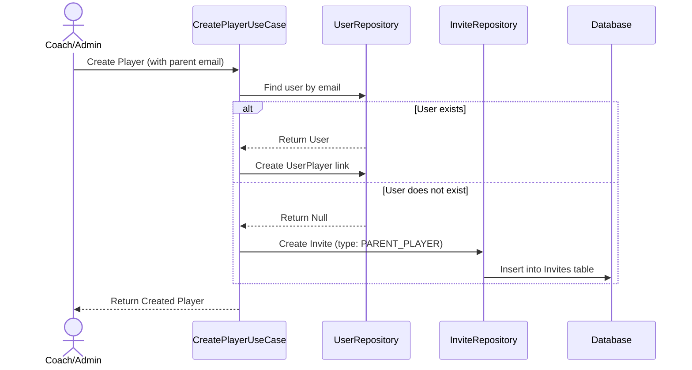
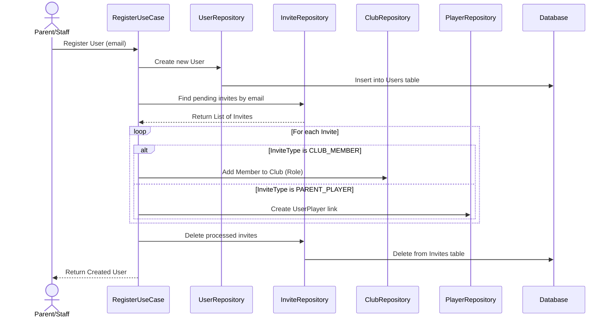
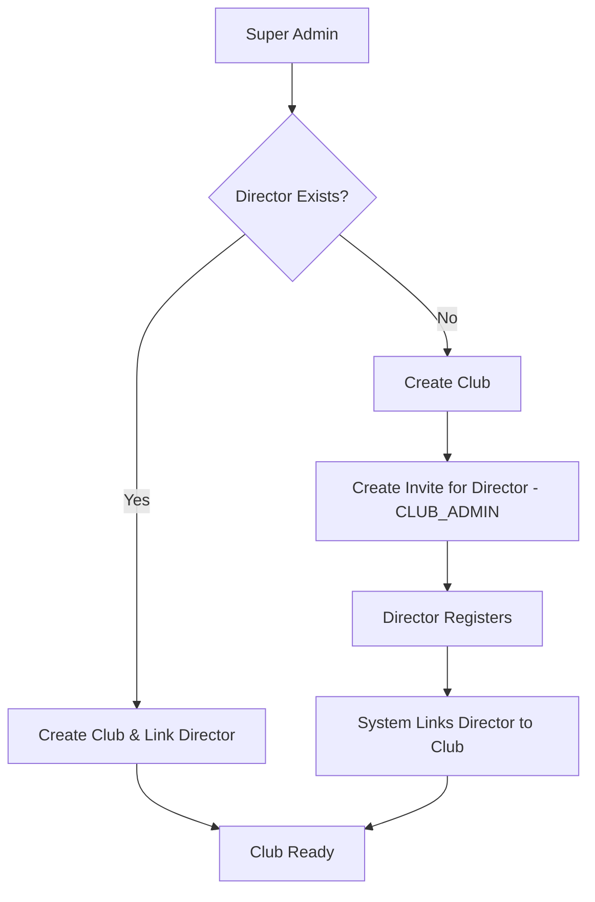
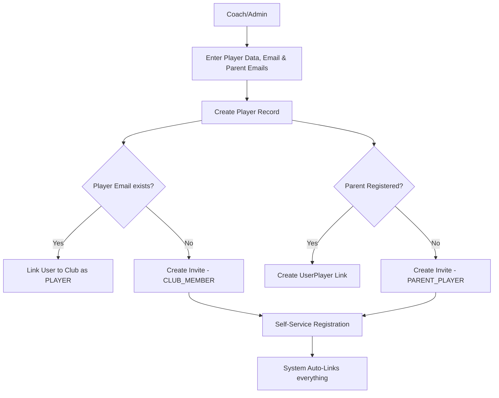
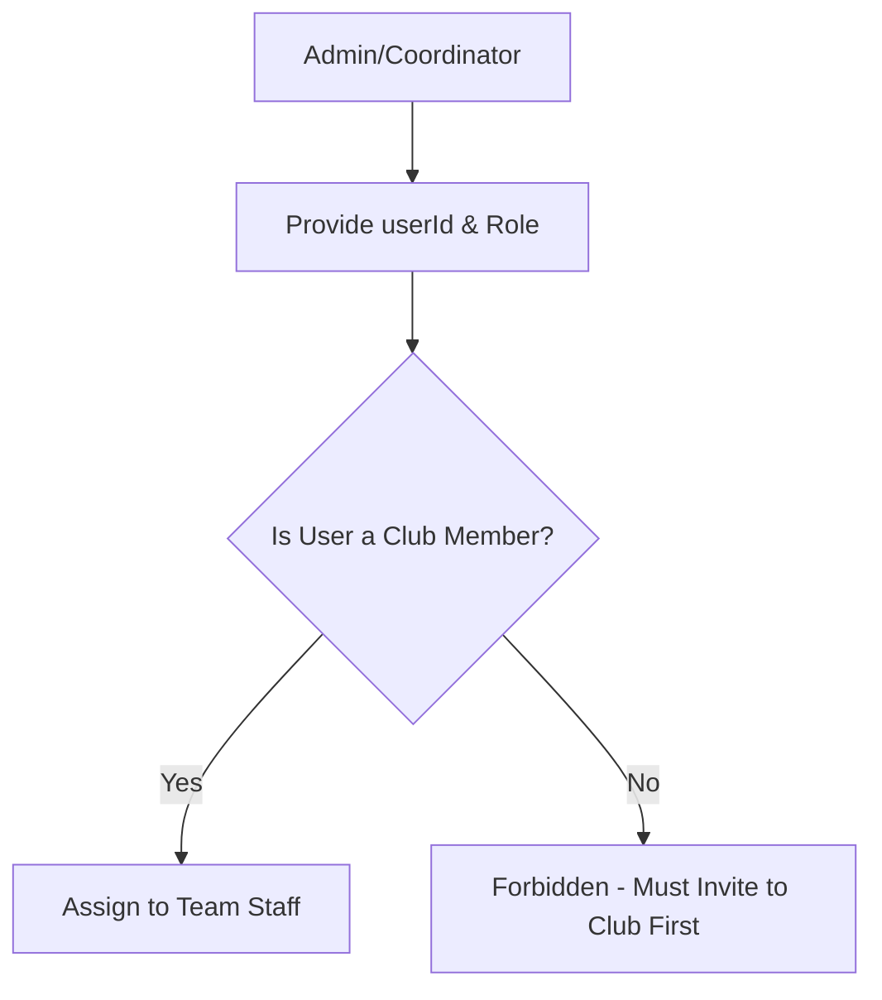
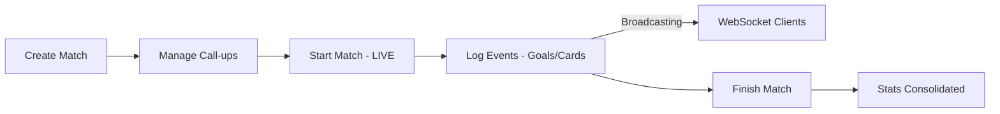
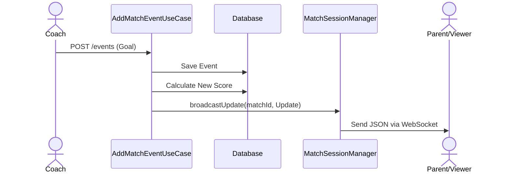

# Technical Decisions - Football Manager Platform

This document records the architectural patterns, libraries, and design principles adopted in this project.

## 1. Architectural Pattern: Clean Architecture
We follow a layered architecture to ensure separation of concerns, testability, and independence from frameworks.

### Layers:
- **Domain**: The core of the application. Contains **Entities**, **Repository Interfaces**, and **Use Cases**. It has no dependencies on external libraries (except for core language features).
    - *Use Cases*: Represent a single business action. Each Use Case class MUST have only one public operation, typically using the `operator fun invoke`.
- **Data**: Responsible for data persistence and external API communication. Contains **Repository Implementations**, **Exposed Tables**, and **Database Configuration**.
- **Presentation**: The entry point for users. In the `:server`, this means **Ktor Routes**. In the `:app`, it will be **Compose UI** and **ViewModels**.
- **Core**: A shared module (`:core`) containing models, exceptions, and utilities used by both the Backend and Frontend.

## 2. Dependency Injection: Koin
We use **Koin** for dependency injection because it is lightweight, KMP-friendly, and uses a DSL-based configuration that fits perfectly with Kotlin.
- Modules are defined in `di/AppModule.kt`.
- Use Cases and Repositories are registered and injected into Routes/Controllers.

## 3. Database Layer: JetBrains Exposed (v1)
We use **Exposed** as our SQL ORM.
- **Version 1.4.0+**: We use the latest stable version (using the `v1` package structure).
- **DSL Approach**: We prefer the Type-safe DSL for building queries.
- **Multi-Tenancy**: Every club-specific table contains a `clubId` to ensure data isolation.
- **Atomic Transactions**: We use a `TransactionManager` service in the Domain layer to orchestrate complex operations spanning multiple repositories. This ensures that a Use Case is either fully committed or completely rolled back in case of failure, maintaining data integrity (e.g., creating a player and their invitations must be an atomic unit).
- **Concurrency**: All database operations are wrapped in a `dbQuery` utility using `suspendTransaction` to ensure they don't block the Ktor threads.

## 4. Shared Models & Serialization
- **kotlinx.serialization**: Used for all JSON encoding/decoding. All status and type fields use Enums for type safety.
- **kotlinx-datetime**: Used for handling dates and times. Logical dates (like season start/end) use `LocalDate`, while audit timestamps use `kotlin.time.Instant`.
- **Error Handling**: A standardized system based on a custom `FootballManagerException` hierarchy. 
    - **Exception Types**:
        - `UnauthorizedException` (AUTH_001 -> 401): Authentication failures.
        - `ForbiddenException` (AUTH_002 -> 403): RBAC/Permission violations.
        - `ValidationException` (VAL_001 -> 400): Business rule or request format violations.
        - `ConflictException` (DATA_001 -> 409): Duplicate resources or state conflicts.
        - `DatabaseException` (DATA_002 -> 500): Persistence layer failures.
    - **Mapping**: Ktor's `StatusPages` plugin converts these to a consistent `ErrorResponse` JSON body.
    - **Security**: Unhandled exceptions (`Throwable`) are masked as "An internal server error occurred" to avoid leaking system internals.

## 5. Security & Authentication
- **JWT (JSON Web Tokens)**: Used for stateless authentication.
    - **Access Tokens**: Short-lived (1 hour) for regular requests.
    - **Refresh Tokens**: Long-lived (24 days) stored in the database for session renewal.
- **BCrypt**: Used for hashing passwords before storage.
- **Hierarchical RBAC**: Permissions are managed through a centralized `CheckUserPermissionUseCase` using a level-based system:
    - **Role Levels**: `CLUB_ADMIN` (5), `COORDINATOR` (4), `COACH` (3), `STAFF` (2), `PARENT/PLAYER` (1).
    - **Global vs Team Scope**: `CLUB_ADMIN` and `COORDINATOR` have global access to all club resources. `COACH` and `STAFF` roles are restricted to specific teams they are assigned to (verified via `team_staff` table).
    - **Platform Admin**: A global `isPlatformAdmin` flag bypasses all local club checks ("God Mode").
- **Permission Check Priority (Check Once, Fail Fast)**: To optimize performance and prevent unnecessary database access, authorization validation MUST be the **absolute first** operation performed in a Use Case. 
    - **Rule**: Validation must occur as soon as all necessary context (like `clubId` or `teamId`) is available, and before any state-changing logic or extensive data fetching.
    - **Practice**: If a Use Case requires metadata from a resource to determine the team context, the resource is fetched first, followed immediately by a single granular permission check. This prevents redundant calls to the security layer and unnecessary business logic execution for unauthorized users.
- **Security Testing**: The permission logic is covered by a suite of unit tests (`CheckUserPermissionUseCaseTest`) to prevent regression in access control.
- **Resource Management**: Support for partial updates (PATCH) to manage resource states (e.g., active/inactive status for teams, seasons and players).
- **Match-Opponent Relationship**: Matches are linked to a dedicated `Opponents` table rather than using simple strings. This ensures data consistency across the club and allows for richer opponent data (e.g., logos).

## 6. Real-Time Communication: WebSockets
We use **WebSockets** for delivering instantaneous updates during live matches (Live Score).

- **Implementation**: Ktor's `WebSockets` plugin with `KotlinxWebsocketSerializationConverter` for typed JSON communication.
- **Session Management**: A `MatchSessionManager` handles active connections, grouping them by `matchId`.
- **Hybrid Flow**: Events are recorded via a standard **REST POST** request (for reliability and ACID persistence) and then **broadcasted** to all connected WebSocket clients for that specific match.
- **Auto-Cleanup**: Sessions are automatically removed from the manager upon disconnection or transmission failure.

## 7. Invite System
We use a generic asynchronous invitation system to handle associations for users who may not yet be registered on the platform.

### Flow 1: Creation of an Invite (e.g., Parent-Player Association)

### Flow 2: Resolution of Invites during Registration

## 8. High-Level System Flows

### 8.1. Club Provisioning Flow
How a new club is onboarded onto the platform by the Super Admin.

### 8.2. Player Creation & Parent Association Flow
The process of adding athletes and linking their guardians.

### 8.3. Team Staff Assignment Flow
Coaches and technical staff must be club members before joining a team.

### 8.4. Match Day Lifecycle
This flow describes the operational lifecycle of a match.

### 8.5. Real-Time Event Broadcasting
Detailed view of how a match event reaches the viewers.

## 9. Project Structure (KMP)
- `:server`: Ktor backend.
- `:core`: Shared logic, models, and exceptions.
- `:app:shared`: Shared UI components and logic (Compose Multiplatform).
- `:app:androidApp`, `:app:iosApp`, `:app:webApp`: Platform-specific entry points.
