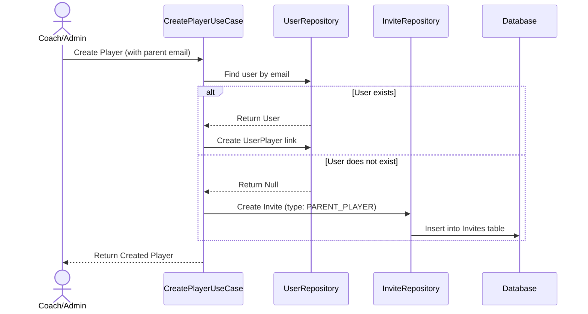
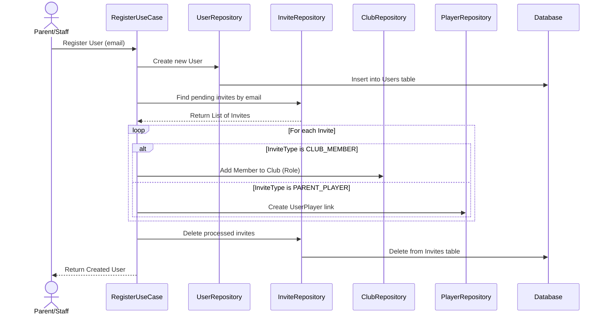
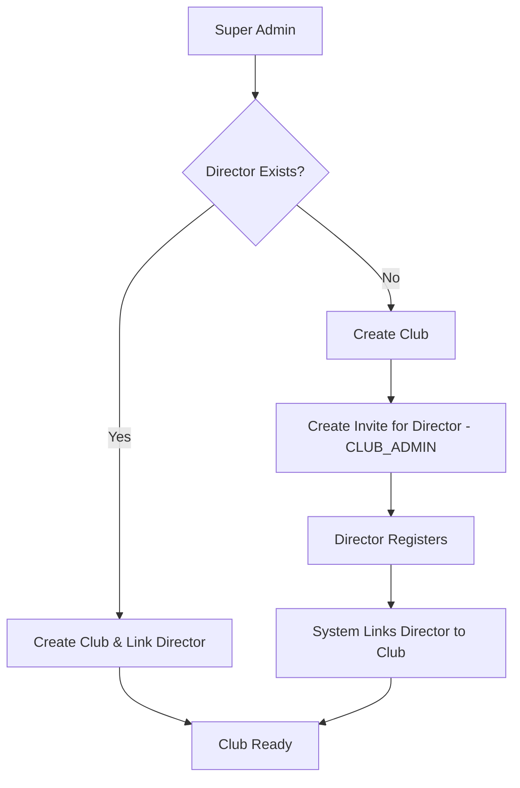
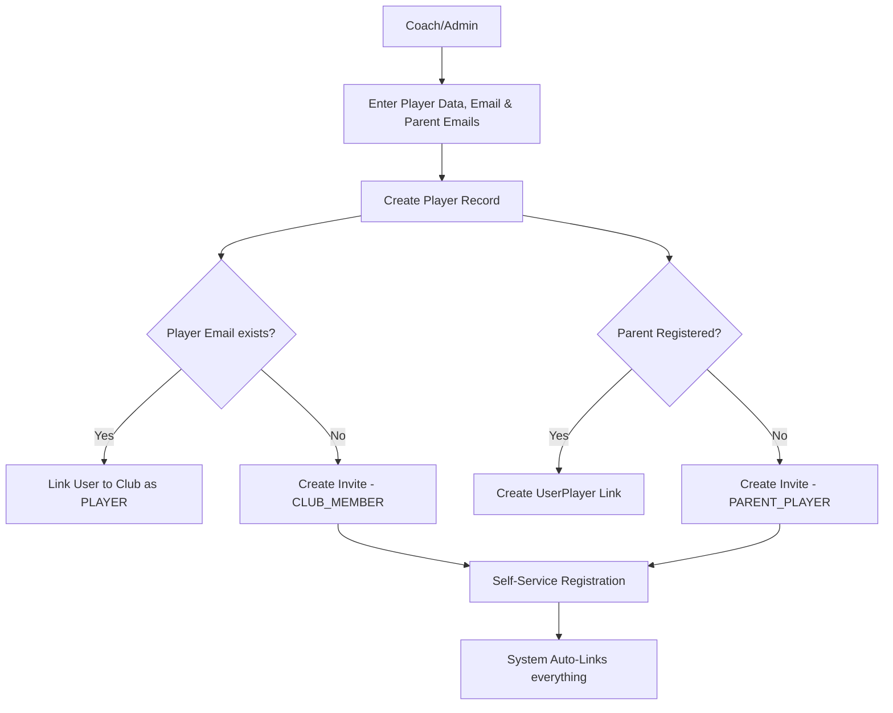
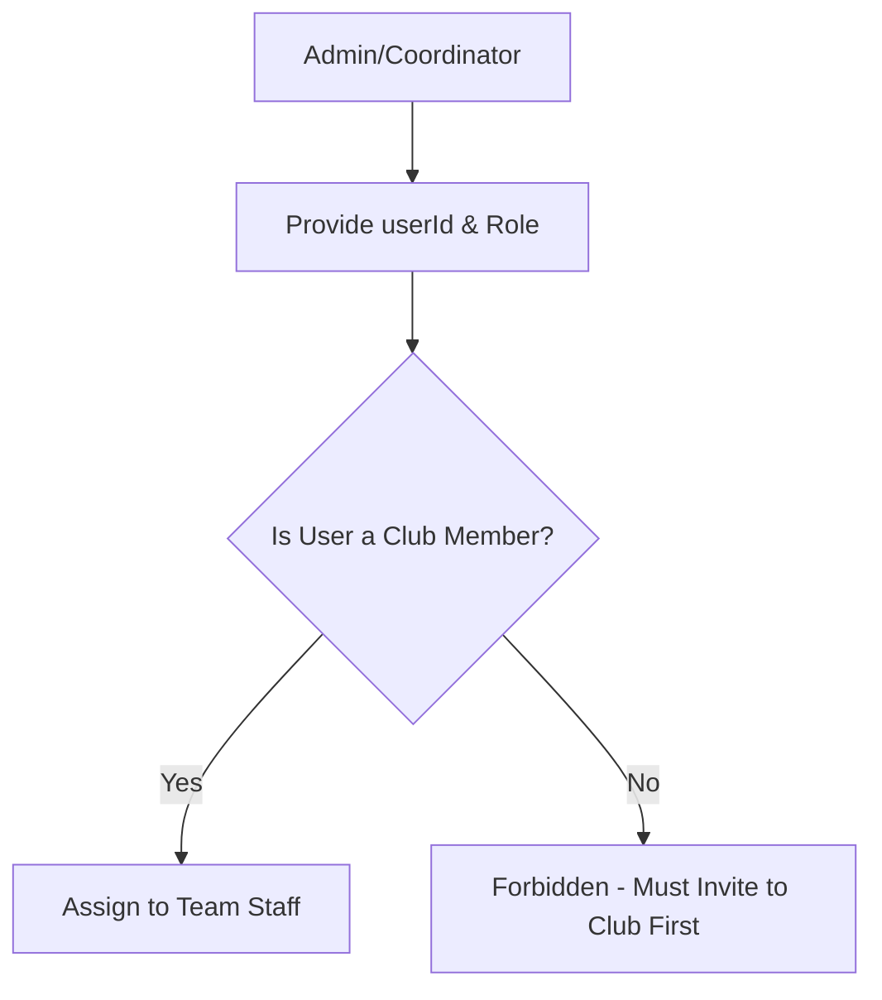
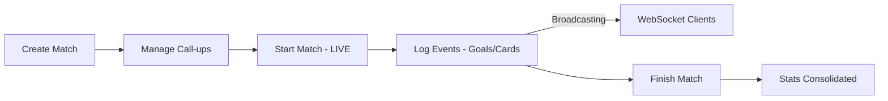
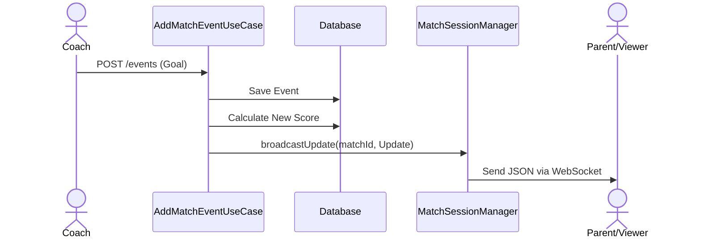

# Technical Decisions - Squadify Platform

This document records the architectural patterns, libraries, and design principles adopted in this project.

## 1. Architectural Pattern: Clean Architecture
We follow a layered architecture to ensure separation of concerns, testability, and independence from frameworks.

### Layers:
- **Domain**: The core of the application. Contains **Entities**, **Repository Interfaces**, and **Use Cases**. It has no dependencies on external libraries (except for core language features).
    - *Use Cases*: Represent a single business action. Each Use Case class MUST have only one public operation, typically using the `operator fun invoke`.
- **Data**: Responsible for data persistence and external API communication. Contains **Repository Implementations**, **Exposed Tables**, and **Database Configuration**.
- **Presentation**: The entry point for users. In the `:server`, this means **Ktor Routes**. In the `:app`, it will be **Compose UI** and **ViewModels**.
- **Core**: A shared module (`:core`) containing models and utilities used by both the Backend and Frontend. Exceptions (`SquadifyException` and subtypes) are server-only and live in `:server`, not here -- the client never catches them, it uses `ApiException` (keyed off the HTTP status code) instead. The actual shared model source files live in `:common`, a plain-JVM module with no Kotlin Multiplatform targets (see section 9) -- `:core` sources those same files into its `commonMain` rather than duplicating them, so client apps still see identical types.

## 2. Dependency Injection: Koin
We use **Koin** for dependency injection because it is lightweight, KMP-friendly, and uses a DSL-based configuration that fits perfectly with Kotlin.
- Modules are defined in `di/AppModule.kt`.
- Use Cases and Repositories are registered and injected into Routes/Controllers.

## 3. Database Layer: JetBrains Exposed (v1)
We use **Exposed** as our SQL ORM.
- **Version 1.4.0+**: We use the latest stable version (using the `v1` package structure).
- **DSL Approach**: We prefer the Type-safe DSL for building queries.
- **Aggregation Efficiency**: When fetching lists that depend on multiple conditions (e.g., getting clubs where a user is either a member OR a parent), we use the `exists` operator with subqueries to perform the logic in a single SQL command. This avoids multiple round-trips to the database and improves performance.
- **PostgreSQL, dev and production alike**: H2 has been removed entirely -- both environments now connect to a real PostgreSQL instance via HikariCP, differing only in *which* database they point at. `ServerConfig.kt` resolves the connection from environment variables (`DATABASE_HOST`, `DATABASE_PORT`, `DATABASE_USER`, `DATABASE_PASSWORD`, `DATABASE_NAME`): `DATABASE_HOST`/`DATABASE_PASSWORD` are required explicitly when `APP_ENV=production` (the server refuses to start rather than fall back to a local default), while `DATABASE_NAME` defaults per environment -- `squadify_dev` locally, `squadify_production` in production -- so the two never collide even against the same Postgres server. `docker-compose.yml` at the repo root spins up a local Postgres matching the dev defaults (`docker compose up -d`), so `./gradlew :server:run` still works with no further setup.
- **Multi-Tenancy**: Every club-specific table contains a `clubId` to ensure data isolation.
- **Atomic Transactions**: We use a `TransactionManager` service in the Domain layer to orchestrate complex operations spanning multiple repositories. This ensures that a Use Case is either fully committed or completely rolled back in case of failure, maintaining data integrity (e.g., creating a player and their invitations must be an atomic unit).
- **Concurrency**: All database operations are wrapped in a `dbQuery` utility using `suspendTransaction` to ensure they don't block the Ktor threads.

## 4. Shared Models & Serialization
- **kotlinx.serialization**: Used for all JSON encoding/decoding. All status and type fields use Enums for type safety.
- **kotlinx-datetime**: Used for handling dates and times. Logical dates (like season start/end) use `LocalDate`, while audit timestamps use `kotlin.time.Instant`.
- **Error Handling**: A standardized system based on a custom `SquadifyException` hierarchy. 
    - **Exception Types**:
        - `UnauthorizedException` (AUTH_001 -> 401): Authentication failures.
        - `ForbiddenException` (AUTH_002 -> 403): RBAC/Permission violations.
        - `ValidationException` (VAL_001 -> 400): Business rule or request format violations.
        - `ConflictException` (DATA_001 -> 409): Duplicate resources or state conflicts.
        - `DatabaseException` (DATA_002 -> 500): Persistence layer failures.
        - `IllegalIdFormatException` (VAL_002 -> 400): A path/body value that should be a UUID isn't
          one (stale client, typo'd URL, malformed request). Thrown by `String.toUuid()`
          (`server/.../util/UuidParsing.kt`), which every repository uses instead of calling
          `Uuid.parse` directly -- see `ISSUES TO FIX.md`, "Unguarded `Uuid.parse(...)` everywhere".
        - `NotFoundException` (DATA_003 -> 404): An entity looked up by ID doesn't exist -- the
          primary resource in the request, or one it references (e.g. a `clubId`/`ageGroupId` on a
          create payload). See `PROCESS_FLOWS.md` §11 for the standardization pass that made this
          consistent across every use case.
    - **Mapping**: Ktor's `StatusPages` plugin converts these to a consistent `ErrorResponse` JSON body.
    - **Security**: Unhandled exceptions (`Throwable`) are masked as "An internal server error occurred" to avoid leaking system internals.

## 5. Security & Authentication
- **JWT (JSON Web Tokens)**: Used for stateless authentication.
    - **Access Tokens**: Short-lived (1 hour) for regular requests.
    - **Refresh Tokens**: Long-lived (30 days) stored in the database for session renewal. `RefreshTokenUseCase` treats "not past its stored expiry" as a business rule it owns: the repository (`findRefreshToken`) just returns the row, and the use case rejects (and deletes) a token whose `expires_at` has passed, the same way it rejects an unknown one. Each successful refresh rotates the token (old row deleted, new 30-day row saved).
    - **Signing Secret**: The HMAC signing key is **not** in source. `JwtConfig` reads it from `ServerConfig.jwtSecret` (see *Environment Configuration* below), which sources the `JWT_SECRET` environment variable. In `PRODUCTION` the server refuses to start if it is unset; in `DEV` it falls back to a clearly-labelled placeholder so a plain `./gradlew run` works with no setup. The `issuer` and `audience` claims remain compile-time constants in `JwtConfig` — they are not secret and do not vary by environment.
- **BCrypt**: Used for hashing passwords before storage.
- **Platform-Admin Seeding (startup)**: `SeedPlatformAdminUseCase` runs once when the Ktor module boots (invoked from `Application.module()` right after Koin is installed) and guarantees a platform-admin ("superuser") account exists, so a freshly-created or wiped **dev** database is usable immediately with no manual bootstrapping step. It is **idempotent**: it only creates the account when no user with the configured email exists, and never mutates an existing account (so it cannot silently escalate a normal user that happens to share the email). A normal restart against an intact database is a no-op. Configuration lives in `ServerConfig` and is injected into the use case (which stays free of environment lookups): in `DEV` it is enabled by default with clearly-labelled fallback credentials (`admin@local.dev` / `admin1234`, overridable via `SEED_ADMIN_EMAIL` / `SEED_ADMIN_PASSWORD`); in `PRODUCTION` it is disabled unless `SEED_ADMIN_ENABLED=true` is set explicitly, and then `SEED_ADMIN_EMAIL` and `SEED_ADMIN_PASSWORD` are both required — there is never a password fallback in production. Covered by `SeedPlatformAdminUseCaseTest`.
- **Environment Configuration**: `config/ServerConfig.kt` is the single place server-side runtime config is resolved. It exposes an `AppEnvironment` enum (`DEV` / `PRODUCTION`, selected from the `APP_ENV` variable, defaulting to `DEV`) and reads secrets/tunables from real environment variables so nothing sensitive lives in source: the JWT signing secret, the PostgreSQL connection details (see §3), and the platform-admin seeding credentials/toggle (see *Platform-Admin Seeding* above). This mirrors, on the server, the `AppConfig` dev/prod split already used on the client (§10).
- **Hierarchical RBAC**: Permissions are managed through a centralized `CheckUserPermissionUseCase` using a level-based system:
    - **Role Levels**: `CLUB_ADMIN` (5), `COORDINATOR` (4), `COACH` (3), `STAFF` (2). (`MEMBER` is club-level, level 1.)
    - **Global vs Age-Group Scope**: `CLUB_ADMIN` and `COORDINATOR` have global access to all club resources. `COACH` and `STAFF` are scoped to specific **age groups** they are assigned to (verified via `age_group_staff`). Players and family members are not roles here — their read access flows from a linked player being in the relevant age group's pool (`age_group_players`). A `teamId` passed to `CheckUserPermissionUseCase` is resolved to its age group before these checks.
    - **Platform Admin**: A global `isPlatformAdmin` flag bypasses all local club checks ("God Mode").
- **Permission Check Priority (Check Once, Fail Fast)**: To optimize performance and prevent unnecessary database access, authorization validation MUST be the **absolute first** operation performed in a Use Case. 
    - **Rule**: Validation must occur as soon as all necessary context (like `clubId` or `teamId`) is available, and before any state-changing logic or extensive data fetching.
    - **Practice**: If a Use Case requires metadata from a resource to determine the team context, the resource is fetched first, followed immediately by a single granular permission check. This prevents redundant calls to the security layer and unnecessary business logic execution for unauthorized users.
- **Security Testing**: The permission logic is covered by a suite of unit tests (`CheckUserPermissionUseCaseTest`) to prevent regression in access control.
- **Resource Management**: Support for partial updates (PATCH) to manage resource states (e.g., active/inactive status for teams, seasons and players).
- **Match-Opponent Relationship**: Matches are linked to a dedicated `Opponents` table rather than using simple strings. This ensures data consistency across the club and allows for richer opponent data (e.g., logos).
- **Pagination**: To ensure scalability and performance as data grows (e.g., hundreds of players or matches), list-based endpoints (GET) will implement a standard pagination strategy using `limit` and `offset` (or `page`) query parameters. This prevents excessive memory consumption and slow response times.
- **Email System (Pending)**: While the Invitation logic is fully implemented at the database and domain levels, the physical sending of emails (SMTP/API integration) is currently not implemented. Invocations to the email service should be treated as placeholders until a provider (e.g., SendGrid, Mailjet) is selected.

## 6. Real-Time Communication: WebSockets
We use **WebSockets** for delivering instantaneous updates during live matches (Live Score).

- **Implementation**: Ktor's `WebSockets` plugin with `KotlinxWebsocketSerializationConverter` for typed JSON communication.
- **Session Management**: A `MatchSessionManager` handles active connections, grouping them by `matchId`.
- **Hybrid Flow**: Events are recorded via a standard **REST POST** request (for reliability and ACID persistence) and then **broadcasted** to all connected WebSocket clients for that specific match.
- **Auto-Cleanup**: Sessions are automatically removed from the manager upon disconnection or transmission failure.
- **Client**: The KMP client connects via `ktor-client-websockets` (`WebSockets` plugin + `KotlinxWebsocketSerializationConverter`, same JSON config as the REST `ContentNegotiation`), authenticating with the JWT as a `?token=` query param (browser WebSockets can't send custom headers). `MatchRepositoryImpl.observeLiveMatch` exposes it as a cold `Flow<LiveMatchUpdate>`. It's a best-effort second channel, not the primary path: `LiveMatchViewModel` applies every mutating action's own REST response to local state immediately, and does not retry the socket if it drops — see PROCESS_FLOWS.md §8.4.

## 7. Invite System
We use a generic asynchronous invitation system to handle associations for users who may not yet be registered on the platform.

### Flow 1: Creation of an Invite (e.g., Parent-Player Association)

### Flow 2: Resolution of Invites during Registration

## 8. High-Level System Flows

### 8.1. Club Provisioning Flow
How a new club is onboarded onto the platform by the Super Admin.

### 8.2. Player Creation & Parent Association Flow
The process of adding athletes and linking their guardians.

### 8.3. Age-Group Staff Assignment Flow
Coaches and technical staff must be club members before joining an age group.

### 8.4. Match Day Lifecycle
This flow describes the operational lifecycle of a match.

### 8.5. Real-Time Event Broadcasting
Detailed view of how a match event reaches the viewers.

## 9. Project Structure (KMP)
- `:server`: Ktor backend. Depends on `:common` directly, not `:core`. Owns `SquadifyException` and its
  subtypes directly (`server/.../exception/SquadifyException.kt`) -- these are never used client-side.
- `:common`: Plain-JVM module (no KMP targets) holding the model source files shared with the client
  apps (request/response DTOs, etc). Exists so building `:server` never needs to configure a Kotlin
  Multiplatform target (Android, iOS, JS, Wasm) -- Gradle fully configures a project's build script for
  any dependent to build it, so depending on the multiplatform `:core` directly would force every
  server build to configure Android tooling just to resolve dependencies, even though the server never
  touches it.
- `:core`: Shared logic and models, exposed to the client apps across all KMP targets. Its `commonMain`
  sources the same files from `:common` (via `srcDir`, not a project dependency -- `commonMain` can't
  depend on a plain-JVM module) so there is no duplication.
- `:app:shared`: Shared UI components and logic (Compose Multiplatform).
- `:app:androidApp`, `:app:iosApp`, `:app:webApp`: Platform-specific entry points.

## 10. Client Architecture (KMP)
The client follows a modern multiplatform architecture to share as much logic as possible while providing native performance and UI.

- **UI Framework**: **Compose Multiplatform** for sharing UI code across Android, iOS, Desktop, and Web.
- **Navigation**: **androidx.navigation:navigation-compose** (KMP version) for type-safe navigation using Kotlin Serialization.
- **Dependency Injection**: **Koin** for managing ViewModels and services.
- **Environment Configuration**: An `AppConfig` interface is used to manage environment-specific variables like `baseUrl`. This allows switching between `dev` and `prod` configurations without changing business logic.
- **Session Management (Persistence)**: We use the **russhwolf:multiplatform-settings** library to store session tokens (`accessToken`, `refreshToken`) persistently across app launches. 
    - **Session Refresh**: On every app launch (via the `SplashScreen`), the system attempts to refresh the access token using the stored `refreshToken`. If successful, the user proceeds to the Dashboard with updated credentials; otherwise, the session is cleared, and the user is redirected to the Login screen. This ensures tokens remain fresh and security is maintained.
- **State Management**: **MVVM (Model-View-ViewModel)** pattern using `androidx.lifecycle:lifecycle-viewmodel` (KMP).
    - **State Pattern**: UI state is modeled using `sealed classes` (e.g., `LoginUiState`) to ensure type safety and mutually exclusive states (Idle, Loading, etc.). Each screen has its own state file (e.g., `LoginUiState.kt`) in the same package as the screen.
    - **State Updates**: We prefer using `_state.update { ... }` over direct assignment (`_state.value = ...`) to ensure thread-safe updates to the `MutableStateFlow`.
    - **Navigation Events**: Navigation is treated as a "one-shot" event (Side Effect) using a dedicated `SharedFlow` (e.g., `navigationEvent`) and specific event classes. This prevents re-triggering navigation when returning to a screen.
    - **Feature Packaging**: Components belonging to the same feature (Screen, ViewModel, UiState) are kept in the same package (e.g., `presentation.ui.login`) to improve discoverability and cohesion.
    - **Shared Components**: `presentation.ui.components` holds Composables reused across more than one feature package -- `PrimaryLoadingButton` (the standard full-width submit button with a loading-spinner state), `FMTopBar` (the dark toolbar with an optional subtitle and trailing actions slot), `DatePickerSheet` (a bottom-sheet `DatePicker` with optional `minDate`/`maxDate` bounds), `EmptyStateCallToAction` (the icon+title+subtitle+button "nothing here yet" layout used by `ClubDetailsScreen`'s no-seasons/no-age-groups states), and `MatchRow` (the one match-list-row look for every match state -- SCHEDULED, LIVE/HALF_TIME, FINISHED, CANCELLED -- used by the club Matches tab, Age Group Details' "Next games", and Team Details' upcoming/results lists; takes a `Match` plus an optional `teamName` and `MatchScore?`, since a match never carries its own score). New UI that repeats an existing screen's exact layout/styling a second time should be extracted here rather than copied.
    - **Returning a Result to the Previous Screen**: When a screen needs to signal something back to the screen that pushed it (e.g. "a season was just created, reload"), use the standard Compose Navigation pattern: the pushed screen sets a value on `navController.previousBackStackEntry?.savedStateHandle`, and the previous screen's `composable<...> { backStackEntry -> ... }` block reads it via `backStackEntry.savedStateHandle.getStateFlow(key, default)`, clearing it once consumed. Needed because Koin scopes a screen's `ViewModel` to its back-stack entry, so popping back to a screen reuses its existing (now stale) state rather than re-running the `ViewModel`'s `init`.
- **Typed HTTP Errors**: `HttpClientExtensions.handleResponse()` (used by every repository) throws `ApiException(statusCode, code, message)` for any non-2xx response, carrying the HTTP status and the server's `ErrorResponse.code` (see §4's exception table) instead of a bare `Exception(message)`. This lets a ViewModel branch on *what kind* of failure occurred (e.g. a 409 conflict getting special handling) without pattern-matching the message text -- which per `AI_GUIDELINES.md` "No Raw Exception Messages in UI" a screen shouldn't be displaying verbatim anyway.
- **Communication**: Ktor Client (`ktor-client-cio` + `ktor-client-content-negotiation`) handles REST communication; `ktor-client-websockets` handles the live match updates socket (§6).

## 11. Mobile & Client Guidelines: Aligning with Current Google Guidance

This section records the current (2026) Google/JetBrains-recommended approach for Compose Multiplatform / Android development, cross-checked against what this project's `gradle/libs.versions.toml` and `app/` modules actually do today. Each point below states the guidance, then this project's real current status against it — some are already satisfied, some are open work.

### 11.1 UI toolkit: Jetpack Compose

Compose is Google's default and recommended UI toolkit; the XML View system is legacy, maintenance-only. **Status: already the case.** This project is fully on Compose Multiplatform (`composeMultiplatform = "1.11.1"`) across all four client targets (`app/androidApp`, `app/shared` for iOS, `app/desktopApp`, `app/webApp`) — there is no View-based UI anywhere in the codebase.

### 11.2 Design system: Material 3

Use `androidx.compose.material3` (the Compose Multiplatform equivalent: `org.jetbrains.compose.material3`), not the legacy `material` (M2) artifact. **Status: already the case** — `material3 = "1.9.0"` is the only Material dependency declared, consumed from `app/shared`'s `commonMain`.

"Material 3 Expressive" is not a separate library or an opt-in mode to switch on — it's the current direction of the `material3` artifact itself (updated theming, motion, shape, and typography, aligned with Android 16's visual language). Staying current on `material3` releases *is* adopting it; there's no separate migration step.

The **Compose Styles API** is a newer (2026) mechanism for building a styleable design system: `Modifier.styleable()` layers three levels of styling — component defaults, theme-level overrides, and call-site overrides — with `MutableStyleState` handling state-based styling (pressed/disabled/hovered) automatically. It replaces passing individual hardcoded style parameters (`backgroundColor`, `shape`, etc.) into every composable. **Status: not yet adopted** — this project's shared `presentation/ui` components currently take individual parameters rather than a centralized `Style`/`ComponentStyles` object. Worth evaluating once the shared component library grows past a handful of screens; not a blocker today.

### 11.3 Architecture

The existing pattern (§10: Screen + `UiState` + `ViewModel`, MVVM/UDF, sealed-class states, one-shot navigation via `SharedFlow`) is correct and matches current guidance. Refinements to fold in:

- Collect state with `collectAsStateWithLifecycle()` rather than plain `collectAsState()`, so screens stop collecting `StateFlow` updates while not visible (lifecycle-aware collection). Verify this is consistently used wherever a `ViewModel`'s `state: StateFlow<UiState>` is collected in a `@Composable`.
- DI via Koin is the right call, confirmed: Hilt is Android-only (annotation-processor based, no iOS/Web/Desktop target), so it can't be used in a module shared across all four client targets the way Koin already is (`koin-core`, `koin-compose`, `koin-compose-viewmodel`).
- Coroutines + Flow everywhere is already the pattern in use (`kotlinx-coroutines`, `_state.update { }`, per §10).
- Google's [Now in Android](https://github.com/android/nowinandroid) sample remains the canonical reference for this architecture style (MVVM, UDF, modularization) — useful as a pattern reference, but it's Android-only, not KMP, so treat it as a reference for *shape*, not a literal template, given this project's shared module spans Android, iOS, Desktop, and Web.

### 11.4 Navigation: Navigation 3

`androidx.navigation3` inverts the ownership model from Navigation 2: instead of the library owning one internal back stack, the app owns it directly as a plain observable list (`rememberNavBackStack`, backed by `SnapshotStateList`). As of Compose Multiplatform 1.10+, it has first-class support across **all** Compose Multiplatform targets — Android, iOS, Desktop, and Web — which lines up with this project's four client targets. JetBrains' own docs describe adopting it as "less a migration, more a rewrite" of navigation, not a version bump, so it should be scoped as its own dedicated piece of work rather than folded into an unrelated feature.

**Status: not yet adopted.** This project is still on `navigation-compose` 2.9.2 (`navigation = "2.9.2"`, Navigation 2.x) in `app/shared`. Two concrete things to plan for before migrating, both confirmed from official docs:

- **Serialization on non-JVM targets**: Android's route serialization relies on reflection, which doesn't work on iOS/Web. Migrating requires registering every route type explicitly via polymorphic serialization in a `SavedStateConfiguration` — this is the detail most likely to cause friction here specifically, since this project targets iOS and Web in addition to Android.
- **Web back-button support isn't fully built in yet** — integrating the `webApp` target's browser back button currently needs a separate `navigation3-browser` library, with official integration still pending upstream.

### 11.5 Adaptive UI (do this from day one)

Support phones, foldables, tablets, and desktop from the start, using window size classes, `material3-adaptive`, multi-pane layouts, and adaptive navigation (bottom bar on compact width ↔ navigation rail on expanded width). Retrofitting this after screens are built single-layout is significantly more expensive than designing for it upfront.

**Status: not started.** No `material3-adaptive` dependency exists in `libs.versions.toml`, and no window-size-class logic exists in the codebase today. Given this project already ships a `desktopApp` target (inherently a large-width surface) alongside phone-sized Android/iOS targets, this is a real, current gap rather than a future nice-to-have — the guidance to do it "from day one" applies directly, since screens are actively being built without it right now.

### 11.6 Edge-to-edge (mandatory)

Android 15 (API 35) enforces edge-to-edge by default but still allowed an app-level opt-out (`windowOptOutEdgeToEdgeEnforcement`). Android 16 (API 36) removes that opt-out entirely — an app targeting API 36+ cannot suppress edge-to-edge at all.

**Status: mostly already in place.** This project already compiles/targets API 37 (`android-compileSdk = "37"`, `android-targetSdk = "37"`) — past the point where opting out is even possible — and `MainActivity` already calls `enableEdgeToEdge()`. What hasn't been verified screen-by-screen is whether every screen's content properly consumes `WindowInsets` (e.g. via `Scaffold`'s built-in inset handling) instead of assuming safe margins around system bars. Worth a deliberate pass once Navigation 3 (§11.4) and adaptive layouts (§11.5) land, since both restructure how the top-level scaffold is built.

### 11.7 Build & tooling

- **Kotlin 2.x with the K2 compiler**: already the case — `kotlin = "2.4.10"`, which is on a K2-only release line (K1 has been fully retired by this point in the 2.x series). No action needed.
- **Gradle Kotlin DSL + version catalog**: already the case — every module uses `.kts`, and all dependency versions are centralized in `gradle/libs.versions.toml`.
- **targetSdk 35/36, minSdk 24+**: already exceeded — this project compiles and targets API 37 with `minSdk = 24`.
- **Baseline Profiles + R8 full mode for release**: **not yet configured.** `app/androidApp`'s release build type currently sets `isMinifyEnabled = false` despite specifying ProGuard files, and no Baseline Profile module or dependency exists anywhere in the project. This is a concrete, current gap against the guidance, not just an unstarted aspiration.
- **AGP 9 for pure-Android modules**: **already done, and done correctly.** AGP 9 (`agp = "9.3.1"`) dropped support for combining the standard Kotlin Multiplatform Gradle plugin with `com.android.application`/`com.android.library` — the required fix is to split a pure Android app module (using `com.android.application`) from a KMP-aware shared module (using the newer `com.android.kotlin.multiplatform.library` plugin with a `kotlin.android { }` block, instead of `com.android.library` + `kotlin.androidTarget { }`). That is exactly the shape this project already has: `app/androidApp` uses `libs.plugins.androidApplication`, while `app/shared` uses `libs.plugins.androidMultiplatformLibrary`. No migration needed here — this project is ahead of where the guidance assumes most KMP projects currently are.

### 11.8 Open items against this guidance

- [ ] Adopt `material3-adaptive` + window size classes; add adaptive navigation (bottom bar ↔ navigation rail) — nothing exists yet (§11.5).
- [ ] Plan and execute the Navigation 2 → Navigation 3 migration, budgeting specifically for polymorphic route serialization on iOS/Web (§11.4).
- [ ] Enable R8 full mode (`isMinifyEnabled = true` with an appropriate `proguard-rules.pro`) and add a Baseline Profile for `app/androidApp`'s release build (§11.7).
- [ ] Audit screen-level composables for correct `WindowInsets` consumption now that edge-to-edge is unavoidable at the targeted API level (§11.6).
- [ ] Evaluate the Compose Styles API for the shared design system once `presentation/ui` grows past its current size (§11.2) — not urgent today.

**Sources**: [Compose Multiplatform 1.10.0 release notes](https://blog.jetbrains.com/kotlin/2026/01/compose-multiplatform-1-10-0/) · [Navigation 3 in Compose Multiplatform](https://kotlinlang.org/docs/multiplatform/compose-navigation-3.html) · [Navigation 3 — Android Developers](https://developer.android.com/guide/navigation/navigation-3) · [Updating multiplatform projects to AGP 9](https://kotlinlang.org/docs/multiplatform/multiplatform-project-agp-9-migration.html) · [Material Design 3 in Compose — Android Developers](https://developer.android.com/develop/ui/compose/designsystems/material3) · [Jetpack Compose Styles API](https://developer.android.com/agents/skills/jetpack-compose/theming/styles/skill) · [Behavior changes: apps targeting Android 16](https://developer.android.com/about/versions/16/behavior-changes-16) · [Now in Android sample](https://github.com/android/nowinandroid)

## 12. Crash Reporting & Distribution: Firebase (Android-only for now)

`app/androidApp` is registered with Firebase project `squadify-958d3` (`google-services.json` checked in --
it's not a secret, it only carries public app identifiers). Two products are wired up so far, both
Android-only since neither Crashlytics nor App Distribution supports the desktop/web targets, and iOS
(`app/iosApp` -- a real Xcode project, see the "Environment-Based App Config" section) hasn't been
registered with Firebase yet either -- that's a real, separate gap, not something blocked on the app
existing:

- **Crashlytics**: `firebase-bom` + `firebase-crashlytics` dependency, plus the `google-services` and
  `firebase.crashlytics` Gradle plugins. Fully automatic once the app initializes -- no code changes needed
  for basic crash reporting.
- **App Distribution**: authenticates non-interactively via a service-account key (Firebase App Distribution
  Admin role), so `./gradlew app:androidApp:appDistributionUploadRelease` builds and uploads a release with
  no login step. The `release` build type's `firebaseAppDistribution { serviceCredentialsFile = ... }` block
  points at `app/androidApp/firebase-service-account.json` -- a local-only file, gitignored, never committed.
  Releases go to the `squadify-testers` group (`groups = "squadify-testers"` in the same block) -- manage
  membership in the Firebase console under App Distribution -> Testers & Groups.

## 13. Web Client Deployment: Docker + nginx

`app/webApp/Dockerfile` builds and serves the web client, deployed as its own Railway service alongside
`:server` (see `server/Dockerfile`). Build context is the repo root, same reasoning as `:server`'s
Dockerfile: `settings.gradle.kts`'s `include(...)` requires every listed project directory to physically
exist in the build context (verified -- omitting one fails with "Configuring project ':x' without an
existing directory is not allowed"), regardless of `--configure-on-demand`.

- **Build target**: `composeCompatibilityBrowserDistribution` -- a Wasm build with an automatic Kotlin/JS
  fallback bundled into one static output, so the app runs in any modern browser regardless of Wasm GC
  support. The build stage still needs the Android SDK (same as the pre-`:common`-split `:server`
  Dockerfile) purely to let Gradle configure `:app:shared` -> `:core`'s Android target, even though
  nothing Android-specific is compiled -- `:app:webApp` doesn't get the same clean-dependency split
  `:server` has, since it genuinely needs `:app:shared`'s KMP-compiled output.
- **`--configure-on-demand` is deliberately NOT used** for this build -- Gradle warns the js/wasmJs
  targets don't support it.
- **Runtime**: a plain `nginx:alpine` image serving the static bundle (`app/webApp/nginx.conf`), with a
  `try_files ... /index.html` SPA fallback and gzip enabled for the large `.js`/`.wasm` assets. No JDK,
  Gradle, Android SDK, or Node in the final image.
- **Real memory requirement discovered building this**: `kotlin.daemon.jvmargs` needed raising from
  3072M to 4096M in the root `gradle.properties` -- the Compose-for-Web compile (pulls in Skiko) hits
  "Not enough memory to run compilation" below that, independent of Docker/CI specifics. Also fixed a
  latent bug in both Dockerfiles: neither copied `gradle.properties` into the build context, so this
  setting (and any other project-level Gradle property) was silently never applied inside the container
  -- `:server`'s build happened to still succeed on Gradle/Kotlin's smaller defaults given its lighter
  compile, but this was luck, not correctness.

## 14. Association Notification Email: EmailService + Resend

`domain/service/EmailService.kt` is a best-effort, must-never-throw interface (`ResendEmailService` is
the only implementation, `data/service/`) sending three notifications, all triggered from the same
places the underlying association already happens -- `ProvisionClubUseCase`, `AddClubMembersUseCase`,
`AddStaffToAgeGroupUseCase`:

- **Existing user directly added** to a club or age-group staff -> a "you've been added" email.
- **No account yet** (club/director invite path -- an `Invite` row is created, same as always) -> a
  "register to join" email linking to `ServerConfig.webAppBaseUrl` (a placeholder until the web client
  is deployed -- see `ISSUES TO FIX.md`). `RegisterUseCase` already resolves pending invites by email at
  registration time, so registering with the invited address is all that's needed to complete the join
  -- no new resolution logic was added for this.
- Push/in-app notifications are explicitly out of scope here (not built yet) -- email is the only
  channel implemented.

**Send timing**: every call site fetches whatever it needs (club/age-group name) *inside*
`transactionManager.runInTransaction { }` and only calls `emailService.send...()` after that block
returns. Two things forced this shape, both hit as real bugs while building this, not just design
foresight:
- A slow/failed Resend call must never roll back a club/age-group association that already succeeded --
  so the send has to happen after commit, never inside the transaction.
- Repository methods here (e.g. `ClubRepository.getClubById`) have no transaction of their own --
  they rely on an ambient one from `runInTransaction`. Calling one *after* the transaction closes throws
  (verified: this exact mistake produced a real 500 on `POST /clubs/{id}/members` during manual testing).
  The fix is fetching the name *inside* the transaction and carrying the plain value out, not the repo
  call itself.

**Resend + no domain yet**: `RESEND_API_KEY` (`ServerConfig.resendApiKey`) is optional, not
required-in-production like `jwtSecret`/`databasePassword` -- a missing key makes `ResendEmailService`
log a warning and skip the send rather than block the request or crash startup, since email here is a
notification, not a security-critical value. Without a verified sending domain, Resend only delivers
from `onboarding@resend.dev` to the Resend account's own email -- real delivery to arbitrary invitees
needs a verified domain (`RESEND_FROM_ADDRESS` env var overrides the default once one exists).

## 15. API Versioning: `/v1` Prefix

Every route is now nested under `/v1` (`Application.kt`'s `routing { route("/v1") { authRoutes(); ... } }`)
-- a single wrapper around the existing route-function calls, no changes needed in any of the 9
`*Routes.kt` files, since each is an extension function on `Route` and Ktor composes the path prefix
from whatever context they're nested in. The root health check (`GET /`) stays unversioned deliberately
-- infra/uptime monitors hit it directly and shouldn't need to know the API version.

Client-side, every repository builds its URLs as `"${appConfig.baseUrl}/..."`, so the fix is entirely at
the `AppConfig` construction site -- every environment's `baseUrl` now ends in `/v1` (see §16, "
Environment-Based App Config", for how each platform constructs its `AppConfig` today -- the
`DevAppConfig`/`ProdAppConfig` classes referenced when this section was first written no longer exist).
Every call site (including the live-match WebSocket URL, derived from the same `baseUrl` via a scheme
swap) picks up `/v1` automatically -- no changes needed in any of the ~10 `*RepositoryImpl.kt` files.

Verified against a real running server, not just compilation: the old unversioned paths now 404
(`GET /clubs` -> 404), the new `/v1` paths work end-to-end including a real WebSocket upgrade
(`GET /v1/matches/{id}/live` -> `101 Switching Protocols`, then closes with "Unauthorized" as expected
with no token), and the unversioned root health check still responds normally.

## 16. Environment-Based App Config

Three environments across every client: **dev** (a local/LAN server, for active development), **staging**
(what Firebase App Distribution builds should point at -- deploy and verify there before production),
**production** (the store release / deployed web client). `AppConfig` (`domain/config/AppConfig.kt`,
`baseUrl` + `isDebug`) is unchanged, but there is no longer a per-environment class in `app:shared`
(`DevAppConfig`/`ProdAppConfig` are gone) and no hardcoded Koin binding. `initKoin(appConfig: AppConfig, ...)`
now takes the config as a parameter, constructed via the single `data class DefaultAppConfig` -- **each
platform's own entry point builds it and passes it in**, using whatever mechanism that platform's real
build-variant system offers:

- **Android** (`app/androidApp`): three product flavors (`dev`/`staging`/`prod`), each setting a
  `BASE_URL` via `buildConfigField`. `SquadifyApplication.onCreate()` reads `BuildConfig.BASE_URL`/
  `BuildConfig.DEBUG` and passes them to `initKoin`. `dev`/`staging` carry an `applicationIdSuffix`
  (`.dev`/`.stg`; `prod` stays bare, for the real Play Store listing) -- originally *not* suffixed at
  all, but that let a device that had ever run more than one flavor be handed the *same* FCM
  registration token across them (Firebase scopes a token by package name + project + signing cert, not
  by build variant), so a push triggered on one environment's server could land on a device someone only
  meant to test another environment on; see §24's push-notifications section. `google-services.json` is
  now registered for all three resulting package names under the one Firebase project (`squadify-958d3`).
  One consequence: Firebase App Distribution's task is no longer the flat `appDistributionUploadRelease`
  -- flavors split it into `appDistributionUploadDevRelease`/`...StagingRelease`/`...ProdRelease`
  (verified: ran `./gradlew :app:androidApp:tasks --all`, confirmed all three exist). Use
  `appDistributionUploadStagingRelease` for tester builds, per the "staging first" rule above.
- **Desktop & Web** (`app/desktopApp`, `app/webApp`): no OS/toolchain-level build-variant system, so both
  use the same pattern instead -- a `generateSquadifyConfig` Gradle task writes a small
  `internal object SquadifyBuildConfig { const val BASE_URL = ...; const val IS_DEBUG = ... }` file based
  on a `-PsquadifyEnv=dev|staging|production` Gradle property (default `dev`), wired into the module's
  main source set via `srcDir(generateSquadifyConfig)`. Each `main()` reads `SquadifyBuildConfig` and
  calls `initKoin` before starting the UI. `dev` defaults to `http://localhost:8080/v1` here (not the
  Android flavor's LAN IP) -- Desktop and a local Kotlin/JS dev server both run on the same machine as
  the backend, unlike a physical Android device on WiFi, so `localhost` is actually correct and doesn't
  go stale if the dev machine's LAN IP changes. `app/webApp/Dockerfile` passes `-PsquadifyEnv=production`
  by default (`ARG SQUADIFY_ENV`, overridable with `--build-arg SQUADIFY_ENV=staging` for a staging
  deploy).
- **iOS** (`app/iosApp`): a real, existing Xcode project (not a Gradle module, so it doesn't show up in
  `settings.gradle.kts` -- easy to miss for exactly that reason). `iOSApp.swift`'s `init()` picks
  `baseUrl`/`isDebug` via `#if DEBUG`/`#else` (Xcode's own default Debug/Release build configurations,
  present in every Xcode project) and calls `Shared`'s `KoinHelperKt.startKoinIOS(baseUrl:isDebug:)`
  (`app/shared/src/iosMain/.../KoinHelper.kt`), which constructs a `DefaultAppConfig` and calls
  `initKoin`. Only two tiers for now (dev/production, not a third "staging"), since adding a real
  Staging Xcode Build Configuration + scheme is safest done interactively in Xcode rather than by
  hand-editing `project.pbxproj` blind.
  - **A real Kotlin/Native naming gotcha hit while wiring this up**: the bridge function was originally
    named `initKoinIOS`, but Kotlin/Native's Objective-C interop generator silently prefixes any exported
    function starting with `init` with `do` (to avoid colliding with Objective-C's special initializer
    semantics) -- so the Swift-visible name became `doInitKoinIOS(...)`, not `initKoinIOS(...)`, and
    calling the expected name failed to compile with "has no member". Renamed to `startKoinIOS` to avoid
    the prefix collision entirely rather than calling the "do"-prefixed name from Swift.
  - **Verified with real Xcode builds, not just Kotlin compilation**: `xcodebuild -scheme iosApp -sdk
    iphonesimulator build` succeeded for both Debug and Release configurations (confirmed **BUILD
    SUCCEEDED** for both). Also hit and worked around a Gradle/Xcode integration staleness issue along
    the way: `linkDebugFrameworkIosSimulatorArm64` reported `UP-TO-DATE` and Xcode kept linking against a
    stale `Shared.framework` even after the Kotlin source changed, until the link task was force-rerun
    directly (`--rerun-tasks`).

`staging-api.squadify.pt`/`api.squadify.pt` are **placeholders** in every one of the above -- swapped in
once the corresponding Railway environments/custom domains actually exist (see `ISSUES TO FIX.md`).

**A real, pre-existing bug this surfaced**: Desktop and Web never called `initKoin()` at all before this
change -- any DI-injected ViewModel would have crashed at runtime on either platform. Fixed as a natural
side effect of wiring in per-platform `AppConfig` construction (every platform's `main()`/entry point now
has to call `initKoin` to get an `AppConfig` in). Also had to change `app:shared`'s `koin-core` dependency
from `implementation` to `api` -- `initKoin()`'s return type (`KoinApplication`) is part of this module's
public surface, so consumers need the class on their own compile classpath; this was only ever masked
before because nothing outside Android actually called `initKoin()`.

**A second, separate pre-existing bug found while verifying this (out of scope, not fixed here)**: running
the Desktop app for the first time (via `./gradlew :app:desktopApp:run`) crashes with
`IllegalArgumentException: Route ... CreateAgeGroups could not find any NavType for argument sport of
type SportType` -- a missing `NavType` registration for `SportType` in Navigation 3's type-safe routes,
unrelated to Koin/AppConfig (confirmed: no Koin-related errors precede it; the crash happens well into
Compose Navigation setup). Never surfaced before because Desktop never got far enough to reach navigation
at all.

## 17. CI/CD: Staging Auto-Deploy, Manual Production Deploy

**Branch strategy** (per the developer, 2026-09-20): `develop` is the integration branch -- every PR
branches from and merges into `develop`, and that's what "staging" tracks. `main` is the release branch,
updated only when the developer deliberately merges `develop` into it; nothing deploys automatically from
`main` alone. This is what actually drives the two mechanisms below, not just a naming convention --
staging's auto-deploy triggers (both Railway's and the Android workflow's) point at `develop`, and
`deploy-production.yml` is dispatched by hand against whichever ref the developer chooses (in practice,
`main`, once a release's `develop` state has been merged there).

Split across two mechanisms, deliberately not funneled entirely through GitHub Actions:

- **Railway (server + web client), staging**: Railway's own native GitHub integration (Railway dashboard
  -> each service -> Settings -> Source), not a GitHub Actions workflow. Each staging-environment service
  is connected to this repo's `develop` branch with auto-deploy on, and Railway rebuilds/redeploys on
  every push using the same Dockerfiles already in the repo. Simpler and more reliable than reimplementing
  what Railway already does natively. Each service's **Watch Paths** setting (also Settings -> Source)
  should be scoped to what it actually depends on (server: `server/**`, `common/**`, root build files;
  web: `app/webApp/**`, `app/shared/**`, `core/**`, root build files) so a change to the *other* client
  doesn't trigger an unnecessary redeploy of a service nothing in it actually changed.
- **Android -> Firebase App Distribution, staging**: `.github/workflows/deploy-staging.yml`, triggered on
  push to `develop`, scoped with a `paths` filter to what `app/androidApp`'s build actually depends on
  (itself, `app/shared`, `core`, the version catalog/wrapper/root build files) -- added after the
  developer noticed the workflow was rebuilding and redistributing an unchanged APK on every push
  regardless of whether anything Android-relevant had changed. Railway has nothing to do with Android
  builds, so this genuinely needs a real CI job -- runs `:server:test` as a gate, then
  `android-actions/setup-android` (GitHub's own runners don't necessarily have the exact
  `compileSdk`/`build-tools` versions this project pins) and
  `./gradlew :app:androidApp:assembleStagingRelease :app:androidApp:appDistributionUploadStagingRelease`.
  The Firebase service account (`app/androidApp/firebase-service-account.json`, gitignored locally -- see
  §12) and the release keystore (`keystore/keystore.properties` + `keystore/squadify-keystore.jks`,
  gitignored -- see the Android release-signing section) are both written from repo secrets at the exact
  paths the Gradle config already expects.
- **Railway (server + web client), production**: `.github/workflows/deploy-production.yml`,
  `workflow_dispatch` only (the "Run workflow" button in the Actions tab, dispatched against `main` for a
  real release) -- deliberately not on push, per the developer. Same test gate, then the Railway CLI
  (`ghcr.io/railwayapp/cli` container, `railway up --service <name> --ci`) via a `RAILWAY_TOKEN` project
  token scoped to the production environment, following Railway's own documented CI pattern
  (https://docs.railway.com/cli/deploying). Android/iOS store publishing is deliberately out of scope
  here -- no signing/Play Console/App Store Connect pipeline exists yet (see `ISSUES TO FIX.md`).

**Required repo secrets** (Settings -> Secrets and variables -> Actions) -- all set and verified working
end-to-end against a real staging deploy: `FIREBASE_SERVICE_ACCOUNT_JSON`, `ANDROID_KEYSTORE_PROPERTIES`,
`ANDROID_KEYSTORE_BASE64` (same service account/keystore used locally), and `RAILWAY_TOKEN` (a project
token from Railway's dashboard, scoped to the production environment).

## 18. Call-up Status Simplified to Binary

`CallUpStatus` used to be a 5-value enum (`CALLED_UP`/`CONFIRMED`/`DECLINED`/`NOT_AVAILABLE`/`STANDBY`)
with a dedicated `UpdateCallUpStatusUseCase` (Coach-level staff only -- there was never a path for a
Parent/Player to self-confirm). Per the developer, removed outright rather than kept: since parents/
players are out of scope for v1.0.0, nothing had ever actually set a call-up to anything other than
`CALLED_UP` by anyone. Being called up is now binary -- `CallUpStatus` is a single-value enum (kept as
an enum, not dropped from `MatchCallUp` entirely, so a real attendance-status model is additive later
rather than a schema change).

Removed: `UpdateCallUpStatusUseCase` (server + client) and its route
(`PATCH /v1/matches/call-ups/{callUpId}/status`); `UpdateCallUpRequest`; the tap-to-cycle status chip,
confirmed/out/pending counts, and the active/standby list split on `MatchDetailsScreen`; the
`callUpsConfirmed` half of the Club Home "Next up" pill (`ClubHomeNextUp`, now just `callUpsTotal`).
`StartMatchUseCase`'s and `LiveMatchScreen`'s eligibility filters (`status == CALLED_UP ||
status == CONFIRMED`) simplified to "in the call-up list at all", since there's no other status left to
filter on.

Verified against a real running server, not just compilation: built a fresh club/season/age-group/team/
match, added two players via `ManageCallUpsUseCase`, confirmed both come back `CALLED_UP` in the match
details response, and confirmed the removed status route now 404s.

## 19. Match-Day Permissions Opened to Staff (not just Coach)

Per the developer, 2026-09-18: age-group **staff** (`TeamRole.STAFF`, level 2) can now do match-day
operations that were previously coach-only (`TeamRole.COACH`, level 3) -- managing call-ups, starting a
match, and updating its status. Lowered `minTeamRole` from `COACH` to `STAFF` in `ManageCallUpsUseCase`,
`StartMatchUseCase`, and `UpdateMatchStatusUseCase`. Deliberately **not** extended to everything
match-related: scheduling/editing a match (`CreateMatchUseCase`, `UpdateMatchUseCase`) and logging/
deleting match events (`AddMatchEventUseCase`, `DeleteMatchEventUseCase`) all stay coach-only -- the
developer explicitly scoped this to match-day operations, not the full match lifecycle.

**The `MatchDetails.canManage` flag had to split in two.** It previously gated three different things at
once in the client (`MatchDetailsScreen`/`MatchDetailsViewModel`): editing the match's own record, call-up
management, and entering the live match screen (the only path to starting a match). Since editing now
needs to stay coach-only while the other two open to staff, a single boolean could no longer represent
all three without either wrongly exposing "Edit" to staff or wrongly hiding call-ups/start-match from
them. `GetMatchDetailsUseCase` now returns two non-throwing permission probes:
- `canManage` (coach+ only, unchanged): gates the "Edit" action on the Details section only.
- `canManageMatchDay` (coach **or** staff, new): gates call-up management (the "Available" pool section,
  the squad-size hint, the inert "remind" text) and the bottom action bar that opens the live match
  screen (`onEnterLiveMatch`).

Both are still further gated by `match.status != FINISHED` client-side, same as before the split -- a
finished match stays a read-only record for everyone regardless of role. See `PROCESS_FLOWS.md` §7.1b/
§7.2/§8.0/§8.2 for the updated flowcharts and `PERMISSION_TEST_MATRIX.md`'s write-permission audit table.

Covered by `ManageCallUpsUseCaseTest` (new file), and new staff-allowed cases added to
`StartMatchUseCaseTest`, `UpdateMatchStatusUseCaseTest`, and `GetMatchDetailsUseCaseTest` (asserting
`canManageMatchDay = true` / `canManage = false` for a staff-level caller).

## 20. Delete Match, and Removing a Player from a Call-up

Per the developer, 2026-09-19: two gaps on the match details screen.

**Delete match.** No use case, repository method, or route for permanently removing a match existed
before this -- `DeleteMatchUseCase` is new (coach-only, same `minTeamRole` gate as editing a match; see
§19 for why deletion wasn't grouped with the match-day operations opened to staff). Neither
`MatchCallUps.matchId` nor `MatchEvents.matchId` has `ON DELETE CASCADE`, so the use case explicitly
clears both (`matchEventRepository.deleteEventsByMatch` -- new method -- then
`matchRepository.manageCallUps(matchId, emptyList())`, reusing the existing diff/replace write rather
than adding a bulk-clear method) before deleting the `Matches` row itself, all inside one transaction.
Exposed as `DELETE /matches/{matchId}`. Client-side: a "⋮" overflow menu in `MatchDetailsScreen`'s top
bar (visible only when `canManage`, mirroring `AgeGroupDetailsScreen`'s existing overflow-menu pattern)
with a single "Delete match" item, gated behind a confirmation dialog since it's irreversible. See
`PROCESS_FLOWS.md` §7.2b.

**Removing a call-up.** `ManageCallUpsUseCase` already supported removal at the backend (it's a batch
replace -- see §7.2's Exposed implementation, which diffs the given `playerIds` against what's stored
and deletes whatever's missing). The bug was client-only: `CallUpRow` had no remove affordance at all
(only `PoolRow`, for adding, had a button), and `MatchDetailsViewModel` had no `onRemoveFromCallUp`.
Fixed by mirroring `onAddToCallUp`'s exact optimistic-update/rollback shape in reverse, and adding a
"−" circle button to `CallUpRow` (same size/shape as `PoolRow`'s "+", red instead of green), shown only
when `canManageMatchDay`.

**Extracted a shared `ConfirmDialog`** (`presentation.ui.components`) for the delete-match confirmation,
since `LiveMatchScreen` already had an identical private `AlertDialog`-wrapping composable for its own
half-time/full-time/delete-event confirmations -- per `AI_GUIDELINES.md`'s shared-component rule, this
is now the one copy both screens use, and `LiveMatchScreen`'s private version was removed.

Covered by a new `DeleteMatchUseCaseTest` (coach succeeds and clears events/call-ups before the match
row in the correct order via `coVerifyOrder`; staff denied; not-found).

## 21. Push Notifications (Android): Server-Side Token Registration

First step, per the developer -- storage landed in an earlier commit on this branch (`fcm_tokens` table,
one user to N tokens). This adds the actual endpoints: `POST /v1/fcm-tokens` (register) and
`DELETE /v1/fcm-tokens` (remove, called by the client on logout). No client (Android) work yet -- that's
a later commit on the same branch.

**No `CheckUserPermissionUseCase` call.** Unlike every club/age-group-scoped use case, `RegisterFcmTokenUseCase`/
`RemoveFcmTokenUseCase` don't need one: `userId` always comes from the caller's own JWT (`call.userId` in
`FcmTokenRoutes.kt`), never a client-supplied parameter, so there's no cross-user resource to accidentally
expose -- the route's `authenticate("auth-jwt")` block already is the entire authorization boundary. A
user registering/removing "someone else's" token isn't a reachable code path in the first place.

**Registration is an upsert, not a plain insert** -- `ExposedFcmTokenRepository.upsertToken` uses Exposed's
`upsert(FcmTokens.token, onUpdate = { it[userId] = ... })`, conflicting on the token's own unique
constraint (see the earlier `fcm_tokens` commit's reasoning: a token identifies one app install, not one
user). The `onUpdate` lambda deliberately touches only `user_id` -- `created_at` is left alone on a
reassignment, so it keeps meaning "when this token row was first created," not silently becoming a
"last re-registered at" value under a name that says otherwise.

**Removal is idempotent by design** -- `deleteToken(userId, token)` deletes `WHERE user_id = ? AND token = ?`
in one statement (no separate existence/ownership check first) and the use case always reports success,
whether or not a row actually matched. A token that's already gone, was never registered, or now belongs
to a different user (e.g. reassigned by the upsert above) is not an error -- the client's logout flow
should never have to branch on this call's result. This is also why the token travels in the `DELETE`
request's body rather than a path segment: FCM tokens are opaque strings up to ~4096 chars, not the kind
of thing you'd want URL-encoded into a path.

**Why removal is its own endpoint, not part of a "logout" use case**: there isn't one server-side. The
client's `LogoutUseCase` (`app/shared/.../domain/usecase/LogoutUseCase.kt`) only ever clears the local
session (`SessionRepository.clearSession()`) -- no server call at all, and nothing revokes a refresh token
early today either (see §5's refresh-token rotation, which only invalidates *on use*, not on demand). Given
that, bolting FCM cleanup onto a use case that doesn't exist would mean inventing server-side logout
semantics as a side effect of a push-notification feature. Kept as its own explicit, idempotent endpoint
instead -- the client (a later commit) calls it itself as one step of its own logout sequence, before
clearing the local session.

Verified against a real running server, not just compilation (see `PROCESS_FLOWS.md` §2.5 for the full
scenario list): registered a token as one user, re-registered the identical value as a second user and
confirmed exactly one row reassigned (not duplicated), confirmed a non-owner's delete is a no-op, the real
owner's delete actually removes it, a repeat delete stays a no-op success, an unauthenticated request is
rejected, and a blank token is rejected. Covered by `RegisterFcmTokenUseCaseTest` and
`RemoveFcmTokenUseCaseTest`.

## 22. Push Notifications (Android): Client-Side Registration + Receiving

Third piece on the same branch -- §21 built the server endpoints; this wires the Android client to them
and adds the receiving side (Firebase Cloud Messaging SDK, `google-services.json` already registered --
see §12). Still Android-only: iOS/Desktop/Web get no real implementation yet.

**`PushTokenProvider`, not `expect`/`actual`.** `app/shared` needs a way to ask "what's this device's
current push token," but only Android has an answer -- the natural KMP tool for "one shared interface,
different behavior per platform" is `expect`/`actual`, but that requires an `actual` on *every* compiled
target (Android, iOS, JVM/Desktop, JS, wasmJs), meaning four throwaway `return null` files just to satisfy
the compiler. Used the pattern already established for `AppConfig` instead (§16: "each platform's own
entry point builds it and passes it in"): `PushTokenProvider` is a plain `commonMain` interface,
`initKoin` takes one as a parameter defaulting to `NoOpPushTokenProvider` (returns null), and only
`SquadifyApplication.onCreate` (Android) overrides it with a real, Firebase-backed one
(`FirebasePushTokenProvider`, wrapping `FirebaseMessaging.getInstance().token`'s Play Services `Task` in
a manual `suspendCancellableCoroutine` rather than pulling in the whole `kotlinx-coroutines-play-services`
artifact for one call). Every other platform's entry point needs zero changes.

**Where registration is triggered.** `RegisterCurrentFcmTokenUseCase` (fetch the current token via
`PushTokenProvider`, register it, swallow any failure -- same best-effort reasoning as `EmailService`,
§14) is called from two places doing the identical thing for different reasons: `LoginViewModel` right
after a fresh login, and `SplashViewModel` right after confirming an existing session is still valid on
app launch. Both already duplicate an analogous piece of logic (the single-club redirect check), so a
third small duplication here -- calling one shared use case from both -- matches the codebase's existing
tolerance for that specific kind of ViewModel-level duplication rather than introducing a new
cross-cutting mechanism (a "session established" event bus, say) to avoid it. `SquadifyMessagingService.
onNewToken` (fired by Firebase itself whenever a token is created or rotated, not just at login) also
registers directly -- same best-effort swallowing, since a background system callback has nowhere useful
to surface a failure to anyway.

**Where removal is triggered.** `RemoveFcmTokenUseCase` takes `PushTokenProvider` + `FcmTokenRepository`,
fetches the current token itself, and best-effort removes it server-side (same swallow-and-log shape as
`RegisterCurrentFcmTokenUseCase`). `LogoutUseCase` just calls it before clearing the local session --
removal has to happen first, since it's an authenticated call needing the soon-to-be-discarded access
token, but the local session is *always* cleared regardless of whether removal succeeded.
`LogoutUseCase.invoke()` is `suspend`; its one call site, `AccountViewModel.onLogoutClicked()`, was
already inside a `viewModelScope.launch { }`, so this needed no further change there.

**Notification channels (API 26+).** Four `NotificationChannelCompat`s are created up front in
`SquadifyApplication.onCreate` (`createNotificationChannels()`, using `NotificationManagerCompat` --
these handle the pre-O no-op internally, so unlike the raw platform `NotificationChannel`/
`NotificationManager` APIs this needs no manual `Build.VERSION.SDK_INT` check): `live_matches`
(`IMPORTANCE_HIGH` -- kickoff/goals/cards/full-time are time-sensitive enough to warrant a heads-up),
`age_group` and `invites` (`IMPORTANCE_DEFAULT`), and a `default` fallback. Names/descriptions are
plain string resources (`strings.xml`), shown to the user in Android's own per-app notification
settings. Which channel a given notification lands in is decided entirely by the *sender*, not the
client: FCM's own `notification.android_channel_id` payload field round-trips to the client SDK as
`RemoteMessage.Notification.channelId`, so `SquadifyMessagingService.onMessageReceived` just reads that
(`notification.channelId ?: NOTIFICATION_CHANNEL_DEFAULT`) rather than needing any client-side
classification logic -- once the server actually sends pushes (§21 built registration only, not
sending), it sets this field per notification type. A message with no channel id set at all (e.g. a
manual test push from the Firebase console, which can't set this field) falls back to `default`.

**`SquadifyMessagingService`** is instantiated by the Android OS, not Koin, so it can't take constructor-
injected dependencies the normal way -- it implements `KoinComponent` and resolves
`RegisterFcmTokenUseCase` via `by inject()` instead (Koin is already started in `SquadifyApplication.
onCreate` by the time this could ever fire). `onMessageReceived` only handles FCM's standard "notification"
payload (title/body) for now -- there's no "data" payload contract yet, since nothing server-side actually
sends a push yet (that's a later commit); tapping a shown notification just opens `MainActivity`, no deep
linking, for the same reason.

**Notification icon**: `R.drawable.ic_notification`, a hand-authored `VectorDrawable` (`res/drawable/
ic_notification.xml`) rather than `R.mipmap.ic_launcher` -- Android renders a full-color launcher icon
degraded (a white silhouette/blob) in the status bar, since it needs a proper monochrome/alpha-only
asset there. Ten equal 3.0dp dots in a 4-3-3 formation (same layout the app's launcher mark uses),
2.6dp gaps, inside the 24x24dp box's 2dp safe margin -- `fillColor` is a formality since the system
re-tints the whole shape anyway.

**`POST_NOTIFICATIONS` runtime permission.** Declaring it in the manifest is necessary but not sufficient
on API 33+ -- `MainActivity` requests it via `rememberLauncherForActivityResult` in a `LaunchedEffect` on
first composition. Token registration and message delivery both work identically whether or not this is
granted; only the *system tray display* is gated by it. `NotificationManagerCompat.notify()`'s own lint
annotation (`@RequiresPermission(conditional = true)`) requires an explicit guard on API 33+ or `lintVital`
fails the release build -- used `areNotificationsEnabled()` (covers both "permission never granted" and
"user disabled notifications for this app" in one check) rather than a raw `checkSelfPermission` call,
matching Google's own recommended idiom for this exact case.

Verified: `:app:shared:compileAndroidMain` and `:app:androidApp:compileStagingDebugKotlin` both compile
clean. `:app:androidApp:assembleStagingRelease` (the real release build, including `lintVital`) succeeds
end to end, and `apksigner verify --print-certs` on the resulting APK confirms it's signed with the real
release keystore (`CN=Squadify, O=Squadify`), not the debug one. **Not verified**: no actual device/
emulator run was performed in this environment (no way to launch and interact with the app here) -- the
permission dialog, notification display, and token registration/removal HTTP calls are all unexercised
at runtime, only compiled and statically checked. Worth a real manual pass on a device before considering
this done.

## 23. Push Notifications: Server-Side Sending (Club Membership + Age-Group Staff Added)

§21/§22 built storage and the Android client's receiving side but nothing server-side ever sent a
push. This wires the first real sends: the two "existing user added directly" events that already
trigger an email -- `EmailService.sendClubMembershipAdded` (club membership) and
`sendAgeGroupStaffAdded` (age-group staff), both §14 -- now also trigger a push, to every device the
user has a registered token for, if any.

**Firebase Admin SDK, not a hand-rolled HTTP v1 client.** Sending a real FCM push needs an OAuth2
access token obtained from a service-account key (JWT-signed, refreshed on expiry) -- rebuilding that
by hand (as was deliberately avoided for `PushTokenProvider`'s single `getToken()` call on Android, §22)
isn't the right trade here, since the server needs the *full* send API (multicast, per-token failure
detail, retries), not one call. `com.google.firebase:firebase-admin` (a plain JVM library -- works on
any JVM backend, unrelated to the Android `firebase-bom` artifacts) handles credential refresh and
exposes `FirebaseMessaging.sendEachForMulticast(MulticastMessage)`, which was confirmed against the
actual resolved jar (`javap` on `FirebaseMessaging`, `MulticastMessage.Builder`, `AndroidConfig.Builder`,
`AndroidNotification.Builder`) before writing code against it, the same rigor used for Exposed's
`upsert` (§3).

**`ServerConfig.firebaseServiceAccountJson`** follows the exact same optional/best-effort pattern as
`resendApiKey`: the raw service-account JSON content (not a file path -- there's no reliable place to
mount a file on Railway), required from `FIREBASE_SERVICE_ACCOUNT_JSON` and reused from the same
Firebase project (`squadify-958d3`) already registered for Android Crashlytics/App Distribution/FCM
(§12) -- a service account with Firebase Cloud Messaging privileges, not necessarily the same key used
for CI's App Distribution uploads (`ISSUES TO FIX.md`'s CI secret is a separate concern: GitHub Actions
vs. this server's own runtime). Blank/missing credentials are not a startup failure -- push is a
notification, not a security-critical value -- `FirebaseAdminPushNotificationService` just logs and
skips every send, verified against a real running server: `FIREBASE_SERVICE_ACCOUNT_JSON not set --
skipping push to N device(s)`.

**`FcmTokenRepository.getTokensForUsers(userIds)`** returns a `Map<String, List<String>>`, mirroring
`UserRepository.getUserRolesInClub`'s existing batch-lookup shape (one query for N users, not N
queries -- see AI_GUIDELINES.md's database-efficiency rule) -- a user absent from the result has no
registered device, which is the normal case, not an error. Both use cases (`AddClubMembersUseCase`,
`AddStaffToAgeGroupUseCase`) fetch this map *inside* the transaction (same reasoning as `clubName`: the
repository has no ambient transaction of its own once the block closes) for every newly-added existing
member/staff, then -- after the transaction commits, alongside the email sends -- call the matching
`PushNotificationService` method once per person who actually has at least one token. Anyone with no
token is simply skipped; the use case never calls the push service for them at all. `AddStaffToAgeGroupUseCase`'s
transaction block needed a small reshuffle to add this: its last expression used to be the repository
call whose `Boolean` result the whole use case returns, so the token fetch (also needing to sit inside
the transaction) had to be captured into a local `val` first, with that `val` made the block's final
expression instead.

**Channel**: `AddClubMembersUseCase`'s push sets `notification.android_channel_id` to `"invites"`;
`AddStaffToAgeGroupUseCase`'s sets it to `"age_group"` -- both via
`AndroidConfig.Builder().setNotification(AndroidNotification.builder().setChannelId(...))`, matching
`SquadifyMessagingService.NOTIFICATION_CHANNEL_INVITES`/`NOTIFICATION_CHANNEL_AGE_GROUP` on the Android
client (§22). There's no shared code between server and Android for these ids (they're an Android UI
concept, not a KMP `common` model), so each string is duplicated with a comment pointing at the other
side rather than introduced as a new shared constant for a string used in exactly two places.

Verified end to end against a real running server and Postgres, for both events (no Firebase
credentials configured, so the send itself falls back to its "skipping" log path, but every step up to
the actual FCM call is real): registered a token, had an admin add that user to a club (then, in a
second pass, as staff to an age group), and confirmed the log shows the token was found (`fcm_tokens`
query) and the push was attempted (`skipping push to 1 device(s)`); repeated both with a user who has
no registered token and confirmed no push log line appears at all for them (only the email skip).
`:server:test` passes, including a `FirebaseAdminPushNotificationServiceTest` mirroring
`ResendEmailServiceTest`'s "must never throw with no credential configured" contract test, and an
updated `AddStaffToAgeGroupUseCaseTest` covering the new constructor shape.

**Not done yet**: both association events that already send email (club membership, age-group staff)
now push too, so there's no remaining `EmailService`-has-it-but-`PushNotificationService`-doesn't gap.
In-app (non-push) notifications and iOS/Desktop/Web support are still unstarted -- see
`REQUIREMENTS.md`'s Push/In-App Notifications roadmap line.

## 24. Push Notifications: Match Events (Club-Wide, Not Association-Scoped)

A different shape of push from §23's: not tied to a specific user gaining access to something, but a
club-wide broadcast of a match's notification-worthy moments, sent to **every club member**, not just
the match's own age group's staff/players/parents. Per explicit direction from the developer: match
events are club-wide news (anyone at the club might want to know a fixture was scheduled, moved, or
just went 1-0), unlike the call-up/edit/view permissions elsewhere in the match domain, which stay
scoped to the age group. Whether match *viewing* itself should also be club-wide rather than
age-group-scoped is a separate, open question the developer raised but explicitly deferred -- not
touched by this change; see `GetMatchesUseCase`/`GetMatchDetailsUseCase` and "issues to fix.md"'s
access-control section for the current (age-group-scoped) state.

Two batches of events, added in separate passes but sharing all the same infrastructure below:
- **Live-match moments** (first): kickoff, a goal (including an own goal), half-time, the second half
  restarting, full-time.
- **Schedule changes** (second, once the developer explicitly scoped it in -- parent/player-facing
  notification ideas raised in the same conversation, like call-up alerts, were deliberately deferred
  to the roadmap instead, since the developer wants to keep focus on club features for now; see
  `REQUIREMENTS.md`): a fixture created, rescheduled (its opponent, date/time, or location actually
  changed -- a notes-only edit does *not* count as a schedule change and sends nothing), or cancelled.

**`NotifyMatchEventUseCase`** (originally `NotifyLiveMatchEventUseCase`, renamed once the schedule
events made "live match" no longer an accurate description of everything it sends -- a plain rename,
done while this was all still on the same unmerged branch, so no compatibility shim was needed), a new
kind of use case for this codebase: not exposed via any route, and not a per-user association side
effect like §23's pushes, but a shared orchestrator injected into the five use cases that can trigger
one of these moments (`CreateMatchUseCase` -> scheduled, `UpdateMatchUseCase` -> rescheduled,
`UpdateMatchStatusUseCase` -> half-time/second-half/full-time/cancelled -- distinguishing second-half
from a first-ever kickoff by the match's *previous* status, same condition already used there to decide
whether to call `markSecondHalfStarted` -- `StartMatchUseCase` -> kickoff, `AddMatchEventUseCase` ->
goal/own-goal). Precedented by `CheckUserPermissionUseCase`, which is exactly this shape (a reusable
domain-level helper constructor-injected into ~20 other use cases) -- introduced here to avoid
duplicating "fetch team/opponent names, every club member's tokens, build the message, send" five
times over, once per trigger.

**Fetch-inside-a-transaction-of-its-own, not the caller's.** Every other best-effort push/email so far
fetches its data *inside* the triggering use case's transaction, then sends *after* that transaction
closes -- because the send must never roll back a real change, but the repository calls needed to
build the message still need an ambient transaction while they run. `NotifyMatchEventUseCase` is
always called *after* its trigger's transaction has already committed, so it can't reuse that
transaction -- it opens its own (via the same injected `TransactionManager`) purely to read match/team/
opponent/token data, then sends outside that. The five trigger use cases themselves needed the same
"transaction, then a value, then a conditional post-commit call" restructuring §23 already used for
`AddClubMembersUseCase`/`AddStaffToAgeGroupUseCase` -- `StartMatchUseCase`, `AddMatchEventUseCase`, and
`CreateMatchUseCase` were previously expression-bodied (`= transactionManager.runInTransaction { ... }`
as the whole function), which had to become block-bodied to add a step after the transaction returns.
`UpdateMatchUseCase` additionally needed to compare the merged match against the original to decide
*whether* to notify at all -- `request.dateTime != null` isn't the right test (a caller could resend
the existing value), so it compares the actually-merged `opponentId`/`dateTime`/`location` against the
pre-edit match instead.

**Recipients**: `ClubRepository.getClubMembers(match.clubId)` (already existed, used by
`GetClubMembersUseCase` for the staff picker) for every active member's user id, then
`FcmTokenRepository.getTokensForUsers` (§23) flattened into one token list -- deliberately every
member's *every* device, not deduped by user, since each device is a separate real notification target.
No push is sent (the whole use case short-circuits) if nobody has a registered token at all.

**Channel**: the three live-match-adjacent moments use `"live_matches"` (matching
`SquadifyMessagingService.NOTIFICATION_CHANNEL_LIVE_MATCHES` on the Android client, §22 -- the one
channel created at `IMPORTANCE_HIGH`); the three schedule-change events use `"age_group"`
(`NOTIFICATION_CHANNEL_AGE_GROUP`) instead -- its stated purpose on the client ("Roster, staff, and
age-group updates") already covers a fixture being created, moved, or cancelled, and reusing it meant
this needed zero Android-side changes (no new channel, no `strings.xml`/`SquadifyApplication` edits).

**500-token chunking**: a single FCM `MulticastMessage` caps out at 500 recipients -- a real API limit,
not a style choice -- which the two §23 association pushes could never plausibly hit (one push per
person added) but a club-wide broadcast plausibly could for a large club. `FirebaseAdminPushNotificationService.send`
now chunks into groups of 500 and sends one `MulticastMessage` per chunk, aggregating failure-count
logging per chunk rather than assuming the token list always fits in one call.

Verified end to end against a real running server and Postgres (no Firebase credentials configured, so
each send falls back to its logged skip path, but every step up to the actual FCM call is real), across
two separate passes:
- **Live-match moments**: built a full fixture (club, season, age group, 7-a-side team, opponent, 7
  players called up), registered FCM tokens for two different club members -- the club admin, and a
  second, deliberately plain member with no age-group/team assignment at all -- then drove a match
  through kickoff, a goal, half-time, the second half, and full-time. Every one of the five actions
  logged exactly one push attempt (`skipping push to 3 device(s)`), and critically the device count
  included the plain member's token -- confirming recipients really are every club member, not just the
  ones with access to the match itself.
- **Schedule changes**: created a match (logged one push attempt), edited only its `notes` (logged
  *zero* -- confirming a non-schedule edit correctly sends nothing), edited its opponent (logged one
  push attempt), then cancelled it (logged one push attempt) -- exactly 3 attempts across 4 API calls,
  matching the expected SCHEDULED/RESCHEDULED/CANCELLED firings precisely.

`:server:test` passes, including `NotifyMatchEventUseCaseTest` (happy path per event -- all eight now,
including the three schedule ones -- no tokens found sends nothing, nonexistent match / a repository
throwing both still never propagate), `FirebaseAdminPushNotificationServiceTest` cases for every method
(plus one exercising the >500-token chunking path), a new `CreateMatchUseCaseTest` (this use case had
no test file before), and coverage added to `UpdateMatchUseCaseTest`/`UpdateMatchStatusUseCaseTest`/
`StartMatchUseCaseTest`/`AddMatchEventUseCaseTest` asserting the right event fires (or doesn't) per
scenario -- including that a notes-only `UpdateMatchUseCase` call sends nothing.

## 25. Push Notifications: Environment Isolation + Local Credential Fallback

Found by manual testing, not designed up front: with dev/staging/prod all sharing one `applicationId`
(`com.ricardofrango.squadify`, no suffix) and one Firebase project, a device that had ever run more than
one flavor could be handed the *same* FCM registration token across them -- Firebase scopes a token by
package name + project + signing cert, not by build variant/flavor. Since each server environment
already only ever sends to tokens found in its *own* database (dev/staging/prod each have separate
Postgres instances), that alone wasn't the leak: the leak was that the *same physical token* could exist
in two different environments' databases if the same device registered it against both, and Firebase
itself has no concept of "environment" to stop a send addressed to that token regardless of which
environment's server sent it -- it just delivers to whatever device that token is bound to.

**Fix, client side**: `app/androidApp/build.gradle.kts`'s `dev`/`staging` flavors now carry
`applicationIdSuffix` (`.dev`/`.stg`; `prod` stays bare) -- see §16's "Environment-Based App Config"
section for the updated description. This makes each flavor a genuinely distinct app to Firebase, so
even the same physical device produces different, non-interchangeable tokens per flavor, closing the
loophole. `google-services.json` now registers three `client` entries (one per resulting package name)
under the same Firebase project (`squadify-958d3`) -- Firebase supports multiple package names under one
project natively for exactly this multi-flavor scenario, so this didn't require creating additional
Firebase projects.

**Server side needed no code change**: Firebase Admin SDK credentials are scoped to the *project*, not
to individual apps/package names, so the one existing `FIREBASE_SERVICE_ACCOUNT_JSON` (§24) still covers
all three apps -- FCM sends are addressed by device token, not by package name, so
`FirebaseAdminPushNotificationService` never needed to know which flavor registered a given token.
Verified empirically: the same default Admin SDK service-account key already used for CI's Firebase App
Distribution uploads (`firebase-service-account.json`, `client_email` matching Firebase's
`firebase-adminsdk-<random>@<project>.iam.gserviceaccount.com` auto-provisioned pattern -- not a
narrowly-scoped "App Distribution only" credential, despite the name association) was confirmed to
already carry Cloud Messaging permission too, via a real dry-run send (`FirebaseMessaging.send(message,
dryRun = true)`) that reached Firebase's servers and got rejected only for an intentionally-fake token
(`"The registration token is not a valid FCM registration token"` -- a token-format rejection, not a
`PERMISSION_DENIED`, which is what would have happened if this credential actually lacked FCM
authorization). Confirmed again by sending a real (non-dry-run) message to an actual previously-
registered device token through the real `FirebaseAdminPushNotificationService` class and getting a
genuine `200` from `fcm.googleapis.com` -- both checks used a throwaway test class, deleted immediately
after, never committed.

**`ServerConfig.firebaseServiceAccountJson` gained a local-dev file fallback.** Requiring
`FIREBASE_SERVICE_ACCOUNT_JSON` exported in every shell before `./gradlew :server:run` works was
explicitly rejected by the developer as a permanent requirement -- the fix needed to be in code, not a
runtime habit. Mirrors the exact pattern `app/androidApp/build.gradle.kts` already uses for the release
keystore (`keystorePropertiesFile.exists()` -> use it, else fall back): when the env var isn't set,
`ServerConfig` now reads the same gitignored `firebase-service-account.json` file directly. The first
implementation of this used a single repo-root-relative path and silently never worked under the one
launch method it was actually for -- Gradle's `application`/`test` tasks default their JVM's working
directory to the `server/` *module* folder, not the repo root, even though `./gradlew` itself is
conventionally invoked from the root (confirmed empirically: `File(".").absolutePath` printed
`.../server` under both `:server:run` and `:server:test`). Fixed by trying `../firebase-service-account.json`
first (what actually resolves under Gradle's real working directory) with the bare repo-root-relative
form kept as a second candidate for any other invocation method. The env var still takes priority over
both when set, since Railway (staging/production) has no reliable place to mount a file at all -- this
fallback is local-dev-only convenience, not a replacement for the env var in deployed environments.
