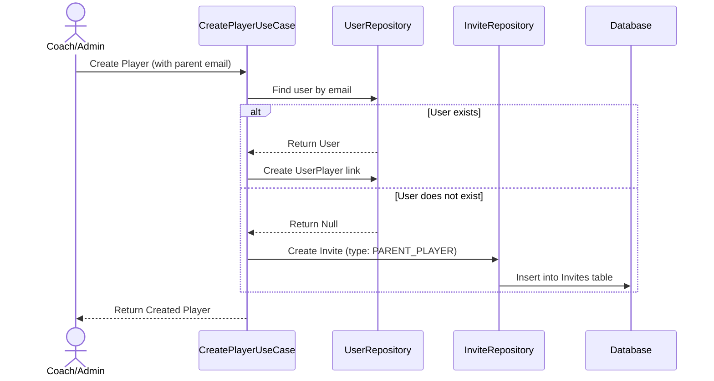
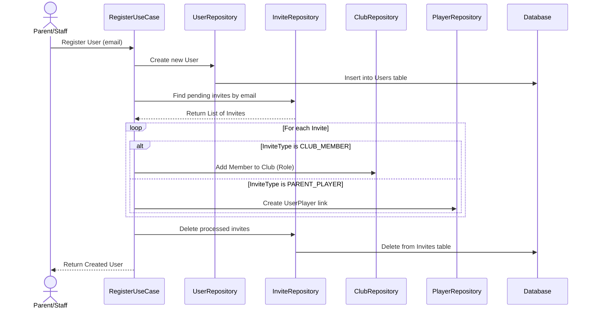
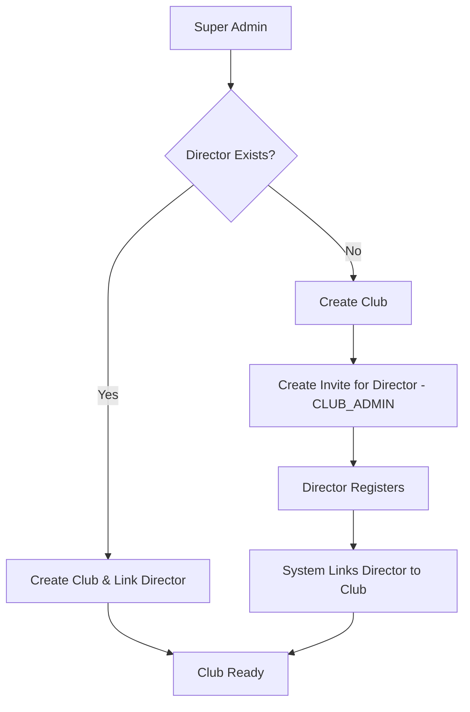
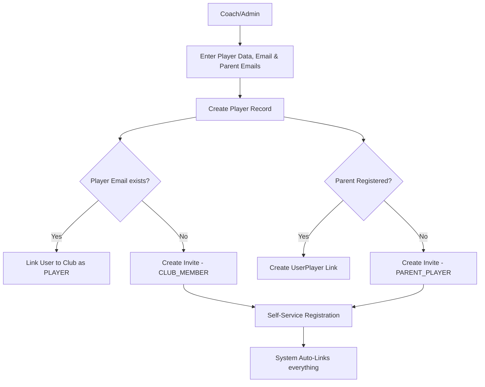
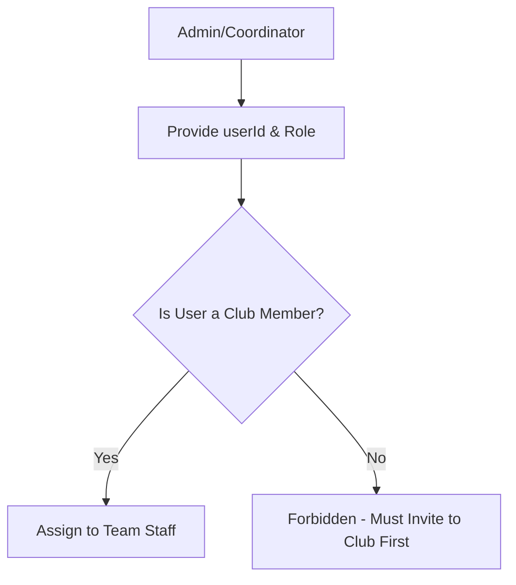
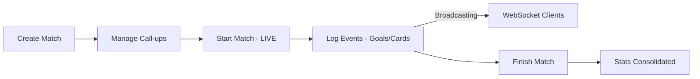
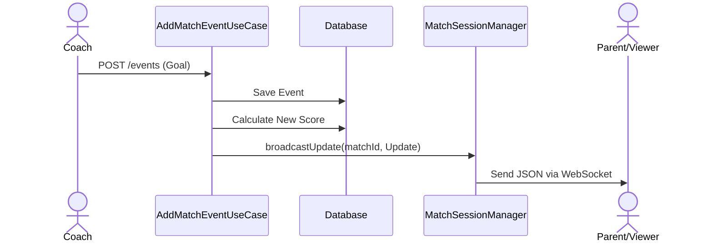

# Technical Decisions - Club Manager Platform

This document records the architectural patterns, libraries, and design principles adopted in this project.

## 1. Architectural Pattern: Clean Architecture
We follow a layered architecture to ensure separation of concerns, testability, and independence from frameworks.

### Layers:
- **Domain**: The core of the application. Contains **Entities**, **Repository Interfaces**, and **Use Cases**. It has no dependencies on external libraries (except for core language features).
    - *Use Cases*: Represent a single business action. Each Use Case class MUST have only one public operation, typically using the `operator fun invoke`.
- **Data**: Responsible for data persistence and external API communication. Contains **Repository Implementations**, **Exposed Tables**, and **Database Configuration**.
- **Presentation**: The entry point for users. In the `:server`, this means **Ktor Routes**. In the `:app`, it will be **Compose UI** and **ViewModels**.
- **Core**: A shared module (`:core`) containing models, exceptions, and utilities used by both the Backend and Frontend.

## 2. Dependency Injection: Koin
We use **Koin** for dependency injection because it is lightweight, KMP-friendly, and uses a DSL-based configuration that fits perfectly with Kotlin.
- Modules are defined in `di/AppModule.kt`.
- Use Cases and Repositories are registered and injected into Routes/Controllers.

## 3. Database Layer: JetBrains Exposed (v1)
We use **Exposed** as our SQL ORM.
- **Version 1.4.0+**: We use the latest stable version (using the `v1` package structure).
- **DSL Approach**: We prefer the Type-safe DSL for building queries.
- **Aggregation Efficiency**: When fetching lists that depend on multiple conditions (e.g., getting clubs where a user is either a member OR a parent), we use the `exists` operator with subqueries to perform the logic in a single SQL command. This avoids multiple round-trips to the database and improves performance.
- **Development Database**: Currently using **H2** (file-based) for rapid prototyping and local development.
- **Production Database (Pending)**: The system is designed to be compatible with **PostgreSQL**. A migration to a dedicated production database is required to ensure data persistence and reliability, as the current H2 setup is susceptible to data loss during clean builds.
- **Multi-Tenancy**: Every club-specific table contains a `clubId` to ensure data isolation.
- **Atomic Transactions**: We use a `TransactionManager` service in the Domain layer to orchestrate complex operations spanning multiple repositories. This ensures that a Use Case is either fully committed or completely rolled back in case of failure, maintaining data integrity (e.g., creating a player and their invitations must be an atomic unit).
- **Concurrency**: All database operations are wrapped in a `dbQuery` utility using `suspendTransaction` to ensure they don't block the Ktor threads.

## 4. Shared Models & Serialization
- **kotlinx.serialization**: Used for all JSON encoding/decoding. All status and type fields use Enums for type safety.
- **kotlinx-datetime**: Used for handling dates and times. Logical dates (like season start/end) use `LocalDate`, while audit timestamps use `kotlin.time.Instant`.
- **Error Handling**: A standardized system based on a custom `ClubManagerException` hierarchy. 
    - **Exception Types**:
        - `UnauthorizedException` (AUTH_001 -> 401): Authentication failures.
        - `ForbiddenException` (AUTH_002 -> 403): RBAC/Permission violations.
        - `ValidationException` (VAL_001 -> 400): Business rule or request format violations.
        - `ConflictException` (DATA_001 -> 409): Duplicate resources or state conflicts.
        - `DatabaseException` (DATA_002 -> 500): Persistence layer failures.
    - **Mapping**: Ktor's `StatusPages` plugin converts these to a consistent `ErrorResponse` JSON body.
    - **Security**: Unhandled exceptions (`Throwable`) are masked as "An internal server error occurred" to avoid leaking system internals.

## 5. Security & Authentication
- **JWT (JSON Web Tokens)**: Used for stateless authentication.
    - **Access Tokens**: Short-lived (1 hour) for regular requests.
    - **Refresh Tokens**: Long-lived (30 days) stored in the database for session renewal. `RefreshTokenUseCase` treats "not past its stored expiry" as a business rule it owns: the repository (`findRefreshToken`) just returns the row, and the use case rejects (and deletes) a token whose `expires_at` has passed, the same way it rejects an unknown one. Each successful refresh rotates the token (old row deleted, new 30-day row saved).
    - **Signing Secret**: The HMAC signing key is **not** in source. `JwtConfig` reads it from `ServerConfig.jwtSecret` (see *Environment Configuration* below), which sources the `JWT_SECRET` environment variable. In `PRODUCTION` the server refuses to start if it is unset; in `DEV` it falls back to a clearly-labelled placeholder so a plain `./gradlew run` works with no setup. The `issuer` and `audience` claims remain compile-time constants in `JwtConfig` — they are not secret and do not vary by environment.
- **BCrypt**: Used for hashing passwords before storage.
- **Platform-Admin Seeding (startup)**: `SeedPlatformAdminUseCase` runs once when the Ktor module boots (invoked from `Application.module()` right after Koin is installed) and guarantees a platform-admin ("superuser") account exists, so a freshly-created or wiped **dev** database is usable immediately with no manual bootstrapping step. It is **idempotent**: it only creates the account when no user with the configured email exists, and never mutates an existing account (so it cannot silently escalate a normal user that happens to share the email). A normal restart against an intact database is a no-op. Configuration lives in `ServerConfig` and is injected into the use case (which stays free of environment lookups): in `DEV` it is enabled by default with clearly-labelled fallback credentials (`admin@local.dev` / `admin1234`, overridable via `SEED_ADMIN_EMAIL` / `SEED_ADMIN_PASSWORD`); in `PRODUCTION` it is disabled unless `SEED_ADMIN_ENABLED=true` is set explicitly, and then `SEED_ADMIN_EMAIL` and `SEED_ADMIN_PASSWORD` are both required — there is never a password fallback in production. Covered by `SeedPlatformAdminUseCaseTest`.
- **Environment Configuration**: `config/ServerConfig.kt` is the single place server-side runtime config is resolved. It exposes an `AppEnvironment` enum (`DEV` / `PRODUCTION`, selected from the `APP_ENV` variable, defaulting to `DEV`) and reads secrets/tunables from real environment variables so nothing sensitive lives in source. Its scope today is deliberately narrow — the JWT signing secret, the dev-only gating of the H2 web console (`Application.kt`), and the platform-admin seeding credentials/toggle (see *Platform-Admin Seeding* above). It does **not** yet switch the database engine; the H2 → PostgreSQL move for production is a separate, larger tracked item (see §3 and `REQUIREMENTS.md`). This mirrors, on the server, the `AppConfig` dev/prod split already used on the client (§10).
- **Hierarchical RBAC**: Permissions are managed through a centralized `CheckUserPermissionUseCase` using a level-based system:
    - **Role Levels**: `CLUB_ADMIN` (5), `COORDINATOR` (4), `COACH` (3), `STAFF` (2). (`MEMBER` is club-level, level 1.)
    - **Global vs Age-Group Scope**: `CLUB_ADMIN` and `COORDINATOR` have global access to all club resources. `COACH` and `STAFF` are scoped to specific **age groups** they are assigned to (verified via `age_group_staff`). Players and family members are not roles here — their read access flows from a linked player being in the relevant age group's pool (`age_group_players`). A `teamId` passed to `CheckUserPermissionUseCase` is resolved to its age group before these checks.
    - **Platform Admin**: A global `isPlatformAdmin` flag bypasses all local club checks ("God Mode").
- **Permission Check Priority (Check Once, Fail Fast)**: To optimize performance and prevent unnecessary database access, authorization validation MUST be the **absolute first** operation performed in a Use Case. 
    - **Rule**: Validation must occur as soon as all necessary context (like `clubId` or `teamId`) is available, and before any state-changing logic or extensive data fetching.
    - **Practice**: If a Use Case requires metadata from a resource to determine the team context, the resource is fetched first, followed immediately by a single granular permission check. This prevents redundant calls to the security layer and unnecessary business logic execution for unauthorized users.
- **Security Testing**: The permission logic is covered by a suite of unit tests (`CheckUserPermissionUseCaseTest`) to prevent regression in access control.
- **Resource Management**: Support for partial updates (PATCH) to manage resource states (e.g., active/inactive status for teams, seasons and players).
- **Match-Opponent Relationship**: Matches are linked to a dedicated `Opponents` table rather than using simple strings. This ensures data consistency across the club and allows for richer opponent data (e.g., logos).
- **Pagination**: To ensure scalability and performance as data grows (e.g., hundreds of players or matches), list-based endpoints (GET) will implement a standard pagination strategy using `limit` and `offset` (or `page`) query parameters. This prevents excessive memory consumption and slow response times.
- **Email System (Pending)**: While the Invitation logic is fully implemented at the database and domain levels, the physical sending of emails (SMTP/API integration) is currently not implemented. Invocations to the email service should be treated as placeholders until a provider (e.g., SendGrid, Mailjet) is selected.

## 6. Real-Time Communication: WebSockets
We use **WebSockets** for delivering instantaneous updates during live matches (Live Score).

- **Implementation**: Ktor's `WebSockets` plugin with `KotlinxWebsocketSerializationConverter` for typed JSON communication.
- **Session Management**: A `MatchSessionManager` handles active connections, grouping them by `matchId`.
- **Hybrid Flow**: Events are recorded via a standard **REST POST** request (for reliability and ACID persistence) and then **broadcasted** to all connected WebSocket clients for that specific match.
- **Auto-Cleanup**: Sessions are automatically removed from the manager upon disconnection or transmission failure.

## 7. Invite System
We use a generic asynchronous invitation system to handle associations for users who may not yet be registered on the platform.

### Flow 1: Creation of an Invite (e.g., Parent-Player Association)

### Flow 2: Resolution of Invites during Registration

## 8. High-Level System Flows

### 8.1. Club Provisioning Flow
How a new club is onboarded onto the platform by the Super Admin.

### 8.2. Player Creation & Parent Association Flow
The process of adding athletes and linking their guardians.

### 8.3. Age-Group Staff Assignment Flow
Coaches and technical staff must be club members before joining an age group.

### 8.4. Match Day Lifecycle
This flow describes the operational lifecycle of a match.

### 8.5. Real-Time Event Broadcasting
Detailed view of how a match event reaches the viewers.

## 9. Project Structure (KMP)
- `:server`: Ktor backend.
- `:core`: Shared logic, models, and exceptions.
- `:app:shared`: Shared UI components and logic (Compose Multiplatform).
- `:app:androidApp`, `:app:iosApp`, `:app:webApp`: Platform-specific entry points.

## 10. Client Architecture (KMP)
The client follows a modern multiplatform architecture to share as much logic as possible while providing native performance and UI.

- **UI Framework**: **Compose Multiplatform** for sharing UI code across Android, iOS, Desktop, and Web.
- **Navigation**: **androidx.navigation:navigation-compose** (KMP version) for type-safe navigation using Kotlin Serialization.
- **Dependency Injection**: **Koin** for managing ViewModels and services.
- **Environment Configuration**: An `AppConfig` interface is used to manage environment-specific variables like `baseUrl`. This allows switching between `dev` and `prod` configurations without changing business logic.
- **Session Management (Persistence)**: We use the **russhwolf:multiplatform-settings** library to store session tokens (`accessToken`, `refreshToken`) persistently across app launches. 
    - **Session Refresh**: On every app launch (via the `SplashScreen`), the system attempts to refresh the access token using the stored `refreshToken`. If successful, the user proceeds to the Dashboard with updated credentials; otherwise, the session is cleared, and the user is redirected to the Login screen. This ensures tokens remain fresh and security is maintained.
- **State Management**: **MVVM (Model-View-ViewModel)** pattern using `androidx.lifecycle:lifecycle-viewmodel` (KMP).
    - **State Pattern**: UI state is modeled using `sealed classes` (e.g., `LoginUiState`) to ensure type safety and mutually exclusive states (Idle, Loading, etc.). Each screen has its own state file (e.g., `LoginUiState.kt`) in the same package as the screen.
    - **State Updates**: We prefer using `_state.update { ... }` over direct assignment (`_state.value = ...`) to ensure thread-safe updates to the `MutableStateFlow`.
    - **Navigation Events**: Navigation is treated as a "one-shot" event (Side Effect) using a dedicated `SharedFlow` (e.g., `navigationEvent`) and specific event classes. This prevents re-triggering navigation when returning to a screen.
    - **Feature Packaging**: Components belonging to the same feature (Screen, ViewModel, UiState) are kept in the same package (e.g., `presentation.ui.login`) to improve discoverability and cohesion.
    - **Shared Components**: `presentation.ui.components` holds Composables reused across more than one feature package -- `PrimaryLoadingButton` (the standard full-width submit button with a loading-spinner state), `FMTopBar` (the dark toolbar with an optional subtitle and trailing actions slot), `DatePickerSheet` (a bottom-sheet `DatePicker` with optional `minDate`/`maxDate` bounds), and `EmptyStateCallToAction` (the icon+title+subtitle+button "nothing here yet" layout used by `ClubDetailsScreen`'s no-seasons/no-age-groups states). New UI that repeats an existing screen's exact layout/styling a second time should be extracted here rather than copied.
    - **Returning a Result to the Previous Screen**: When a screen needs to signal something back to the screen that pushed it (e.g. "a season was just created, reload"), use the standard Compose Navigation pattern: the pushed screen sets a value on `navController.previousBackStackEntry?.savedStateHandle`, and the previous screen's `composable<...> { backStackEntry -> ... }` block reads it via `backStackEntry.savedStateHandle.getStateFlow(key, default)`, clearing it once consumed. Needed because Koin scopes a screen's `ViewModel` to its back-stack entry, so popping back to a screen reuses its existing (now stale) state rather than re-running the `ViewModel`'s `init`.
- **Typed HTTP Errors**: `HttpClientExtensions.handleResponse()` (used by every repository) throws `ApiException(statusCode, code, message)` for any non-2xx response, carrying the HTTP status and the server's `ErrorResponse.code` (see §4's exception table) instead of a bare `Exception(message)`. This lets a ViewModel branch on *what kind* of failure occurred (e.g. a 409 conflict getting special handling) without pattern-matching the message text -- which per `AI_GUIDELINES.md` "No Raw Exception Messages in UI" a screen shouldn't be displaying verbatim anyway.
- **Communication**: Ktor Client (`ktor-client-cio` + `ktor-client-content-negotiation`) handles REST communication; WebSocket support for live match updates is still pending.

## 11. Mobile & Client Guidelines: Aligning with Current Google Guidance

This section records the current (2026) Google/JetBrains-recommended approach for Compose Multiplatform / Android development, cross-checked against what this project's `gradle/libs.versions.toml` and `app/` modules actually do today. Each point below states the guidance, then this project's real current status against it — some are already satisfied, some are open work.

### 11.1 UI toolkit: Jetpack Compose

Compose is Google's default and recommended UI toolkit; the XML View system is legacy, maintenance-only. **Status: already the case.** This project is fully on Compose Multiplatform (`composeMultiplatform = "1.11.1"`) across all four client targets (`app/androidApp`, `app/shared` for iOS, `app/desktopApp`, `app/webApp`) — there is no View-based UI anywhere in the codebase.

### 11.2 Design system: Material 3

Use `androidx.compose.material3` (the Compose Multiplatform equivalent: `org.jetbrains.compose.material3`), not the legacy `material` (M2) artifact. **Status: already the case** — `material3 = "1.9.0"` is the only Material dependency declared, consumed from `app/shared`'s `commonMain`.

"Material 3 Expressive" is not a separate library or an opt-in mode to switch on — it's the current direction of the `material3` artifact itself (updated theming, motion, shape, and typography, aligned with Android 16's visual language). Staying current on `material3` releases *is* adopting it; there's no separate migration step.

The **Compose Styles API** is a newer (2026) mechanism for building a styleable design system: `Modifier.styleable()` layers three levels of styling — component defaults, theme-level overrides, and call-site overrides — with `MutableStyleState` handling state-based styling (pressed/disabled/hovered) automatically. It replaces passing individual hardcoded style parameters (`backgroundColor`, `shape`, etc.) into every composable. **Status: not yet adopted** — this project's shared `presentation/ui` components currently take individual parameters rather than a centralized `Style`/`ComponentStyles` object. Worth evaluating once the shared component library grows past a handful of screens; not a blocker today.

### 11.3 Architecture

The existing pattern (§10: Screen + `UiState` + `ViewModel`, MVVM/UDF, sealed-class states, one-shot navigation via `SharedFlow`) is correct and matches current guidance. Refinements to fold in:

- Collect state with `collectAsStateWithLifecycle()` rather than plain `collectAsState()`, so screens stop collecting `StateFlow` updates while not visible (lifecycle-aware collection). Verify this is consistently used wherever a `ViewModel`'s `state: StateFlow<UiState>` is collected in a `@Composable`.
- DI via Koin is the right call, confirmed: Hilt is Android-only (annotation-processor based, no iOS/Web/Desktop target), so it can't be used in a module shared across all four client targets the way Koin already is (`koin-core`, `koin-compose`, `koin-compose-viewmodel`).
- Coroutines + Flow everywhere is already the pattern in use (`kotlinx-coroutines`, `_state.update { }`, per §10).
- Google's [Now in Android](https://github.com/android/nowinandroid) sample remains the canonical reference for this architecture style (MVVM, UDF, modularization) — useful as a pattern reference, but it's Android-only, not KMP, so treat it as a reference for *shape*, not a literal template, given this project's shared module spans Android, iOS, Desktop, and Web.

### 11.4 Navigation: Navigation 3

`androidx.navigation3` inverts the ownership model from Navigation 2: instead of the library owning one internal back stack, the app owns it directly as a plain observable list (`rememberNavBackStack`, backed by `SnapshotStateList`). As of Compose Multiplatform 1.10+, it has first-class support across **all** Compose Multiplatform targets — Android, iOS, Desktop, and Web — which lines up with this project's four client targets. JetBrains' own docs describe adopting it as "less a migration, more a rewrite" of navigation, not a version bump, so it should be scoped as its own dedicated piece of work rather than folded into an unrelated feature.

**Status: not yet adopted.** This project is still on `navigation-compose` 2.9.2 (`navigation = "2.9.2"`, Navigation 2.x) in `app/shared`. Two concrete things to plan for before migrating, both confirmed from official docs:

- **Serialization on non-JVM targets**: Android's route serialization relies on reflection, which doesn't work on iOS/Web. Migrating requires registering every route type explicitly via polymorphic serialization in a `SavedStateConfiguration` — this is the detail most likely to cause friction here specifically, since this project targets iOS and Web in addition to Android.
- **Web back-button support isn't fully built in yet** — integrating the `webApp` target's browser back button currently needs a separate `navigation3-browser` library, with official integration still pending upstream.

### 11.5 Adaptive UI (do this from day one)

Support phones, foldables, tablets, and desktop from the start, using window size classes, `material3-adaptive`, multi-pane layouts, and adaptive navigation (bottom bar on compact width ↔ navigation rail on expanded width). Retrofitting this after screens are built single-layout is significantly more expensive than designing for it upfront.

**Status: not started.** No `material3-adaptive` dependency exists in `libs.versions.toml`, and no window-size-class logic exists in the codebase today. Given this project already ships a `desktopApp` target (inherently a large-width surface) alongside phone-sized Android/iOS targets, this is a real, current gap rather than a future nice-to-have — the guidance to do it "from day one" applies directly, since screens are actively being built without it right now.

### 11.6 Edge-to-edge (mandatory)

Android 15 (API 35) enforces edge-to-edge by default but still allowed an app-level opt-out (`windowOptOutEdgeToEdgeEnforcement`). Android 16 (API 36) removes that opt-out entirely — an app targeting API 36+ cannot suppress edge-to-edge at all.

**Status: mostly already in place.** This project already compiles/targets API 37 (`android-compileSdk = "37"`, `android-targetSdk = "37"`) — past the point where opting out is even possible — and `MainActivity` already calls `enableEdgeToEdge()`. What hasn't been verified screen-by-screen is whether every screen's content properly consumes `WindowInsets` (e.g. via `Scaffold`'s built-in inset handling) instead of assuming safe margins around system bars. Worth a deliberate pass once Navigation 3 (§11.4) and adaptive layouts (§11.5) land, since both restructure how the top-level scaffold is built.

### 11.7 Build & tooling

- **Kotlin 2.x with the K2 compiler**: already the case — `kotlin = "2.4.10"`, which is on a K2-only release line (K1 has been fully retired by this point in the 2.x series). No action needed.
- **Gradle Kotlin DSL + version catalog**: already the case — every module uses `.kts`, and all dependency versions are centralized in `gradle/libs.versions.toml`.
- **targetSdk 35/36, minSdk 24+**: already exceeded — this project compiles and targets API 37 with `minSdk = 24`.
- **Baseline Profiles + R8 full mode for release**: **not yet configured.** `app/androidApp`'s release build type currently sets `isMinifyEnabled = false` despite specifying ProGuard files, and no Baseline Profile module or dependency exists anywhere in the project. This is a concrete, current gap against the guidance, not just an unstarted aspiration.
- **AGP 9 for pure-Android modules**: **already done, and done correctly.** AGP 9 (`agp = "9.3.1"`) dropped support for combining the standard Kotlin Multiplatform Gradle plugin with `com.android.application`/`com.android.library` — the required fix is to split a pure Android app module (using `com.android.application`) from a KMP-aware shared module (using the newer `com.android.kotlin.multiplatform.library` plugin with a `kotlin.android { }` block, instead of `com.android.library` + `kotlin.androidTarget { }`). That is exactly the shape this project already has: `app/androidApp` uses `libs.plugins.androidApplication`, while `app/shared` uses `libs.plugins.androidMultiplatformLibrary`. No migration needed here — this project is ahead of where the guidance assumes most KMP projects currently are.

### 11.8 Open items against this guidance

- [ ] Adopt `material3-adaptive` + window size classes; add adaptive navigation (bottom bar ↔ navigation rail) — nothing exists yet (§11.5).
- [ ] Plan and execute the Navigation 2 → Navigation 3 migration, budgeting specifically for polymorphic route serialization on iOS/Web (§11.4).
- [ ] Enable R8 full mode (`isMinifyEnabled = true` with an appropriate `proguard-rules.pro`) and add a Baseline Profile for `app/androidApp`'s release build (§11.7).
- [ ] Audit screen-level composables for correct `WindowInsets` consumption now that edge-to-edge is unavoidable at the targeted API level (§11.6).
- [ ] Evaluate the Compose Styles API for the shared design system once `presentation/ui` grows past its current size (§11.2) — not urgent today.

**Sources**: [Compose Multiplatform 1.10.0 release notes](https://blog.jetbrains.com/kotlin/2026/01/compose-multiplatform-1-10-0/) · [Navigation 3 in Compose Multiplatform](https://kotlinlang.org/docs/multiplatform/compose-navigation-3.html) · [Navigation 3 — Android Developers](https://developer.android.com/guide/navigation/navigation-3) · [Updating multiplatform projects to AGP 9](https://kotlinlang.org/docs/multiplatform/multiplatform-project-agp-9-migration.html) · [Material Design 3 in Compose — Android Developers](https://developer.android.com/develop/ui/compose/designsystems/material3) · [Jetpack Compose Styles API](https://developer.android.com/agents/skills/jetpack-compose/theming/styles/skill) · [Behavior changes: apps targeting Android 16](https://developer.android.com/about/versions/16/behavior-changes-16) · [Now in Android sample](https://github.com/android/nowinandroid)
